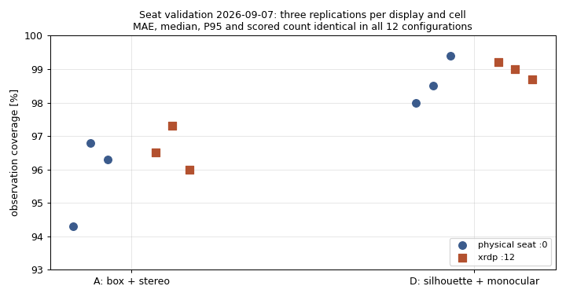

# Remote versus physical-seat benchmark validation

Recorded dates: 2026-09-07, 2026-10-29
Tested revisions: `f6e7d238a399af7ba2b46fafb331d05428ab1e26`
Provenance: partial

The two runs below were made on 2026-09-07 and written up on 2026-10-29,
when the owner accepted them as the execution-environment qualification for
the Gazebo GLX workflow. This closed the plan
`BENCHMARKING — Execution-environment qualification`, which had called for a
fresh matched comparison. Vendored dependencies were dirty (`clearpath_common`
2 files, `clearpath_simulator` 3, `slam_toolbox` 1; see the provenance files),
and the full run outputs stay under `artifacts/benchmarks/20260907_*_seat_validation/`.

## Question and conditions

Does a Gazebo benchmark run produce the same measurements on the machine's
physical seat as in a remote xrdp session? Both runs used the committed
contract `benchmark_sweep_seat_validation.yaml` (installed copy sha256
`58da88f1fede09a5985f844d43da4ddfa55377e6279a16667354d78c180a48bc`): the
`benchmark_scenarios_examples.yaml` scenes at three repeats, estimators
`projective_ranging,euclidean_reconstruction`, and two cells with three
rotated process-level replications each:

- **A (light):** `box` mask gate, `stereoscopic` depth; neither model runs.
- **D (heavy):** `silhouette` gate, `monocular` depth; SlimSAM then Depth
  Anything run in the mask worker.

| | Physical seat | Remote |
|---|---|---|
| Display | `:0.0`, deivid on `tty7` (seat0) | `:12.0`, deivid's xrdp session |
| Start | 14:02:48 +0200 | 14:41:40 +0200 |
| GL renderer (`sweep.json`) | NVIDIA RTX PRO 6000, not software | NVIDIA RTX PRO 6000, not software |
| ROS domain | 43 | 43 |
| Video recording | off | off |
| 1-min load during the run | 0.4–13.0 | 0.2–14.3 |

## Results

All 12 configurations on each display scored 18 of 24 instances with the same
error to three decimals:

| Cell, estimator | MAE | median | P95 [m] |
|---|---|---|---|
| A, projective | 0.060 | 0.060 | 0.073 |
| A, euclidean | 0.065 | 0.059 | 0.094 |
| D, euclidean | 0.563 | 0.486 | 1.363 |
| D, projective | 0.577 | 0.489 | 1.365 |

Only observation coverage (OK camera frames over observed frames) varied:
cell A 94.3–96.8 % on the seat and 96.0–97.3 % remotely, cell D 98.0–99.4 %
and 98.7–99.2 %. The spread between replications on one display is as large as
the difference between displays. Configuration wall times were 3m33s–4m02s on
the seat and 3m37s–3m52s remotely; sampled RTF stayed within 0.967–0.991.

## Decision and limits

Accepted on 2026-10-29: Gazebo GLX through `tools/gpu-run` is
measurement-equivalent on the physical seat and in an xrdp session. The
evidence has these limits, which the owner accepted rather than rerun:

- It predates the measured camera mount (2026-09-10) and the shared D455
  profiles (2026-09-13); the camera ran the retired fx 443.53 640x480 model.
- It covers the five example scenes (24 instances), not the full set.
- No equivalence margins were declared before the runs, and the display
  order was not alternated (seat first). Agreement was exact, so no margin
  would decide it.
- Isaac, headless EGL, 1280x720, video recording and GUI or RViz load were
  not tested. Software rendering is a known failure mode, not a qualified
  environment.

Supporting files: the
[seat](assets/2026-09-07-seat-validation/physical_seat_summary.txt) and
[remote](assets/2026-09-07-seat-validation/xrdp_summary.txt) summaries,
provenance files and load logs in
[`assets/2026-09-07-seat-validation/`](assets/2026-09-07-seat-validation/).
