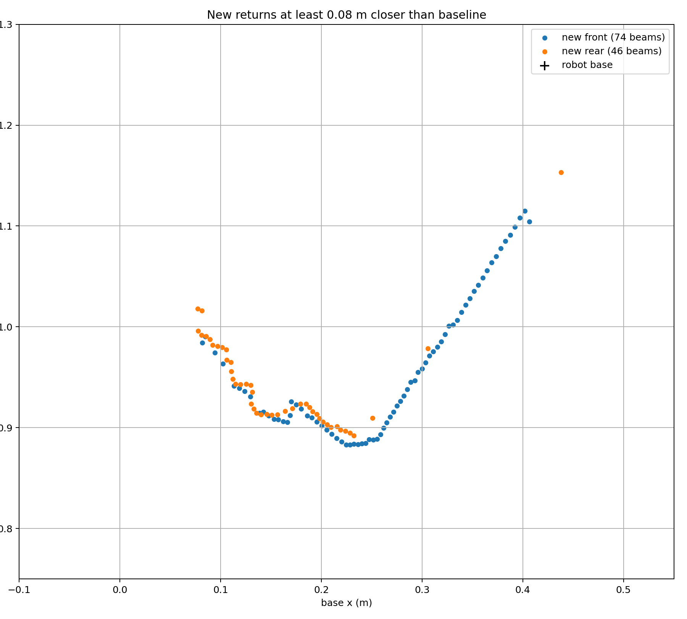
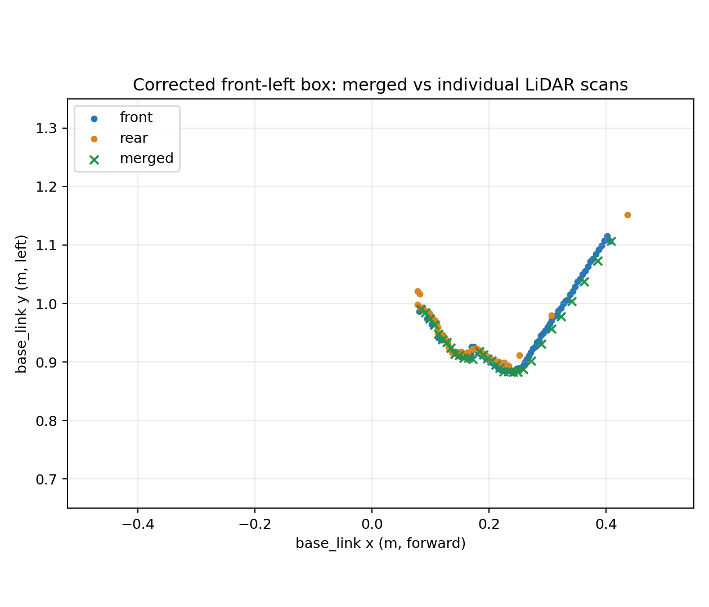

# r100_0160 rear LiDAR side-target recheck

Recorded dates: 2026-09-24
Tested revisions: `2c866dcbdda5c8c8ddb274cce7f6c6356f95844a`
Provenance: partial

The revision is the repository checkout on Intel host `cpr-r100-0160`, not a
verified installed revision of the Clearpath or MyBotShop nodes. The test used
the robot-local `/etc/clearpath/robot.yaml`, whose rear x was −0.3922 m, and
the MyBotShop scan-merger configuration, whose `laser2XOff` was also −0.3922 m.
Both individual Hokuyo streams came from the installed
`/usr/sbin/clearpath-sensors-start` launcher run directly as user `robot`; the
systemd sensor service was inactive. The installed sensor and middleware package
revisions were not pinned for this run. Raw scan arrays, capture and analysis
scripts, metadata, checksums, and wider plots remain on the robot PC under
`artifacts/hardware/20260924-rear-lidar-recheck/` and are not included in this
record. These limits prevent exact reconstruction from this archive alone.

## Method and result

The user confirmed the robot was stationary with its drive disabled before
targets were placed. A sampled emergency-stop topic was `true` and sampled
odometry twist was zero. No base commands were sent. Earlier in the session the
user had reported a short forward movement; its cause was not established, so
these captures begin only after the stationary confirmation.

The front and rear scanners each delivered about 200 scans per five-second
capture, with 1081 beams spanning ±135°. At each placement, a no-box capture
was compared with a capture containing an upright box. Per-beam median ranges
isolated returns that became more than 8 cm closer with the box. Those points
were mapped to the robot base plane using front x = +0.3922 m, rear x = −0.3922 m,
and rear yaw π from the robot-local configuration. The comparison is the mean
of the two directed median nearest-neighbour distances between isolated front
and rear target points. A grid of added rear x shifts in 1 mm steps checked
whether the configured offset needed a material correction; the former rear
x = −0.4278 m was also evaluated against the same captures.

| Placement | Points front/rear | No added shift | Best extra rear x shift and residual | Former rear offset |
|---|---:|---:|---:|---:|
| First side placement, box 67 cm from left body edge | 78 / 94 | 10.0 mm | +10 mm; 7.1 mm | 29.2 mm |
| Quiet-area flat face beside robot middle | 65 / 68 | 8.8 mm | +10 mm; 7.6 mm | 9.9 mm |
| Quiet-area angled face, behind robot centre | 65 / 55 | 7.9 mm | +10 mm; 5.4 mm | 32.8 mm |
| Corrected front-left corner placement | 54 / 44 shared-edge points | 7.8 mm | −6 mm; 7.4 mm | 22.9 mm |

The flat face runs nearly parallel to the x direction, so its result poorly
constrains the rear x offset; it is evidence that both scanners saw the same
object. The first and angled placements expose target edges and distinguish
the former offset. The first angled placement was behind robot centre at
x ≈ −0.15 m, contrary to the intended front-left position. The team moved the
28 × 18 cm box and verified the placement in a short scan before the final
five-second capture. Its nearest corner appeared at base-plane (x, y) =
(+0.2286, +0.8830) m from the front scanner and
(+0.2324, +0.8921) m from the rear. The corrected placement gives 7.8 mm
median point agreement without an added shift. Its best-fit −6 mm extra
rear x shift improves the median by only 0.4 mm, far too little to justify a
mount change. Range error, corner sampling, small yaw error, and target geometry
can contribute at this scale. The former 35.6 mm rearward offset gives
materially worse agreement on the informative placements.

*Corrected front-left capture, cropped around the target. Blue is the front
scan, orange the rear scan. The scanners see different extents of the angled
box; the metric uses their shared edges. The 8 cm before/after threshold
isolates new returns; points below that change are absent from this figure.*

This satisfies the practical stationary side-target recheck of the symmetric
rear mounting offset. It does not establish formal extrinsic uncertainty,
moving-robot validity, or recovery after a Hokuyo read timeout. Those remain
separate acceptance gates.

## Installed merged scan, same box position

With the box still at the corrected front-left position, a ten-second capture
sampled the individual front and rear scans and the installed merged
`/r100_0160/sensors/scan` output concurrently. The user again confirmed the
robot was parked with its drive disabled; sampled emergency stop was `true` and
odometry twist was zero. The merged output used frame `base_link`, 723 beams
at approximately 0.5° spacing, configured range 0.1–25 m, and a reported
`scan_time` of 0.1 s. It actually delivered 394 scans in the ten-second window,
or 39.89 Hz; front and rear delivered 400 and 399 scans (39.90 and 39.94 Hz).
None of the three streams had a timestamp gap above 100 ms in this window;
their largest gaps were 41.4, 45.2, and 33.7 ms respectively.

Per-beam median returns were mapped into `base_link` using the configured
individual scanner poses. In a box region x = 0.05–0.45 m and y = 0.75–1.25 m,
the individual scans had 74 front and 45 rear valid points. The merged scan
had 32 points on its coarser angular grid. Each merged point was compared with
its nearest individual point in that region: median separation was 2.3 mm,
95th percentile 8.2 mm, maximum 8.4 mm. The installed merger therefore
preserved this stationary box geometry and delivered a live output throughout
the capture. Its `scan_time` field does not reflect the observed publication
rate, so consumers should use measured timestamps for timing assessment.

This is a stationary, single-placement comparison. It does not test motion,
occlusion behavior in other scenes, sustained uptime, or read-timeout recovery.
