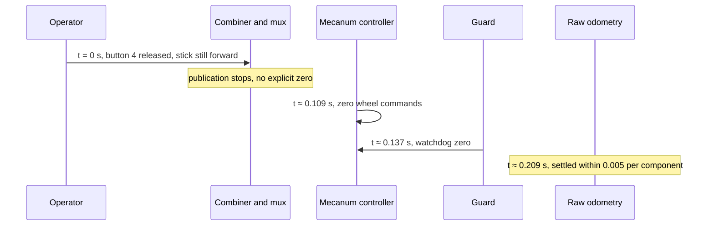

# r100_0160 commissioning guard installation and first low-speed trials

Recorded dates: 2026-10-06
Tested revisions: unknown
Provenance: partial

This record covers the first stationary inspection of the native velocity
command path on `r100_0160` (domain 0), the installation of the commissioning
speed guard, and the first supervised forward pulses, command-loss trials and
deadman observations at the 0.05 m/s planar / 0.1 rad/s yaw caps. It was
extracted from the consolidated driving reference at the
[documentation snapshot](https://github.com/Cognitive-Software-Labs/DyNAMO-Ridgeback/blob/077692ab033fd3a86d4849bbbbdb443a9f0c2125/docs/physical/driving_readiness.md).

Provenance gaps: the source text names no repository commit for the guard,
installer or recorders that ran, so no tested revision is claimed. Installed
file hashes live in the installation receipts. Raw recordings, receipts and
analyses live only on the robot host under `artifacts/hardware/` and are not
tracked. The later direction pulses below carry no recorded date in the source
text.

## Stationary inspection of the native path

The 2026-10-06 stationary inspection established the native command path. Nav2
was absent from the live graph; the Nav2 portion of the path was the
repository's configured path, not an observed active publisher. Joystick, RC
and interactive-marker inputs entered the mux independently of the collision
monitor. The mux output and the controller subscription used
`geometry_msgs/msg/TwistStamped`. `ListControllers` reported the mecanum
controller active, not chained, claiming all four wheel velocity interfaces.
Raw odometry reported zero velocity during the passive stationary observation;
filtered odometry had small nonzero estimates. Neither proves a physical stop.
At this point the combiner's 0.4 m/s and 0.5 rad/s scales (×3 with boost) and the
Nav2 smoother's 1.3 m/s and 4 rad/s limits were the only speed bounds, and the
inspection concluded that an explicit commissioning speed limit was needed
before motor tests.

During the operator-assisted stationary stop check, the first post-confirmation
capture still received `emergency_stop: false`. After the operator confirmed
flashing red lights, a later capture received `true` in all eight samples and
diagnostics reported `E-stopped`; all four motor outputs reported zero volts.
There was no continuous capture across the physical button transition, so its
latency and the reason for the earlier false values are unestablished. No
motion was commanded against the stop and no stop reset was performed.

Motor diagnostics reported roughly 15–20 Hz feedback against a 40 Hz diagnostic
target. Direct motor status reported fault value 8 during the stop, while
aggregated diagnostic fields reported no bridge-driver fault. Neither reading
alone established a hardware defect; the
[wheel-feedback reference at the documentation snapshot](https://github.com/Cognitive-Software-Labs/DyNAMO-Ridgeback/blob/077692ab033fd3a86d4849bbbbdb443a9f0c2125/docs/physical/drive_feedback_diagnostics.md)
later owned the confirmed fault-decoding defect.

Raw inspection data, original configs and the passive observation script are
under `artifacts/hardware/20261006-driving-readiness/` on the tested host. These
files are local evidence, not tracked recovery inputs.

## Guard installation

The commissioning guard was installed with the physical e-stop engaged and the
resulting path verified without publishing velocity commands. Installation
evidence is under `artifacts/hardware/20261006-commissioning-caps-install/`. A
separate read-only check under `artifacts/hardware/20261006-commissioning-caps/`
confirmed three engaged-stop samples, 46 stationary raw-odometry samples, the
active controller, and the expected exclusive guard publisher and controller
subscription. All four installed file hashes matched the installation result.
Platform and guard units were active; sensor and VNC process IDs were
unchanged. This verified the stationary installed state, not cold-boot recovery
or physical stopping.

In the isolated loopback pipeline check (installed mecanum controller, mock
wheels, domain 213), the first candidate remap failed. The corrected
first-precedence remap passed all seven original checks.

## First forward pulse

Before the e-stop QoS repair was installed, one supervised forward pulse
delivered 20 nonzero commands through the guard at 0.05 m/s with matching source
stamps. Raw wheel odometry recorded a maximum forward velocity of about
0.0508 m/s and 0.0472 m displacement before recording ended; the operator
reported that the robot moved and stopped by itself. These values are wheel
odometry, not an independent physical distance measurement.

That first trial is incomplete: the test helper crashed while serializing its
first explicit zero because it assigned a Python integer to a ROS float64
field. The guard and platform stayed active. A separate zero-only recovery and
passive observation confirmed stationary raw odometry, but there was no
continuous recording across stopping and no stopping-time qualification. After
the operator re-engaged the physical stop, a separate passive check confirmed
three engaged-stop samples and 43 stationary raw-odometry samples, with the
guard routing and active controller retained. The physical direction was not
yet confirmed independently of the odometry sign. The helper was then changed
to convert command values to floats, with a regression test that serializes
and deserializes both integer-zero inputs and motion using actual ROS message
types. Evidence, including the pre-fix source and truncated recording, lives in
`artifacts/hardware/20261006-forward-pulse-live/`.

The corrected forward trial completed with explicit zero commands and
continuous odometry; the operator confirmed forward movement and a clean stop.
Wheel odometry recorded 0.0521 m travel and settled within a strict 0.001
per-component velocity tolerance about 0.485 s after the first zero command.
These are wheel-data measurements, not a physical stopping-distance
qualification.

## Direction pulses and startup transients

Later backward, lateral and turn-left pulse trials completed software
recording, but turn-right retries and a backward repeat triggered
startup-transient aborts. Those findings are owned by the
[wheel-feedback reference at the documentation snapshot](https://github.com/Cognitive-Software-Labs/DyNAMO-Ridgeback/blob/077692ab033fd3a86d4849bbbbdb443a9f0c2125/docs/physical/drive_feedback_diagnostics.md#observed-startup-transients).
A later five-direction gently ramped sequence completed under unchanged abort
limits, with the operator confirming every direction and a clean stop. This
qualified that small ramped sequence; it did not close the abrupt-start
investigation.

## Command-publication loss

Three gently ramped forward command-loss trials ended publication at the peak
and observed a full second of silence before cleanup zeros. All three recorded
stationary raw odometry during the silence; the operator confirmed movement and
a self-stop for the third. In the first capture, the guard zero, the zero wheel
command and raw-odometry settling occurred approximately 0.122 s, 0.144 s and
0.246 s respectively after the last nonzero command (odometry tolerance 0.005
per component). These are host receive-time measurements for that capture, not
certified physical braking times. Evidence lives under
`artifacts/hardware/20261006-forward-command-loss/` and its two repeat
directories. This closed the bounded command-publication-loss trial, not
joystick or radio connection loss.

## Deadman observations

The first deadman observer run captured only stationary data: every joystick
axis and button remained zero, the physical stop report remained asserted, and
no nonzero mux, guard or wheel command was recorded. A successful recorder exit
was not a successful stop test. Evidence: `artifacts/hardware/20261006-deadman-stop/`.

A second run captured forward joystick commands limited to 0.05 m/s, an explicit
zero on stick centring, zero wheel commands and stationary final raw odometry.
The deadman button stayed held and the final reported physical stop remained
released, so it did not qualify deadman release. The operator subsequently
confirmed a stationary robot with the physical stop engaged. Evidence:
`artifacts/hardware/20261006-deadman-stop-2/`. At that point deadman, connection
loss, physical e-stop under motion and cold boot remained open, and driving
readiness was incomplete.

The `20261006-deadman-stop-4` recording captured release of button 4 while the
forward stick was still nonzero. The joystick combiner and mux stopped
publishing, without sending an explicit zero.

*Measured deadman release in `20261006-deadman-stop-4`, callback receive times.
Notice that the controller's own reference expiry zeroed the wheels before the
guard watchdog zero arrived.*

These are callback receive-time measurements, not physical braking or
button-to-firmware latency guarantees. The recorded controller references
stayed within the installed 0.05 m/s planar and 0.1 rad/s yaw caps.

The recording contained two command bouts, longer than the requested one-second
forward trial, with some joystick-requested yaw; those protocol deviations
apply to its interpretation. Final raw odometry was stationary, but the last
firmware stop report remained released. The operator could not tell whether
button release stopped the robot, then confirmed it stationary with the e-stop
engaged; a follow-up capture verified 19 asserted-stop reports and zero raw
odometry. Evidence and analysis are under
`artifacts/hardware/20261006-deadman-stop-4/`. This established the software
response to a captured deadman release; the physical stopping observation is
inconclusive for this trial. A later trial in
[the 2026-10-09 record](2026-10-09-estop-qos-and-disconnect-trials.md#observed-low-speed-deadman-stop)
supplied physical confirmation for a captured low-speed release.
