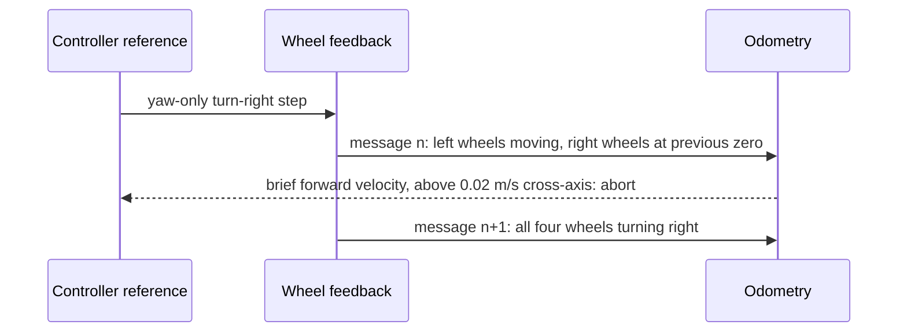

# Puma diagnostic build, first rate capture and startup-transient aborts

Recorded dates: 2026-10-06
Tested revisions: unknown
Provenance: partial

This record covers the first isolated build of the Clearpath 2.9.4 Puma motor
driver with the fault-mask patch, a short passive rate capture, and guarded
one-second step pulses on the physical Ridgeback. The source text recorded no
repository commit for the tools used, so tested revisions are unknown. Raw
evidence stays on the robot host under `artifacts/hardware/` in the directories
named below; none of it was copied into the repository. The text was moved here
from the [wheel-feedback reference at the documentation snapshot](https://github.com/Cognitive-Software-Labs/DyNAMO-Ridgeback/blob/077692ab033fd3a86d4849bbbbdb443a9f0c2125/docs/physical/drive_feedback_diagnostics.md)
when that page was split.

## Isolated diagnostic build

The diagnostic-only fault-mask patch replaced the upstream bit-shift decoding
with a bitwise AND. The offline verifier checked the downloaded 2.9.4 source
hash, applied the patch to a temporary tree and compiled the extracted corrected
expression against all 256 fault values and four masks. An isolated full
package build with that patch also completed. Neither check installed or
qualified the rebuilt driver on the robot.

The isolated build exposed an upstream bounds warning: analog-input access uses
field index 15 in a status-cache array of length 15, while the protocol index
mask permits 0–15 and several smaller cache arrays also lack bounds checks.
This is a source-level memory-access defect; it was not established as the
cause of any observed motion transient. The candidate was judged unsuitable for
deployment, which led to the cache-safety patch in
[the repair record](2026-10-12-puma-repair-rates-and-freshness-replays.md).
The build, source archive hash and warning are preserved under
`artifacts/hardware/20261006-puma-diagnostic-build/`.

## Passive rate capture

A five-second passive `vcan` capture and a ten-second ROS capture are under
`artifacts/hardware/20261006-driving-readiness/`. They showed unequal
per-device setpoint traffic and did not close the rate investigation. The
longer paired capture of 2026-10-12 is in the repair record.

## Guarded step pulses

The guarded step-pulse sequence completed backward, left, right and turn-left
requests with final stationary raw odometry. No operator observation of
physical direction or stopping was recorded for those four step cases.
Turn-right aborted twice, and a later repeat aborted during backward. Each
abort stopped the test and sent zeros because reported motion outside the
requested axis exceeded the conservative 0.02 m/s planar threshold.

The turn-right retry recorded a controller reference containing only yaw. One
wheel-feedback message reported the two left wheels moving while both right
wheels remained at their previous zero readings; the next message reported all
four moving in the requested turn direction. The controller used those mixed
readings to produce brief forward odometry.

This establishes the software calculation, not whether the physical wheels
responded at different times or their feedback was delivered at different
times. Evidence is under `artifacts/hardware/20261006-axis-pulses/`,
`artifacts/hardware/20261006-turn-right-retry/` and
`artifacts/hardware/20261006-axis-pulses-repeat/`.

## Ramped pulses

The helper's optional 250 ms rise/fall profile stayed within the original peak
and one-second duration and changed only the requested acceleration. One gently
ramped turn-right trial and a subsequent five-direction ramped sequence
completed under the **same abort thresholds**. The operator confirmed all
requested directions and clean stops, and cross-axis readings were much smaller
than in the step trials. This supported using the ramp for subsequent
commissioning; it did not show that the cache or physical timing issue was
fixed. Evidence is under `artifacts/hardware/20261006-turn-right-ramp/` and
`artifacts/hardware/20261006-axis-pulses-ramp/`.

## Correction

Correction dated 2026-10-29, made when the reference page was split: the page
still said that physical direction and stopping observations for the four step
cases were required. They were never added for those step runs. The ramped
sequence above and the operator-confirmed bounded floor trials that completed
all six direction signs on 2026-10-14 (D1 in the
[qualification plan at the documentation snapshot](https://github.com/Cognitive-Software-Labs/DyNAMO-Ridgeback/blob/077692ab033fd3a86d4849bbbbdb443a9f0c2125/docs/plans/PHYSICAL_remaining_qualification.md#driving-and-feedback))
superseded that requirement. The abrupt-start cause itself remained open.
