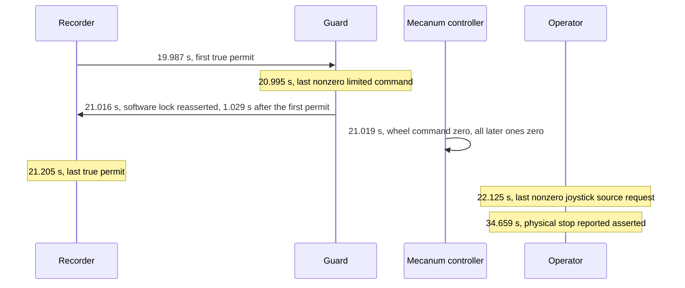

# r100_0160 test-permit interlock, bounded-permit and moving-disconnect trials

Recorded dates: 2026-10-09, 2026-10-12
Tested revisions: unknown
Provenance: partial

This record covers the installation of the guard's temporary test-permit
interlock, its stationary checks, the held-command suppression check, the
bounded-permit trials that reached the one-second budget, and the first
interlocked moving controller disconnects on `r100_0160`. It was extracted from
the consolidated driving reference at the
[documentation snapshot](https://github.com/Cognitive-Software-Labs/DyNAMO-Ridgeback/blob/077692ab033fd3a86d4849bbbbdb443a9f0c2125/docs/physical/driving_readiness.md).

Provenance gaps: the source text names no repository commit for the guard,
observer or installer that ran, and the observer's acceptance bounds changed
between runs as described below. Installed file hashes live in the receipts.
Raw recordings, controller journals and analyses live only on the robot host
under `artifacts/hardware/`. All times within a run are observer receive times
in seconds from recording start.

## Interlock installation

The guard mode `--require-test-permit` was installed and verified stationary on
2026-10-09. All four files matched the receipt under
`artifacts/hardware/20261009-test-interlock-install/`, and the active guard
command included the required-permit flag. The passive post-install recording
received nineteen asserted stop reports and zero limited commands, wheel
commands and raw odometry throughout. This mode stayed installed until it was
replaced by the original manual-speed profile on 2026-10-21.

Seven loopback-only ROS checks on domain 214 passed with simulated topics and no
hardware nodes: no-permit blocking, capped permitted forwarding, heartbeat loss,
maximum budget expiry, refusal to rearm with false/true alone, blocked physical
release and a new permit following an asserted-stop cycle. Offline boundary
tests also passed. Evidence: `artifacts/hardware/20261009-test-interlock-staged/`.

The `20261009-interlocked-neutral-release-2` recording captured physical stop
release for 15.94 seconds while all 479 software-lock reports in the operator
phase stayed asserted (maximum receive gap 51.7 ms). No mux commands arrived;
all 458 limited commands, 455 wheel commands and 455 raw odometry samples were
finite and zero. The final two physical stop reports were asserted. This
verified software-lock assertion across neutral physical release. The operator
confirmed the robot remained still and the physical stop was pressed afterward.
It did not test suppression of a held command with the physical stop released.

## Held-command suppression

The 2026-10-12 `20261012-interlock-held` live run verified held-command
suppression: while the physical stop was reported released, 1,506 nonzero
joystick-combiner source samples arrived (maximum requested component 0.4 m/s).
All 482 software-lock reports in the operator phase stayed asserted; no mux
commands arrived. All 461 limited-command samples, 459 wheel-command samples
and 459 raw odometry samples were finite and exactly zero. The operator
confirmed no physical movement when forward was pressed. The final two physical
stop reports were asserted. Forward requests spanned 14.68–23.33 seconds,
exceeding the requested one-second input; this deviation means it is not a
compliant one-second trial. This verified the lock's suppression, not bounded
permitted movement or moving disconnection. Raw results and analysis:
`artifacts/hardware/20261012-interlock-held/`.

## Bounded-permit trials

The first `20261012-bounded-permit` live trial aborted when a capped forward
command of 0.05 m/s also contained 0.00143 rad/s yaw from small lateral stick
input. The observer had required effectively zero command yaw, which was too
strict for a manual-input test. The operator confirmed stationary state with
the physical stop pressed afterward. The run did not reach the one-second budget
boundary. The observer was revised to permit command yaw up to 0.005 rad/s (5% of
the installed yaw cap); planar speed, lateral-command limits and raw-odometry
abort limits were unchanged. This changed only the trial's command acceptance,
not the installed guard or robot control configuration.

The second attempt (`20261012-bounded-permit-2`) never armed: the controller had
zero motion axes and released driving-enable buttons, but unused axis 2 rested
at +1, and the observer incorrectly required every axis to be zero. The
deployed combiner and the tracked recovery copy matched SHA-256
`d3a4431a92e66cb671459cb52df089a4d2ec8874eca0358081ab5c22add40f7b`; its motion
mapping consumes axes 0 (yaw), 1+4 (forward) and 3 (lateral). The neutral check
was corrected to require these four axes within 0.05, both enable buttons
released, fresh input and finite values on all axes, letting unused axes 2 and
5 rest at nonzero values. The forward-input check follows the same mapping. No
permits were issued in this failed attempt; the robot configuration was
unchanged.

The `20261012-bounded-permit-3` live recording reached the budget boundary.

*Measured budget boundary in `20261012-bounded-permit-3`. Notice that the lock
and zero wheel command precede both the end of permits and the end of joystick
input, so the budget, not a controller release or the physical stop, ended
motion.*

Raw odometry retained small settling readings (under roughly 0.0023 in its
components after permit start + 1.15 seconds) before settling; this is not a
physical stopping-distance or certified braking-time measurement. The operator
confirmed that the robot stopped by itself while forward remained held, and
that it was afterward stationary with the physical stop pressed. The final two
physical stop reports were asserted. The bounded-permit gate is observed for
this trial. The joystick request lasted longer than the roughly 1.25-second
prompt window, and physical re-engagement occurred substantially later; both
are procedure deviations. This run tested bounded permission, not controller
link loss. Raw results and analysis: `artifacts/hardware/20261012-bounded-permit-3/`.

## Interlocked moving disconnect

The `20261012-interlocked-moving-disconnect` trial (observer mode
`interlock-disconnect`) captured a real deliberate controller disconnect
despite ending with a Bluetooth-client timeout. The request was recorded at
21.800 seconds; held input reset to neutral at 21.818 seconds, and the first
zero wheel command after motion arrived at 21.904 seconds. All later recorded
wheel commands stayed zero. The software budget lock only reasserted at 22.298
seconds, while true permit heartbeats continued until 22.486 seconds. The
commanded stop therefore preceded the backstop by about 0.394 seconds; it is not
explained by budget expiry or permit cancellation. The controller driver logged
disconnected at 2026-10-12 10:12:28 UTC and subsequent Bluetooth inspection
confirmed `Connected: no`. The operator confirmed the robot afterward stationary
with the physical stop pressed. Physical stopping caused by the disconnect was
not separately confirmed for this run; the raw observer abort status is
retained.

The child `bluetoothctl` process had not exited after two seconds and was
killed; its empty buffered output and timeout must not be equated with failed
transport loss. The recorder was changed to invoke the client with a one-second
CLI timeout and closed stdin so it no longer waits on the interactive terminal.
The D3 recorder was then tightened offline to record through the bounded permit
after a disconnect request, exit only with a fresh asserted physical stop, zero
limited and wheel commands and stationary raw odometry, and query the
controller's actual Bluetooth state after that safe tail instead of treating a
late or nonzero `bluetoothctl` exit as proof of a connected controller.

The repeat `20261012-interlocked-moving-disconnect-2` completed recording and
supports deliberate moving-disconnect stopping.

| Event | Time (s) |
|---|---|
| Link disconnection requested | 17.857 |
| Last nonzero joystick source request | 17.861 |
| First zero limited output | 17.962 |
| First zero wheel command | 17.997 |
| Software budget lock asserted | 18.355 |
| Last true permit | 18.567 |

All subsequent 513 limited commands and 205 wheel commands were exactly zero.
Wheel commands stopped about 0.358 seconds before the budget backstop. Raw
odometry included small settling readings; receive timestamps do not establish
certified braking time or distance. The driver logged disconnected at
2026-10-12 10:19:49 UTC, Bluetooth subsequently reported disconnected, and the
client exited zero. The operator reported forward movement, automatic stopping
and joystick disconnection, followed by pressing the physical e-stop. Final
firmware reports asserted that stop. Deliberate moving-disconnect stopping is
observed for this trial; silent radio loss, sustained outage and safe
reconnection remained separate gates. The reconnect attempts that followed are
in [the controller-input record](2026-10-12-controller-input-loss-and-reconnect-cycles.md).
