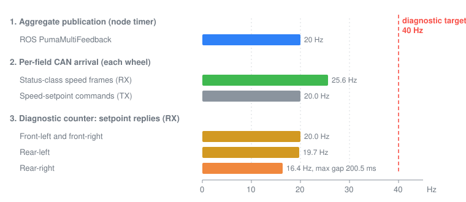

# Puma repair driver, CAN rates and offline freshness models

Recorded dates: 2026-10-09, 2026-10-12, 2026-10-13
Tested revisions: unknown
Provenance: partial

This record covers the withdrawn October 9 repair candidate, the corrected
repair build and its stationary installation, the first paired passive CAN rate
capture, and the offline completeness candidate with the timing models used to
judge it. The source text recorded no repository commit for the builder,
installer, replay or capture tools, so tested revisions are unknown. The build
and install receipts on the robot host pin source, patch and binary hashes, but
they were not copied into the repository. All directories named below are on
the robot host under `artifacts/hardware/`. The text was moved here from the
[wheel-feedback reference at the documentation snapshot](https://github.com/Cognitive-Software-Labs/DyNAMO-Ridgeback/blob/077692ab033fd3a86d4849bbbbdb443a9f0c2125/docs/physical/drive_feedback_diagnostics.md).

## Withdrawn October 9 candidate

The October 9 repair candidate was withdrawn before deployment. Its receipt
listed patches, but the source used for compilation still contained the
upstream code: `git apply` silently skipped paths because the exported source
lived below the repository's ignored artifact directory. The compiler's
array-bounds warning and unchanged source hashes exposed the error. The
isolated sanitizer harness had applied its patch in a separate temporary tree
and remained valid, but it did not establish patch application to the full
compiled package. The builder and installer were corrected (applied with
`patch`, forward and reverse checks, regression test, installer provenance
gate) before the next build.

## Corrected build and installation

The corrected 2026-10-12 package build (fault-flag and cache-safety patches)
completed with no compiler stderr. 1,013 cache and message checks, sixteen
alignment checks and 1,024 fault-mask cases passed, and the old upstream
harness still reproduced the bounds and alignment defects. Source and binary
checksums, sanitizer outputs and build logs are under
`artifacts/hardware/20261012-puma-repair-candidate/`.

It was installed and verified stationary the same day, with the receipt under
`artifacts/hardware/20261012-puma-repair-install/`. The running driver
executable was then under
`/opt/dynamo-puma/76ff6b99a1e35cc56e27e07302aa98f94ebb85f809348e25eaab04a50ef49856/`.
Its full package manifest and the three installed helper and drop-in hashes
matched the verified stage. The test-interlocked caps stayed byte-identical to
their baseline. Only the platform and guard were restarted, and installation
recorded no sensor, camera or VNC service changes. The DDS interface-readiness
helper was included, but cold-boot recovery was not tested.

## Stationary feedback captures

`artifacts/hardware/20261012-stationary-wheel-feedback/` received 380 aggregate
feedback samples at approximately 20 Hz, with a maximum receive gap of
51.9 ms. Every message included all four wheel identities, zero reported speeds
and zero output voltages. Raw motor status fault was 8 while the
human-readable bridge-fault fields reported false, reconfirming the decoding
defect. This does not identify a hardware fault cause or prove per-wheel cache
freshness.

The independent post-install recording
`artifacts/hardware/20261012-puma-repair-postinstall/` received 380 aggregate
messages at approximately 20 Hz, with every wheel identity present and every
speed zero. All 19 physical-stop and 396 software-lock reports were asserted.
The human-readable bridge-driver fault was now true, consistent with raw mask 8
while physically stopped: correct decoding, not the cause of that status.
Diagnostics still measured approximately 20 Hz for the front and rear-left
wheels and 17.8 Hz for rear-right against the unchanged 40 Hz target. No
movement was performed.

## Paired passive rate capture

*Stationary rates from `20261012-wheel-can-rate`. Notice that status-speed
frames are equal on every wheel while counted setpoint replies fall short on
the rear-right wheel, and that no counted stream reaches the 40 Hz target.*

`artifacts/hardware/20261012-wheel-can-rate/` separated actual speed-state
traffic from the diagnostic counter after the repair was installed. Over
14.976 seconds:

| Stream | Per device | Rate | Maximum receive gap |
|---|---|---|---|
| Status-class speed frames, received | 384 each | about 25.64 Hz | at most 40.1 ms |
| Speed-setpoint replies (API `0x0480`), received, each front wheel | 300 | 20.03 Hz | about 51.5 ms |
| Speed-setpoint replies, received, rear-left | 295 | 19.70 Hz | about 100.4 ms |
| Speed-setpoint replies, received, rear-right | 245 | 16.36 Hz | about 200.5 ms |
| Speed-setpoint commands and empty setpoint queries, transmitted | each about 20.03 Hz | — | — |

Counts use the full capture duration; RX and TX distinguish frames received by
the host from locally transmitted traffic. The capture showed incoming
setpoint-response asymmetry despite equal outgoing traffic while stationary.
It did not establish the loss location or show that physical speed feedback
stalled; the speed-state stream stayed steady for every wheel. Interface
receive timestamps are not wire timestamps, and no under-motion latency or
physical wheel response was measured.

## Offline completeness candidate

`clearpath_puma_freshness.patch` was then an offline candidate. It required
every wheel's feedback fields instead of ORing flags across wheels, reset
status-field completeness for each wheel, and ran consuming diagnostic getters
on a copied cache so diagnostics no longer cleared publication flags. That
establishes receipt since consumption, not an absolute field age or
simultaneous physical wheel response.

The offline verifier executed the actual extracted node and diagnostic routine
bodies with inert per-wheel caches. The upstream source falsely accepted twenty
single missing-feedback cases, fifteen missing-status cases and a distributed
partial-field batch, and its diagnostics consumed feedback availability. The
candidate rejected all such incomplete batches, preserved diagnostic reads and
let complete batches be consumed once. Source and patch hashes and results are
under `artifacts/hardware/20261012-puma-freshness-offline/routine-tests-3/`.
The full candidate package compiled with empty compiler stderr. It was neither
installed nor part of the two-patch builder at the time; it was later installed
as one layer of the field-age driver
([acceptance record](2026-10-22-d5-acceptance.md)).

## Superseded timing models

Both models below were offline projections for a candidate that was never
deployed in this form. They are superseded by the split-bound field-age driver
and its live acceptance.

**Flag-only model.** Replaying `artifacts/hardware/20261012-wheel-can-rate` at a 20 Hz publish
timer over ten phases, with diagnostics every second and two seconds of warmup
excluded, projected baseline output of 18.96–19.04 Hz with forty-three batches
per phase containing unreceived wheel fields. The completeness candidate
projected 16.41–16.49 Hz with none of those batches, but its maximum projected
publication gap rose to 200 ms. Maximum modelled cached-field age fell from
about 197 ms to 97 ms. A synthetic missing wheel reply produced a long candidate
publication gap rather than borrowing other wheels' freshness. The model had no
physical wheel timing, transport queue, full driver state machine or
hardware-consumer behavior.

**Motion-field model.** An offline-only policy required each wheel's position
and speed to have arrived since the previous publication and bounded every
cached field to 200 ms. Over ten timer phases of the same capture it projected
19.96–20.04 Hz, a 50 ms maximum publication gap and a 196.8 ms maximum cached
field age, only about 3 ms below the limit. Synthetic loss of one wheel's speed
produced a 400 ms publication gap; loss near the end of a trace also counted as
silence. The model is `tools/hardware/replay_puma_freshness.py`, with output in
`artifacts/hardware/20261013-motion-field-replay-2.json`; no driver patch or
robot configuration changed.

## 30-second stationary capture

On 2026-10-13 a second passive capture lasted 29.982 seconds with the physical
stop pressed. Every wheel had 769 speed replies with maximum receive gaps of
about 40 ms; rear-right setpoint replies numbered 523, with a maximum gap of
about 151 ms. The motion-field model projected 19.98–20.01 Hz, a 50 ms maximum
gap and a maximum cached-field age of about 150 ms. An all-fields-new model
projected 12.72–17.33 Hz across timer phases. Capture and replay are under
`artifacts/hardware/20261013-wheel-can-30s/`. On this host `candump -L -x`
wrote compact `CANID#DATA R/T` lines, so the replayer was extended to accept
that format as well as the earlier verbose log.

## Deployment boundary at the time

These results led to a hold: do not deploy the completeness candidate merely
because its routine checks pass; first verify the hardware consumer's handling
of absent or stale aggregate feedback and choose explicit age bounds, keeping
firmware, control rates, command caps and the installed two-patch driver
unchanged. The controller reconnect investigation and the cold-boot
checks were independent of this candidate. The consumer side was resolved in
[the consumer record](2026-10-13-consumer-plugin-and-feedback-outage.md) and the
bounds in [the acceptance record](2026-10-22-d5-acceptance.md).
