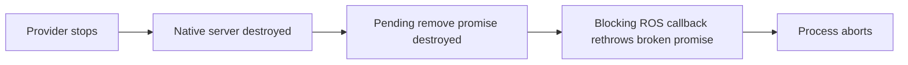

# Benchmark shutdown ordering and RViz node ownership

Recorded dates: 2026-10-23
Tested revisions: `5e65a0bd3c904a7676ee5042b4a3138eeec11964`, `feb01669f1297df2af755ce9cd2ed18083e7a8b2`
Provenance: partial

## Tested state and evidence boundary

The first revision is the root checkout's parent; application tests also used
uncommitted changes. The second is the pinned RViz 14.1.23 dependency. Frozen
root patches, relevant untracked sources, RViz diffs, file hashes and status were
saved under `artifacts/benchmarks/shutdown_final_20261023/inputs_v3` and later
snapshots. These local generated inputs are required to reconstruct dirty-tree
results; the parent hash alone does not identify them. Preliminary probe revisions
were not all copied, so this record does not claim complete provenance for the
exploratory populations. The final populations below identify their own inputs.

The host used ROS 2 Jazzy, Isaac Sim 6.1, CycloneDDS 0.10.5,
`rmw_cyclonedds_cpp` 2.2.4, rclcpp 28.1.22, and an RTX PRO 6000 Blackwell with
driver 595.99.02. No driver or kernel changes formed part of the experiment.
Real ROS/GPU probes ran with host access: the restricted execution environment
could not establish DDS networking or host process visibility. Failed sandbox
starts are setup failures, not simulator shutdown observations.

## Application stop order

The original single-run wrapper grouped configuration and environment beneath
one foreground launch. A terminal interrupt therefore stopped the provider
while its client attempted scene rollback. A physics-only Gazebo experiment
separated the two sessions, used isolated ROS domains and Gazebo partitions,
spawned 16 entities, and interrupted only after scene readiness. It used the
installed Gazebo Sim 8.15.0 and ros_gz_sim 1.0.24, without camera sensors or RViz.

| Schedule | Ready trials | Cleanup verified before provider stop | Native `Broken promise` aborts |
|---|---:|---:|---:|
| Stop client and provider together | 3 | 0 | 1 |
| Stop client, then provider | 3 | 3 | 0 |
| Product single-run owner, frozen v3 | 3 | 3 | 0 |
| Product single-run owner, final v4 | 3 | 3 | 0 |

All owner/client/provider statuses were zero for the product-owner population.
No forced escalation occurred. Host process audits found no living members in
its nine owned sessions. An earlier audit used restricted process visibility;
the audit JSON explicitly records its correction using host-visible process
inspection. The separate product stop reports were already captured on the host.

Raw order results are in `artifacts/benchmarks/shutdown_order_20261023_5e65a0bd`;
product results are in `shutdown_final_20261023/physics_supervised_v3` beneath the
same benchmark artifact root. The v3 product file hashes match `inputs_v3`.
The v4 repetition followed the final sweep signal/resume corrections; its
`physics_supervised_v4/audit.json` records all-zero process outcomes, no escalation,
an empty host audit of nine owned sessions, and the tested source hashes.

The owned Apport report for PID 410183 matches `simultaneous_02`, its unique
namespace and world path, and 2026-10-23 15:38:13 Berlin. Its stack contains
`std::rethrow_exception`, `BlockingServiceHandler<RemoveCommand, Entity>`, and
`rclcpp::Executor::execute_service`. The pinned
[UserCommands implementation](https://github.com/gazebosim/gz-sim/blob/446a44335a45b704b4d36dabcc5508ee34eeb3d8/src/systems/user_commands/UserCommands.cc#L788)
queues a promise and calls unguarded `future.get()`; `PreUpdate` normally fulfills
it. The exact report, backtrace, eleven loaded-library hashes and source bytes
were preserved beneath `simultaneous_02/native_stack`.

This remains narrower than a validated dependency correction. Pinned
[ros_gz_sim](https://github.com/gazebosim/ros_gz/blob/5912bfe7976a79d2cc9f373b2d40a8a3a3e33da2/ros_gz_sim/src/gzserver.cpp#L89)
destroys its local native server before shutting down ROS interfaces. Native
service closures capture raw private pointers, and deregistration does not drain
already-copied in-process handlers. Catching the future exception would mask the
captured abort without proving callback lifetime. Retaining server/interfaces
until the standalone executor returns was assessed as a source-only candidate;
it was not implemented or tested. Application ordering removes the demonstrated
trigger, but does not establish safe direct provider interruption.

## Separate RViz defects

Restoring the existing Image-unsubscribe patch removed the reproduced stale-filter
abort from the bounded standalone probes. Those probes used an owned Xvfb display
and Mesa, not the native GPU workload. The patched basic population had 19 ready,
clean exits. Scoped simulated-time controls also exited cleanly with both
publisher/RViz stop orders and without a clock publisher. A global simulated-time
override was kept separate because it also changes RViz's hidden TF listener.

The initial stock Cyclone probe had two failed readiness gates, one followed by
an abort. A later ready stock population had one abort among two Image trials.
Those startup failures must not be combined into a ready shutdown failure rate.
The six ready Fast DDS controls exited cleanly, but did not establish a middleware
switch as a correction for the RViz ownership defect.

With the Image patch loaded, an untraced native-display Isaac run still crashed
RViz with SIGSEGV during active all-estimator cancellation. It used the public
single-run wrapper, one 2.5 m target, all four registered estimators, a 20 s
capture window, actual node-scoped simulated time and TF remaps. Readiness required
clock, camera, real overlay traffic, mask and pointcloud measurements, the RViz
overlay subscriber, successful unfiltered scene queries, and fresh capture truth.
The operator interrupt occurred two seconds after those gates, before `run.json`
existed. The observer recorded 49 overlay images at 2560 by 480, 41 mask messages
and 44 pointcloud messages.

Rollback was independently verified: a successful `GetEntities` response reported
the benchmark entity absent at Unix time 1792765096.112665; environment SIGINT
followed at 1792765096.697673. A later failed query during simulator shutdown was
not counted as scene-absence evidence. The public launcher returned 1 for the
RViz crash, while preserving the runner's intentional 130 status. All owned
sessions were empty after the harness reaped orphaned descendants. One already
zombie Isaac descendant exited 1 without a captured command; its identity remains
unresolved and is an additional unfavorable helper outcome, not a clean SDK exit.

The exact RViz process was PID 600867. Its Apport core and pre-stop maps were
preserved under
`artifacts/benchmarks/20261023_shutdown_actual_isaac_single_overlay_v3_all_active`.
SIGSEGV had `si_code=SEGV_MAPERR` and fault address equal to instruction address
`0x7e5666790cd6`. The pre-stop map placed that address at offset `0xe7cd6` in
`libddsc.so.0.10.5`, resolving to `ddsrt_select+102`; the crash-time mappings had
no DDS segment covering it. Other surviving DDS threads were in `ddsrt_recvmsg`
and `dds_sleepfor`. This establishes live middleware execution after its text was
unmapped.

The main thread was in `exit(0)` through GLX finalizers and `dlclose`. The DSO
being unmapped in that particular frame was `libnvidia-glcore.so.595.99.02`.
That frame does not identify the earlier DDS unload as a driver defect.

The core also retained a live, unparented `ViewManager` at `0x639c36236060` and
its current `FixedOrientationOrthoViewController` at `0x639c36389400`. Pinned
[RViz source](https://github.com/ros2/rviz/blob/feb01669f1297df2af755ce9cd2ed18083e7a8b2/rviz_common/src/rviz_common/visualization_manager.cpp)
allocated this manager without deleting it. The controller's reset-time service
retains an aliasing shared pointer from
[rclcpp NodeBase](https://github.com/ros2/rclcpp/blob/28.1.22/rclcpp/src/rclcpp/node_interfaces/node_base.cpp)
through `ServiceBase`. This explains how the RCL node can outlive destruction of
the outer C++ `Node`, keeping a Cyclone participant alive. The Image subscription
patch does not release that owner.

## Ownership correction and qualification boundary

A focused real QApplication/RenderPanel/VisualizationManager test initialized
current and saved Orbit views with simulated time enabled. Before correction,
all four ownership assertions failed: the view manager, both controllers and the
weakly observed `NodeBase` survived teardown. Early test-setup rendering failures
were preserved separately; they did not count as this failing regression.

The correction deletes the view manager after tools and before frame/context
teardown. Its destructor detaches the render panel and releases the property
model while the plugin factory and implementation still exist. This releases
both current and saved controllers while their scene is usable. The identical
focused regression passes after correction, including expiration of the weak
`NodeBase` owner. It also passes against the final complete-workspace rebuild.

The original untraced crash population remains distinct from runs with
descendant process/signal tracing. Tracing is
used to identify short-lived SDK helpers; it does not establish timing or crash-rate
equivalence. The rare image-bridge residual and direct provider interruption
remain independent signatures unless separately reproduced and corrected.

## Final frozen-input runs

The final application/dependency inputs are in `shutdown_final_20261023/inputs_v4`.
The complete 34-package source build passed after regeneration of stale build
metadata. The running RViz libraries must be compared against this snapshot's
hashes; an earlier focused build has different binary hashes with the same
corrected source. Diagnostic auditor corrections are preserved separately from
the frozen application code and original audit results.

Three sequential single-run attempts were declared, with a stop on any failed
readiness or whole-process audit. Only `single_01` ran. It used the same public
launch arguments and active-capture gates as the untraced failing population,
with descendant process/signal tracing added. RViz and the owner exited zero;
the runner returned its intentional 130 after a traced interrupt. A successful
scene query confirmed target removal 3.736 seconds before environment SIGINT.
No owner escalation or living owned-session members remained, and both RViz
library hashes matched `inputs_v4`.

The whole-process audit failed and stopped the declared matrix. Before the
operator interrupt, a forked Isaac Python descendant was killed by an SDK thread
with SIGKILL, and another descendant ran
`nvidia-ngx-updater -api update -cmsid 194708940 -feature dlssg -gpuarch 352`,
exiting 1. Their expected-status semantics were not established. They are
startup outcomes, not evidence that application cancellation escalated. Known
auditor bookkeeping issues for `pgrep` no-match status 1 and the runner's Python
re-exec are documented independently; correcting those does not waive the SDK
outcomes. The original audit and trace are retained alongside `interpretation.json`.

No attempts 2 or 3 were silently substituted. A separately declared single
sweep-cancellation check, `sweep_active_01`, tested the public sweep with one
all-estimator configuration. Its manifest recorded `interrupted` with
`lifecycle.clean=true`; configuration and environment returned zero, RViz
returned zero, and the runner's traced interrupt produced 130. Public sweep exit
1 is its interrupted protocol. Target removal was confirmed 4.106 seconds before
environment SIGINT, and no escalation or living owned processes remained.
Captured RViz binary hashes matched `inputs_v4`.

That sweep's whole-process audit also failed on SDK startup SIGKILL and updater
exit 1 before cancellation. Additionally, the last observed capture-truth age at
the interrupt was 0.609 seconds against the declared 0.5-second threshold, despite
earlier readiness passing. No completed `run.json` existed before the signal.
This provides real ordered-cleanup evidence, but does not pass the stricter
active-workload freshness gate or complete SDK qualification. It does not
reclassify the stopped single-run matrix as three successful runs.
