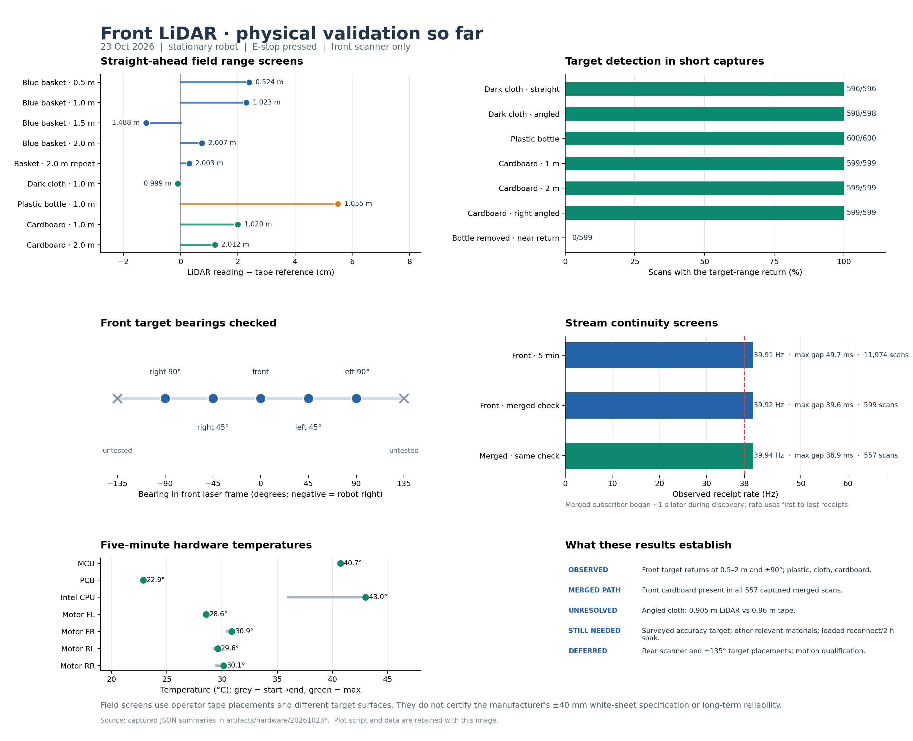
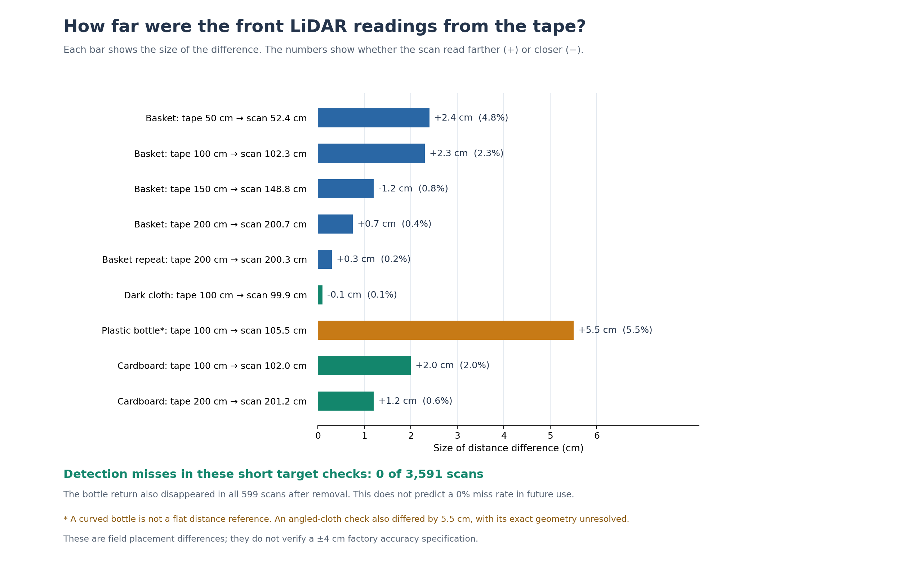

# r100_0160 front LiDAR stationary field screening

Recorded dates: 2026-10-23
Tested revisions: `749b2f101def73649246bb28b833ae1c2f1dc710`
Provenance: partial

## Conclusion and boundary

The **front** LiDAR on `cpr-r100-0160` returned the placed basket, dark cloth,
plastic bottle, and cardboard targets in the short stationary captures below.
The basket range screens spanned 0.5–2 m; the operator placed it at front,
±45°, and ±90° bearings. A five-minute front-stream screen received 11,974
scans at 39.91 Hz with increasing stamps and a 49.7 ms maximum receipt gap.
The front cardboard return also appeared in every captured scan of the vendor
merged output during a separate 15-second check.

This is a **front-only field screening result**. No LiDAR calibration parameter,
mount, or TF was adjusted. It does not establish the manufacturer's ±40 mm
accuracy condition: the optical reference and target surfaces were not surveyed,
the factory white-sheet setup was not reproduced, and the physical model/serial
was not confirmed. It does not qualify the rear scanner, motion, or long-run
loaded reliability. The reported 100% short-capture detections are observations
at these placements, not a general zero-miss guarantee.

*Figure 1. All plotted measurements are front-session field observations; the
distance chart compares heterogeneous objects against operator tape placements.*

## Conditions and method

- Indoors, robot stationary, physical E-stop pressed. An operator moved the
  targets; no robot motion was commanded. Existing ROS publishers supplied
  `/r100_0160/sensors/lidar2d_0/scan` (`lidar2d_0_laser`) and
  `/r100_0160/sensors/scan` (`base_link`). No second sensor TCP client was opened.
- The operator measured the blue basket's 1 m placement as 94 cm from the
  robot's outer edge plus approximately 6 cm from that edge to the LiDAR.
  Subsequent target distances were operator-reported tape placements. Exact
  laser optical origin, tape uncertainty, surface shape at scan height, and
  object dimensions were not independently surveyed.
- The front raw scan exposed 1,081 bins over approximately ±135° at 0.25°
  increments. Static TF reported a forward sensor offset of 0.3922 m from
  `chassis_link`; the merged scan used `base_link`. A reported scan angle is
  positive to robot left and negative to robot right.
- Full scans and per-trial JSON summaries are under the local ignored
  `artifacts/hardware/20261023*` run directories. The plots and the numerical
  results below are promoted here. The complete raw scan captures were not
  committed, which limits independent reanalysis.

## Range screens

| Target and operator tape placement | Median raw return | Reading minus tape |
|---|---:|---:|
| Blue basket, 0.5 m | 0.524 m | +24 mm |
| Blue basket, 1.0 m, repositioned | 1.023 m | +23 mm |
| Blue basket, 1.5 m | 1.488 m | −12 mm |
| Blue basket, 2.0 m | 2.0075 m | +7.5 mm |
| Blue basket, 2.0 m, clear repeat | 2.003 m | +3 mm |
| Dark cloth on basket, 1.0 m | 0.999 m | −1 mm |
| Plastic bottle, 1.0 m | 1.055 m | +55 mm; curved surface |
| Upright cardboard, 1.0 m | 1.020 m | +20 mm |
| Upright cardboard, 2.0 m | 2.012 m | +12 mm |

The 2 m cardboard value uses its interior +1.25° to +3.25° beams. A broader
±15° search also included an unrelated, pre-existing return near +13° at
about 2 m; its broad-region median is not a cardboard distance. Before
cardboard placement, the selected interior beams saw background at 4.123 m;
with cardboard they read 2.012 m in 599/599 scans.

The repositioned 1 m basket capture had a transient nearer return when a
person crossed in front of the scanner; the operator identified the person.
An earlier 2 m repeat had the same kind of crossing, so the clear 2 m repeat
is reported separately. These crossings must not be counted as scanner faults
or silently mixed into static-target repeatability.

The angled dark-cloth placement produced a 0.905 m median nearest return,
while the operator later measured 0.96 m to the nearest cloth-covered corner:
a 55 mm discrepancy. The exact return point, cloth geometry, and optical
reference are unresolved, so this observation cannot pass or fail a formal
accuracy limit. The curved bottle's +55 mm difference likewise is a
detection result, not a flat-reference accuracy result.

*Figure 2. Positive values mean the scan read farther than the operator's
tape placement; negative values mean closer. The bars show magnitude only.*

## Detection and angular screens

| Placed target | Target-range scans / captured scans | Observation |
|---|---:|---|
| Dark cloth, straight at 1 m | 596/596 | Median central return 0.999 m |
| Dark cloth, angled | 598/598 | Detection continuous; nearest-distance discrepancy above |
| Plastic bottle at 1 m | 600/600 | Narrow cluster spanning about 5°; median 1.055 m |
| Plastic bottle removed | 0/599 | No 0.8–1.2 m front near-return after removal |
| Cardboard at 1 m | 599/599 | Median 1.020 m |
| Cardboard at 2 m | 599/599 | Fixed interior-beam median 2.012 m |
| Angled cardboard on robot right | 599/599 | New −45° to −39° cluster, fixed interior median 1.0505 m |

The right-angled cardboard cluster replaced 2.416 m background in the same
−45° to −40° interior beams. The operator described this placement as 30°,
70 cm from the front and 1 m from the right side. Those two offsets do not
define a direct sensor-to-surface reference, so it is an off-axis detection
check rather than an accuracy check.

The basket appeared on the expected sides at −90° (0.974 m at that beam),
−45° (1.051 m), +45° (1.042 m), and +90° (0.965 m); the straight-ahead
placements cover 0°. The initial −45° directory was corrected from an
operator-disconfirmed “left” label to robot right, with the original summary
retained in its run directory. Neither ±135° placement was completed; the
operator reported insufficient room for +135°. Rear target geometry was not
tested because access was unavailable.

## Delivery, merge, and temperatures

| Capture | Count | Receipt rate | Maximum receipt gap | Result scope |
|---|---:|---:|---:|---|
| Front, stationary 5 min | 11,974 | 39.91 Hz | 49.7 ms | Increasing stamps; same service PID, no restart, E-stop remained pressed, no odometry motion |
| Front, with right cardboard | 599 | 39.92 Hz | 39.6 ms | Target in 599/599 raw scans |
| Vendor merged, same check | 557 | 39.94 Hz | 38.9 ms | Target at expected transformed bearing/range in 557/557 merged scans |

The merged subscriber's first receipt was about 1.03 s after the front
subscriber's first receipt during discovery. Its smaller total count across
the fixed wall-clock recording therefore does not imply a lower steady rate.
The front target's raw median was 1.052 m at −45° to −40°; the merged
`base_link` target was about 1.364 m at −34° to −30°, consistent with the
forward sensor offset. Rear contribution, overlap correspondence, and
move/remove ghost latency were not qualified.

During the five-minute capture, reported maxima were 40.7°C MCU, 22.9°C PCB,
43.0°C Intel package, and 28.6–30.9°C across four motor-controller channels.
These are observed temperatures, not component-specific thermal pass claims.
The 5-minute result is a short baseline, not the planned two-hour loaded soak.

## Provenance and remaining work

The repository checkout's base revision was the hash above. At session time,
`docs/index.md` had a documentation-only working-tree change and the active
LiDAR plan was untracked. This record retains the [index patch](assets/2026-10-23-front-lidar/dirty-docs-index.patch.gz)
and a [plan snapshot](assets/2026-10-23-front-lidar/plan-snapshot.txt) for
interpretation; neither was a deployed sensor change. A later SHA-256 read of
`/etc/clearpath/robot.yaml` was
`f8d2bfc71c4c101a946fe4d3c184ddaaf950349c09d3e286a0639952e4465da4`.
Installed driver executable/configuration hashes, exact sensor model/serial,
complete raw captures in Git, and quantified tape/reference uncertainty are
missing, hence provenance is **partial**. The documentation commit containing
this report is not itself the tested revision.

For a full accuracy and reliability verdict, use a surveyed flat reference
with documented laser origin; complete relevant representative obstacle
materials; qualify rear and both raw-to-merged contributions when accessible;
run the intended compute/camera load, attended front reconnect trials, and the
two-hour loaded soak. Motion remains a separate conditional stage. Record any
inaccessible position as untested, not as a scanner failure.
