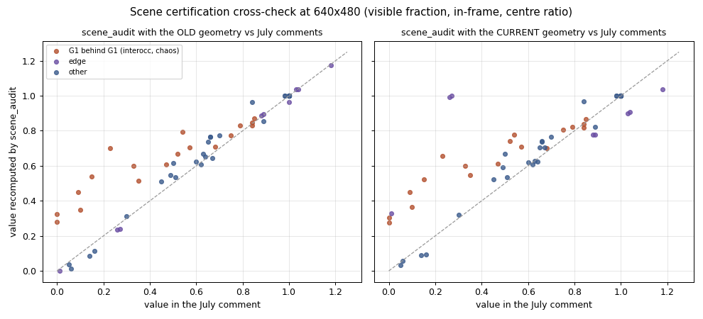
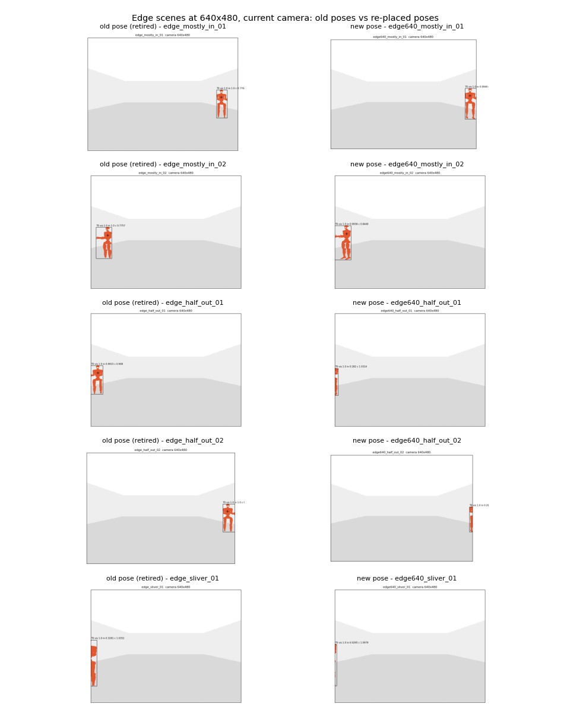
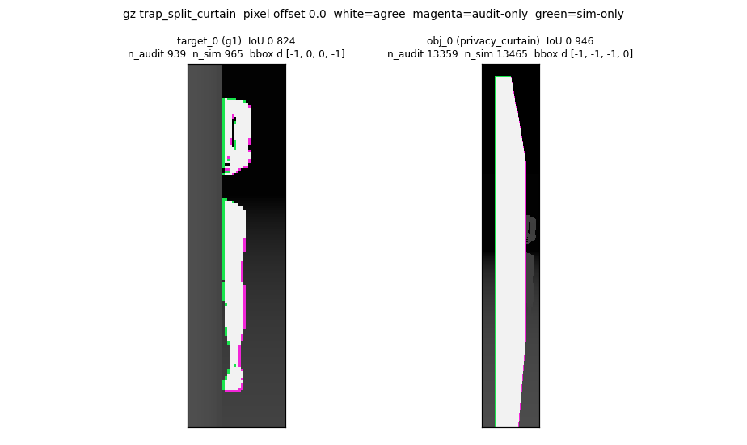
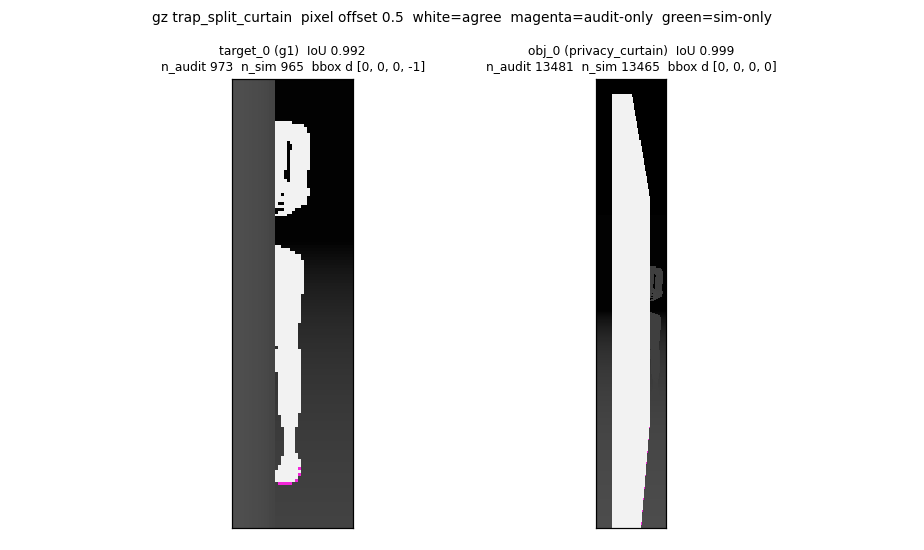

# Benchmark scene recertification for the current camera

Recorded dates: 2026-10-29
Tested revisions: `c23a0fb3ca58dd07a04c881c00bcbbfac872e711`, `9649353971cb7b48fd1b58335b21b674597c319b`
Provenance: partial

The audits ran from a working tree based on the first tested revision, with the
`scene_audit` tool, asset seating and scenario edits uncommitted; those changes
were committed together with this record. The full audit outputs stayed under
`artifacts/benchmarks/scene_audit/20261029_*`; the two claim comparisons and
the figures below are preserved in
[`assets/2026-10-29-scene-recertification/`](assets/2026-10-29-scene-recertification/).

## Scope and decisions

The scenario comments in `benchmark_scenarios_full.yaml` came from a lost
one-shot script (2026-07-26) that rasterized a stylized box-figure target
through the retired generic Clearpath camera: fx = 443.53 at 640x480 (a 1.25 rad
horizontal FOV) and a camera at (0.25, 0, 0.85). The current camera is the
D455 profile (fx = 384 at 640x480, within about 1 % of the `r100_0160` factory
calibration) with its colour optical frame at base_link + (0.280, -0.012,
1.035), and the front LiDAR plane moved from z 0.342 to 0.226.

Decisions (deivid, 2026-10-29):

- Certify at 640x480 only. Raw HD exceeds the Intel-Thor link, so hardware
  perception stays at 640x480; the audit still reports 1280x720.
- Stand every target and object on the floor. Until this change both
  simulators spawned models at z = 0, 5 cm into the 0.05 m floor slab, which
  hid the G1's feet. That was a deliberate continuity choice; it was dropped
  because geometry-dependent runs need rerunning anyway and hardware targets
  stand on the floor. The Gazebo G1 link was lifted 15.4 mm so its origin is
  ground contact like the Isaac wrapper.
- Relabel scenes whose occlusion no longer matches the family band, but
  re-place the edge scenes, which no longer tested the image edge at all.
  The five `edge_*` ids were retired and replaced by `edge640_*` ids with the
  same range, side and relative yaw, so no id refers to two poses.
- Keep the Isaac/Gazebo G1 asset difference as a documented limitation; no
  asset unification is planned.

## Method

`scene_audit` ray-casts a depth-ordered id buffer of the Gazebo visual
geometry (36-mesh G1, primitive objects with 64-segment cylinders, floor slab)
through the sensor geometry expanded from `clearpath/robot.yaml`, and casts the
1081-beam front LiDAR in its scan plane. Its own tests cover analytic boxes,
half occlusion, half in-frame, near-plane clipping and pole beam counts.

Legacy cross-check: re-running the tool with the old camera and LiDAR geometry
reproduced the 72 numeric comments with median absolute difference 0.021
(69 % within 0.05). Centre ratio agreed within 0.008 and in-frame within 0.035.
Every mismatch above 0.15 was a G1 hidden behind another G1: the old box
figure was solid, while the mesh far target shows through the near target's
limb gaps (comment 0.00-0.23, mesh 0.28-0.70).

Static backend agreement: the Isaac robot USD places the colour camera frame
at exactly (0.28035, -0.0115, 1.0345) and the front laser at (0.3922, 0,
0.2264) in base_link; both backends take intrinsics from the shared profiles;
all eight object models match between SDF and USD to 0.00 mm. A rendered
comparison against simulator depth captures was not run.

## Results at 640x480 with seated assets

| Family | Old comment | Current audit | Outcome |
|---|---|---|---|
| interocc moderate (band 0.15-0.45) | 0.15, 0.23 | 0.52, 0.66 | relabelled, above band |
| interocc sliver (band 0.03-0.15) | 0.09, 0.10 | 0.45, 0.36 | relabelled, above band |
| interocc neartotal (band 0.00-0.03) | 0.00, 0.00 | 0.27, 0.30 | relabelled, above band |
| objpartial_01, _02 (band 0.35-0.65) | 0.65, 0.50 | 0.71, 0.67 | relabelled, above band |
| edge mostly-in (centre 0.88-0.96) | 0.89, 0.88 | centre 0.78, 0.78 | re-placed: in-frame 0.99, 1.00 |
| edge half-out (in-frame ~0.26) | 0.26, 0.27 | in-frame 0.99, 1.00 | re-placed: 0.28, 0.29 |
| edge sliver (in-frame ~0.01) | 0.01 | in-frame 0.33 | re-placed: 0.03 |

The re-placed edge families are banded on in-frame fraction instead of centre
ratio, because the G1's arms reach the frame edge before its torso centre
does: mostly-in 0.99-1.00 (touching the edge), half-out 0.20-0.35, sliver
0.005-0.05. The mostly-in replacements read centre ratio 0.91 and 0.84.

Retired edge ids and their replacements, as `(x, y, yaw)`:

| Retired id | Old pose | Replacement | New pose |
|---|---|---|---|
| `edge_mostly_in_01` | (4.39, -2.67, 2.74) | `edge640_mostly_in_01` | (4.18, -2.98, 2.67) |
| `edge_mostly_in_02` | (3.98, 2.38, 2.80) | `edge640_mostly_in_02` | (3.89, 2.53, 2.84) |
| `edge_half_out_01` | (4.30, 3.03, 3.48) | `edge640_half_out_01` | (4.11, 3.28, 3.54) |
| `edge_half_out_02` | (4.37, -3.08, 2.79) | `edge640_half_out_02` | (4.17, -3.34, 2.73) |
| `edge_sliver_01` | (2.67, 2.05, 3.44) | `edge640_sliver_01` | (2.61, 2.12, 3.47) |

Seating the assets changed audited values by at most 0.083 and no verdict.
Every objocc_heavy and the other objpartial scenes stay in band; all multi
targets read at least 0.95; near_clip feet remain clipped by the vertical FOV;
far_clamp torsos sit at 8.90 and 9.04 m optical depth and far_beyond at 10.45 m.

In the in-box clutter block every shin keeps at least 79 % of its angular
width. Six flank poles project 1-4 px outside the G1's detection box, and the
second pole of `interfere_pair_05` intersects the G1's hand by 2.5 cm; their
comments say so. The "control twin" comments in that block never described
their scenes (no pole-free twins existed even in `e1bdc171`, which added the
block on 2026-08-23) and were replaced with each scene's own pole numbers.

The same geometry drift had left the polar-profiling reference stale: it
derived the near-range floor from a camera optical origin at 1.028 m and
`lidar2d_0_laser` at 0.342 m, a scan plane 0.686 m below the camera projecting
to `v = fy·0.686/Z + cy`, with the plane leaving the 480-row frame below about
1.10 m. With the current 0.808 m drop that floor is about 1.29 m; the reference
was updated in the same change.

## Rendered comparison

The geometric audits above sampled pixels at integer image coordinates. A
rendered spot-check then compared the audit with real depth renders at the
second tested revision (`src/` clean). Both backends ran headless on ROS domain
57 with the environment launch only (simulator, robot, camera, no measurement
layer); entities were spawned and deleted through the runner's scene-control
client, and each capture repeated bit-identically (Gazebo) or within 1 mm
(Isaac). Masks came from depth differences with a 2 cm threshold: a target's
visible mask is where the full scene is nearer than the scene without it.

Thresholds were fixed before capture: target masks IoU >= 0.85, pixel count
within 10 %, bbox edges within 3 px and visible fraction within 0.05 in
Gazebo; Isaac object masks IoU >= 0.85 and count within 10 %, `CameraInfo` K
equal to the profile, Isaac G1 reported but not judged.

| Backend, entities | Offset 0 | Offset 0.5 |
|---|---|---|
| Gazebo, 8 targets in 7 scenes | 6 pass, IoU 0.79-0.98 | 8 pass, IoU 0.992-1.000 |
| Isaac, 4 objects | 3 pass, IoU 0.78-0.98 | 4 pass, IoU 0.945-0.999 |

Visible fractions matched within 0.011 at either offset, and every bbox edge
within 2 px at 0.5. Both backends publish `fx = fy = 384, cx = 320, cy = 240`.
The offset-0 failures were a uniform one-pixel band (simulator-only on left and
top edges, audit-only on right and bottom): both renderers sample pixel centres
at `i + 0.5` while publishing `cx = W / 2`. The audit default became 0.5 and
the scenario comments were refreshed from a 0.5 audit; values moved by at most
0.025 and no band verdict changed, so the values in the tables above are the
offset-0 audit. Remaining count deficits sit where an object is within the
2 cm threshold of what lies behind it (bed underside, pole bases, feet on the
floor); in Isaac, part of one pole base near the floor is missing from the
render (likely base-disc tessellation, not checked). The Isaac G1 masks read
IoU 0.918-0.991 against the Gazebo-mesh audit, with visible fractions within
0.011.

Per-entity results for both offsets are in
[`rendered_spotcheck_results.csv`](assets/2026-10-29-scene-recertification/rendered_spotcheck_results.csv);
an Isaac object overlay is
[`rendered_spotcheck_isaac_objects_offset05.png`](assets/2026-10-29-scene-recertification/rendered_spotcheck_isaac_objects_offset05.png).

## Limits

The audit models the Gazebo G1. Visual and collision meshes differ for 11 of
its 36 parts; cameras and `gpu_lidar` render visuals. The rendered comparison
covered seven scenes; the remaining families rest on the geometric audit.
