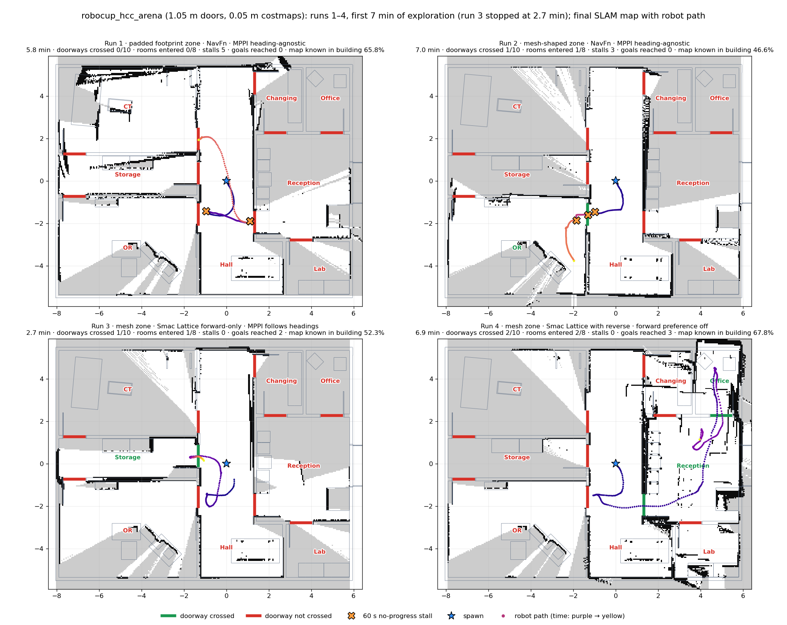
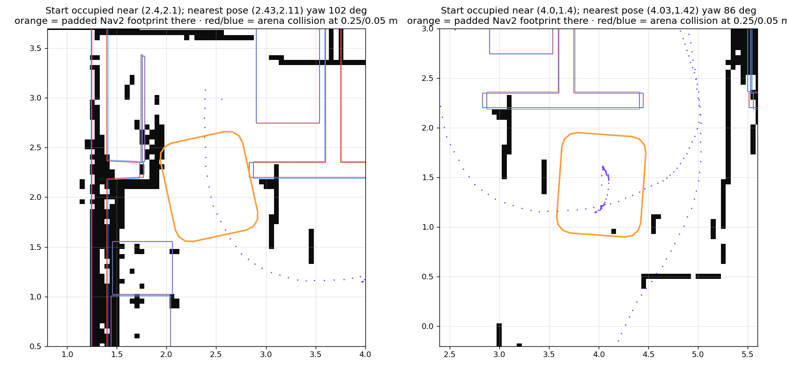

# HCC arena doorway runs and the mesh-shaped robot outline

Recorded dates: 2026-10-30
Tested revisions: `f88c46fd50ce713bd32108fa54c3fc3d39e3833f`, `64695c7f9961958526b7d5ffd6bc5a1ede6ca2aa`
Provenance: partial

All four runs used the `robocup_hcc_arena` world as committed in `f88c46fd` and
the 0.05 m costmaps and rescaled explorer cell parameters of `64695c7f`. Run 1
used `64695c7f` unchanged. Runs 2–4 ran on uncommitted `nav2_params.yaml`
changes; each run's full difference from `64695c7f` is preserved as a patch
beside this record. Launch and console logs stayed in the session scratch
space and were not retained, so provenance is partial.

## Conditions

- Gazebo backend, `start_exploration.sh robocup_hcc_arena
  target_localization_enabled:=false`, one run per configuration, no seeds.
- The UST-10LX simulation patch was not applied in this workspace, so both
  simulated LiDARs ran Clearpath's stock 540-sample, noise-free model, not the
  qualified 1081-sample model with range noise.
- Run 1 used ROS domain 42. For runs 2–4 another user's Gazebo session held
  domain 42 on the shared host, so they used domain 43; Gazebo transport stayed
  per-user.
- Runs 2–4 were stopped by hand. All numbers below cover the first 7 minutes of
  exploration; run 3 was stopped at 2.7 minutes. Run paths come from the
  `map → base_link` transform, or for runs 1 and 2 from the slam_toolbox pose
  graph.

## Results

| Run | Collision-monitor zone | Planner and MPPI heading | Patch | Doorways crossed | Rooms entered | 60 s stalls | Goals reached | Planner refusals |
|---|---|---|---|---|---|---|---|---|
| 1 | Padded Nav2 footprint, 101.4 × 84.7 cm | NavFn; `PathAngleCritic` mode 1 | none | 0/10 | 0/8 | 5 | 0 | 0 |
| 2 | Clearpath mesh shape + 5.1 mm, 95.2 × 80.1 cm | as run 1 | [run 2](assets/2026-10-30-hcc-arena-doorways/run2-nav2_params.patch) | 1 | OR | 3 | 0 | 0 |
| 3 | as run 2 | Smac Lattice, omni, forward only; mode 2 with path orientations | [run 3](assets/2026-10-30-hcc-arena-doorways/run3-nav2_params.patch) | 1 | Storage | 0 | 2 | 25 |
| 4 | as run 2 | as run 3 plus reverse expansion; `PreferForwardCritic` off | [run 4](assets/2026-10-30-hcc-arena-doorways/run4-nav2_params.patch) | 2 | Reception, Office | 0 | 3 | 58 |

**Run 1.** Over its full 9.7 minutes the explorer stalled 8 times, all at
doorways, reached no goal and declared exploration complete. At Door_02 MPPI
commanded about 0.09 m/s sideways and 0.03 rad/s, while the collision monitor
published zero. The padded footprint left 10 cm per side in the 1.05 m doorway,
and 0.09 m/s over the monitor's 1.2 s look-ahead is 11 cm.

**Run 2.** The tighter monitor zone let the robot through the OR sliding door.
It then stopped twice: at the corridor wall turned −56° from the door axis, and
inside OR in the gap between the CIARTIC unit and the wall. Both times MPPI
commanded rotation (about 0.11 rad/s) and the monitor published zero. NavFn
paths carry no heading and mode 1 ignores it, so nothing turned the robot
before the gap.

**Run 3.** The robot entered Storage. The forward-only lattice then required a
180° turn to leave, MPPI began turning in the doorway, and at about 20° every
plan failed with `Start occupied`: the padded footprint needs 1.14 m at that
heading.

**Run 4.** With reverse expansion the robot crossed into Reception and the
Office without a stall. It then lost 58 plans to `Start occupied` at three
spots: in the changing-room doorway, where the SLAM map smeared the open leaf
about 30 cm into the opening, and twice on open Reception floor, where one
occupied map cell with no arena geometry under it sat at the padded
footprint's rear edge. The explorer blacklisted 18 goals.

## Decisions

On 2026-10-30 the user decided that `r100_0160` has the Clearpath mesh shape.
The collision monitor took the mesh-shaped zone for run 2, and after run 4 the
Nav2 footprint took the same outline with no padding, so one body model serves
both costmaps and the monitor. That contradicts the 2026-10-16 direct tape
survey at the corners; the open check is in the backlog. Smac Lattice remained
under evaluation and was not part of that change.

## Outline replaced

The survey-based outline of 2026-10-16 had 16 points: straight edges 12 mm
(the tape uncertainty) outside each surveyed face and corner vertices on the
13.3 cm rounding offset by 12 mm, pushed out by the 30° chord sag. It measured
99.4 × 82.7 cm nominal and 101.4 × 84.7 cm with the 10 mm padding, and every
measured and rounding point lay at least 12 mm inside it before padding and
22 mm with it. Its
16-point predecessor of September 22, fitted to the simulator envelopes, had
failed the direct survey: the ends stuck out 2 mm past the padded polygon and
the rounded corners 42 mm past its chamfers.

The preliminary survey's read-only comparison against the September outline
(`artifacts/hardware/20261016-s8-outline/analysis.json`) found 7 mm side-face
clearance inside the padded footprint, less than the 12.2 mm combined
uncertainty; 60 mm quarter-circle corners put their 45° points about 55.5 mm
outside it. Live Gazebo and Isaac launches of the September outline reported
the 10 mm padding and published all 16 padded points, and the collision
monitor republished that outline from `local_costmap/published_footprint`.

These documentation figures were current until this change:

- [Configured 16-point outline](assets/2026-10-30-hcc-arena-doorways/former-navigation-footprint.png)
- [Recentred Gazebo/Isaac envelopes with the September outline](assets/2026-10-30-hcc-arena-doorways/former-navigation-footprint-aligned-envelope.png)
- [Raw simulator projections inside the padded September outline](assets/2026-10-30-hcc-arena-doorways/former-navigation-footprint-envelope.png)

## Limits

Single runs in one world, with a LiDAR model that is neither the qualified
simulation nor hardware. Rooms count as entered when the path reaches 0.2 m
inside the room's box. The figure's map-known percentage is not ground-truth
coverage; this world has no ground-truth map. None of these results qualify
hardware behaviour.
