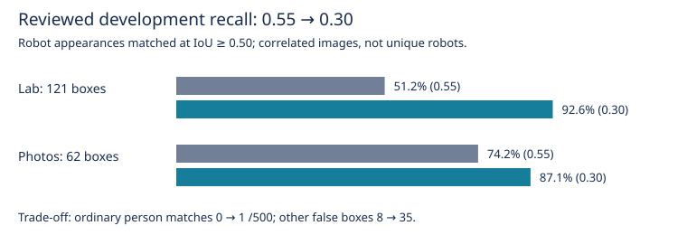

# OWLv2 threshold selection and live exploration observation

Recorded dates: 2026-10-29, 2026-10-30, 2026-11-01
Tested revisions: `c0dd50f13f38de4433aa9ee7ede32736d1c73f72`
Provenance: partial

## Decision and scope

On 1 November the operator requested changing the shared confidence default
from **0.55 to 0.30**, retaining OWLv2 and the generic `humanoid robot` prompt.
This followed offline recovery under occlusion and the operator's live
exploration observation below. This was an operating-point decision, not a
held-out validation or proof of universal person rejection. No robot-specific
prompt or rejection rule was introduced.

The recorded offline source base was the revision above with uncommitted
evaluator tools. Per-run environment files preserve checkpoint/runtime identity
and source-status lists, but the exact historical dirty-tree patch was not
snapshotted at inference time. A later source snapshot cannot establish that
missing provenance. The live run's revision, exact date, duration and installed
configuration were not independently captured. Accordingly, provenance is partial.

## Inputs, method and local evidence

All image-containing evidence remains private and local; no image assets are
copied into this record. These are absolute local evidence paths, not portable
archive dependencies:

- Reviewed dataset: `/home/stefi/ScenesForDetectionTesting/detector-evaluation-v1`.
  The locked development population comprised **352 images: 230 lab frames and
  122 photographs**, with 121 lab robot boxes, 62 photo robot boxes and 500
  scored person boxes. Test partitions were not evaluated.
- Original B0 run: `artifacts/benchmarks/detector-evaluation/dataset-6edf07505bb11dc8/20261029T154821Z-b0-development/`.
- New recordings supplied by the operator:
  `/home/stefi/ScenesForDetectionTesting/20261029T141724Z-distance-benchmark-raw/bags`.
  All **32 local bag attempts**, including retries and one explicitly rejected
  initial attempt, were sampled. Each contributed 20 clean RGB frames: the first
  frame at or after 0.5, 1.5, ..., 19.5 seconds within its settled interval,
  selected using bag receive timestamps. Total: **640 frames**.
- New-recording B0 evidence: `artifacts/benchmarks/detector-new-g1-20261030/`.
  `manifest.json` records input hashes; `source_map.json` maps each neutral image
  ID to bag, scenario, target offset and exact bag/RGB timestamps.
  `gallery.html` contains all sampled frames and predictions.
- Threshold experiment: `artifacts/benchmarks/detector-threshold-diagnostic-20261101/`.
  `new/` and `development/` preserve complete inference outputs and environment
  identities; `config.json`, `run.py`, `parity.json`, `summary.json`,
  `paired-robot-ids.json`, `REPORT.md` and `gallery.html` preserve configuration,
  reproduction commands, comparisons and interactive inspection. Each derived
  threshold has separate prediction JSONL files. The gallery switches between
  thresholds and recording attempts.

The checkpoint was `google/owlv2-base-patch16-ensemble`, revision
`cfd3195ba4ea9592eec887ded089f4c08eff231d`, CUDA float32. The prompt remained
`humanoid robot`. One inference per image at proposal floor **0.10** cached raw
outputs. Production box normalization and same-label NMS were reapplied at the
registered thresholds 0.10, 0.20, 0.30, 0.40, 0.50, 0.55, 0.60, 0.70 and 0.80.
All 992 images completed without inference errors. Deriving 0.55 reproduced the
original B0 boxes and scores exactly on both populations. No compute benchmark
claim is made from cached sweeps.

## Reviewed development results

Correct robot and person matches use the frozen one-to-one IoU >= 0.50 policy.
People counts below are ordinary matches, not conservative mixed-box upper
bounds. Other false boxes include background and localization failures.

| Threshold | Lab robots /121 | Photo robots /62 | People mistaken /500 | Other false boxes |
|---|---:|---:|---:|---:|
| 0.55 (historical B0) | 62 | 46 | 0 | 8 |
| 0.50 | 64 | 50 | 0 | 13 |
| 0.40 | 82 | 53 | 0 | 24 |
| **0.30 (selected)** | **112** | **54** | **1** | **35** |
| 0.20 | 114 | 56 | 9 | 147 |
| 0.10 | 115 | 58 | 64 | 604 |

At 0.30, the single ordinarily matched person was in a photograph: lab people
were **0/259**, photo people **1/241**. No baseline robot annotations were lost;
58 additional robot appearances were matched. Conservative robot matches were
112/121 lab and 43/62 photo, versus 62/121 and 35/62 at B0. The conservative
person upper bound was 0/259 lab and 16/241 photo. Fully scored no-robot images
with a false alarm increased from zero to **0/109 lab and 2/72 photo**.
The nine explicitly tagged partial-visibility lab development frames improved
from **2/9 to 6/9**. Visibility tags were inferred from scene IDs, not a complete
review of occlusion. Image 7's scoring-scope decision remained pending.

Aggregate figure transcribed from the threshold run’s `summary.json`; it contains
no private images. The recall gain comes with additional false detections.

## New recordings: coverage and box-quality limits

At B0, the 640 sampled frames broke down as follows:

| Group | Frames with predictions / sampled frames |
|---|---:|
| Clear full-body G1 | 20/20 |
| Prop interference | 377/420 |
| Partial-body scenarios | 100/120 |
| Heavy occlusion | 0/60 |
| Rejected initial clear attempt | 16/20 |

For the conspicuous misses highlighted during visual inspection:

| Threshold | Coat rack: bag 18 /20 | Coat rack: bag 19 /20 | Partial screen: bag 31 /20 |
|---|---:|---:|---:|
| 0.55 | 0 | 0 | 0 |
| 0.40 | 17 | 0 | 0 |
| **0.30** | **20** | **0** | **11** |
| 0.20 | 20 | 20 | 20 |

These are **frames with any prediction**, not IoU-scored correct detections:
the new frames had no reviewed bounding-box truth. Midpoint spot checks showed
that lowering the threshold recovered the G1 behind the coat rack in bag 18;
in bag 19 at 0.20, the box covered only its torso. Some partial-view predictions
extended over occluders or hidden legs. The choice of 0.30 therefore did not
resolve every coat-rack or occlusion failure. Fully hidden robots cannot be
counted as missed visible subjects without checking image scope.

## Operator-reported live exploration observation

Reported on **1 November 2026** in the development discussion; the exact live
run date was not supplied. The operator ran exploration with threshold **0.30**.
The Ridgeback and G1 were stationary while a person moved through the camera
frame. The operator observed that the detector kept detecting the G1
appropriately and did not mark the person as a humanoid robot.

This is qualitative operator evidence supporting the operating-point choice.
No live bag/log, precise prompt/checkpoint dump, duration, processed-frame count,
reviewed boxes or independent false-positive audit was supplied. It does not
establish performance while either robot moves, robustness to other people or
rooms, or a numerical live recall/false-positive rate. The offline result of
one photo person mistake remains part of the evidence despite this successful
live observation.

## Historical baseline and deployment boundary

B0's recorded config remains frozen at **0.55**. It must not be relabeled as a
0.30 experiment. Its evaluator guard deliberately refuses to treat it as the
current production default after the change; a subsequent comparison needs a
new explicitly frozen baseline/contract. Existing predictions remain readable.

The repository default change does not mutate a running node or an explicit
launch/service override. In particular, Thor's persisted
`/etc/default/dynamo-localization` settings remain authoritative for its service.
The live test was reported as already using 0.30; no remote deployment or service
restart was performed as part of the repository edit.
