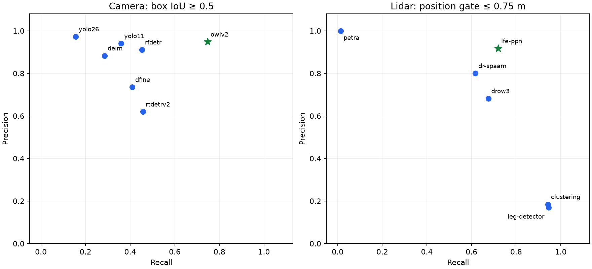
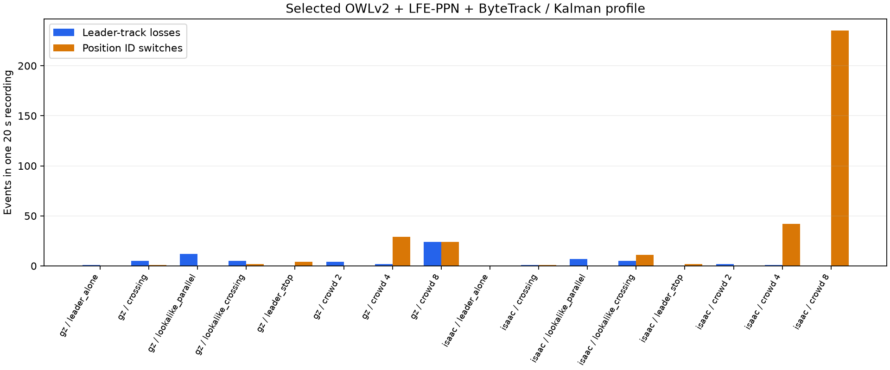

# F2 simulation candidate comparison

Recorded dates: 2026-11-02
Tested revisions: `4d29410dfbcdd1f53bd498d55d2e2d8734b2db69`
Provenance: partial

## Scope and provenance

This campaign tested the dirty `leader-following` checkout based on the revision
above, with uncommitted F1/F2 additions. It is not a result for that commit alone.
Per-scene source snapshots, per-detector source copies, raw bags, predictions,
receipts and scores are retained under `artifacts/leader-following/`. The final
source/dependency/model [manifest](assets/2026-11-02-f2-simulation/provenance.json)
and final [source bundle](assets/2026-11-02-f2-simulation/source.tar.gz) are also
preserved here; raw patches remain under `f2-provenance/` in the artifact root. Utility and
receipt changes occurred during the campaign; exact source attribution for all
early MOT/single-target runs is incomplete, so provenance remains partial.

The retained [candidate matrix](assets/2026-11-02-f2-simulation/results.json)
contains 320 scored runs: twenty methods on sixteen stationary-observer cases
(eight configurations in Gazebo and eight in Isaac). Each case has 400 evaluation
ticks over 20 seconds. All candidate methods within a case used the same bag.
The [selected fusion reports](assets/2026-11-02-f2-simulation/selected-fusion.json)
contain the sixteen combined-profile runs. The
[acceptance check](assets/2026-11-02-f2-simulation/acceptance.json) also records
actual ROS People publication from both simulators' recordings. Robot/Thor performance was explicitly
deferred; no physical robot or closed-loop following was tested.

One recording lacked the full latched static TF tree. It was replaced after
increasing recorder TF history and requiring sensor-to-odometry transforms at
readiness. The final corpus verifies RGB-D freshness/registration and sensor TF
at every tick. Earlier failed/incomplete runs and the rejected recording are
excluded from this matrix and retained separately.

## Protocol and limits

Camera variants use pretrained weights with no fine-tuning: YOLO11n, YOLO26n,
RT-DETRv2-R18, D-FINE-small-COCO, DEIM-D-FINE-small-COCO, RF-DETR-small and
OWLv2-base-patch16-ensemble. The standard camera confidence preset is 0.25;
OWLv2 uses its documented postprocessor default 0.1 and text `a person`.
An earlier OWLv2 0.25 diagnostic is excluded: that threshold suppressed almost
all detections and must not be interpreted as a model-family failure.

Lidar variants use JRDB annotated checkpoints for DROW3/DR-SPAAM, the published
LFE-PPN ONNX model, original PeTra bootstrapping graph, the ROS leg forest and
the in-repo cluster baseline. Each native scan is processed in its own frame,
then detections are transformed and merged. LFE uses its 0.937660 score threshold
and two CPU intra-op threads (one inter-op thread). DROW3/DR-SPAAM invalid
beams use the upstream ROS wrapper's 29.99 m padding. Final review on
2026-11-02 corrected an initial 10 m padding diagnostic; those earlier rows
are excluded from the accepted comparison. The leg forest uses its
upstream default threshold -1; earlier 0.1-threshold diagnostics are excluded.
PeTra uses the original occupancy encoding and leg pairing; modern TensorFlow
graph rewriting/oneDNN are disabled for compatibility. The forest port changes
obsolete OpenCV/TF headers and the comparator's missing `const` qualification.

Camera metrics use IoU >= 0.5 with clipped animated-mesh boxes. Visible fraction
is an in-image silhouette estimate: mesh z-buffering accounts for other people,
recorded depth accounts for nearer fixtures with 15 cm tolerance, and gait is
sampled at the asset frame rate. It is not exact renderer instance segmentation.
Stratified precision ignores predictions matched to other strata and retains
all unmatched false positives in each stratum; its FP counts are not additive.
Lidar precision/recall use a 0.75 m world-position gate, with separate range-band
and outside-camera coverage reports in the matrix. These are not detector AP.

MOT methods use identical YOLO11 detection boxes. HOTA is official TrackEval
bounding-box IoU HOTA over 0.05:0.05:0.95; IDF1 uses IoU 0.5. Table values are
macro averages across cases. Position diagnostics are scored separately. The
single-target methods use the same tiny SAM2.1 weights, SAMURAI mode off/on,
with one initial leader-box-derived pixel click and no subsequent truth input.
Coverage is matched leader coverage, not merely a nonempty output. Optional SAM
CUDA hole-filling postprocessing was unavailable in both modes. Recovery events
and unmatched leader frames remain in the retained results.

The scenes share one human mesh/texture and deterministic paths. There is one
recording per configuration, not ten independent repetitions. These results
support an F2 simulation implementation choice, not generalization to real
people or the later repeated closed-loop F4 evaluation. Input adapters receive
sensor data; the bag reader uses only truth time columns for scheduling, and
annotations remain in evaluation code. Single-target initialization is the
explicit exception: a frame-zero simulated operator click.

Timing ran on an RTX PRO 6000 Blackwell workstation, with concurrent benchmark
jobs. The table gives the median of per-case medians and the maximum per-case
p95; these are not pooled per-frame percentiles or robot/Thor latency. Camera/
lidar times include decoding, transforms and CV association; MOT timing is the
tracker alone, and SAM timing is propagation only. GPU figures are peak PyTorch
allocations, not total GPU/process memory; CPU methods allocate no GPU tensors.
Licenses below describe tested implementations; checkpoint terms remain with
their upstream distributions.

## Camera results

| Candidate | Cases | Box precision | Box recall | Median case ms | Worst case p95 ms | GPU MiB | License |
|---|---:|---:|---:|---:|---:|---:|---|
| yolo11 | 16 | 0.941 | 0.360 | 12.8 | 71.0 | 68 | AGPL-3.0 |
| yolo26 | 16 | 0.973 | 0.156 | 15.3 | 55.6 | 79 | AGPL-3.0 |
| rtdetrv2 | 16 | 0.620 | 0.457 | 34.9 | 132.7 | 208 | Apache-2.0 |
| dfine | 16 | 0.736 | 0.409 | 41.6 | 179.8 | 167 | Apache-2.0 |
| owlv2 | 16 | 0.948 | 0.747 | 133.8 | 252.7 | 780 | Apache-2.0 |
| rfdetr | 16 | 0.911 | 0.453 | 26.5 | 68.1 | 205 | Apache-2.0 |
| deim | 16 | 0.883 | 0.286 | 25.5 | 118.5 | 134 | Apache-2.0 |

## Lidar results

| Candidate | Cases | Position precision | Position recall | Median case ms | Worst case p95 ms | GPU MiB | License |
|---|---:|---:|---:|---:|---:|---:|---|
| clustering | 16 | 0.185 | 0.943 | 29.5 | 121.5 | 0 | BSD-3-Clause |
| drow3 | 16 | 0.682 | 0.675 | 22.4 | 33.9 | 1541 | GPL-3.0 |
| dr-spaam | 16 | 0.800 | 0.618 | 29.4 | 40.4 | 153 | GPL-3.0 |
| lfe-ppn | 16 | 0.917 | 0.720 | 1.8 | 3.4 | 0 | MIT |
| petra | 16 | 1.000 | 0.013 | 13.9 | 33.9 | 0 | LGPL-3.0 |
| leg-detector | 16 | 0.170 | 0.946 | 5.1 | 33.2 | 0 | BSD source headers; package license undeclared |

## Multi-person tracking results

| Candidate | Cases | Mean HOTA | Mean IDF1 | Position ID switches | Median case ms | Worst case p95 ms | License |
|---|---:|---:|---:|---:|---:|---:|---|
| bytetrack | 16 | 0.300 | 0.455 | 35 | 1.3 | 3.3 | AGPL-3.0 (BoxMOT implementation) |
| botsort | 16 | 0.297 | 0.423 | 37 | 9.7 | 97.4 | AGPL-3.0 (BoxMOT implementation) |
| ocsort | 16 | 0.190 | 0.292 | 18 | 1.4 | 14.1 | AGPL-3.0 (BoxMOT implementation) |
| deepocsort | 16 | 0.228 | 0.354 | 31 | 11.3 | 145.0 | AGPL-3.0 (BoxMOT implementation) |
| strongsort | 16 | 0.216 | 0.320 | 97 | 10.6 | 57.1 | AGPL-3.0 (BoxMOT implementation) |

## Single-target results

| Candidate | Cases | Leader coverage | Median case ms | Worst case p95 ms | GPU MiB | License |
|---|---:|---:|---:|---:|---:|---|
| sam2 | 16 | 0.607 | 38.0 | 124.0 | 850 | Apache-2.0 |
| samurai | 16 | 0.633 | 53.6 | 203.6 | 850 | Apache-2.0 |

## Selected combination and scenario results

OWLv2 had the strongest box precision/recall balance at its documented default
threshold; RF-DETR is the faster configurable alternative. LFE-PPN had the best
balanced lidar position score and small CPU cost. ByteTrack had the highest mean
HOTA/IDF1 among the tested default image trackers and low tracker cost. The
runtime uses the existing Ultralytics ByteTrack implementation; its combined
profile is evaluated separately below, rather than claiming parity with the
BoxMOT implementation used in the default comparison.

The chosen preset adapts ByteTrack's high/new thresholds to OWLv2's 0.1 score
scale, uses a 0.05 low threshold and disables confidence-weighted IoU matching;
otherwise correct 0.1-score boxes fail a 0.8 association gate even at perfect
spatial overlap. The buffer is 30 updates and matching threshold 0.8. This is
selected-tracker integration tuning, not a parameter search across all methods.
Camera IDs prefer compatible Kalman assignments but cannot bypass the 0.75 m
position gate. The physical filter uses 0.75 s track expiry and 1.5 m/s²
acceleration noise. Camera confirmation creates people; lidar only sustains or
refines confirmed tracks. Appearance remains empty pending F3.

| Backend/case | Leader-track losses | Position ID switches | Position precision | Position recall |
|---|---:|---:|---:|---:|
| gz-leader_alone-4 | 1 | 0 | 1.000 | 0.815 |
| gz-crossing-4 | 5 | 1 | 1.000 | 0.939 |
| gz-lookalike_parallel-4 | 12 | 0 | 1.000 | 0.931 |
| gz-lookalike_crossing-4 | 5 | 2 | 1.000 | 0.807 |
| gz-leader_stop-4 | 0 | 4 | 0.833 | 0.931 |
| gz-crowd-2-retry1 | 4 | 0 | 0.991 | 0.945 |
| gz-crowd-4-retry2 | 2 | 29 | 0.910 | 0.900 |
| gz-crowd-8-sensor-retry1 | 24 | 24 | 0.971 | 0.512 |
| isaac-leader_alone-4 | 0 | 0 | 1.000 | 0.985 |
| isaac-crossing-4 | 1 | 1 | 0.990 | 0.976 |
| isaac-lookalike_parallel-4 | 7 | 0 | 1.000 | 0.975 |
| isaac-lookalike_crossing-4 | 5 | 11 | 0.774 | 0.855 |
| isaac-leader_stop-4 | 0 | 2 | 0.962 | 0.974 |
| isaac-crowd-2 | 2 | 0 | 0.998 | 0.995 |
| isaac-crowd-4 | 1 | 42 | 0.883 | 0.990 |
| isaac-crowd-8 | 0 | 235 | 0.715 | 0.826 |

Dense crowds still produce substantial association errors, especially the
nine-person Isaac configuration. Completing F2 means the compared, runnable
tracking baseline and its reports exist; it does not mean perfect identity
continuity. F3 appearance/leader recognition and F4 closed-loop evaluation remain
open. No real-time hardware qualification follows from the offline scores.

The two panels use different matching definitions (box IoU versus world-position
gating); compare candidates within a panel only.

Losses and switches are retained even for the selected combination; the dense
crowd cases expose the remaining identity-continuity limitation.
