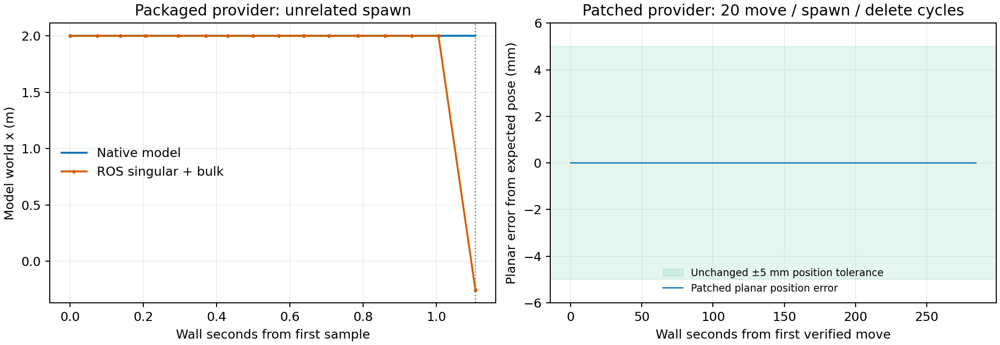

# Gazebo canonical-link state after scene additions

Recorded dates: 2026-11-02
Tested revisions: `3435eec20b894c3854ab3ff35497032f131fc806`
Provenance: partial

## Finding and decision

The maintained ros_gz scene-state correction fixes the demonstrated reporting
defect, but **the complete live acceptance is not passed**. The stationary
move/spawn stress and all selected scene checks passed. Two server shutdowns
segfaulted, another required escalation, controller activation was intermittent,
and raw robot poses were not exactly equal across scene orders. These results
must not be represented as background or lifecycle qualification.

All evidence paths below are relative to
`artifacts/benchmarks/gz_scene_state_patch_20261102/` in the tested checkout.
The root was dirty, including background Groups A–C and concurrent Isaac work.
`baseline_root/`, `baseline_ros_gz/`, and the other `baseline_<dependency>/`
directories preserve the starting revisions, complete diffs, status, index and
untracked inputs. `tested_inputs/` preserves another source/configuration snapshot
and object hashes before the order matrix. `delivery_inputs/` is explicitly a
later documentation/delivery snapshot. Provenance remains partial: the shared
worktree was not atomically frozen throughout the experiment, and the entire
host/package environment was not archived. The root SHA alone cannot recreate
these dirty-tree runs.

The deterministic real-proxy test confirmed the proposed mechanism: an unrelated
`scene/info` event caused the old initializer to replace already valid canonical
world pose and nonzero velocities with defaults, then send two `control/state`
writebacks. The old service converted the zero canonical-link world pose through
the link offset, yielding an incorrect model pose. This explains both an origin
report for an identity canonical offset and a non-origin wrong report for an
offset link. Physics need not refresh a stationary link immediately.

The chosen local correction creates missing reporting components on the
simulation thread, never writes mirrored state back to Gazebo, and rejects
unavailable fields. A server-side reset generation replaces the scene-message
reset heuristic. Reset reseeding and its first forced component publication are
needed because paused Physics may leave an already-correct seed marked unchanged;
otherwise the mirrored reset pose can remain stale. Component availability and
reset generation travel with the corresponding state. Ordinary additions preserve
existing valid fields and cannot satisfy a reset wait.

Official upstream was inspected on the recorded date. Jazzy
[commit c895cafe4436662109860b4fbc58bbfca53e83bd](https://github.com/gazebosim/ros_gz/commit/c895cafe4436662109860b4fbc58bbfca53e83bd)
addresses initializer locking but retains the destructive writeback.
[PR #950](https://github.com/gazebosim/ros_gz/pull/950) was a draft reset change
requiring a separate Gazebo backend correction. Saved `upstream_*` API responses
and diffs retain the inspected state. Neither supplied a complete compatible
backport, so the pins were preserved and this correction was maintained locally.

## Tested stack and loader proof

| Input | Recorded value |
|---|---|
| ros_gz source | `5912bfe7976a79d2cc9f373b2d40a8a3a3e33da2`, 1.0.24 |
| gz-sim source | `446a44335a45b704b4d36dabcc5508ee34eeb3d8`, 8.15.0 |
| Packaged ros_gz_sim | `1.0.24-1noble.20261006.035056` |
| Packaged gz-sim vendor | `0.0.13-1noble.20260905.073557` |
| Scene-state patch SHA-256 | `68db4e775db4d8d84b179dc2f004e71752c149b3b5ea57a2ea3bfd5fa31d12bf` |
| Loaded workspace server component SHA-256 | `3baab69862ed99c915d492d56bce4e13eb71eae95342fd1b7fbdfa9feb0e7a3f` |
| Full scenario SHA-256 | `618c6e52f070cdfb1735ebe9717b16d6ad4f8c40afbed18f622e1f64c67c0fc9` |
| Examples scenario SHA-256 | `6200a4d4ea2a94a121978f5e028dce74dfcd8c786852db8f63a6bc81f1f943c6` |
| Generated lab layout SHA-256 | `4d445c3cd472922cbf97a197c5b3401e13575847921f197a070cf08d7d24c967` |

`live_loader_proof.json` and `live_maps_<pid>.txt` show the owned server loading
`install/ros_gz_sim/lib/libgzserver_component.so`, the existing workspace
gz-sim core/Sensors patch, and NVIDIA rendering libraries. Bridge libraries and
image executables still resolve to the workspace overlays. Exact commands,
search paths and hashes are retained there and in `tested_inputs/metadata.json`.
`live_ogre2.log` identifies NVIDIA / RTX PRO 6000 Blackwell, driver 595.99.02.
The pre-existing bridge/image source diff remained byte-for-byte unchanged.

The correction is stacked after `ros_gz_bridge_shutdown.patch`. Only
`ros_gz_bridge ros_gz_image ros_gz_sim` are now built from ros_gz; only the
verified empty, untracked `ros_gz_sim/COLCON_IGNORE` was removed. Clean full
checkouts at the pin established application, read-only exact-diff verification,
idempotence, reverse/reapply, recovery of a missing later patch, and rejection of
unrecorded tracked changes. See `verify_stack.py`, `verify_stack_driver.log`,
`stack_final.log`, and `dependencies_final.log`. The checker migration test also
establishes that enabling a package requires explicitly removing its old marker
while retaining other exclusions.

## Before and after proof

`deterministic_before.log` fails against the packaged old proxy with overwritten
world fields and writebacks; the patched real-proxy test passes without
writebacks. Real-system tests cover repeated initialization, unavailable new
fields, preservation of offset pose/nonzero velocities, reset generations and
publication after Physics marks a seed unchanged.

`baseline_loader.log` fails the native/service launch regression after an
unrelated spawn: native model x remains 2 m while both services report
−0.254286107 m. `baseline_loader_maps.txt` proves that this baseline loaded the
packaged component. This run stops at the first failing post-spawn check; its
16 samples are not a long-duration baseline. The older hand-check evidence
under `artifacts/benchmarks/background_scenes/` remains separate and untouched.

The panels are different experiments: the left is the offset-link regression
with a fail-fast assertion; the right is the real Ridgeback stress run.
`plot_state.py` reproduces the figure from `baseline_loader_samples.jsonl` and
`stress_samples.jsonl`.

The isolated old-provider reset baseline tested DEFAULT/ALL in PLAYING/PAUSED
modes. All four requests returned success in 21–28 ms but subsequent service
x = −0.254286107 m disagreed with native x = 0. See
`baseline_reset_matrix.launch.json` and `baseline_reset_maps.txt`. An earlier
combined old-provider moving/reset attempt crashed; it is preserved in
`baseline_final.log` and is not substituted for the isolated reset baseline.
The final patched launch regression passes stationary additions/deletions,
moving-link velocity checks without teleporting that model, and all four reset
cases. Paused reset may be reported as STOPPED at iteration zero by the existing
statistics-based state service; that separate mode-reporting behavior was not
changed. `reset_final3.log` and `test_results_final.log` retain the final results:
297 tests, zero errors/failures, 57 skips. Twelve checker tests pass in
`checker_pytest.log`.

## Live placement and order results

Runs used `target_distance_calibration`, isolated ROS domains 77/80/81 and unique
Gazebo partitions, the packaged CycloneDDS configuration, and task-local
Clearpath generated files. Existing user/GPU sessions were preserved. No broad
cleanup ran against another session. `stress_probe.py`, `acceptance_runs.py`, and
`acceptance_glx_runs.py` retain exact commands and bounds.

The detector remained OWLv2 `google/owlv2-base-patch16-ensemble`, threshold 0.30,
label `humanoid robot`, 10 Hz. Captures used pointcloud only, camera 640×480,
settle 2 s and capture 3 s, no video/overlay. Stress, smoke and the first partial
order matrix used headless EGL rendering. The complete order matrix used GLX
(`headless_rendering:=false`, `gz_gui:=false`). Both changes from the historical
GUI-enabled runs are material configuration differences, not equivalent scoring
populations.

| Experiment | Result |
|---|---|
| Alternating 2.0/0.5 m stress, final y = 0.25 m and yaw = 0.4 rad | 20 cycles, 2,741 paired singular/bulk/native observations, zero disagreements |
| Stationary observation after spawning | At least 10 simulation seconds per cycle; 200.884 s total; no healing move during observation |
| Freshness bounds observed | Native age ≤0.112431 wall s; native/service stamp gap ≤0.118 simulation s |
| Maximum planar position/yaw errors | ROS 3.545e−14 m, native 1.116e−13 m; yaw zero, against unchanged 0.005 m / 0.002 rad limits |
| Move duration | 0.0371–0.5658 wall s; median 0.5472 s |
| Examples with / without props | 5/5 + 5/5 state checks pass; identical dx/command sequence `[4.35, 2.85, 1.10, 3.35, 3.35]` m |
| Complete GLX order matrix | Solo 13/13, file order 13/13, reverse 13/13 state checks pass; all six per-scene normalized hashes match |
| Earlier headless order matrix | 11/11 checks pass across four solo launches; stopped after lifecycle escalation |

The pinned full scenario explicitly overrides `single_facing_01` to eight
repetitions. Thus each complete six-scene arm has 13 trials despite the global
`repeats:=1`; these are scenario repetitions, not automatic retries. No state
failure was retried. Dropped-prop restoration matches the previous/current drop
sets in both orders, including the desk/bin restored before `multi_02` forward.
`acceptance_summary.json` records every trial, hash, restoration and control-arm
comparison; raw `runs/<name>/run.json` files remain authoritative.

**Exact raw robot-pose equality did not pass.** All scene x values match exactly.
The normalized hashes intentionally use planar state. Raw z spans
0.074835–0.0758996 m for `single_facing_01`, and 0.074843–0.0758996 m for
`interfere_behind_03`. Other selected scenes retain z = 0.0758996 m. All six
scenes have tiny yaw differences; maximum observed magnitude is 1.930e−16 rad.
The first two named scenes also have y differences up to 9.42138e−12 m.
Every distinct raw pose and coordinate range is retained in the summary. These
differences were reported without changing normalization or tolerances.

The measured TF mount chains use unprefixed frame IDs on namespaced TF topics.
Camera and LiDAR relative translations are (0.28035, −0.0115, 1.0345) m and
(0.3922, 0, 0.2264) m. `sensor_world_chains.json` composes each measured native
robot root with the full robot-relative TF chain, including the yaw case; these
are derived sensor world positions, not independent native sensor-pose samples.
The main stress launch's controller activation failed. The complete matrix's
solo `multi_02` and `far_beyond_01` logs do show both controllers activated and
their settled state checks passed without a pullback. This provides bounded
active-controller placement evidence, not an active-controller 20-cycle stress
qualification or camera-estimator parity.

## Lifecycle failures and remaining acceptance

`lifecycle_summary.json` enumerates every started child, reported exit and
escalation for every live environment and configurator log. The complete GLX
matrix has 27 children per environment. All configurator launches exit cleanly;
the environments were each stopped through a controlling PTY with one Ctrl-C
byte. Their parent launchers all return zero, despite these failures:

| GLX environment | Nonzero child exits |
|---|---|
| solo `single_facing_01` | controller spawner 1 |
| solo `multi_02` | None |
| solo `far_beyond_01` | None |
| solo `trap_layered_01` | controller spawner 1 |
| solo `chaos_01` | controller spawner 1; gzserver −11 after Ctrl-C |
| solo `interfere_behind_03` | controller spawner 1; gzserver −11 after Ctrl-C |
| forward | controller spawner 1 |
| reverse | controller spawner 1 |

All other children, including all bridge/image and detector children, report
clean exits in these eight runs. No GLX matrix run escalated. No owned processes
remain, and each post-configurator filtered and unfiltered `bench_` inventory
is empty with the robot returned home. Main stress/smoke shutdown also reports
clean children except its earlier spawner exit 1. The first headless matrix's
trap launch escalated through internal TERM/KILL, then the harness sent TERM
after its 45 s bound (parent −15); gzserver's own final exit is unreported.
Its owned process inventory is empty. These are failed lifecycle observations.

The spawner failure is a five-second controller-switch timeout. Two patched
launches and one bounded packaged-component baseline activated both controllers,
so these data do not establish its cause or show that it predates the patch.
`control_baseline2_*` proves the packaged component, preserved workspace Sensors,
activation and clean owned shutdown. Its optional `ros2 control` inventory
command was unavailable on this host. The first `control_baseline_*` attempt had
a defective test wrapper missing the `create` executable; its launch exception,
EKF/image aborts and detector TERM are harness-contaminated and excluded from
the comparison. No available server core establishes the two SIGSEGV causes.
They are retained as unattributed failures, not excused as pre-existing.

The reporting correction and bounded state results are reviewable. General
shutdown/controller repairs were not bundled into it. Lifecycle qualification,
exact raw pose equality, independently measured sensor-world poses, the original
camera-estimator bit comparisons, user visual review, and separate Isaac gates
remain incomplete. No full 88-scene scoring sweep or replacement gallery ran.
The separate persistent velocity-command behavior after `SetEntityState` was
not changed. No commit or publication was performed.

## Review scope

Task-owned root changes are `patches/ros_gz_scene_state.patch`,
`tools/check_dependencies`, the checker migration test, the dependency portions
of `README.md` and `docs/project/PROJECT_CONTEXT.md`,
`docs/project/dependencies.md`, this record/figure and archive-index entry, and
the plan's implementation status. Graphify was run as required;
its previous dirty versions were preserved in `graph_before_rebuild/`. The final
run's shrink guard refused to replace an existing 7,273-node `graph.json` with
the extracted 7,239-node graph, while regenerating the report/HTML. The existing
JSON was retained, no force override was used, and `graph_guard_preserved/`
preserves that output beside `graphify_final.log`. The generated outputs are
therefore not established as a mutually consistent final graph snapshot.
Other background/Isaac changes, including the separate README gallery section,
are preserved user/shared work and are not part of this dependency correction.

The new patch contains the complete nested `ros_gz_sim` diff: CMake integration,
server registration, `canonical_link_state.{cpp,hpp}`, proxy synchronization,
singular/shared state conversion, reset completion, and three regression files
(`test_canonical_link_state.cpp`, `test_gazebo_proxy.cpp`,
`test_scene_state.launch.py`). The earlier bridge/image patch remains separate.
The root change is unstaged; the new nested files use only the intent-to-add
metadata required by the dependency checker's exact-diff contract. Disposable
reverse/reapply was proved; the tested live overlay was retained for review.
