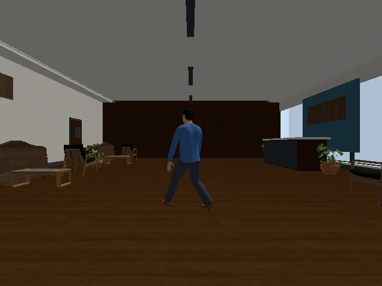
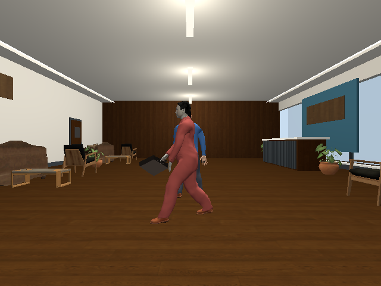
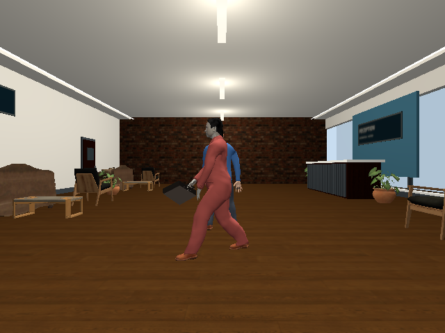
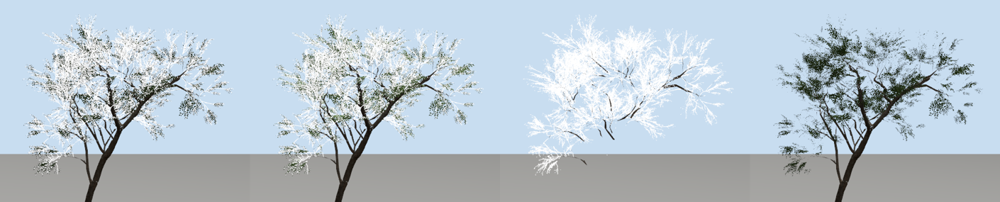
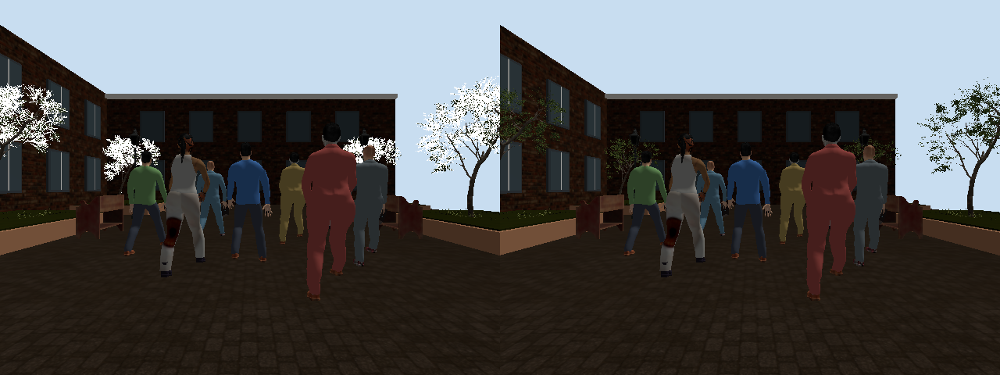

# Gazebo material resource isolation and scenario playback

Recorded dates: 2026-11-05
Tested revisions: `ff7df8b93a561a12c63720374cb8d9288a3dd905`
Provenance: partial

## Visual defect and controlled comparison

A full office run from the clean base revision passed the scene/sensor gates
but showed a wood-textured end wall where brick was specified, unreadable sign
textures and dark ceiling fixtures. Structural sensor checks alone could not
identify this rendering defect.

Namespacing Collada identifiers and adding indoor point lights/emissive
fixtures improved illumination but did not correct the wall texture.

The source architecture maps all used generic basenames such as `Diffuse.jpg`.
Exporting per-run copies named after the surface and channel corrected the
camera image, consistent with shared texture resource-name collisions in the
renderer. Material IDs remain namespaced as a separate precaution. Both
Collada references and SDF PBR maps use the unique copies; source pixels are
unchanged. This is scoped to architectural fixture maps.

These images are consecutive experiments, not identical frame-aligned
comparisons: the first shows the alone scenario, and the latter two show
crossing at the six-second sample. The observer and office layout are shared.
Gazebo shading still differs from Isaac and is not photographic realism.

The final dirty-tree patch and source snapshot are linked at the end of this
record; they also contain the later tree fix. A complete simulator/driver and
dependency environment is not preserved, so provenance remains partial.

## Playback method and limits

The [campaign script](assets/2026-11-05-gazebo-material-isolation/campaign.py)
runs all six 20-second scenario families in both backends, distributed over
three worlds: office alone/crossing, warehouse parallel/crossing look-alikes,
and courtyard stop/crowd. The crowd has eight bystanders plus its leader.
Private ROS domains 213 and 214 isolate the backends. This is twelve cases,
not the complete world-by-scenario-by-crowd-size matrix. The runner does not
record sensor bags or run detection/recognition inference in this campaign.
Each case retains camera samples, calibration, sensor health, scripted routes,
simulator-observed truth and rendering inputs in the local artifact root
`artifacts/leader-following/realistic-full-playback-r2/`.

The original campaign was interrupted after two completed office cases to
correct the visual defect; its warehouse case is not counted as completed.
The corrected population uses a separate root and reruns the office cases.
Regression tests cover unique texture basenames, valid local Collada
references and illuminated fixtures.

All twelve cases passed the scene/sensor gates in the
[playback summary](assets/2026-11-05-gazebo-material-isolation/playback-summary.json).
[Manifest receipts](assets/2026-11-05-gazebo-material-isolation/run-receipts.json)
preserve routes, cast, duration and input hashes. Their maximum pose error was
below 0.005 metres/radians, the qualifier tolerance. These results do not
measure leader recognition or establish pixel-level correctness: subsequent
camera inspection exposed white Gazebo tree foliage despite passing gates.
Sample Gazebo frames from this population: the
[courtyard crowd](assets/2026-11-05-gazebo-material-isolation/gz-courtyard-crowd-8.png)
with white foliage and the
[warehouse swap](assets/2026-11-05-gazebo-material-isolation/gz-warehouse-lookalike_crossing-8.png).

## White tree foliage diagnosis

The twelve-case population above used a tree export that Gazebo rendered with
white-looking foliage. A first diagnostic population (tree DAE copies using
absolute image paths, ambient/specular controls, a flat-colour diffuse or a
simplified compound image identifier) appeared to remove the white. That
interpretation was wrong: the flat-colour and simplified-identifier copies were
rewritten with prefixed `ns0:` Collada tags, and their camera frames contain no
tree at all, trunks included. The identifier normalization committed in the
dirty tree was therefore unsupported, and the first final courtyard rerun
(tree `model.dae` `99aeff77…`) still showed white foliage.

A standalone Gazebo camera [harness](assets/2026-11-05-gazebo-material-isolation/gzshot.py)
renders one mesh with saved frames; the sensor renders only while an image
subscriber exists, so the harness starts one. Isolated renders, left to right:
the exported tree; the leaves with a flat green diffuse colour; only the branch
triangles; the export without its `<lines>` primitive.

White strokes persisted with flat-coloured leaves, with leaves alone and with
branches alone, so neither texture lookup nor leaf shading caused them. The
export carried 87,895 loose source edges as a Collada `<lines>` primitive; Gazebo
draws it as unlit white lines, while the Isaac vertex cache uses faces only.
Removing that primitive restored green foliage. The converter now deletes
`<lines>`/`<linestrips>` from static exports and records the count in
`conversion.json`; the identifier normalization was removed. Reconversion
reproduced the previous mesh cache exactly (`mesh.npz` `49f5fd17…`), so Isaac
renders of the tree are unaffected; the new `model.dae` is `9e906b47…`.

## Final courtyard reruns

Both affected Gazebo courtyard cases (stop with four people, crowd with eight
bystanders) passed the scene/sensor gates twice: once with the unsupported
identifier export and once with the loose-edge removal. Their maximum pose
error was zero; [receipts](assets/2026-11-05-gazebo-material-isolation/courtyard-final-summary.json)
record each run's tree hashes. Robot-camera frames at six seconds, before and
after removing the lines primitive:

The Isaac courtyard preview rendered after the reconversion used the same mesh
cache and showed green foliage. The twelve-case population predates both tree
exports, and no Isaac playback case was rerun for this asset change. These
remain scene/sensor checks, not recognition results.

The working-tree changes relative to the base revision are preserved as a
[patch](assets/2026-11-05-gazebo-material-isolation/source.patch) and
[source snapshot](assets/2026-11-05-gazebo-material-isolation/source.tar.gz),
with [test output](assets/2026-11-05-gazebo-material-isolation/tests.log)
(127 passed, 2 skipped). The tree asset is committed in the same change.
