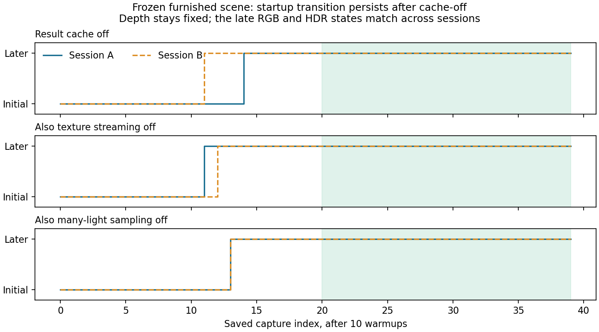

# Isaac cache policy and residual rendering probes

Recorded dates: 2026-11-05
Tested revisions: `cc86eef5a5c708be2a31aac64db29a91225f4023`
Provenance: partial

## Implemented policy and proof

Following the [cache investigation](2026-11-05-isaac-render-cache-diagnosis.md),
the dirty-tree runner disabled the PathTracing result cache only for
`sim_mode=deterministic` with `renderer=PathTracing`. It preserved many-light
sampling and existing realtime/other-renderer settings. Non-DLSS AA requests
in that combination cleared `limitedOps`, preventing silent DLSS restoration.
The CLI help stopped promising byte-identical sensor data.

Fifteen focused policy/affinity tests passed. A fresh instrumented copy of the
production main completed both furnished scenes in stereo and monocular
conditions with exit 0. All 510 settings snapshots recorded result cache off,
many-light on, global AA 0 and render-product AA `none`. No estimator or timed
capture semantics changed; the eight-condition campaign was not started.

Evidence is workstation-local under
`artifacts/benchmarks/isaac_residual_20261105T182114Z/`. The bundle preserves the
base revision, workspace patch, current production runner snapshot, script
versions/hashes, sweeps, USD snapshots, native RGB/depth/HDR arrays, settings,
state records, diagnostics and process results. Provenance is partial because
the complete binary/dependency environment was not locked. Ignored evidence
and uncommitted source changes are not transported by a documentation commit.
Runtime VERSION was `6.1.0-rc.26+release.49347.2d230af4.gl`.

## Sample shortfall and missing depth

The new run captured 82 and 88 stereo batches, then 90 and 91 monocular batches
against a 100-batch request in each 10-second wall-time window. The detector's
10 FPS setting was an upper rate limit. The sampled-window implementation
correctly retained its fixed deadline instead of extending it to fill a quota.

Five first-scene monocular samples lacked both depth and live measurements.
Depth Anything's lazy initialization coincided with a 2821.264 ms measurement
worker and 21 pending-detection replacements. The earlier cache-off run had a
2790.699 ms worker, 23 replacements and six similarly missing samples. The
latest-pending-message policy intentionally replaces queued work while a
worker is busy. A drain cannot recover detections never processed.

These gaps were not numerical mismatches between depth predictions. Existing
readiness could observe empty measurements before a useful target triggered
lazy model loading. An eventual readiness change should require a real
depth-bearing target measurement before the timed window; changing that
protocol was outside this patch.

## Frozen furnished scenes

Two live furnished scenes were exported. The replay probes retained authored
camera/optics and scene content, removed captured executable graphs/render
products before opening a prepared USD, disabled physics, held time at zero,
and used explicit Replicator wait-for-render capture. They captured uint8 RGB,
float32 depth and float16 HDR at 640x480, 64 spp, after ten warmups.

| Static control | Scene | Exact RGB/HDR pairs | Within-session RGB states |
|---|---|---:|---:|
| Result cache off | interfere_control_01 | 37/40 | 2 |
| Result cache off | chaos_03 | 40/40 | 2 |
| Also texture streaming off | interfere_control_01 | 39/40 | 2 |
| Also texture streaming off | chaos_03 | 40/40 | 2 |
| Also many-light sampling off | interfere_control_01 | 40/40 | 2 |
| Also many-light sampling off | chaos_03 | 39/40 | 2 |

Every geometric-depth pair matched. All variants matched the final twenty
RGB/HDR captures in both scenes. The cache-off interfere pair switched between
two shared states at saved indices 14 versus 11; chaos switched at 10 versus
10. HDR changed as well as RGB, so this transition was not solely an 8-bit
encoding effect. Explicit synchronous material loading repeated a setting
already true in the measured default and did not remove the transition.

Each subplot indexes that configuration's initial/later image state; states
are not assumed to have identical pixels across configurations. Green shading
marks the final twenty captures. Regenerate with `plot_startup.py` in the
workstation evidence bundle.

## Physics control and unresolved live residual

Normal-physics and held-pose snapshot probes each matched RGB/depth/HDR in
100/100 paired captures. Normal joint fluctuations were reproducible at about
2.4e-10 m/rad. Holding the pose showed no improvement in these lighter probes;
they did not reproduce the original full-workload pixel mismatch and cannot
exclude physics or acceleration-structure updates in that workload.

The new instrumented live run still had changing stereo RGB: one green-channel
pixel/one level in chaos, and a transient involving fifteen pixels/up to seven
levels in interfere. Instrumentation and USD export can affect timing; this
single session was not a fresh acceptance pair. Do not equate the snapshot
startup transition with the earlier one-pixel live residual or claim an
improvement factor across these different workloads.

Three setup attempts were stopped or rejected before valid evidence: a wrong
scene selector, deletion of the active viewport render scope, and captured
Orchestrator graphs preventing new capture scheduling. They remain labeled
and excluded. Corrected probes required complete manifests, native nonblank
outputs and the intended time/AA/settings invariants.

Renderer startup/phase state remains a supported investigation route. The exact
internal cause of the final live pixel differences was not established; neither
texture streaming off nor many-light sampling off was a demonstrated cure.
Those extra settings were not applied to production. Strict live image
identity remains unqualified, with no tolerance relaxation.
