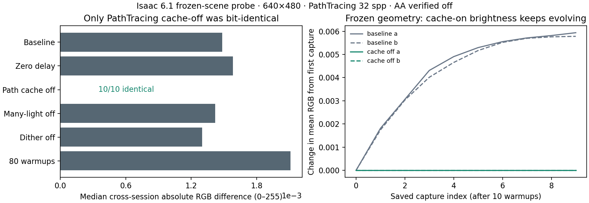

# Isaac render cache and frame-freshness diagnosis

Recorded dates: 2026-11-05
Tested revisions: `cc86eef5a5c708be2a31aac64db29a91225f4023`
Provenance: partial

## Finding

PathTracing's result cache was a major contributor to independent-session RGB
variation. Disabling `/rtx/pathtracing/cached/enabled` removed the residual in
the isolated frozen scene and substantially improved the furnished pipeline.
It did **not** establish strict full-pipeline image identity. Disabling the
many-light cache as well did not resolve the final one-level RGB differences.
No production source, defaults, estimator settings, or acceptance criteria were
changed; the eight-condition campaign was not started.

The workstation-local evidence bundle is
`artifacts/benchmarks/isaac_render_diagnosis_20261105T174316Z/`.
It preserves raw NPZ captures, six full-session sweeps, effective settings,
camera/rig snapshots for the final pair, process results, experiment scripts,
starting workspace patch, runtime version, GPU information, and comparison
scripts. These ignored artifacts are not transported by a documentation commit.
Provenance is partial because the complete dependency/binary environment was
not locked and the first frozen baseline's source snapshot was reconstructed
from the known script edits rather than hashed at process start.

## Frozen-scene experiment

Twelve fresh GUI-enabled Isaac processes compared six recipes in pairs. Runtime
VERSION was `6.1.0-rc.26+release.49347.2d230af4.gl`; GPU was an RTX PRO 6000
Blackwell with driver 595.99.02. The fixed benchmark room and G1 were rendered
at 640×480 with PathTracing, 32 spp and 32 total spp, verified AA off, denoiser
and adaptive sampling off, and paused timeline. Each capture used Replicator's
wait-for-render path. Ten warmups preceded ten saved captures, except for the
80-warmup control.

| Recipe | Identical RGB pairs | Identical geometric-depth pairs |
|---|---:|---:|
| Cache-on control | 0/10 | 10/10 |
| Zero-delay experience | 0/10 | 10/10 |
| PathTracing result cache off | 10/10 | 10/10 |
| Only many-light cache off | 0/10 | 10/10 |
| Dither explicitly zero | 0/10 | 10/10 |
| 80 warmups | 0/10 | 10/10 |

Both caches initially read true; dither already read zero and histogram/auto
exposure was disabled. The dither run therefore repeated an existing setting.
All non-identical frozen comparisons differed by at most one 8-bit level.
Result-cache-off produced one RGB hash per session, shared across sessions.

The figure shows cross-session error and within-session brightness evolution.
Regenerate it with `plot_frozen.py` in the evidence bundle. Cache-off changed
image content: the first frozen cache-on versus cache-off images differed by
1.23514 levels mean absolute RGB error, maximum 40. Repeatability improvement
must not be described as unchanged rendering or used to mix old and new inputs.

## Frame freshness

A separate probe used fixed 1/30 s `app.update()` steps and
OnPlaybackTick → ROS2CameraHelper publication on isolated ROS domain 131.
Target poses changed before ticks 48, 64, and 80. Direct annotator depth and
ROS depth first showed the new poses at ticks 49, 65, and 81 in both default
and zero-delay experiences. Headers aligned with those delayed states within
2 ns of the corresponding simulation tick. Zero-delay did not eliminate the
one-update lag under this mutation ordering; this does not measure the full
furnished pipeline's latency.

An initial setup attempt disabled playback capture and failed on blank
annotator output. It exited 1 and is excluded. The corrected two runs enabled
playback capture and exited 0; failed inputs and outputs remain preserved.

## Furnished pipeline

Six fresh sessions tested `interfere_control_01` and `chaos_03` with lab props,
OWLv2, stereo and Depth Anything monocular conditions, PathTracing at 64 spp,
640×480, GUI, fixed-step simulation, ideal stereo depth and LiDAR noise retained.
Both controls and candidates disabled AA limitedOps at startup and verified
global AA 0 and render-product AA `none` during execution. These are verified-AA
off controls, not untouched production launches. All six sessions exited 0.

| Configuration | Stereo RGB | Monocular RGB | Geometric depth | Present monocular depth |
|---|---:|---:|---:|---:|
| Cache-on control | 0/111 | 0/81 | 108/111 | 0/80 |
| Result cache off | 112/115 | 118/118 | 115/115 | 112/112 |
| Both caches off | 96/119 | 145/145 | 118/119 | 141/141 |

Counts are exact equalities among absolute-simulation-timestamp matched pairs
within each trial. Absolute stamps do not establish equal time since placement
for cache-on images. The comparator retains trial and instance identities.
Missing depth is reported separately from numerical inequality: the result-cache
off pair had six one-sided missing monocular frames; the both-caches-off pair
had two one-sided missing and two both-missing monocular frames.

With only the result cache off, the three RGB mismatches each affected one
channel at pixel `(row 275, column 312)`. With both caches off, the 23 RGB
mismatches each affected the red channel at `(row 395, column 63)` in
`chaos_03`; both sessions shared the same two complete image hashes, but
flip-flopped between them at different ticks. Every residual RGB mismatch was
one level. Disabling the additional cache was therefore not a demonstrated
improvement. The one remaining geometric-depth mismatch was sub-micrometre.

The final pair shared identical sets of sampled camera view and projection
matrices. Tiny rig-joint fluctuations were recorded, but those observations do
not identify the cause of the residual image differences. Do not attribute
these pixels conclusively to PhysX, GPU scheduling, or a random seed.

For both cache-off recipes, projective and Euclidean trial estimates were
identical wherever scored; outcomes remained matched, including gate misses.
Polar still differed, by up to 7.1614 mm in the final stereo pair, with
intentionally noisy LiDAR. This does not establish deterministic LiDAR or
strict renderer identity. The 100-batch requests were incompletely fulfilled
in some trials; no capture window was extended.

## Consequence

The result cache is an experimentally supported cause of the dominant RGB
history effect. More warmup, zero-delay mode, and disabling many-light sampling
alone were not cures in the frozen experiment. Cache-off is a useful candidate
for future controlled capture, not a completed live-determinism fix.

Strict live bit identity remains unqualified. Further work should control the
scene-application/capture boundary and record actual render inputs around the
remaining pixel transitions before choosing another renderer change. A fixed
recorded dataset can give estimators identical inputs for offline comparison;
that is a separate benchmark design choice, not evidence that live Isaac is
bit-identical. Repeated images test stability; neither frame count nor distinct
image count proves statistical independence.
