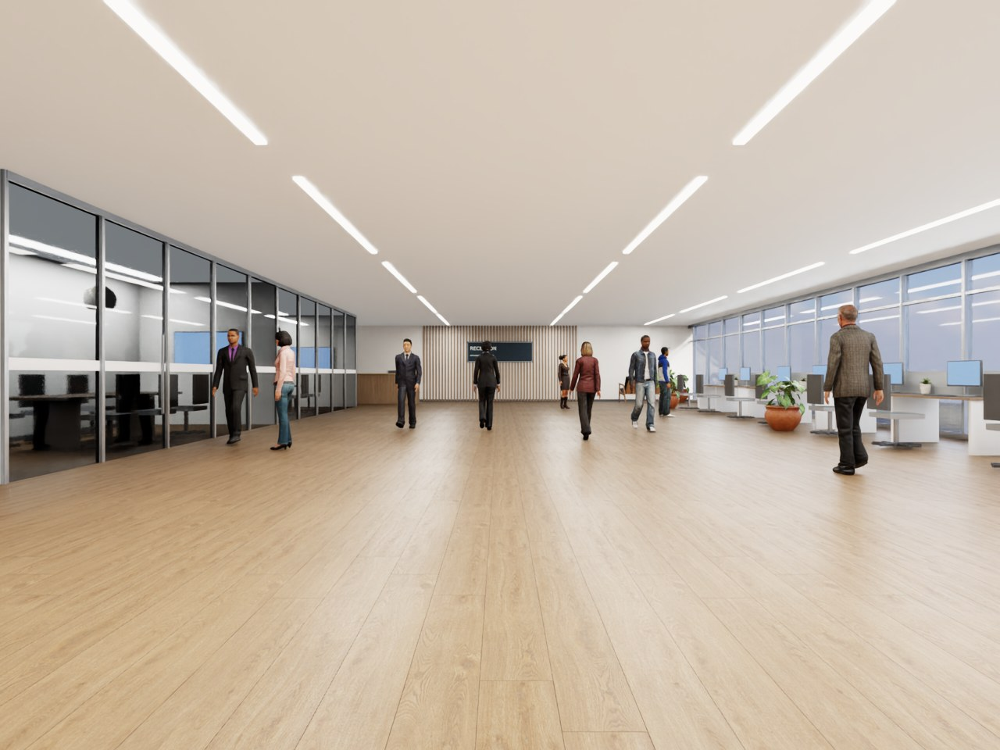
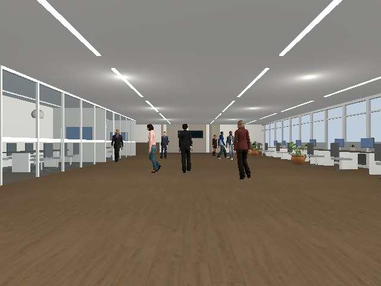

# Modern office and Rocketbox pedestrians

Recorded dates: 2026-11-05
Tested revisions: `eeacb3d6f03002a9b504e10490153edddaba4111`
Provenance: partial

## Goal and scope

The realistic profile's lobby, warehouse and courtyard used four repeated
source characters walking at 0.2-0.5 m/s, and standing people froze mid-stride.
This record covers the replacement visual population: one modern open-plan
office as the default world, fourteen distinct Microsoft Rocketbox (MIT)
characters with retargeted walk and idle motion, and natural-pace routes for
the six scenario families. It is evidence of rendering and scene/sensor
playback only. No detector, tracker or recognition model was run.

## Character selection and licensing

Microsoft Rocketbox was chosen because it is MIT-licensed (redistributable in
this repository with attribution), ships about 115 rigged adults with detailed
faces, hair and clothing, and includes motion-capture walk and idle clips on
the same Biped skeleton. Poly Haven has no modern task chairs, desks or
monitors; those, the glazing and the sofa are procedural geometry with Poly
Haven surfaces. Fourteen characters were selected from the publisher previews
for variety of age, skin tone, build and outfit.

Source files are pinned to publisher commit
`0943055db6ec570bcef9f2c8b41c9e5467c808f9`; hashes are in the committed
`rocketbox/sources.json` and per-character `conversion.json` receipts.

## Retargeting findings

Each finding below was observed in an actual render before it was fixed:

- Applying a clip's local bone rotations to an avatar left arms in the T-pose,
  because clip and avatar rest poses differ. Copying world bone orientations
  onto the avatar's own bone offsets fixed it.
- Gazebo exploded the skins while the armature node carried the FBX 0.01 scale
  and rotation. Baking the object transform into the rest pose fixed it.
- With the facing turn keyed into the pelvis, Gazebo actors kept the rest
  orientation and walked sideways. Moving the turn onto the unscaled armature
  node, as in the earlier working skins, fixed it.
- Grounding sampled every third frame left soles 1.6 mm below the floor;
  every frame is now sampled.
- Four unweighted jewellery vertices on one character stayed behind once
  object motion moved into the bones; they now inherit neighbour weights.
- Identical look-alikes walked in lock-step; deterministic per-person gait and
  idle phase offsets now desynchronize them in both simulators.

## Playback results

At the tested revision, all six scenario families ran for 20 s in both
Gazebo and Isaac in `modern_office` (crowd with eight bystanders, stop with
three standing people): twelve of twelve cases passed the scene/sensor gates,
with maximum observed-versus-commanded pose error 1.3e-7 m/rad. See the
[playback summary](assets/2026-11-05-modern-office-rocketbox/playback-summary.json).
Two earlier attempts at the same campaign are not counted: one swap route
started outside the qualifier's front-lidar gate (route moved, test added) and
one stopped on a stale install symlink to a removed texture.

## Limits and provenance

These are renders and scene/sensor checks, not recognition results, and not
photographic realism: meshes are 7,000-10,000 triangles, faces and hands do
not animate, clothing is rigid, walk/idle switches are instantaneous and
pedestrians do not react. Gazebo shading is visibly simpler than Isaac's.
Only the modern office was played back; earlier worlds now use the new cast
without a new playback population. Run output stays in the ignored artifact
root `artifacts/leader-following/modern-office-playback-final/`; the
simulator/driver environment is not preserved, so provenance is partial.
Intermediate WIP commits of this work were pushed by another process during
the session; the tested revision above is the completed state.
