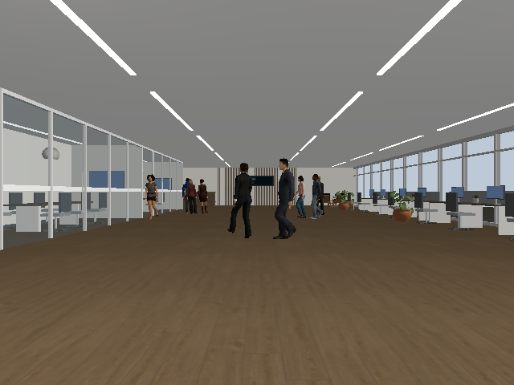
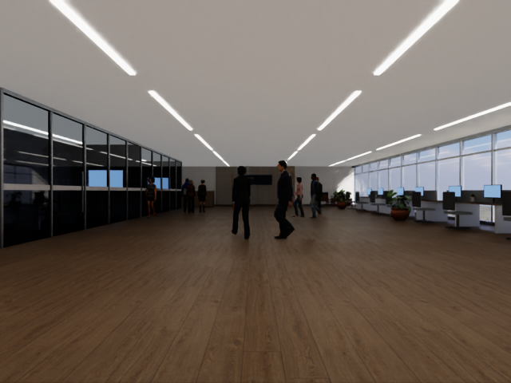

# Direct viewport measurements and reduced-lighting comparison

Recorded dates: 2026-11-11
Tested revisions: `8eb3c81ecec238af7206a2250b4e8193fe969856`
Provenance: partial

The tested checkout was dirty. The evidence bundle preserves the working-tree
patch, Python source snapshots from each successful run, manifests, measurement
script, Gazebo meter source, raw event times and camera images. Simulator binaries,
driver binaries, full asset contents and concurrent host load are not bundled;
these measurements do not establish exact reproducibility on another machine.

## Method and scope

One simulator at a time ran the modern-office realistic profile and the first
8 simulation seconds of the eleven-person explainer scenario. All robot sensors
remained enabled at their existing settings. Gazebo used the existing `gpu-run`
NVIDIA OpenGL route. No claim is made about remote desktop delivery FPS.

Gazebo's small GUI plugin recorded `gz::gui::events::Render` notifications,
which occur after the user camera renders. Isaac recorded active viewport
`subscribe_to_frame_change` callbacks. The script counted events against monotonic
wall time, from the first observed ground-truth sample plus two wall seconds
until the last observed sample. RGB figures count actual received ROS callbacks
in the same window. No rate was derived from simulation Hz times real-time factor.

Both measurements use the normal GUI window, but exact viewport dimensions and
remote streaming rate were not recorded. Single short trials cannot establish
small differences or sustained throughput across all scenarios. Sensor callbacks
can be dropped or delayed; their rate is not an independent camera renderer count.

## Results

| Backend / mode | Render callbacks | Wall window (s) | Viewport FPS | RGB received FPS |
|---|---:|---:|---:|---:|
| Gazebo reference, r2 | 150 | 7.100 | 21.13 | 26.48 |
| Gazebo reduced lighting, r3 | 137 | 7.119 | 19.24 | 26.27 |
| Isaac reference, r3 | 206 | 13.416 | 15.35 | 15.43 |
| Isaac reduced lighting, original 30 Hz loop, r5 | 206 | 13.280 | 15.51 | 15.59 |
| Isaac reduced lighting, attempted 60 Hz loop, r3 | 438 | 22.318 | 19.62 | 9.86 |
| Isaac 60 Hz plus DLSS Performance, r4 | 438 | 22.748 | 19.25 | 9.67 |

Reducing lighting did not demonstrate a useful improvement. The 60 Hz variants
increased render throughput modestly while taking longer to play the same
scenario and lowering received camera throughput. Both the 60 Hz change and
DLSS override were removed. The reference renderer remains the default; the
lighting-only option is retained for controlled comparisons. **50 FPS was not
achieved.** These trials do not isolate the dominant remaining bottleneck.

The first Gazebo meter attempt used an incorrect QML resource path and has no
viewport result. Gazebo performance r2 crashed in transport discovery before
loading the meter; its apparent zero viewport FPS is invalid and excluded.
A retry completed. The source of that transport crash was not established.

## Evidence

- [Measurement source](assets/2026-11-11-lighting-performance/measure.py) and
  [Gazebo render-event meter](assets/2026-11-11-lighting-performance/meter/DirectFps.cc).
- [Reference Gazebo event times](assets/2026-11-11-lighting-performance/gz-reference-measurement.json)
  and [reduced-lighting Gazebo event times](assets/2026-11-11-lighting-performance/gz-performance-measurement.json).
- [Reference Isaac event times](assets/2026-11-11-lighting-performance/isaac-reference-measurement.json)
  and [final lighting-only Isaac event times](assets/2026-11-11-lighting-performance/isaac-performance-measurement.json).
- [60 Hz Isaac trial](assets/2026-11-11-lighting-performance/isaac-performance-r3-measurement.json)
  and [60 Hz DLSS trial](assets/2026-11-11-lighting-performance/isaac-performance-r4-measurement.json).
- [Run source snapshots and manifests](assets/2026-11-11-lighting-performance/run-sources.zip),
  [dirty-tree patch](assets/2026-11-11-lighting-performance/working-tree.patch),
  and [evidence hashes](assets/2026-11-11-lighting-performance/sha256.json).

The office, furniture and people remain visible with reduced lighting. Lighting
changes alter recognition inputs and require separate qualification.

The reduced-lighting interior is darker than reference lighting; this comparison
is not evidence of a visual-quality improvement.

Full local evidence remains under `artifacts/leader-following/lighting-performance/`.
