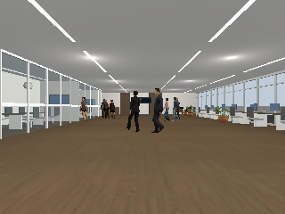
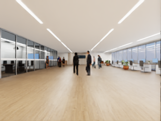

# Human LOD, sensor and collision performance checks

Recorded dates: 2026-11-11
Tested revisions: `8eb3c81ecec238af7206a2250b4e8193fe969856`
Provenance: partial

The checkout was dirty. Preserved Python run-source snapshots, manifests,
measurements, the final dirty-tree patch and LOD receipts describe the experiment.
The final patch includes later documentation and deduplication changes and is
not an exact patch for every run. The shared Isaac sensor override source was
not copied into the early run snapshots; the final patch preserves it. External
binaries, exact concurrent host load and all asset bytes are not bundled here.

## Tested changes

Fourteen Rocketbox derivatives were baked with Blender 4.2.9 at a 0.5 triangle
ratio, retaining skeletons, walk/idle clips and original shared textures. Distant
selection covered the entire route relative to the fixed robot and initial
Isaac observer, excluded leader/look-alike, and selected six of eleven people
in the explainer scene. Original files were retained. Bounds, floor, UV/index,
texture identity and gait checks covered all derivatives.

The balanced profile combined these LODs, primitive furniture/prop colliders,
320×240 RGB/aligned depth at 15 simulation Hz, and disabled unused camera point
cloud publication. Reference lighting remained enabled. Isaac retained its
30 Hz loop. These trials did not isolate each option's independent contribution.

## Direct measurements

Each recorded trial ran the first eight simulation seconds of the modern-office
explainer scenario, one simulator at a time, with eleven people. Gazebo used
NVIDIA OpenGL via the existing GPU launcher. Actual viewport render callbacks
and received ROS RGB callbacks were counted over monotonic wall time, excluding
the first two wall seconds after ground truth began. These are not RDP delivery
rates. Recording adds work, and the short single trials are not sustained-FPS
qualifications or directly comparable to unrecorded earlier trials.

| Backend / recorded run | Viewport callbacks | Window (s) | Viewport FPS | RGB received FPS |
|---|---:|---:|---:|---:|
| Gazebo reference r3 | 101 | 7.404 | 13.64 | 25.53 |
| Gazebo balanced r2 | 186 | 6.475 | 28.73 | 14.21 |
| Isaac reference r3 | 208 | 14.469 | 14.38 | 14.44 |
| Isaac balanced r3 | 206 | 13.430 | 15.34 | 7.74 |

Gazebo balanced r1 had a transport-discovery GUI crash; its zero viewport count
was invalid. The runner was subsequently changed to reject GUI exits rather
than silently completing a server-only run. Isaac balanced r2 exposed a NumPy
scalar / USD vector conversion error, corrected before the successful r3.

Isaac reference's timed `app.update` calls had a median 53.6 ms wall duration
and 38.4 ms main-thread CPU time. All Python animation calls summed to about
0.68 seconds, including initialization. One GPU sample while running showed
31% utilization. These observations do not isolate all update costs, prove a
specific synchronization fault, or establish the GPU's sustained utilization.
**50 FPS was not achieved.**

## Tracker checks and limitations

Recorded RGB-D/TF data was replayed through the existing YOLO11 camera adapter
and constant-velocity association, scored with a 0.75 m world-position gate.
This metric counts all ground-truth people, including those not visible; it is
not visibility-qualified detector recall, AP, HOTA or identity qualification.

| Backend / mode | Position recall | Precision | ID switches | Leader loss events |
|---|---:|---:|---:|---:|
| Gazebo reference | 0.5750 | 0.9583 | 37 | 1 |
| Gazebo balanced | 0.5125 | 0.9545 | 39 | 1 |
| Isaac reference | 0.4676 | 0.9216 | 33 | 1 |
| Isaac balanced | 0.4420 | 0.9078 | 42 | 1 |

The actual ROS tracker also published valid nonempty `People` messages on both
balanced bags: Gazebo 111/114 messages, Isaac 115/116. This establishes pipeline
operation, not acceptance of the reduced sensor quality. Reference remains the
default. All four runs passed trajectory/sensor validation. A subsequent full
24-second unrecorded Isaac GUI run passed with 5,280 truth rows and maximum
pose error 1.33e-7; its viewport FPS was not instrumented.

The combined host test run had 220 passes, 24 skips and one failure: the existing
G1 scene-control test expected z=0, while the committed asset catalog specified
`spawn_z_m: 0.05`. Neither that catalog nor test was changed. Initial sandbox
attempts also failed to create ROS logs; the host retry used workspace log paths.
The added performance tests and marker decoder tests passed.

## Remote delivery

The server marker completed a three-second smoke test, and the client decoder
passed known-ID, partial-update and missing-marker tests. No connected browser
was available to the agent. The user agreed to run the browser-side probe, but
no client result had arrived when this record was written. There is therefore
**no measured RDP delivery result**. The independent marker measures delivery
capacity for marker updates, not the number of complete simulator frames that
arrived; comparison with viewport FPS must retain that limitation.

## Evidence

- [Measurements and source snapshot bundle](assets/2026-11-11-runtime-performance/run-sources.zip),
  [dirty-tree patch](assets/2026-11-11-runtime-performance/working-tree.patch), and
  [hashes](assets/2026-11-11-runtime-performance/sha256.json).
- [Measurement script](assets/2026-11-11-runtime-performance/measure.py),
  [tracking comparison](assets/2026-11-11-runtime-performance/tracking-comparison.json),
  [Gazebo ROS publication](assets/2026-11-11-runtime-performance/node-gz-balanced.json),
  and [Isaac ROS publication](assets/2026-11-11-runtime-performance/node-isaac-balanced.json).
- [Gazebo reference](assets/2026-11-11-runtime-performance/gz-reference-measurement.json),
  [Gazebo balanced](assets/2026-11-11-runtime-performance/gz-balanced-measurement.json),
  [Isaac reference](assets/2026-11-11-runtime-performance/isaac-reference-measurement.json),
  and [Isaac balanced](assets/2026-11-11-runtime-performance/isaac-balanced-measurement.json).

The office and original outfits remain visible at the smaller sensor resolution.

These images demonstrate populated rendering, not equivalent recognition quality.
Full local recordings and logs remain under
`artifacts/leader-following/performance-all/`.
