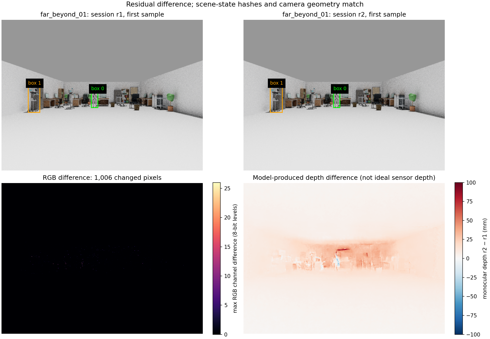

# Isaac isolated-condition repeatability and historical Gazebo comparison

Recorded dates: 2026-11-03, 2026-11-04, 2026-11-13, 2026-11-20, 2026-11-21
Tested revisions: `563ed717831fe028afa81ac99749a5cccf7e5cd0`, `7f40fa0a3ca81ec437afb8cf2fee0b9759d4c362`, `4e22a20fdc5e15622f0980f81e0de5facca187bf`, `6d7817cbb7b068c2a851e9cb357dea14a0098d63`, `8321456e7b3c5ae9eac2f61f4aa258805ddb88a9`
Provenance: partial

## Decision and tested scope

After reviewing the four Isaac pairs, the Gazebo comparison and the average
differences, the owner accepted the observed repeatability as sufficient for
the tested isolated-condition workflow. This closes that empirical objective.
It includes the retained 20.527 mm box/monocular Euclidean residual; it does not
fit a new numerical bound around it. Earlier proposed 5 mm mask / 30 mm polar
criteria were diagnostic proposals, not an adopted scientific equivalence test.
RGB bit identity is not an additional acceptance gate.

The conclusion applies to the preserved combined P0/render/readiness build,
default models, 640×480 lab scenes and recorded GUI workload. It is not an
accuracy verdict or a population variance estimate. The coverage audit below
distinguishes this accepted scope from
remaining or conditional work.

## Method and provenance

Each of box/monocular, silhouette/monocular, box/ideal-stereo and
silhouette/ideal-stereo ran first in two independent fresh Isaac sessions.
One smoke preceded each pair. Eight valid full sessions completed **872 trials
and 4,360 sampled batches**: 88 scenes expand to 109 trials per session through
packaged repeat overrides. Each estimator has 135 target-instance rows per
session. No other condition ran before the measured condition in that session.

Fixed inputs and workload:

- Furnished lab, fixed scenario/background mapping, 640×480, 2 s settling and
  **10 s wall-clock measurement windows**. The first five batches per window
  were stored; full-window CSV estimates use the whole window.
- Projective ranging, Euclidean reconstruction and polar profiling together;
  pointcloud excluded. OWLv2 `google/owlv2-base-patch16-ensemble`, target label
  `humanoid robot`, threshold 0.30, requested detector rate 10 FPS; unchanged
  SlimSAM and Depth Anything defaults.
- Deterministic PathTracing, AA 0, renderer result cache off, non-DLSS
  `limitedOps` off, denoiser off, ideal sensor depth, requested RTF 1.
  LiDAR noise remained enabled. GUI, RViz, overlays, video and diagnostics on.
- NVIDIA RTX PRO 6000 Blackwell, driver `595.99.02`, hardware GL verified through
  `tools/gpu-run` in the owning xrdp display `:10.0`, ROS domain 131.

The live build was `/tmp/DyNAMO-Ridgeback-p0`, headed at P0 commit
`563ed717831fe028afa81ac99749a5cccf7e5cd0`, plus the code-only delta from base
`cc86eef5a5c708be2a31aac64db29a91225f4023` to main
`7f40fa0a3ca81ec437afb8cf2fee0b9759d4c362`. The applied delta includes the four
new Python helper/test files. Its SHA-256 is
`e272745ed4d73fe221f95fded0f22cd68b3e0336801756db0e0837e19dab1820`.
The main checkout and its install were not used as the modified test build;
P0 remained unmerged and unpushed when the owner accepted these results.

The three affected packages were built in the P0 worktree over the main
underlay; installed copied entrypoints and package prefixes were verified.
Dependency checks passed. The combined-build unit receipt records **142 passed,
51 skipped**; this does not claim that skipped environments were tested.
The first bundle froze 918 implementation/input/harness files; each remaining
bundle froze 923. Pre-session and final hash receipts matched. A stereo
harness-only lock handover correction was made before launch, with old freeze
receipts retained; no renderer, detector or estimator setting changed.

The [preserved evidence snapshot](assets/isaac_condition_repeatability_20261121/evidence.json)
contains collection summaries, both Gazebo comparison forms, exact input YAML
text, provenance and the first frozen-file index. The
[P0 runtime/test delta](assets/isaac_condition_repeatability_20261121/p0-runtime.patch.gz)
and [render/readiness delta](assets/isaac_condition_repeatability_20261121/render-readiness.patch.gz)
preserve the source changes separately from generated graph/documentation
changes, as gzip-compressed byte-exact patches. These are historical evidence
assets, not proposed main source edits.
Provenance remains partial: the binary dependency environment is not fully
locked, model weights and large raw captures are not vendored into the archive,
and the complete execution harness remains in the local bundles below.

## Isaac paired results

Pair by `trial_id`, `instance_index` and estimator. Δ is the absolute difference
between the two finite `trial_estimate_m` values, **not error against truth**.
Means weight numeric target-instance pairs equally. Matching misses receive no
invented zero delta. Coverage and outcome/reason changes are therefore reported
beside numerical differences. Values below are millimetres; displayed zeros
at six decimal places need not imply exact equality unless stated.

| Condition | Estimator | Numeric pairs / 135 | Mean abs Δ (mm) | Max abs Δ (mm) | Outcome/reason changes |
|---|---|---:|---:|---:|---:|
| Box / monocular | Projective | 109 | 0.008955 | 0.472069 | 0 |
| Box / monocular | Euclidean | 105 | 0.205730 | 20.526886 | 0 |
| Box / monocular | Polar | 103 | 2.572277 | 19.703388 | 1 |
| Silhouette / monocular | Projective | 100 | 0 | 0 | 0 |
| Silhouette / monocular | Euclidean | 99 | 0 | 0 | 0 |
| Silhouette / monocular | Polar | 101 | 2.591243 | 22.190094 | 0 |
| Box / stereo | Projective | 115 | 0 | 0 | 0 |
| Box / stereo | Euclidean | 115 | 0 | 0 | 0 |
| Box / stereo | Polar | 102 | 2.026278 | 9.423733 | 1 |
| Silhouette / stereo | Projective | 117 | 0.000844 | 0.029325 | 0 |
| Silhouette / stereo | Euclidean | 117 | 0.000748 | 0.055313 | 0 |
| Silhouette / stereo | Polar | 101 | 3.200291 | 19.080639 | 0 |

Silhouette/monocular and box/stereo projective and Euclidean estimates were
exactly equal wherever both repetitions returned numbers. All four pairs
retained identical mask-estimator outcomes/reasons. Polar has one changed
outcome/reason in each box condition, none in either silhouette condition;
box/monocular `trap_lidar_table` changed from `no_value / TOO_FEW_RAYS_SELECTED`
to `scored`. Noise and finite-return coverage are part of that path's behavior.

### Residual box/monocular case

The largest mask difference was `far_beyond_01`, Euclidean instance 0:
11.898299217 → 11.918826103 m, a 20.526886 mm change. The saved box-1 values
match those CSV estimates, but box 1 covers a background cabinet. Its box
changed from `[84, 211, 121, 294]` to `[84, 211, 122, 294]`, and its detector
score from 0.313612 to 0.320518. The true G1 box 0 stayed
`[285, 229, 305, 279]`. Thus this is also a false-positive/association warning;
it cannot be presented as correctly identified G1 depth-model variation.
Its RGB difference is observed; its origin is unresolved.

The retained diagnostic figure comes from the box/monocular bundle. It shows
the two RGB samples with G1/cabinet boxes and their RGB/monocular-depth
differences; it is evidence for this row, not an independent target annotation.

### Capture, state and RGB checks

Every valid full session had zero skipped trials, 109 successful scene-state
checks, five stored batches per window, no sampled event missing its live
record, verified detector identity, nonempty video and clean normal shutdown.
Monocular producer-readiness stamps preceded capture; applicable SlimSAM and
Depth Anything warm-sample guards passed. Detected batches retained required
context; empty detection batches may legitimately omit model depth.
No GPU contention appeared in the 60 s host samples; transient contention
between samples was not exhaustively excluded.

| Condition | Trials with all five sampled RGB pairs identical / 109 |
|---|---:|
| Box / monocular | 104 |
| Silhouette / monocular | 107 |
| Box / stereo | 95 |
| Silhouette / stereo | 89 |

Box/monocular `far_beyond_01` had up to 1,006 changed pixels / 26 8-bit levels.
Other box/monocular differences involved at most 16 pixels / six levels. The
three other conditions involved at most 13 pixels / six levels. No stored
paired depth sample showed a jump above the 0.15 m diagnostic threshold.
Identical sampled monocular inputs gave identical captured model-depth maps.
One box/stereo sample (`interfere_pair_01`, `rgb_3`) had identical RGB but three
ideal-depth pixels differed by at most 2.384185791×10⁻⁷ m, without finiteness
changes or estimate impact. This does not demonstrate monocular inference noise.

These checks cover five early batches, not every frame of each 10 s window.
Equal state snapshots and no large sampled depth jumps are useful evidence,
not a proof that no hidden geometry could exist.

## Repair and excluded attempt

Box/stereo repetition 2 exercised the real P0 repair path after
`objpartial_01_rep5`: two stale right-wrist-pitch visual prims were found and
removed on the next update, **one update / 25 ms simulation time** later.
There was **one found event, one repaired event and zero persistent events**.
No other full session logged a Fabric event.

For the 60 later trials, paired numeric projective/Euclidean estimates remained
exactly equal and outcomes unchanged; sampled RGB matched in **59/60**. The
exception was `far_clamp_02` (five pixels, at most six levels). No later stored
depth jump above 0.15 m appeared. This demonstrates recovery within one full
condition session, not cross-condition persistence or perfect post-repair RGB.

The first silhouette/monocular smoke in the `220558Z` bundle stored only four
of five batches, then Isaac exited 139. The native trace includes
`libnvidia-glcore.so.595.99.02`, Vulkan/Kit renderer frames and
`SimulationApp.update()`; provider timeouts and shutdown failures followed
simulator death. No full session started. That attempt is excluded from all
reported pairs. One fresh retry at `221404Z` used unchanged settings and passed,
followed by two valid full sessions. The exact graphics-crash trigger remains
unresolved. An accidental crash is not a deliberate child-failure qualification.

## Historical Gazebo comparison, including averages

The reference is `qualification_20261104_b66f6d1_restart11`, which imports
Gazebo runs actually recorded November 3–4 at `4e22a20`, `6d7817c` and
`8321456`. It is not a new Gazebo run at the latest Isaac build or uniformly at
the reference bundle's filename revision. Full CSV hashes and saved metrics
were checked before computing the comparison with the Isaac pairing function.

For Gazebo, projective/Euclidean mean and maximum paired differences are
exactly zero in all four conditions, and every estimator retains its
outcomes/reasons. All 109 trials per condition have five identical stored RGB
pairs. Its box/monocular r1 has five unmeasured sampled startup batches; those
do not invalidate full-window CSV repeatability but leave that first-trial
sampled-live replay comparison inconclusive.

| Condition | Gazebo numeric pairs, projective / Euclidean / polar | Isaac numeric pairs, same order | Gazebo polar mean / max (mm) | Isaac polar mean / max (mm) |
|---|---|---|---|---|
| Box / monocular | 106 / 103 / 91 | 109 / 105 / 103 | 2.502664 / 11.785030 | 2.572277 / 19.703388 |
| Silhouette / monocular | 94 / 93 / 89 | 100 / 99 / 101 | 2.103291 / 8.497953 | 2.591243 / 22.190094 |
| Box / stereo | 111 / 112 / 91 | 115 / 115 / 102 | 2.157039 / 12.981176 | 2.026278 / 9.423733 |
| Silhouette / stereo | 109 / 109 / 89 | 117 / 117 / 101 | 2.580626 / 8.919954 | 3.200291 / 19.080639 |

To compare averages on the same scored population, restrict each estimator
to trial/instance identities numeric in **all four** corresponding backend/
repetition runs, then pool those rows across conditions (row weighted):

| Estimator | Common numeric pairs | Gazebo mean abs Δ (mm) | Isaac mean abs Δ (mm) |
|---|---:|---:|---:|
| Projective | 387 | 0 | 0.001414 |
| Euclidean | 377 | 0 | 0.054680 |
| Polar | 343 | 2.364465 | 2.372195 |

The common-scored restriction retains the box/monocular Euclidean outlier.
The near-equal pooled polar means are descriptive, not a statistical
equivalence claim. Comparing separate coverage sets changes the pooled means
to 2.335838 mm Gazebo / 2.595995 mm Isaac (360 / 407 polar pairs).

There are **83 unchanged shared scene definitions**; five old `edge_*` scenes
were replaced/repositioned as `edge640_*`. Catalog target seating changed
from spawn z 0 to floor height 0.05 m; Gazebo STL and Isaac USD targets also
differ. The background mapping, revisions and session layouts differ:
historical Gazebo used multi-condition sessions, latest Isaac one condition
first per session. This is historical context, **not a controlled backend-only
A/B**. The earlier [contaminated Isaac full-matrix pair](2026-11-06-isaac-full-repeatability.md)
is a separate result population and is not pooled into these measurements.

## Documentation and experiment coverage audit

The governing repeatability, replay, geometry and shutdown documentation was
reread after collection. Status at the owner's acceptance:

| Requirement or claim | Coverage and remaining boundary |
|---|---|
| Four isolated condition pairs, default models/workload | **Covered and accepted.** Eight valid fresh sessions with collection/state/readiness checks and normal shutdown. |
| P0 A1 regression tests | **Executed with skips.** Combined-build receipt: 142 passed, 51 skipped; not every environment was exercised. |
| P0 A2 removal stress | **Earlier evidence covered.** 3,000 cycles across deactivate/no-freeze/unique modes, four found/repaired events, zero persistent residues; paused unique mode intentionally omitted depth checks. |
| P0 A3 reuse/control | **Earlier evidence covered.** 1,000 reuse cycles, no false-positive audit findings; baseline/timing controls retained. |
| P0 A4 persistent injection | **Earlier evidence covered.** Orphan stayed discoverable, audit logged persistent and deletion returned `CLEANUP_INCOMPLETE`. |
| Original P0 A5: all four conditions inside each of two persistent sessions | **Unperformed.** The new pairs qualify the isolated route; they do not test cross-condition scene/renderer history. Needed before extending acceptance to persistent multi-condition sweeps. |
| Offline replay of these new captures | **Unperformed.** Box/real-SlimSAM event/coordinate/status/association parity, sampled-window parity, candidate-cache comparison, resource costs and parallel scaling remain. Earlier replay receipts cover older datasets only. |
| Controlled Gazebo-to-Isaac comparison | **Historical context only.** No fresh matched-build/input backend pair was collected; required before backend-causal/equivalence claims. |
| Geometry recertification | **Previously covered.** New captures add repeatability on recertified scenes; they do not replace older geometry-dependent accuracy tables. |
| Isolation, occlusion and throughput studies | **Still open.** No 12-recipe controlled isolation comparison, failure-stage occlusion attribution, or 14-config/three-replication model-throughput and diagnostics-off/on experiment. Timing logs alone do not close them. |
| Shutdown/failure matrix | **Partial.** Eight normal completions; no deliberate pending-request cancellation, mid-trial stop, repeated interrupts or child-failure matrix across both backends. Native crash trigger remains unexplained. |
| More settings or systems | **Outside this acceptance.** Headless/other display or resolution, D455-like depth, changed models, configurator lifecycle and hardware annotation/association qualification. Pointcloud only if scope reopens. |
| More replications or formal statistical bounds | **Not established, not a blocker for the accepted scope.** Two repetitions yield one paired delta per target. A future variance/equivalence claim needs a separately chosen design and margin. |
| Integrating P0 into main | **Engineering step not performed.** Verify the integrated installed build before transferring this experimental-build acceptance to main. |

No requirement for further pixel-perfect renderer investigation follows from
this acceptance. The unresolved RGB origin, cabinet association and excluded
crash remain recorded limitations rather than silently discarded evidence.

## Local evidence locations

All paths below are relative to `/home/stefi/DyNAMO/DyNAMO-Ridgeback` unless
absolute. Large raw logs, captures and videos remain local and are not embedded
in the durable snapshot.

- Aggregate: `artifacts/benchmarks/isaac_remaining_condition_pairs_20261120T220558Z/`;
  `REPORT.md`, `SUMMARY.json`, `plan.json`, `gazebo_comparison.json` and
  `gazebo_comparison_means.json`.
- Box/monocular: `artifacts/benchmarks/isaac_box_monocular_repeatability_20261120T200425Z/`;
  also `residual_diagnostics.json` and `identical_input_check.json`.
- Silhouette/monocular valid retry:
  `artifacts/benchmarks/isaac_silhouette_monocular_repeatability_20261120T221404Z/`.
- Box/stereo: `artifacts/benchmarks/isaac_box_stereo_repeatability_20261120T220558Z/`;
  also `fabric_events.json`, `post_repair_comparison.json` and
  `same_rgb_stereo_depth_details.json`.
- Silhouette/stereo:
  `artifacts/benchmarks/isaac_silhouette_stereo_repeatability_20261120T220558Z/`.
- Each valid bundle: `comparison.json`, `validation_{smoke,r1,r2}.json`,
  `inputs/`, `provenance.json`, `workspace.patch`, `frozen_experiment.json`,
  freeze receipts, execution adjustments, test/build and session logs.
- Excluded smoke:
  `artifacts/benchmarks/isaac_silhouette_monocular_repeatability_20261120T220558Z/`;
  `failure_review.json`, `diagnosis/native_backtrace.txt` and copied Kit logs.
- Earlier P0 stress/control/injection receipts:
  `/tmp/DyNAMO-Ridgeback-p0/artifacts/benchmarks/fabric_p0/`;
  `provider_deactivate`, `provider_nofreeze`, `provider_unique`, `provider_reuse`,
  `baseline_reuse`, `timing_provider*`, `timing_baseline*`, `persistent`.
- Historical Gazebo reference:
  `artifacts/benchmarks/qualification_20261104_b66f6d1_restart11/`; exact imported
  run/capture paths and revisions are retained in the comparison snapshot.

Collection's machine statuses remain `execution-complete-review-required` and
its proposed-limit flags remain historical data. The owner's later scoped
acceptance is recorded in this document; those original receipts were not
rewritten into a different formal qualification verdict.
