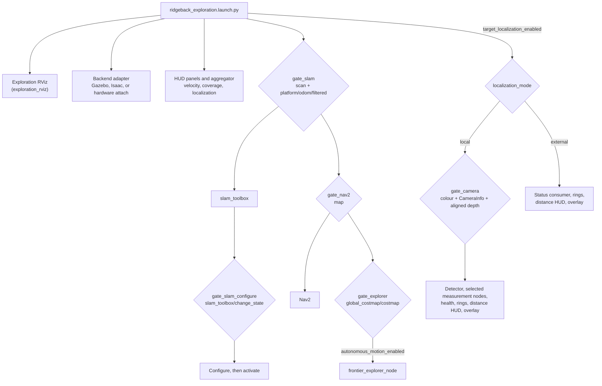

# Exploration architecture

The exploration workflow composes one I/O backend with the same state
estimation, SLAM, Nav2, target-localization, and diagnostic application stack.
The root [README](../../README.md) owns commands, and
[launch arguments](launch_arguments.md) lists every argument and world; this
page owns the component and dependency boundary and the bringup sequence.

```text
 ridgeback_autonomy_gz     ridgeback_autonomy_isaac     ridgeback_autonomy_hardware
 Gazebo + Clearpath        Isaac runner + USD           attach/start Clearpath
           \                       |                       /
            +---- normalized ROS contract ---------------+
                  scan | odom | TF | camera | /clock*
                                   |
                         ridgeback_autonomy
                 SLAM -> Nav2 -> frontier explorer
                    \-> target localization + HUD

 * `/clock` and `use_sim_time=true` exist only in simulation.
```

## Package and dependency ownership

| Package | Owns | Must not own |
|---|---|---|
| `ridgeback_autonomy` | Common nodes, messages, configuration, readiness gates, and public workflows | Gazebo/Qt build dependencies, Isaac runtime, or a hardware driver |
| `ridgeback_autonomy_gz` | Gazebo launch adapter, worlds, models, `SpawnG1` plugin, and the benchmark asset catalog; its `gzserver` serves the standard scene-control services | SLAM/Nav2/perception behavior, benchmark logic |
| `ridgeback_autonomy_isaac` | Isaac launch adapter, runner (which serves the standard scene-control services), sensor specs, USD assets, and the benchmark asset catalog | Common autonomy policy, benchmark logic |
| `ridgeback_autonomy_hardware` | Hardware-safe Clearpath adapter | Simulation packages or autonomous-motion policy |

`dependencies/core.repos` is the common source closure.
`dependencies/gz.repos` adds the Gazebo-only `clearpath_simulator`, `gz-sim`,
and `ros_gz` checkouts (see the [dependency runbook](../project/dependencies.md)).
Package lookup in the dispatcher is lazy, so an Isaac or hardware install does
not need the Gazebo adapter merely to load the common launch, and the
target-distance benchmark resolves only the selected backend's adapter.

The public selector is `backend:=gz|isaac|hardware`. `sim:=gz|isaac` remains a
deprecated compatibility alias. The adapters normalize deployment differences;
common application defaults remain identical unless a physical constraint
requires otherwise. Current intentional differences are simulation time,
camera topic/profile selection, hardware-safe estimator selection, truth-map
overlays, and motion/platform opt-ins.

## Bringup sequence

`ridgeback_exploration.launch.py` starts each stage when its prerequisite
exists, not after a fixed delay. Each `launch_wait` gate exits when its topics
or service appear, and that exit starts the next stage.



*Diamonds are readiness gates. Edges from a gate fire on its exit; labelled
edges are launch conditions.*

| Gate | Waits for | Timeout |
|---|---|---|
| `gate_slam` | `sensors/lidar2d_0/scan` and `platform/odom/filtered` publishers | `sim_ready_timeout`: 45 s, 300 s on Isaac |
| `gate_slam_configure` | `slam_toolbox/change_state` service | 30 s |
| `gate_nav2` | `map` publisher | 60 s |
| `gate_explorer` | `global_costmap/costmap` publisher | 60 s |
| `gate_camera` (local mode only) | colour image, colour `CameraInfo` and aligned-depth publishers | `sim_ready_timeout` |

Gate timeouts are bounded safety fallbacks. A timeout reports the missing
topic, service, or transform and then permits launch to continue; it is not a
replacement for the readiness condition. A `map` publisher implies the full
`map -> odom -> base_link` chain is alive, so Nav2 activates only once TF is
ready. External localization mode has no camera gate, because this host
consumes no camera for inference. [Troubleshooting](../troubleshooting.md#event-driven-startup) covers what to do
when a gate stalls.

## Hardware safety boundary

`ridgeback_autonomy_hardware` defaults to attaching to externally managed
Clearpath platform and sensor services. `start_hardware_platform:=true` is the
only path that includes platform bringup. The application also defaults
`autonomous_motion_enabled:=false`, which prevents the frontier explorer from
sending goals while still allowing sensor, SLAM, Nav2, perception, and TF
validation. The quick-start wrapper skips broad simulator cleanup and does not
invent a ROS domain for hardware.

This flag does not disable goals sent by other clients to an active Nav2 server.
The [driving reference](../physical/driving_readiness.md) owns deployed mux,
controller, manual-input and physical-stop qualification boundaries.

These defaults reduce accidental actuation; they do not certify a deployment.
The live velocity message type, controller configuration, e-stop, footprint,
sensor topics, TF ownership, and camera behavior must pass their physical
validation gates before motion is enabled.

## Exploration and diagnostics

`frontier_explorer_node` reads the Nav2 global costmap, chooses frontiers, and
sends `NavigateToPose` goals. It is the only supported explorer; its sources
live under `src/ridgeback_autonomy/ridgeback_autonomy/frontier_explorer/`.

### Navigation ownership handoff

The explorer owns its Nav2 goal until a matching action result is terminal. An
external mission requests a pause through relative service `mission/pause`
(`std_srvs/srv/Trigger`). The request immediately prevents new frontier goals
and requests cancellation of an active goal, but cancel acceptance does not
release ownership. The transient-local `mission/status` JSON is authoritative:
only `pause_requested=true` together with `handoff_safe=true` permits another
mission component to send a Nav2 goal. Pending acceptance, an active handle, or
any pending/rejected/failed/overdue cancellation keeps `handoff_safe=false`.

`mission/resume` is also explicit. It succeeds only after explorer ownership is
settled and, when configured as required, localization health is current and
advancing. The explorer does not automatically resume after an external pause.
`explore/status` reports exploration progress, not Nav2 ownership, and must not
be used as the handoff acknowledgment.

### Parking mission coordination

`mission_manager_node.py` captures one start pose from the configured TF
frames, consumes the shared target detection/localization interfaces, pauses
the frontier owner through the terminal handoff above, and publishes
transient-local JSON state on `parking_mission/state`. After a stabilized
target estimate it plans parking candidates and checks their paths with
`ComputePathToPose`. With `parking_navigation_enabled` off it stops in
`PARKING_PATH_FEASIBLE`; with it on (simulation launch only) it drives the
original mission tail through its own `NavigateToPose` client: pre-parking pose,
final parking pose, the parking wait, then return to the saved start pose and
`MISSION_COMPLETE`. A failed parking leg returns to the start pose and ends in
`MISSION_FAILED`.

The estimate retains its `generic_target_position` reference and false
`is_foot_midpoint` flag. It is not yet qualified as the G1 ground center needed
by the migrated parking geometry. Invalid samples and source-time TF misses are
recoverable until the localization deadline; ownership or localization timeout
is a technical `MISSION_FAILED`, not successful completion or an automatic
return-home command. Missing pause service, failed pause transport, and an
unsettled explorer goal are reported as distinct failures. The detailed
migration state flow and future insertion
point for G1-region exploration are maintained in the
[parking mission migration plan](../plans/EXPLORATION_parking_mission_migration.md#phase-2d-non-driving-mission-coordinator).

### Mission navigation goal ownership

The manager owns at most one `NavigateToPose` goal and tracks it from the send
until the action reports `SUCCEEDED`, `ABORTED` or `CANCELED`. Only that
terminal result releases the goal. Cancellation follows the explorer's rule:
a cancel request or its answer, accepted or rejected, does not release
ownership, and neither does measured zero velocity. A goal cancelled before
acceptance is cancelled when its handle arrives. A goal that succeeds or aborts
while its cancellation is in flight is released, but never counts as the
abandoned leg's arrival.

During a parking leg, a LiDAR veto, the leg deadline or an unknown
acceptance/result moves the mission to `RETURNING_TO_START` without sending a
goal. The return waits for the terminal result, then for fresh odometry that
confirms the robot stopped after the release, and only then restores the
shared goal checker and sends the return goal. A deadline on the observation or return goal fails the mission at once
while the cancellation is still tracked. A send attempted while a goal is still
owned is refused and fails the mission. A reset while a goal is owned cancels
the mission and is refused until the terminal result arrives. Shutdown can only
request cancellation and logs that termination was not confirmed.

The wait is bounded by the executor's `cancellation_timeout_s` (5 s). Nothing
drives or times out during it. On expiry the manager keeps the handle, sends
one final cancel request and reports terminal `navigation_cancel_unresolved`
(`MISSION_FAILED`, or the issue on an already cancelled mission). It never
starts the return, and a reset stays refused until a late terminal result
releases the goal. Stopping meanwhile relies on Nav2's own cancellation and
collision monitor; the manager publishes no velocity commands. The state
JSON's `parking_mission_navigation` reports `goal_owned` and `cancel_pending`.

The HUD is an aggregator. Independent producers publish text panels such as
velocity and coverage, and `hud_node` combines them for one RViz overlay.
In simulation, coverage compares the live SLAM map with the selected world's
packaged ground-truth map. It is disabled by default on hardware. Map
generation and interpretation are documented beside the
[ground-truth maps](../../src/ridgeback_autonomy/sim/ground_truth_maps/README.md).

Target localization is an optional consumer of the same sensor stack. Its
detector, measurement paths, visualization, and benchmark semantics are owned
by the [target-localization pipeline](../target_localization/target_localization_pipeline.md),
not duplicated here. Exploration runs the same estimator rows the benchmark
compares: all four in simulation, the aligned-depth pair on hardware. Each row
draws its own RViz ring with its own bearing, and a wide distance HUD at the
top right (`hud_target_overlay`) lists the rows side by side with the age of
each reading. Exploration has no ground truth, so that panel has no truth line
and no error column. Each row has its own RViz Displays checkbox under
`Target Estimates`. The camera overlay publishes on `debug/target/overlay`,
shown by the configured RViz Image display.

## Tuning parameters

These are the first parameters to adjust; each file holds the rest.

| File | Parameter | Effect |
|---|---|---|
| `config/frontier_explorer_params.yaml` | `min_frontier_size` / `near_frontier_radius` / `goal_advance_cells` | Frontier clustering, near-tier preference, and goal placement past the centroid |
| `config/frontier_explorer_params.yaml` | `progress_timeout` / `abort_blacklist_threshold` | Stall timeout (cancels only when no progress) and failures required before a frontier is blacklisted |
| `config/frontier_explorer_params.yaml` | `distance_weight` / `size_weight` | Scoring trade-off between how close and how large a far-tier frontier is |
| `config/frontier_explorer_params.yaml` | `goal_cost_threshold` / `goal_safety_margin` / `lethal_cost_threshold` | Goal-safety filtering against the costmap |
| `config/nav2_params.yaml` | `vx_max` / `vy_max` / `wz_max` | Robot linear and turn-rate limits |
| `config/nav2_params.yaml` | `max_accel` / `max_decel` | Velocity smoother acceleration and braking limits |
| `config/slam_toolbox_params.yaml` | `resolution` | Map resolution (m/pixel) |

Paths are relative to `src/ridgeback_autonomy/`.

## Robot geometry

The [shared collision reference](../robot/collision_model.md) owns the Nav2
footprint and its distinction from physical and simulator contact envelopes.
[Robot geometry](../robot/geometry.md) owns configured mounts and dimensional
provenance across the three backends.

## Validation

The [exploration evaluation runbook](evaluation.md) records the
instrumented probe workflow. Current failure signatures and recovery steps live
in [troubleshooting](../troubleshooting.md); dated tuning and incident evidence belongs
in the engineering archive.
