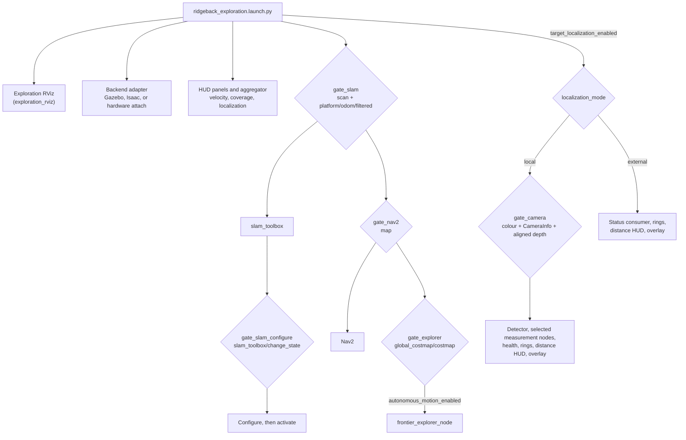

# Exploration architecture

The exploration workflow composes one I/O backend with the same state
estimation, SLAM, Nav2, target-localization, and diagnostic application stack.
The root [README](../../README.md) owns commands, and
[launch arguments](launch_arguments.md) lists every argument and world; this
page owns the component and dependency boundary and the bringup sequence.

```text
 ridgeback_autonomy_gz     ridgeback_autonomy_isaac     ridgeback_autonomy_hardware
 Gazebo + Clearpath        Isaac runner + USD           attach/start Clearpath
           \                       |                       /
            +---- normalized ROS contract ---------------+
                  scan | odom | TF | camera | /clock*
                                   |
                         ridgeback_autonomy
                 SLAM -> Nav2 -> frontier explorer
                    \-> target localization + HUD

 * `/clock` and `use_sim_time=true` exist only in simulation.
```

## Package and dependency ownership

| Package | Owns | Must not own |
|---|---|---|
| `ridgeback_autonomy` | Common nodes, messages, configuration, readiness gates, and public workflows | Gazebo/Qt build dependencies, Isaac runtime, or a hardware driver |
| `ridgeback_autonomy_gz` | Gazebo launch adapter, worlds, models, `SpawnG1` plugin, and the benchmark asset catalog; its `gzserver` serves the standard scene-control services | SLAM/Nav2/perception behavior, benchmark logic |
| `ridgeback_autonomy_isaac` | Isaac launch adapter, runner (which serves the standard scene-control services), sensor specs, USD assets, and the benchmark asset catalog | Common autonomy policy, benchmark logic |
| `ridgeback_autonomy_hardware` | Hardware-safe Clearpath adapter | Simulation packages or autonomous-motion policy |

`dependencies/core.repos` is the common source closure.
`dependencies/gz.repos` adds the Gazebo-only `clearpath_simulator`, `gz-sim`,
and `ros_gz` checkouts (see the [dependency runbook](../project/dependencies.md)).
Package lookup in the dispatcher is lazy, so an Isaac or hardware install does
not need the Gazebo adapter merely to load the common launch, and the
target-distance benchmark resolves only the selected backend's adapter.

The public selector is `backend:=gz|isaac|hardware`. `sim:=gz|isaac` remains a
deprecated compatibility alias. The adapters normalize deployment differences;
common application defaults remain identical unless a physical constraint
requires otherwise. Current intentional differences are simulation time,
camera topic/profile selection, hardware-safe estimator selection, truth-map
overlays, and motion/platform opt-ins.

## Bringup sequence

`ridgeback_exploration.launch.py` starts each stage when its prerequisite
exists, not after a fixed delay. Each `launch_wait` gate exits when its topics
or service appear, and that exit starts the next stage.



*Diamonds are readiness gates. Edges from a gate fire on its exit; labelled
edges are launch conditions.*

| Gate | Waits for | Timeout |
|---|---|---|
| `gate_slam` | `sensors/lidar2d_0/scan` and `platform/odom/filtered` publishers | `sim_ready_timeout`: 45 s, 300 s on Isaac |
| `gate_slam_configure` | `slam_toolbox/change_state` service | 30 s |
| `gate_nav2` | `map` publisher | 60 s |
| `gate_explorer` | `global_costmap/costmap` publisher | 60 s |
| `gate_camera` (local mode only) | colour image, colour `CameraInfo` and aligned-depth publishers | `sim_ready_timeout` |

Gate timeouts are bounded safety fallbacks. A timeout reports the missing
topic, service, or transform and then permits launch to continue; it is not a
replacement for the readiness condition. A `map` publisher implies the full
`map -> odom -> base_link` chain is alive, so Nav2 activates only once TF is
ready. External localization mode has no camera gate, because this host
consumes no camera for inference. [Troubleshooting](../troubleshooting.md#event-driven-startup) covers what to do
when a gate stalls.

## Hardware safety boundary

`ridgeback_autonomy_hardware` defaults to attaching to externally managed
Clearpath platform and sensor services. `start_hardware_platform:=true` is the
only path that includes platform bringup. The application also defaults
`autonomous_motion_enabled:=false`, which prevents the frontier explorer from
sending goals while still allowing sensor, SLAM, Nav2, perception, and TF
validation. The quick-start wrapper skips broad simulator cleanup and does not
invent a ROS domain for hardware.

This flag does not disable goals sent by other clients to an active Nav2 server.
The [driving reference](../physical/driving_readiness.md) owns deployed mux,
controller, manual-input and physical-stop qualification boundaries.

These defaults reduce accidental actuation; they do not certify a deployment.
The live velocity message type, controller configuration, e-stop, footprint,
sensor topics, TF ownership, and camera behavior must pass their physical
validation gates before motion is enabled.

## Exploration and diagnostics

`frontier_explorer_node` reads the Nav2 global costmap, chooses frontiers, and
sends `NavigateToPose` goals. It is the only supported explorer; its sources
live under `src/ridgeback_autonomy/ridgeback_autonomy/frontier_explorer/`.
Each goal faces from the robot towards the goal (`navigator.facing_quaternion`),
so the forward camera looks along the way into the frontier; with the earlier
fixed yaw the holonomic base often drove sideways or backwards. The shared goal
checker keeps its heading tolerance (0.40 rad), which the mission's return,
observation and parking goals rely on; the group's `dev` also relaxes it to any
heading (`ede9bd1`), which is not applied here.

### Navigation ownership handoff

The explorer owns its Nav2 goal until a matching action result is terminal. An
external mission requests a pause through relative service `mission/pause`
(`std_srvs/srv/Trigger`). The request immediately prevents new frontier goals
and requests cancellation of an active goal, but cancel acceptance does not
release ownership. The transient-local `mission/status` JSON is authoritative:
only `pause_requested=true` together with `handoff_safe=true` permits another
mission component to send a Nav2 goal. Pending acceptance, an active handle, or
any pending/rejected/failed/overdue cancellation keeps `handoff_safe=false`.

`mission/resume` is also explicit. It succeeds only after explorer ownership is
settled and, when configured as required, localization health is current and
advancing. The explorer does not automatically resume after an external pause.
`explore/status` reports exploration progress, not Nav2 ownership, and must not
be used as the handoff acknowledgment.

### Parking mission coordination

[Parking mission states and timing](parking_mission_states.md) lists every state, its
limits and its measured duration.

`mission_manager_node.py` captures one start pose from the configured TF
frames, consumes the shared target detection/localization interfaces, pauses
the frontier owner through the terminal handoff above, and publishes
transient-local JSON state on `parking_mission/state`. After a stabilized
target estimate it plans parking candidates and checks their paths with
`ComputePathToPose`. With `parking_navigation_enabled` off it stops in
`PARKING_PATH_FEASIBLE`; with it on (simulation launch only) it drives the
original mission tail through its own `NavigateToPose` client: pre-parking pose,
final parking pose, the parking wait, then return to the saved start pose and
`MISSION_COMPLETE`. A failed parking leg returns to the start pose and ends in
`MISSION_FAILED`.

The estimate retains its `generic_target_position` reference and false
`is_foot_midpoint` flag. It is not yet qualified as the G1 ground center needed
by the migrated parking geometry. Invalid samples and source-time TF misses are
recoverable until the localization deadline; ownership or localization timeout
is a technical `MISSION_FAILED`, not successful completion or an automatic
return-home command. Missing pause service, failed pause transport, and an
unsettled explorer goal are reported as distinct failures. The detailed
migration state flow and future insertion
point for G1-region exploration are maintained in the
[parking mission migration plan](../plans/EXPLORATION_parking_mission_migration.md#phase-2d-non-driving-mission-coordinator).

### G1 heading

Each G1 localization also estimates which way G1 faces, from the depth frames of
that stationary view (`target_orientation.py`, `target_orientation_enabled`).
The G1 holds both forearms forward, and from every side they are the only part
of it more than 0.18 m from its vertical axis: two parallel bars at chest height.
Depth pixels are transformed to the map through TF and matched against those bars
around the localized position, then refined along the bars' own direction. A
heading needs at least 3 of the last 5 frames to agree within 20°. It needs
enough bar points, reaching the fingertips, with at least 80% of the protruding
points on the bars. Otherwise the heading is unknown; it is never inferred from
missing forearms, so a G1 with its arms down gets no heading. The simulators'
poses are not an input. In Gazebo, over 72 views at 24 headings and three robot
positions, the mean error against ground truth was 6.7° (maximum 12.9°), and it
also held with a table next to or across G1's front. The cue is specific to this
forearms-forward posture, and it is unqualified on Isaac and on hardware.

The same frames give G1's body axis (`estimate_body_axis`): the middle of the
legs' extent, plus 0.03 m along the view for the legs' hidden far side. It
replaces the position estimate when at least 3 frames agree within 0.03 m and it
lies within `target_axis_max_shift_m` (0.25 m); otherwise the estimate is kept.
That estimate is a centroid of visible surface points, so it depends on G1's
heading: the forearms pulled it up to 0.13 m toward a camera G1 faced. The axis
was 0.025 m from ground truth on average (maximum 0.049 m) over the same 72
views, from any seed. It uses no forearms and does not feed the heading. The
keep-out reference stays `generic_target_position`.

### G1 position check

The detector's surface estimate is the nearest surface in G1's whole detection
box. When something stands in front of G1's legs or beside it, that is the other
object: on 2026-11-08 a worktable's edge 1.25 m in front of G1 and a panel's end
about 1 m off, and the first of those runs parked beside the table and reported
`MISSION_COMPLETE`. Each localization therefore checks the position against G1
itself in the same stationary depth frames (`target_orientation.py`):

1. The top quarter of the detection box, across its middle 40%, is G1's head and
   upper torso: above a worktable or bed, and away from the box's sides. The
   nearest fifth of those depths gives G1's range (3 of 5 frames within 0.10 m).
2. A surface estimate more than 0.50 m in front of that range (G1's forearm tips
   reach 0.44 m forward of its axis) or 0.30 m behind it is another object, and
   the position is re-seeded on the head, 0.07 m behind its surface.
3. The body axis is then taken from the legs around that seed, as above.
4. The position is used only when at least 20 depth points stand within 0.25 m
   of it at 0.85-1.40 m, G1's torso and head, in 3 of the frames.

Otherwise the localization is not accepted (`target_position_unverified`): the
samples start again, and the existing localization deadline ends the attempt as a
timeout, with the observation-pose fallback or the return after a parking attempt.
Nothing is planned or parked against an unverified position. On Gazebo views
recorded at the 2026-11-08 run poses, the checked position was 0.018-0.034 m from
G1's ground truth, including both mislocalized views; there was no torso on the
table edge the run had parked beside. The shared estimators and benchmarks are
unchanged. `target_body_check` turns the check off only for tests without depth.

Once a G1 is chosen the target does not switch to another humanoid. In a frame with
several humanoid detections the mission takes the one whose box centre lies nearest
the image column where the chosen G1 should appear (from its position, or before the
first localization from the confirmed detection's ray), not the highest score; and
once G1 has a position, every localization sample, however confident, must lie
within the 0.75 m sample jump of it (`detection_away_from_known_target`
otherwise). Before the first localization only weak views are held to the ray,
because a bearing error of a few degrees at 9 m exceeds 0.75 m. Nothing identifies a
humanoid by appearance; see the backlog for several G1s.

Before the first localization the robot turns its camera in place toward the
confirmed detection when the stop left it more than `first_view_turn_min_deg`
(10°) off the camera axis: the bearing comes from the detection box's centre
column and the camera pose at that detection's stamp. Detections confirmed while
the robot moved otherwise ended at an image edge (score 0.445 with G1 cut off) or
out of view after the stopping distance. The turn uses the observation goal
checker below; if it fails, the robot localizes from where it stopped. If G1 is
not localized after the turn, the robot turns back once to the view it stopped
in, as the observation-pose fallback below: the detector's score depends on the
exact view, and on 2026-11-09 the centred view of G1 7 m away scored below 0.40
where the views before the turn had scored 0.42-0.52.

The heading only orders candidates, and only when planning runs; it never
changes a footprint, keep-out, reach, route or LiDAR check, or a ray's colour,
and a goal is never changed while driving. Without a heading, the ranking is the
original undirected one. With one, by the task point's bearing from G1, relative
to G1's heading and never to the robot's:

1. `g1_left` and `g1_right`, equally, within `parking_side_sector_half_deg` (45°)
   of G1's own left and right. Left is counter-clockwise from the heading, seen
   from above;
2. `g1_rear`, within `parking_rear_sector_half_deg` (30°) of the opposite direction;
3. `g1_front`, within `parking_front_sector_half_deg` (30°) of the heading;
4. `g1_other`, what lies between those sectors.

Path checks run in that order, and the first class with a safe route is
selected. Inside a class the existing reach, clearance and path-length tiers
choose, so neither side is favoured and an unsafe preferred pose always loses to
a safe alternative. With a heading, the clearance score also counts G1's legs,
0.21 m to each side of its axis (`G1_LEG_LATERAL_M`). This affects quality only:
the keep-out is a circle while G1 is wider than deep, and its mapped leg cells
are too coarse to separate poses whose real leg clearance differs by centimetres.
The LiDAR monitor treats those legs as obstacles, so a pose with little real
clearance is stopped on the final approach. A valid pose therefore also keeps the
monitor's margin plus the final-pose tolerance (0.05 + 0.03 m) to occupied cell
centres, G1's mapped legs included (`obstacle_clearance` otherwise): on
2026-11-08 the planner chose poses 0.017 and 0.079 m from G1's mapped legs and
the monitor vetoed both approaches. The reach band itself is unchanged.
Nothing verifies that G1's hands can reach the rear bin. With the held forearms,
the nearest hand is about 0.53 m from the task point straight beside G1, 0.23 m at
the front edge of the side sector, and 0.9 m behind G1; the manager logs this
limit when it selects a pose.

If no safe pose exists and exploration can add nothing, a driving mission returns
to the saved start pose through the normal return leg and ends `MISSION_FAILED`
(`parking_failed`, with the planning reason). It first requires that Nav2 owns no
goal: otherwise, or with driving off, it stops in `PARKING_PLANNING_FAILED`
without sending a goal. A failed return ends `MISSION_FAILED`
(`return_navigation_failed`) without a retry.

### Obstacles above the LiDAR plane

The LiDARs scan 0.18 m above the floor, so the SLAM map has a tabletop's legs
but not its top. Beside the demo table, poses between its legs looked free, and
their rays were green: in Gazebo, the parked footprint fitted between the legs
with the 1.03 m camera mast under the 0.70 m tabletop. The depth frames of each
stationary localization therefore also give the obstacles at robot height
(0.25-1.15 m) within 1.6 m of G1, excluding G1's own body within 0.45 m, whose
forearms are meant to reach over the bin (`overhead_obstacle_points`). Cells with
at least 3 such points are occupied for planning, its revalidation and the
exploration coverage, so the planner and the rays reject those poses. The SLAM
map, Nav2 and the LiDAR monitor are unchanged, and anything outside the camera's
view stays unknown to it.

### G1-centred exploration

After each G1 localization, the manager plans parking from the map at hand
first. It explores only when that planning finds no geometrically valid pose,
or no pose with a safe route (`bounded_search_exhausted`), and parking
positions are still undecided. A position is
undecided when the G1 keep-out and reach budget allow it, but its task cell is
unknown, or its parked footprint touches unknown cells or leaves the map
(`undecided_parking_positions`, using the planner's own checks). Positions
blocked by obstacles are decided, and unknown floor that no parked footprint
reaches is not required. A verified pose elsewhere therefore skips exploration,
even if some directions stay orange. With a known G1 heading only positions
ranked at least as high as the best valid one count: both sides are evaluated,
a valid rear pose does not stop the mapping of G1's sides while they are
unknown, and a side known to be blocked needs no more mapping.

Exploration resumes the shared explorer, focused on G1, for a round. While it
runs, every new map (at most every `g1_exploration_refresh_s`, 2 s) redraws
the donut from the last G1 estimate; that preview never selects a pose. A round
ends:

- as a checkpoint, once poses become valid that no planning attempt has
  considered (none within a cell of one), in a better class than any planned so
  far when G1's heading is known, after at least `g1_exploration_min_round_s`
  (5 s);
- complete, when no position is undecided;
- partial, when the explorer has no reachable frontier left around G1, after
  `g1_exploration_timeout_s` (240 s, shared by all rounds), or when the
  footprint enters G1's protected region.

Every round end pauses the explorer through MissionGuard and relocalizes G1
before the unchanged planning and path checks. If that planning fails again,
only a checkpoint round may lead to another, up to
`g1_exploration_max_rounds` (3). Planning rejects any candidate whose footprint
still touches unknown space, as before.

### Observation return

After exploring or a failed parking attempt, G1 is relocalized from where the
robot stopped when possible. If the camera is
`g1_reacquire_min_range_m`–`g1_reacquire_max_range_m` (1.3–3.5 m) from the G1
estimate, the robot turns in place to point the camera at it. G1's feet leave the
image below about 1.65 m (the camera is 1.03 m up with a 32° vertical half view),
but the position check uses its head and torso: G1 was localized from 1.35 m on
2026-11-09 and not detected at 1.01 m on 2026-10-30. Closer than 1.3 m, the robot
steps straight back, less than 1 m, to put the camera 1.5 m from G1, when that
footprint is free in the map; Nav2 plans that route. On 2026-11-09 a robot 1.2-1.3 m
from G1 after a vetoed attempt instead drove toward an observation pose 4.3 m away,
and the controller stalled 1 m short of it until the 90 s deadline. The same step
back, up to 1.5 m, runs once before planning when G1 is localized while the robot
stands inside G1's keep-out plus the planner's clearance: every route from there
starts in the protected region (`path_g1_keepout`), as on 2026-11-11 when a search
ended with the camera 0.4 m from G1. Otherwise, and
once if the turn, the step back, its view check or the localization fails, it
returns to the observation pose: the latest pose from which G1 was
localized and verified, where the detector has already found it. (The first
localization can be 10 m away; returning there ran past its deadline.) The detector's score near
its threshold depends on the exact view: a lateral shift of 0.1 m or an 18°
turn can put the same, fully visible G1 just below it, and a static simulated
view scores the same on every frame. Relocalizing a G1 that already has a
position therefore uses hysteresis: search confirmation (three of five frames)
keeps the mission's G1 floor of 0.50, while a later relocalization also accepts
the same label from 0.40 when that sample's map position lies within the 0.75 m
sample jump of the known G1 (`weak_detection_away_from_known_target` otherwise).
The first localization has no G1 position yet; it accepts the same label from
0.40 only within 0.75 m of the confirmed detection's camera ray (the box centre's
bearing from the camera pose at that detection), ahead of the camera. G1 confirmed
at 0.556 from about 9 m while the robot moved scored 0.44 on every frame of the
static view after the stop (2026-11-09), as earlier workstation runs did at
0.42-0.45. Every position is still checked for G1's head and torso in depth. The parking launch runs the
detector at that 0.40 floor in local localization mode; generic exploration and
benchmarking keep 0.55. Both goals apply a
temporary goal checker of 0.03 m and 0.10 rad (`observation_xy_tolerance_m`,
`observation_yaw_tolerance_rad`) through the same parameter call the parking
legs use, and are sent only after the change is confirmed. If it is not
confirmed, the turn falls back to the observation pose, and the observation
return fails rather than return loosely. A turn cancelled at its deadline is
released by Nav2 before the observation goal is sent. When Nav2 releases a goal, by
success, failure or deadline, the shared checker is restored.

Nav2 success alone does not start the localization. After fresh odometry
confirms the stop, the manager reads the robot pose from TF. It accepts the
pose only within the checker plus a 0.01 m / 0.02 rad stop allowance, and only
if the camera's optical axis
(`observation_camera_frame`, from TF, so the mount is included) points within
`observation_camera_half_view_rad` (0.60 rad, inside the 0.70 rad half field of
view of both simulators' colour camera) of the latest G1 estimate. Otherwise
the observation return fails with `observation_pose_not_reached`,
`g1_outside_camera_view` or `observation_view_unverified`. There is one
observation-pose goal and no retry. A G1 that still is not detected there ends
at the existing localization timeout.

### Mission navigation goal ownership

The manager owns at most one `NavigateToPose` goal and tracks it from the send
until the action reports `SUCCEEDED`, `ABORTED` or `CANCELED`. Only that
terminal result releases the goal. Cancellation follows the explorer's rule:
a cancel request or its answer, accepted or rejected, does not release
ownership, and neither does measured zero velocity. A goal cancelled before
acceptance is cancelled when its handle arrives. A goal that succeeds or aborts
while its cancellation is in flight is released, but never counts as the
abandoned leg's arrival.

A parking leg gets `parking_max_attempts` (3) executions in total. A failure
specific to the attempt is retried: a LiDAR veto for an obstacle on the route,
in the stopping path or in G1's protected region, a Nav2 abort, or a final pose
the latest map rejects. The mission moves to `RETURNING_TO_OBSERVATION`. Like
the return below, it sends nothing until Nav2 has released the goal and fresh
odometry confirms the stop. It then relocalizes G1 as after exploring, and plans
again with every valid candidate within `parking_retry_exclusion_deg` (20°) of a
failed attempt's bearing rejected (`failed_attempt_direction`). A G1-relative
side is shown blocked as a whole when the vetoing return lies on G1's own body
(within 0.45 m of its axis), or when a second attempt on that side fails. Its
poses, including the planner's provisional pick, are then rejected (`failed_attempt_side`) while another side still has a
valid pose; otherwise it stays usable away from the failed bearings. The ranking
is otherwise unchanged, so the next attempt takes the best remaining class and
direction, and the rays keep their geometric colours. Without an untried
direction, or if G1 is not relocalized, the robot returns to the start and the
mission ends `MISSION_FAILED` (`parking_failed`, naming the attempts). An
unconfirmed stop or an unresolved cancellation fails at once, without a goal.

Any other parking-leg failure moves the mission to `RETURNING_TO_START`: stale
LiDAR or odometry, the leg deadline, an unknown acceptance or result, or the
last attempt. It sends no goal at first. The return waits for the terminal result, then for fresh odometry that
confirms the robot stopped after the release, and only then restores the
shared goal checker and sends the return goal. A deadline on the observation or return goal fails the mission at once
while the cancellation is still tracked. A send attempted while a goal is still
owned is refused and fails the mission. A reset while a goal is owned cancels
the mission and is refused until the terminal result arrives. Shutdown can only
request cancellation and logs that termination was not confirmed.

The wait is bounded by the executor's `cancellation_timeout_s` (5 s). Nothing
drives or times out during it. On expiry the manager keeps the handle, sends
one final cancel request and reports terminal `navigation_cancel_unresolved`
(`MISSION_FAILED`, or the issue on an already cancelled mission). It never
starts the return, and a reset stays refused until a late terminal result
releases the goal. Stopping meanwhile relies on Nav2's own cancellation and
collision monitor; the manager publishes no velocity commands. The state
JSON's `parking_mission_navigation` reports `goal_owned` and `cancel_pending`.

The HUD is an aggregator. Independent producers publish text panels such as
velocity and coverage, and `hud_node` combines them for one RViz overlay.
In simulation, coverage compares the live SLAM map with the selected world's
packaged ground-truth map. It is disabled by default on hardware. Map
generation and interpretation are documented beside the
[ground-truth maps](../../src/ridgeback_autonomy/sim/ground_truth_maps/README.md).

Target localization is an optional consumer of the same sensor stack. Its
detector, measurement paths, visualization, and benchmark semantics are owned
by the [target-localization pipeline](../target_localization/target_localization_pipeline.md),
not duplicated here. Exploration runs the same estimator rows the benchmark
compares: all four in simulation, the aligned-depth pair on hardware. Each row
draws its own RViz ring with its own bearing, and a wide distance HUD at the
top right (`hud_target_overlay`) lists the rows side by side with the age of
each reading. Exploration has no ground truth, so that panel has no truth line
and no error column. Each row has its own RViz Displays checkbox under
`Target Estimates`. The camera overlay publishes on `debug/target/overlay`,
shown by the configured RViz Image display.

## Tuning parameters

These are the first parameters to adjust; each file holds the rest.

| File | Parameter | Effect |
|---|---|---|
| `config/frontier_explorer_params.yaml` | `min_frontier_size` / `near_frontier_radius` / `goal_advance_cells` | Frontier clustering, near-tier preference, and goal placement past the centroid |
| `config/frontier_explorer_params.yaml` | `progress_timeout` / `abort_blacklist_threshold` | Stall timeout (cancels only when no progress) and failures required before a frontier is blacklisted |
| `config/frontier_explorer_params.yaml` | `distance_weight` / `size_weight` | Scoring trade-off between how close and how large a far-tier frontier is |
| `config/frontier_explorer_params.yaml` | `goal_cost_threshold` / `goal_safety_margin` / `lethal_cost_threshold` | Goal-safety filtering against the costmap |
| `config/nav2_params.yaml` | `vx_max` / `vy_max` / `wz_max` | Robot linear and turn-rate limits |
| `config/nav2_params.yaml` | `max_accel` / `max_decel` | Velocity smoother acceleration and braking limits |
| `config/slam_toolbox_params.yaml` | `resolution` | Map resolution (m/pixel) |

Paths are relative to `src/ridgeback_autonomy/`.

## Robot geometry

The [shared collision reference](../robot/collision_model.md) owns the Nav2
footprint and its distinction from physical and simulator contact envelopes.
[Robot geometry](../robot/geometry.md) owns configured mounts and dimensional
provenance across the three backends.

## Validation

The [exploration evaluation runbook](evaluation.md) records the
instrumented probe workflow. Current failure signatures and recovery steps live
in [troubleshooting](../troubleshooting.md); dated tuning and incident evidence belongs
in the engineering archive.
