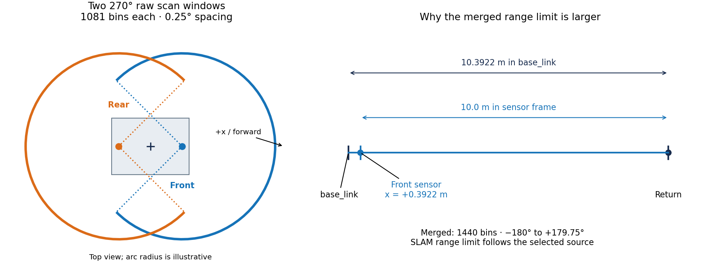

# Isaac 6.1 LiDAR pipeline

The two UST-10LX scans remain independent navigation inputs. `slam_source`
selects SLAM input only: `front_only` (the public default) uses the front scan;
`merged` explicitly enables a front/rear scan in `base_link`. The Gazebo
[parking demonstration](../exploration/parking_demo.md#scene-configuration-and-startup-gates)
selects `merged` by default.

```text
front RTX cloud ── 270° assembler ── front scan ──┬── navigation
                                               ├── front_only SLAM
                                               └──┐
                                                  ├── merger ── merged SLAM
rear RTX cloud ─── 270° assembler ── rear scan ──┬──┘
                                               └── navigation
```

## Current contracts



Each raw window is centered on its sensor's forward axis; the rear sensor
faces backward. The sensor origins are ±0.3922 m from `base_link`. The right
panel shows why a valid 10 m raw return requires a 10.3922 m merged limit.
Arc radii on the left illustrate angular coverage, not maximum range.
Regenerate with `python3 tools/isaac/lidar_qualification.py contract-plot
--out docs/isaac/assets/lidar/scan-contract.png`.

Topic names below are relative to `r100_0001`.

| Topic | Frame | Geometry | Declared range |
|---|---|---|---|
| `sensors/lidar2d_0/scan` | `lidar2d_0_laser` | 1081 bins, -135° through +135°, 0.25° | 0.06–10.0 m |
| `sensors/lidar2d_1/scan` | `lidar2d_1_laser` | same | 0.06–10.0 m |
| `sensors/scan_slam_merged` | `base_link` | 1440 bins, -180° through +179.75°, 0.25° | 0.06–10.3922 m |

Raw scans have a 0.025 s scan period. In deterministic qualification they
publish at 40 Hz in simulation time. A bin with no valid current return is
positive infinity; the assembler does not interpolate or retain old rays.
Nearest valid returns win when multiple points occupy a bin.

One `OmniLidar` prim per physical sensor produces a complete 360° Cartesian
cloud. `ros_io.LidarScanAssembler` clips it to the public 270° contract. The
internal rotary tick/scan rates are both 40 Hz and the firing rate is 57600 Hz,
giving 0.25° spacing. This avoids the missing sectors observed with the
previous clipped-rotary/two-half-cloud configuration on Isaac 6.1. The robot
importer reads `ust10lx_2d.json`; runtime uses the baked robot USD. Changing
the JSON alone does not change the runtime asset.

The raw scan contract applies after assembly; diagnostic `points` topics
contain full-circle renderer output and are not navigation scan inputs.

## Gazebo parity

Gazebo produces the same two raw scans from `gpu_lidar` sensors in the
Clearpath description. Its geometry, range, rate and frames match the table
above. The generated bridges publish them on `sensors/lidar2d_N/scan_gz`, and
`lidar_first_ray_guard` (Gazebo adapter) republishes each on
`sensors/lidar2d_N/scan` with `ranges[0]` set to NaN and every other field
unchanged; see [first ray](#gazebo-first-ray). `patches/clearpath_ust10lx_sim_lidar.patch` supplies the
UST-10LX values; the [dependency runbook](../project/dependency_patches.md#ust-10lx-gazebo-lidar-patch)
owns that patch. The two simulators still differ in three ways:

- **Range noise.** Isaac's RTX noise is Gaussian, unbiased and independent
  per bin, but its stddev grows with range, about `0.0126 m * r^0.80`
  (13 mm at 1 m, 38 mm at 4 m, 67 mm at 8 m). The authored
  `rangeAccuracyM` 0.04 is a scale, not a constant 1-sigma: it is matched only
  near 4.2 m. Gazebo's lidar noise is a single constant Gaussian stddev,
  `GAZEBO_RANGE_NOISE_STDDEV` in `ridgeback_common.lidar_contract` (0.036 m,
  Isaac's value at the benchmark's 3.7 m median target distance). Gazebo is
  therefore noisier than Isaac below about 3.7 m and quieter beyond.
- **Azimuth noise.** Gazebo has none, against Isaac's authored 0.01°. Its
  range-equivalent effect, `r * tan(incidence) * 0.01°`, is below 2 mm on the
  calibration walls, which is under 1% of the range variance.
- **The 10 m edge.** Isaac drops a return whose noisy range exceeds 10 m, so the
  bin reads `+inf`. Gazebo clamps a noisy finite return into
  `[range_min, range_max]`, so a surface just inside 10 m can read exactly
  10.0 m. Beams with no return stay `+inf` on both.

### Gazebo first ray

The installed gz-rendering GPU rays do not measure Gazebo's first ray along
its labelled -135° bearing. Where it and its neighbour are both finite, they
differ by more than 0.3 m in 90–100% of scans, and the first ray tracks the
rays near -45° (bins 359–361) instead. The other edge pairs checked (bins 1–3
and 1078–1080, so the last ray too) agree in about 99% of scans. SLAM integrated those endpoints
as isolated occupied cells that no other ray supported. One such cell inside
the robot's start footprint rejected every parking route. The guard marks that
one bin erroneous (NaN,
REP 117); SLAM, Nav2 and the repository's consumers skip non-finite ranges.
Clearpath's generated bridge launch files stay unchanged: `gazebo.launch.py`
adds one node-targeted remap per `lidar2d` in `robot.yaml`
(`<lidar>_gz_bridge:<ns>/sensors/<lidar>/scan`), so no other node is renamed.
Isaac and hardware scans are not affected.

The bins at the ±45° cube-map face seams (360 and 720) also read `+inf` far
more often than their neighbours. Bin 360 (-45°) also returns phantom short
ranges on both LiDARs, more than 0.3 m short of two agreeing neighbours, in
roughly 10–26% of scans. The parking clearance monitor treats those as real
returns, so they can veto a parking leg. Both seam bins are currently left
unchanged.

Gazebo scans before and after the guard are different populations: do not
pair LiDAR-dependent Gazebo results across that change.

Neither simulator quantises published ranges to `rangeResolutionM`. Gazebo's
bridge leaves `scan_time` at 0, while the Isaac assembler sets it to 0.025 s.
No consumer in this repository reads that field; the merger only copies it
through.

Noise changes reproducibility. This launch path sets no explicit Gazebo
random seed, and both noisy scans and LiDAR-dependent estimates differed
between identical examples runs. Two stationary Isaac sessions had strongly
correlated noise at matching simulation times, but their scans were still
different; Isaac's full benchmark determinism remains unqualified. Neither
measured LiDAR path was bit-reproducible, so LiDAR-dependent A/B comparisons
need repeats.

## Merger and range limits

The front scan supplies the output timestamp. Static sensor poses are
front `(0.3922, 0, 0)` and rear `(-0.3922, 0, pi)` relative to `base_link`.
For equal stamps the rear points need only the static transform. For skewed
stamps within the 20 ms tolerance, they use:

```text
rear sensor at t_rear
   → base_link at t_rear → odom → base_link at t_front → merged angular bins
```

The motion transform uses `odom → base_link`, never SLAM's own map correction.
Both `/tf` and `/tf_static` are remapped to namespaced topics. An unavailable
odom transform drops the rear contribution and increments TF-miss/rear-drop
counters; it is not counted as a successful pair.

Front callbacks wait up to twice the pairing tolerance from local receipt
for a rear callback. This receipt deadline avoids mistaking queued startup
messages for a missing rear sensor. A steady-clock timer resolves expired
entries even when no further scans arrive.

A 10 m forward ray from the front sensor is 10.3922 m from `base_link`.
Accordingly, SLAM's `max_laser_range` is rewritten to 10.0 for `front_only`
and 10.3922 for `merged`. `scan_buffer_maximum_scan_distance` is unchanged:
it is not a ray-range limit. Transformed points outside the declared output
limits are excluded before nearest-return reduction.

The merger logs distinct counts for equal-stamp pairs, compensated pairs,
front-only publishes, rear drops, and TF misses. Equal simulator timestamps
can bypass compensation; only observed deltas and counters establish whether
that happens in a particular run.

## Qualification procedure

The procedure below separates sensor coverage, skew compensation, geometry,
and closed-loop SLAM checks. A scan topic alone does not prove aperture
coverage, and an equal-stamp simulator run does not exercise compensation.
Use fresh, uncontended runs before changing the public `front_only` default.
Raw evidence belongs under ignored `artifacts/isaac-lidar-qualification/`.

- Stabilize geometry, regenerate analytic `initial_test_world` GT, verify dependencies,
  rebuild affected packages, and inspect installed copied executables.
- Use a dedicated, empty ROS domain and fresh headless deterministic boots at
  `rtf:=1.0`. Disable camera, target localization, RViz, coverage overlay, and
  autonomous frontier motion. Start with `odom_noise:=0.0 noise_seed:=0`.
- Run `tools/isaac/lidar_qualification.py capture --pairs 500` during controlled
  rotation. Inspect every-message geometry, all 45° sectors, independent
  sensor contributions, finite-range validity, exact deltas, and cumulative
  counters from boot. Record all launch arguments with repeated `--launch-arg`.
- Use `windows` for consecutive internal RTX clouds (`--legacy-halves` only
  when diagnosing the old two-cloud configuration). Receipt of a cloud alone
  does not establish angular coverage.
- On a separate empty domain, run `skew`: namespaced TF only, scans 10 ms
  apart, rotating odometry, rear contribution, and a real transformed 10 m
  ray. Require compensated pairs and zero TF misses.
- Run the scan-versus-GT geometry check and preserve plots and logs.
- Run `matrix --gt-grid <grid.npz> --out <new-directory>` for fresh simulator
  and SLAM state per trial: noises 0 then 1; seeds 0, 1, 2; front then merged
  at each seed. It stops at the first failed trial and retains its artifacts.
  Diagnose failures before rerunning with `--condition noise/seed/source`.
  Use `--start-at noise/seed/source` to resume the remaining ordered sequence
  in a new artifact directory. The runner refuses an occupied GPU and stops
  if a second GPU process appears; the summarizer rejects such trials.
- Use `summarize '<repo-relative-glob>/*_metrics.json'` only on the 12 accepted
  trial files. Require 3/3 complete runs per condition and finite metrics.
  Report min/median/max and seed-paired merged-minus-front deltas. Preserve
  rejected attempts with the reason; do not silently select favorable runs.

`noise_seed=N` seeds Isaac odometry with N and IMU noise with N+1; seed 0
preserves the original streams. The argument is not forwarded to Gazebo or
hardware. Public invocation details are owned by the [README](../../README.md).

## Archived evidence

- [October 30, 2026 Gazebo first-ray artifact and start-cell diagnosis](../../archive/engineering/2026-10-30-gazebo-lidar-first-ray-artifact.md)
- [October 25, 2026 UST-10LX noise measurement and Gazebo parity](../../archive/engineering/2026-10-25-gazebo-ust10lx-lidar.md)
- [September 17–18, 2026 lidar and SLAM qualification](../../archive/engineering/2026-09-17-isaac-lidar-qualification.md)
- [Invalidated July 2026 investigation](../../archive/engineering/2026-07-12-isaac-slam-investigation.md)
