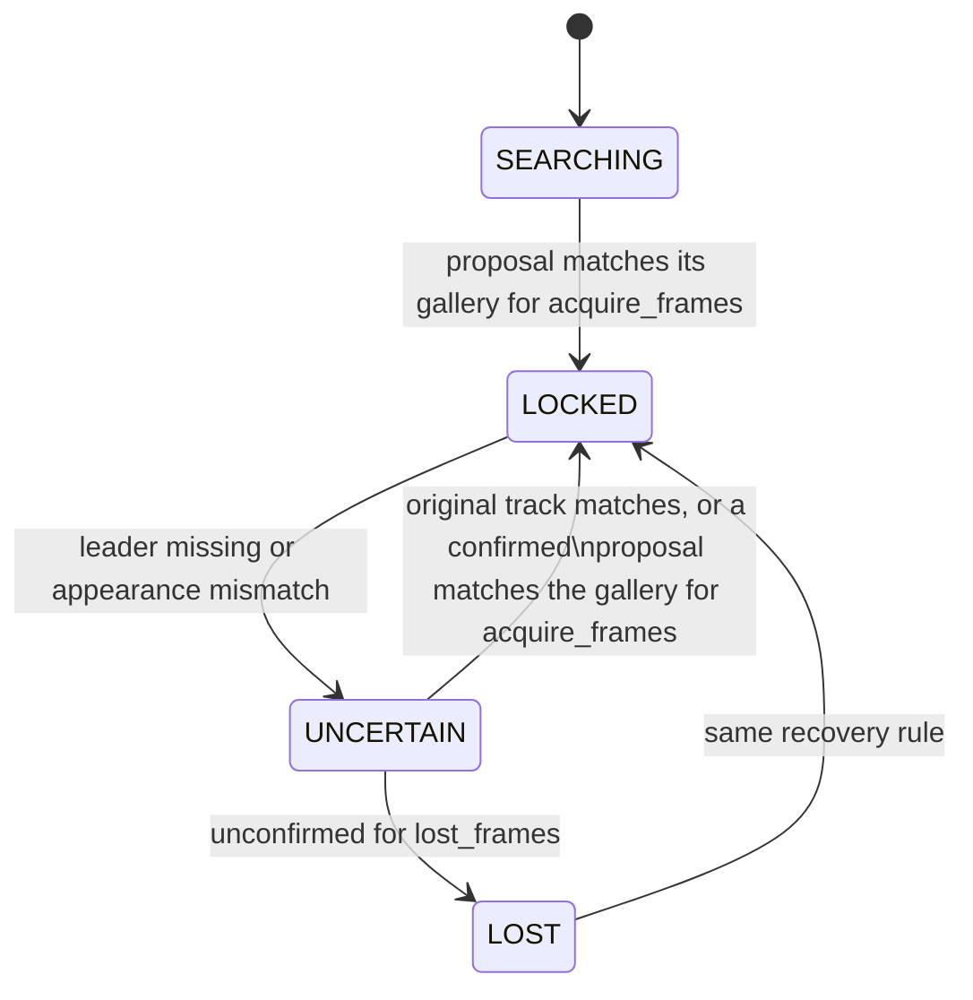

# Leader following

Crowd leader following: the robot locks onto one person and follows them
through people. This page owns the implemented packages, messages and nodes.
The remaining work, target node graph and evaluation protocol live in the
[FOLLOWING plan](../plans/FOLLOWING_leader_in_crowds.md). A plain-language
visual explainer for people outside the project is
[assets/explainer.html](assets/explainer.html).

## Packages

| Package | Contents |
|---|---|
| `src/leader_follow_interfaces` | `Person`, `People` and `LeaderState` messages |
| `src/ridgeback_leader_follow` | Leader lock, `leader_identity`, RGB-D/lidar people fusion and simulation/benchmark helpers |

Both are additive: no existing package depends on them. Identity/tracking
nodes use standard topics and TF; the separate F1 helpers own simulated
pedestrian motion and ground-truth recording.

## Messages

The `.msg` files are the authority; this summarizes their contract.

- **`People`**: header plus `Person[]`. Positions and velocities are in the
  header frame (normally `odom`).
- **`Person`**: stable `id`, `position`, `velocity`, detection `confidence` and
  an L2-normalised re-identification `appearance` embedding that is empty while
  the person is out of camera view.
- **`LeaderState`**: header, `state` (`SEARCHING`, `LOCKED`, `UNCERTAIN`,
  `LOST`), machine-readable `reason`, and the selected person's `track_id` and
  `position` when `has_leader` is true. Only `LOCKED` may drive motion; while
  `SEARCHING` or recovering, the selected person is a candidate being confirmed.

## `leader_identity` node

Subscribes to `leader_follow/people` and publishes one `LeaderState` per
message on `leader_follow/leader`; both topics are relative, so they follow the
robot namespace.

```bash
ros2 launch ridgeback_leader_follow leader_identity.launch.py namespace:=r100_0001 use_sim_time:=true
```

| Parameter | Default | Meaning |
|---|---|---|
| `people_topic`, `leader_topic` | `leader_follow/people`, `leader_follow/leader` | Input and output topics |
| `base_frame` | `base_link` | Frame in which "in front" is judged |
| `acquire_range` | `2.0` | Metres; farthest person that can be locked onto |
| `acquire_half_angle_deg` | `30.0` | Half-width of the front sector |
| `acquire_interval` | `8` | Messages between acquisition attempts while searching |
| `acquire_frames` | `3` | Consecutive matching messages needed to lock or recover |
| `lost_frames` | `8` | Unconfirmed messages before `UNCERTAIN` becomes `LOST` |
| `match_threshold` | `0.72` | Minimum cosine similarity to the leader's appearance gallery |
| `recovery_margin` | `0.05` | Minimum similarity separation from competing recovery candidates |
| `tf_wait_timeout` | `0.25` | Seconds to queue an observation for exact-stamp TF before failing closed |
| `acquire_distance_tolerance`, `acquire_lateral_tolerance` | `0.0`, `0.0` | Optional geometric tie tolerances; selected F3 profile supplies its configured values |

Behaviour:

- **Acquisition.** The nearest person inside the front sector, with positions
  transformed into `base_frame` through TF at the message stamp. Without that
  transform nobody is proposed (`reason: no_base_transform`).
- **Confirmation.** A proposal locks only after it matches its own appearance
  gallery for `acquire_frames` messages. Recovery after a loss also requires the
  stored gallery to match with separation from competing appearance candidates.
- **Fails closed without appearance.** A person whose `appearance` is empty
  cannot be confirmed, so the lock never reaches `LOCKED` until the tracker
  supplies embeddings. Once verified, an empty appearance can hold the existing
  lock through fresh, physically consistent observations of the same track.
  Recovery normally requires appearance; the original lidar track can also
  recover after a short, motion-consistent observation gap. The [recognition reference](recognition.md)
  owns the F3 implementation and its validation limits.



## People tracker node

`people_tracker` publishes camera-confirmed RGB-D/lidar Kalman tracks as
`People`, including velocity and stable association IDs. The
[tracker reference](people_tracker.md) owns sensor synchronization, calibration,
parameters and launch commands. Optional F3 encoders populate appearance vectors
for camera observations; the default remains empty until a model is configured.
The [benchmark reference](benchmarks.md) owns candidate selection and evidence.

## Camera people module

`ridgeback_leader_follow/camera_people.py` detects every person with YOLO and
associates them over frames with BoT-SORT; the appearance embedding function is
injected so a learned re-identification model plugs in unchanged. It is a
library only and one candidate in the F2 detector and tracker benchmark, not a
chosen method; it needs `ultralytics` in the compute environment.

## Crowd simulation

The F1 `crowd_scene` and `qualify_crowd` executables provide all six scene
families, including three crowd densities, in Gazebo and Isaac. They use a
shared licensed animated human asset, the production Ridgeback model and
camera/lidar bindings, and separate simulator-observed ground-truth logs.
The observation robot stays stationary. The [F2 benchmark](benchmarks.md)
evaluates tracking; [F3 recognition](recognition.md) uses separate outfit-profile
recordings. Following control remains later-phase work.

The [crowd simulation reference](simulation.md) owns scene definitions,
commands, asset attribution, sensor readiness, recording, artifact contracts,
qualification gates and limitations.

## Provenance

The lock state machine and camera tracker were ported from the OmTrackVLA
repository's
[`leader_follow` package](https://github.com/Cognitive-Software-Labs/OmTrackVLA/tree/86b1c6e/leader_follow),
where the state machine was checked against the original OmTrackVLA target
wrapper on 24,000 scripted frames with no differences.
