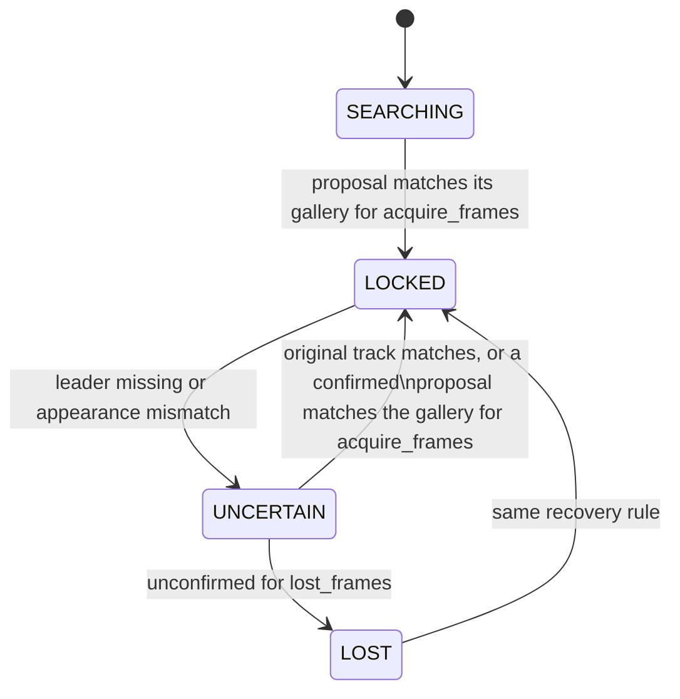

# Leader following

Crowd leader following: the robot locks onto one person and follows them
through people. This page owns the implemented packages, messages and nodes.
The remaining work, target node graph and evaluation protocol live in the
[FOLLOWING plan](../plans/FOLLOWING_leader_in_crowds.md). A plain-language
visual explainer for people outside the project is
[assets/explainer.html](assets/explainer.html).

## Packages

| Package | Contents |
|---|---|
| `src/leader_follow_interfaces` | `Person`, `People` and `LeaderState` messages |
| `src/ridgeback_leader_follow` | Leader lock, `leader_identity`, RGB-D/lidar people fusion and simulation/benchmark helpers |

Both are additive: no existing package depends on them. Identity/tracking
nodes use standard topics and TF; the separate F1 helpers own simulated
pedestrian motion and ground-truth recording.

## Messages

The `.msg` files are the authority; this summarizes their contract.

- **`People`**: header plus `Person[]`. Positions and velocities are in the
  header frame (normally `odom`).
- **`Person`**: stable `id`, `position`, `velocity`, detection `confidence` and
  an L2-normalised re-identification `appearance` embedding that is empty while
  the person is out of camera view.
- **`LeaderState`**: header, `state` (`SEARCHING`, `LOCKED`, `UNCERTAIN`,
  `LOST`), machine-readable `reason`, and the selected person's `track_id` and
  `position` when `has_leader` is true. Only `LOCKED` may drive motion; while
  `SEARCHING` or recovering, the selected person is a candidate being confirmed.

## `leader_identity` node

Subscribes to `leader_follow/people` and publishes one `LeaderState` per
message on `leader_follow/leader`; both topics are relative, so they follow the
robot namespace.

```bash
ros2 launch ridgeback_leader_follow leader_identity.launch.py namespace:=r100_0001 use_sim_time:=true
```

| Parameter | Default | Meaning |
|---|---|---|
| `people_topic`, `leader_topic` | `leader_follow/people`, `leader_follow/leader` | Input and output topics |
| `base_frame` | `base_link` | Frame in which "in front" is judged |
| `acquire_range` | `2.0` | Metres; farthest person that can be locked onto |
| `acquire_half_angle_deg` | `30.0` | Half-width of the front sector |
| `acquire_interval` | `8` | Messages between acquisition attempts while searching |
| `acquire_frames` | `3` | Consecutive matching messages needed to lock or recover |
| `lost_frames` | `8` | Unconfirmed messages before `UNCERTAIN` becomes `LOST` |
| `match_threshold` | `0.72` | Minimum cosine similarity to the leader's appearance gallery |
| `recovery_margin` | `0.05` | Minimum similarity separation from competing recovery candidates |
| `tf_wait_timeout` | `0.25` | Seconds to queue an observation for exact-stamp TF before failing closed |
| `acquire_distance_tolerance`, `acquire_lateral_tolerance` | `0.0`, `0.0` | Optional geometric tie tolerances; selected F3 profile supplies its configured values |

Behaviour:

- **Acquisition.** The nearest person inside the front sector, with positions
  transformed into `base_frame` through TF at the message stamp. Without that
  transform nobody is proposed (`reason: no_base_transform`).
- **Confirmation.** A proposal locks only after it matches its own appearance
  gallery for `acquire_frames` messages. Recovery after a loss also requires the
  stored gallery to match with separation from competing appearance candidates.
- **Fails closed without appearance.** A person whose `appearance` is empty
  cannot be confirmed, so the lock never reaches `LOCKED` until the tracker
  supplies embeddings. Once verified, an empty appearance can hold the existing
  lock through fresh, physically consistent observations of the same track.
  Recovery normally requires appearance; the original lidar track can also
  recover after a short, motion-consistent observation gap. The [recognition reference](recognition.md)
  owns the F3 implementation and its validation limits.



## People tracker node

`people_tracker` publishes camera-confirmed RGB-D/lidar Kalman tracks as
`People`, including velocity and stable association IDs. The
[tracker reference](people_tracker.md) owns sensor synchronization, calibration,
parameters and launch commands. Optional F3 encoders populate appearance vectors
for camera observations; the default remains empty until a model is configured.
The [benchmark reference](benchmarks.md) owns candidate selection and evidence.

## Camera people module

`ridgeback_leader_follow/camera_people.py` detects every person with YOLO and
associates them over frames with BoT-SORT; the appearance embedding function is
injected so a learned re-identification model plugs in unchanged. It is a
library only and one candidate in the F2 detector and tracker benchmark, not a
chosen method; it needs `ultralytics` in the compute environment.

## `follow_controller` node

F4 closed-loop following, started in simulation. `follow_controller`
subscribes to `leader_follow/leader` and sends Nav2's `navigate_to_pose` a
standoff goal `follow_distance` short of the leader, facing it, with the
[`follow_leader.xml`](../../src/ridgeback_leader_follow/config/behavior_trees/follow_leader.xml)
behaviour tree. While the lock holds it refreshes that goal on `goal_update`;
the tree replans at 5 Hz. The goal leads the leader's smoothed velocity by
`lead_time` plus the state's age. Without that lead the robot only matched the
leader's speed and trailed by a constant gap. Within
`follow_distance + hold_tolerance` the robot only turns to face the leader.

It cancels navigation, which stops the robot, whenever the state is not
`LOCKED`, is older than `stale_timeout`, is not in `global_frame`, or the robot
pose is unavailable. Nav2 supplies planning, obstacle clearance, speed limits
and the collision monitor. `leader_follow/follow_status` publishes
`following`, `holding` or `stopped` with its reason.

| Parameter | Default | Meaning |
|---|---|---|
| `follow_distance` | `1.2` | Metres from robot centre to the leader |
| `hold_tolerance` | `0.15` | Extra metres within which the robot only turns |
| `lead_time` | `1.5` | Seconds of predicted leader motion added to the goal |
| `stale_timeout` | `0.5` | Seconds before a missing `LOCKED` state stops the robot |
| `global_frame`, `base_frame` | `odom`, `base_link` | Goal frame and robot frame |

`follow_leader.launch.py` starts the F3 recognition pipeline, the Nav2
servers from `config/follow_nav2_params.yaml` and `follow_controller`. That
file is the exploration Nav2 configuration with `odom` as the global frame (no
map or SLAM), a 20 m rolling global costmap without a static layer, a 0.9 m/s
MPPI forward limit and a 0.3 rad goal heading tolerance. Exploration
configuration is unchanged. In both simulators `--drive` lets the crowd
runner move the robot from `cmd_vel`, paces simulation to
`--real-time-factor` (default 0.5, so perception keeps up) and holds people at
their start poses until the follow stack publishes. It also writes
`robot_truth.csv` from simulator truth: the Isaac rig pose, or the Gazebo
`r100_0001/robot` model pose. Gazebo's odometry topic is
`platform/odom/filtered`; pass `odom_topic:=platform/odom/filtered` to the
launch. Run the two in one private ROS domain:

```bash
export ROS_DOMAIN_ID=171 RMW_IMPLEMENTATION=rmw_cyclonedds_cpp
OMNI_KIT_ACCEPT_EULA=YES isaac_venv/bin/python -m ridgeback_leader_follow.crowd_runner \
  --backend isaac --scene-profile f3 --scenario leader_alone --drive --ros-domain 171 &
ros2 launch ridgeback_leader_follow follow_leader.launch.py
```

For Gazebo, run `ros2 run ridgeback_leader_follow crowd_scene --backend gz ...`
with the same scene options. Run both from the workspace root so the tracker
finds `perception_venv`. The remaining scenarios and the plan's metrics are
not yet implemented.

## Crowd simulation

The F1 `crowd_scene` and `qualify_crowd` executables provide all six scene
families, including three crowd densities, in Gazebo and Isaac. They use a
shared licensed animated human asset, the production Ridgeback model and
camera/lidar bindings, and separate simulator-observed ground-truth logs.
The observation robot stays stationary unless an Isaac run passes `--drive`
(see [`follow_controller`](#follow_controller-node)). The [F2 benchmark](benchmarks.md)
evaluates tracking; [F3 recognition](recognition.md) uses separate outfit-profile
recordings.

The [crowd simulation reference](simulation.md) owns scene definitions,
commands, asset attribution, sensor readiness, recording, artifact contracts,
qualification gates and limitations.

## Provenance

The lock state machine and camera tracker were ported from the OmTrackVLA
repository's
[`leader_follow` package](https://github.com/Cognitive-Software-Labs/OmTrackVLA/tree/86b1c6e/leader_follow),
where the state machine was checked against the original OmTrackVLA target
wrapper on 24,000 scripted frames with no differences.

## Archived evidence

- [First closed-loop following in Isaac](../../archive/engineering/2026-11-11-f4-first-follow.md) — leader-alone tuning runs and distance-keeping results.
- [Closed-loop following in Gazebo](../../archive/engineering/2026-11-11-f4-gazebo-follow.md) — first Gazebo leader-alone run.
