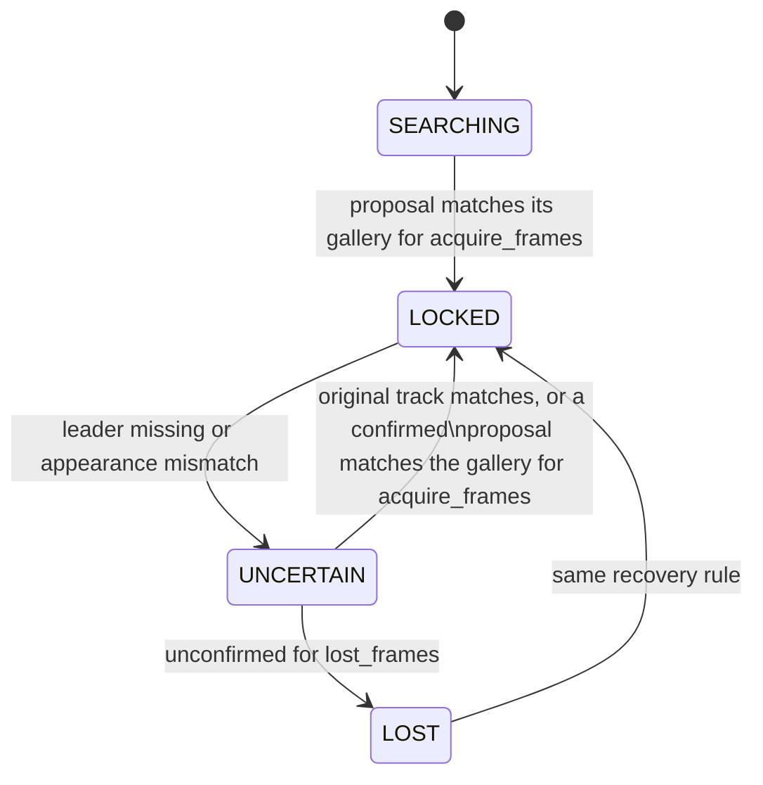

# Leader following

Crowd leader following: the robot locks onto one person and follows them
through people. This page owns the implemented packages, messages and nodes.
The remaining work, target node graph and evaluation protocol live in the
[FOLLOWING plan](../plans/FOLLOWING_leader_in_crowds.md). A plain-language
visual explainer for people outside the project is
[assets/explainer.html](assets/explainer.html).

## Packages

| Package | Contents |
|---|---|
| `src/leader_follow_interfaces` | `Person`, `People` and `LeaderState` messages |
| `src/ridgeback_leader_follow` | Leader lock, `leader_identity`, RGB-D/lidar people fusion and simulation/benchmark helpers |

Both are additive: no existing package depends on them. Identity/tracking
nodes use standard topics and TF; the separate F1 helpers own simulated
pedestrian motion and ground-truth recording.

## Messages

The `.msg` files are the authority; this summarizes their contract.

- **`People`**: header plus `Person[]`. Positions and velocities are in the
  header frame (normally `odom`).
- **`Person`**: stable `id`, `position`, `velocity`, detection `confidence` and
  an L2-normalised re-identification `appearance` embedding that is empty while
  the person is out of camera view.
- **`LeaderState`**: header, `state` (`SEARCHING`, `LOCKED`, `UNCERTAIN`,
  `LOST`), machine-readable `reason`, and the selected person's `track_id` and
  `position` when `has_leader` is true. Only `LOCKED` may drive motion; while
  `SEARCHING` or recovering, the selected person is a candidate being confirmed.

## `leader_identity` node

Subscribes to `leader_follow/people` and publishes one `LeaderState` per
message on `leader_follow/leader`; both topics are relative, so they follow the
robot namespace.

```bash
ros2 launch ridgeback_leader_follow leader_identity.launch.py namespace:=r100_0001 use_sim_time:=true
```

| Parameter | Default | Meaning |
|---|---|---|
| `people_topic`, `leader_topic` | `leader_follow/people`, `leader_follow/leader` | Input and output topics |
| `base_frame` | `base_link` | Frame in which "in front" is judged |
| `acquire_range` | `2.0` | Metres; farthest person that can be locked onto |
| `acquire_half_angle_deg` | `30.0` | Half-width of the front sector |
| `acquire_interval` | `8` | Messages between acquisition attempts while searching |
| `acquire_frames` | `3` | Consecutive matching messages needed to lock or recover |
| `lost_frames` | `8` | Unconfirmed messages before `UNCERTAIN` becomes `LOST` |
| `match_threshold` | `0.72` | Minimum cosine similarity to the leader's appearance gallery |
| `recovery_margin` | `0.05` | Minimum similarity separation from competing recovery candidates |
| `tf_wait_timeout` | `0.25` | Seconds to queue an observation for exact-stamp TF before failing closed |
| `acquire_distance_tolerance`, `acquire_lateral_tolerance` | `0.0`, `0.0` | Optional geometric tie tolerances; selected F3 profile supplies its configured values |

Behaviour:

- **Acquisition.** The nearest person inside the front sector, with positions
  transformed into `base_frame` through TF at the message stamp. Without that
  transform nobody is proposed (`reason: no_base_transform`).
- **Confirmation.** A proposal locks only after it matches its own appearance
  gallery for `acquire_frames` messages. Recovery after a loss also requires the
  stored gallery to match with separation from competing appearance candidates.
- **Fails closed without appearance.** A person whose `appearance` is empty
  cannot be confirmed, so the lock never reaches `LOCKED` until the tracker
  supplies embeddings. Once verified, an empty appearance can hold the existing
  lock through fresh, physically consistent observations of the same track.
  Recovery normally requires appearance; the original lidar track can also
  recover after a short, motion-consistent observation gap. The [recognition reference](recognition.md)
  owns the F3 implementation and its validation limits.



## People tracker node

`people_tracker` publishes camera-confirmed RGB-D/lidar Kalman tracks as
`People`, including velocity and stable association IDs. The
[tracker reference](people_tracker.md) owns sensor synchronization, calibration,
parameters and launch commands. Optional F3 encoders populate appearance vectors
for camera observations; the default remains empty until a model is configured.
The [benchmark reference](benchmarks.md) owns candidate selection and evidence.

## Camera people module

`ridgeback_leader_follow/camera_people.py` detects every person with YOLO and
associates them over frames with BoT-SORT; the appearance embedding function is
injected so a learned re-identification model plugs in unchanged. It is a
library only and one candidate in the F2 detector and tracker benchmark, not a
chosen method; it needs `ultralytics` in the compute environment.

## `follow_controller` node

F4 closed-loop following, started in simulation. `follow_controller`
subscribes to `leader_follow/leader` and sends Nav2's `navigate_to_pose` a
standoff goal `follow_distance` short of the leader, facing it, with the
[`follow_leader.xml`](../../src/ridgeback_leader_follow/config/behavior_trees/follow_leader.xml)
behaviour tree. While the lock holds it refreshes that goal on `goal_update`;
the tree replans at 5 Hz. The goal leads the leader's smoothed velocity by
`lead_time` plus the state's age. Without that lead the robot only matched the
leader's speed and trailed by a constant gap. Within
`follow_distance + hold_tolerance` the robot only turns to face the leader.

It cancels navigation, which stops the robot, whenever the state is not
`LOCKED`, is older than `stale_timeout`, is not in `global_frame`, or the robot
pose is unavailable. Nav2 supplies planning, obstacle clearance, speed limits
and the collision monitor.

The controller server publishes `cmd_vel_mppi`. While following or holding,
`follow_controller` replaces its turn rate with `heading_gain` times the
leader's bearing error, limited to `max_heading_rate`, and republishes it on
`cmd_vel_nav`. The holonomic base then keeps the camera on the leader while
MPPI steers translation around people. While following, it also caps the
translation speed at the leader's pace: the leader's velocity away from the
robot plus `pace_gain` per metre beyond `follow_distance`, at most
`max_pace`, keeping MPPI's direction. The robot slows and stops with the
leader, and a leader who turns back toward the robot stops it rather than
raising the cap. The cap only lowers MPPI's speed. Otherwise the command
passes through unchanged. `leader_follow/follow_status` publishes
`following`, `holding` or `stopped` with its reason.

| Parameter | Default | Meaning |
|---|---|---|
| `follow_distance` | `1.2` | Metres from robot centre to the leader |
| `hold_tolerance` | `0.15` | Extra metres within which the robot only turns |
| `lead_time` | `1.5` | Seconds of predicted leader motion added to the goal |
| `stale_timeout` | `0.5` | Seconds before a missing `LOCKED` state stops the robot |
| `heading_gain`, `max_heading_rate` | `2.0`, `1.0` | Turn toward the leader: rad/s per rad of bearing error, and its limit |
| `pace_matching`, `pace_gain`, `max_pace` | `true`, `0.8`, `1.3` | Cap translation at the leader's receding speed plus this gain per metre of gap error, and its limit |
| `global_frame`, `base_frame` | `odom`, `base_link` | Goal frame and robot frame |

Whenever the controller server is silent for 0.15 s (navigation cancelled,
aborted or not started), `follow_controller` publishes an explicit zero
command, still turning toward a locked leader. Gazebo's drive bridge has no
command timeout and otherwise kept executing the last non-zero command.

## `people_predictor` node

`people_predictor` tells Nav2 where bystanders are heading. It takes the
tracker's people and its lidar-only walkers (`leader_follow/moving_people`,
people outside the camera view; see the [tracker](people_tracker.md#lidar-walkers)).
It drops the leader and any lidar walker within `leader_exclusion` of the
leader's last track, extrapolated for up to `leader_memory` seconds. For
everyone else it publishes:

- `leader_follow/people_obstacles`: a `PointCloud2` in the robot frame marking
  each body (0.3 m) now and along 1 s of constant-velocity prediction. The
  `people_layer` in both follow costmaps consumes it; a ring of points beyond
  its 6 m marking range clears the previous prediction on every update.
- `speed_limit`: Nav2's controller speed limit. Candidate speeds from
  `max_speed` down to `min_speed` along the robot's direction of travel (its
  heading when nearly still) are rolled out with the `acceleration` limit over
  `horizon` seconds. A predicted contact closer than `contact` is scored by
  impact speed, so an unavoidable contact is met slowly. Otherwise the score is
  how close and how soon the nearest pass comes inside `comfort`. The lowest
  score wins, with a small preference for speed. The robot brakes for a walker
  it would meet, but not for one who will pass behind it. Nav2 reads 0 as "no
  limit", so the floor is 0.05 m/s.

| Parameter | Default | Meaning |
|---|---|---|
| `horizon`, `mark_horizon` | `3.0`, `1.0` | Seconds of prediction for the speed limit and for the costmap |
| `comfort`, `contact` | `1.2`, `0.7` | Centre distances: no slowing needed, and treated as touching |
| `min_speed`, `max_speed`, `acceleration` | `0.05`, `1.3`, `1.0` | Speed-limit range (m/s) and the platform acceleration used in rollouts |
| `leader_exclusion`, `leader_memory` | `1.0`, `2.0` | Metres and seconds around the leader's last track where lidar walkers are ignored |
| `moving_max_age` | `0.25` | Seconds a lidar-walker message stays usable |

## Following launch and simulation

`follow_leader.launch.py` starts the F3 recognition pipeline, the Nav2
servers from `config/follow_nav2_params.yaml`, `people_predictor` and
`follow_controller`. That
file is the exploration Nav2 configuration with `odom` as the global frame (no
map or SLAM), a 20 m rolling global costmap without a static layer, a 10 m
local costmap, the platform's 1.3 m/s as MPPI's forward limit with wider
forward-speed sampling (`vx_std` 0.3), a stronger `PathFollowCritic` (weight
20, offset 20), a `people_layer` in both costmaps, and a 0.3 rad goal heading
tolerance. With the exploration weights MPPI itself stayed near 0.6 m/s, and a
5 m local costmap capped it below 1 m/s because MPPI follows only the path
inside it. The launch gives every costmap observation source its fully
qualified topic: Jazzy resolves relative ones inside the costmap's namespace,
where nothing publishes. The
collision monitor adds a stop zone about 0.25 m around the body and counts
two lidar points, so a person's legs register. Exploration
configuration is unchanged. In both simulators `--drive` lets the crowd
runner move the robot from `cmd_vel`, paces simulation to
`--real-time-factor` (default 0.5, so perception keeps up) and holds people at
their start poses until the follow stack publishes. It also writes
`robot_truth.csv` from simulator truth: the Isaac rig pose, or the Gazebo
`r100_0001/robot` model pose. Gazebo's odometry topic is
`platform/odom/filtered`; pass `odom_topic:=platform/odom/filtered` to the
launch. Gazebo's mecanum wheel model reports about twice the true heading
change when the base strafes while turning, and Clearpath's EKF takes
absolute yaw from wheel odometry. Gazebo `--drive` runs therefore write a
run-local `ekf_node` override that fuses only wheel velocities and takes yaw
from the IMU rate. Wheel velocities still overstate strafing, so odometry
position can drift by about a metre over the explainer scene; heading stays
within about one degree. Run the two in one private ROS domain:

```bash
export ROS_DOMAIN_ID=171 RMW_IMPLEMENTATION=rmw_cyclonedds_cpp
OMNI_KIT_ACCEPT_EULA=YES isaac_venv/bin/python -m ridgeback_leader_follow.crowd_runner \
  --backend isaac --scene-profile f3 --scenario leader_alone --drive --ros-domain 171 &
ros2 launch ridgeback_leader_follow follow_leader.launch.py
```

For Gazebo, run `ros2 run ridgeback_leader_follow crowd_scene --backend gz ...`
with the same scene options. Run both from the workspace root so the tracker
finds `perception_venv`. Add `--scene-profile realistic --environment
modern_office --scenario explainer` for the explainer office with all eleven
walkers. Two more scenarios use the same office and walkers:
`explainer_weave`, where the leader drifts 0.6 m either side of the
illustrated route, and `wander`, where the leader walks a random route through
the open hall for 40 s (`--seed`, default 0), clear of furniture and of the
other walkers. In `wander` the other walkers stand once their 24 s routes end.
`roam` keeps all of them moving for 60 s, each walking its route forward and
back, which preserves their spacing. Its leader takes 2–4.5 m legs with turns
up to 120°, a new pace of 0.6–1.35 m/s per stretch, and 1–3 s stops at about a
third of the corners. Routes that would walk the leader within 0.9 m of a
simulated follower are rejected (`--seed` as for `wander`).

`tools/run_leader_follow_sim` runs one simulation with the follow stack in a
private ROS domain and stops both when the scene ends. It defaults to Isaac,
the office and the wandering leader:

```bash
tools/run_leader_follow_sim --backend isaac --scenario crowd --gui
```

`--backend gz`, `--scenario NAME`, `--seed N`, `--output DIR` and other
`crowd_runner` options pass through. `--rviz` opens RViz with
`rviz/follow.rviz`: the leader and tracked people from `follow_markers`
(leader green while `LOCKED`, amber `UNCERTAIN`, red `LOST`), the global and
MPPI plans, the follow goal, both costmaps, predicted bystanders, the lidar
scans, the collision stop zone and the front camera. `--no-pace-matching`
turns the speed cap off. Evidence goes to
`artifacts/leader-following/<time>-follow-<backend>-<scenario>/`, with the
follow-stack log, `follow_recorder` events (`.events.jsonl`) and the
`follow_metrics` result (`.metrics.json`) beside it.

## Following metrics

`follow_recorder` logs the leader state, follow status, collision-monitor
actions and odometry during a run. `follow_metrics RUN...` scores runs against
simulator truth with the plan's metrics: correct-lock fraction, wrong-follow
time (locked on a bystander while not stopped), ID switches (changes of the
simulated person the lock points at), recovery time after each loss of the
leader and any unrecovered loss at the end, distance-keeping error
|centre distance − 1.2 m| from the first lock, closest leader approach,
minimum bystander clearance and collision-monitor stops. Lock targets are
mapped from odometry into the world through the recorded odometry and truth
robot poses, so odometry drift does not mislabel them. A run succeeds when the
scene completed with no wrong-follow time, locked on the leader in its last
second and within 3 m of them. For repeated configurations it reports the
success rate and each metric's median and range.

`tools/run_leader_follow_campaign` runs the matrix: by default the six
scenarios, with crowds of 2, 4 and 8, in both simulators, ten repetitions
each, one after another. It retries a run whose simulator failed or whose
Gazebo controller spawner timed out, keeps finished runs so an interrupted
campaign resumes, and writes `metrics.json` and `metrics.md`.

Scripted walkers do not avoid the robot, so a stopped robot can still be
walked into; the robot does not back away from a leader who walks back toward
it. After the lock is `LOST`, the robot stands still and does not turn to look
for a leader behind it. In the first Isaac `roam` runs (2026-11-13) the robot
reached 1.3 m/s but typically moved at about 0.45 m/s whatever the leader's
pace, trailing 2.5–2.8 m. The limiting stage, the bystander speed limit or
MPPI's approach to each short goal, is not yet identified. Under heavy host load, Clearpath's Gazebo controller spawner can time out
(5 s), leaving the robot unable to move.

## Crowd simulation

The F1 `crowd_scene` and `qualify_crowd` executables provide all six scene
families, including three crowd densities, in Gazebo and Isaac. They use a
shared licensed animated human asset, the production Ridgeback model and
camera/lidar bindings, and separate simulator-observed ground-truth logs.
The observation robot stays stationary unless an Isaac run passes `--drive`
(see [following launch](#following-launch-and-simulation)). The [F2 benchmark](benchmarks.md)
evaluates tracking; [F3 recognition](recognition.md) uses separate outfit-profile
recordings.

The [crowd simulation reference](simulation.md) owns scene definitions,
commands, asset attribution, sensor readiness, recording, artifact contracts,
qualification gates and limitations.

## Provenance

The lock state machine and camera tracker were ported from the OmTrackVLA
repository's
[`leader_follow` package](https://github.com/Cognitive-Software-Labs/OmTrackVLA/tree/86b1c6e/leader_follow),
where the state machine was checked against the original OmTrackVLA target
wrapper on 24,000 scripted frames with no differences.

## Archived evidence

- [First closed-loop following in Isaac](../../archive/engineering/2026-11-11-f4-first-follow.md) — leader-alone tuning runs and distance-keeping results.
- [Closed-loop following in Gazebo](../../archive/engineering/2026-11-11-f4-gazebo-follow.md) — first Gazebo leader-alone run.
- [Following speed and heading in the explainer office](../../archive/engineering/2026-11-11-f4-office-speed.md) — MPPI speed cap, stop zone, leader-facing turn control and the Gazebo lock losses.
- [Gazebo odometry heading during following](../../archive/engineering/2026-11-11-f4-gazebo-odometry.md) — mecanum yaw error, the IMU-yaw EKF override and the corrected explainer result.
- [Predicting bystanders during following](../../archive/engineering/2026-11-12-f4-people-prediction.md) — the side-crosser near miss, the speed-limit crossing grid, Gazebo office runs and closest approaches.
