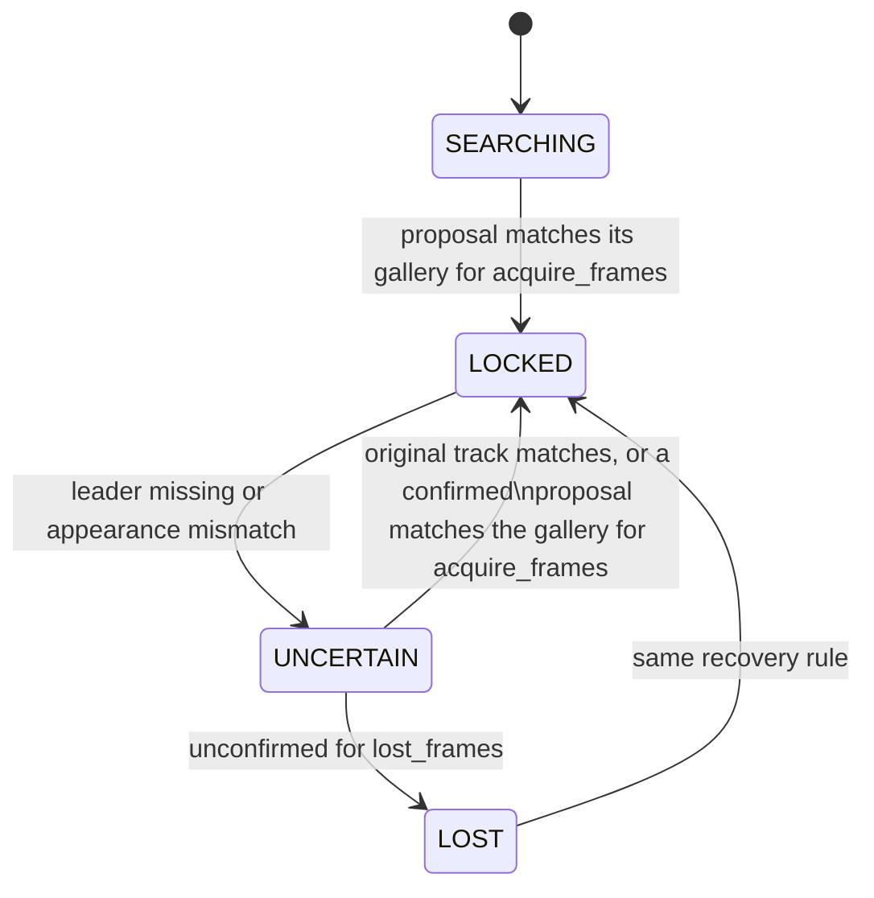

# Leader following

Crowd leader following: the robot locks onto one person and follows them
through people. This page owns the implemented packages, messages and nodes.
The remaining work, target node graph and evaluation protocol live in the
[FOLLOWING plan](../plans/FOLLOWING_leader_in_crowds.md). A plain-language
visual explainer for people outside the project is
[assets/explainer.html](assets/explainer.html).

## Packages

| Package | Contents |
|---|---|
| `src/leader_follow_interfaces` | `Person`, `People` and `LeaderState` messages |
| `src/ridgeback_leader_follow` | Leader lock state machine, `leader_identity` node, camera people tracker module |

Both are additive: no existing package depends on them, and they read only
standard topics and TF.

## Messages

The `.msg` files are the authority; this summarizes their contract.

- **`People`**: header plus `Person[]`. Positions and velocities are in the
  header frame (normally `odom`).
- **`Person`**: stable `id`, `position`, `velocity`, detection `confidence` and
  an L2-normalised re-identification `appearance` embedding that is empty while
  the person is out of camera view.
- **`LeaderState`**: header, `state` (`SEARCHING`, `LOCKED`, `UNCERTAIN`,
  `LOST`), machine-readable `reason`, and the selected person's `track_id` and
  `position` when `has_leader` is true. Only `LOCKED` may drive motion; while
  `SEARCHING` or recovering, the selected person is a candidate being confirmed.

## `leader_identity` node

Subscribes to `leader_follow/people` and publishes one `LeaderState` per
message on `leader_follow/leader`; both topics are relative, so they follow the
robot namespace.

```bash
ros2 launch ridgeback_leader_follow leader_identity.launch.py namespace:=r100_0001 use_sim_time:=true
```

| Parameter | Default | Meaning |
|---|---|---|
| `people_topic`, `leader_topic` | `leader_follow/people`, `leader_follow/leader` | Input and output topics |
| `base_frame` | `base_link` | Frame in which "in front" is judged |
| `acquire_range` | `2.0` | Metres; farthest person that can be locked onto |
| `acquire_half_angle_deg` | `30.0` | Half-width of the front sector |
| `acquire_interval` | `8` | Messages between acquisition attempts while searching |
| `acquire_frames` | `3` | Consecutive matching messages needed to lock or recover |
| `lost_frames` | `8` | Unconfirmed messages before `UNCERTAIN` becomes `LOST` |
| `match_threshold` | `0.72` | Minimum cosine similarity to the leader's appearance gallery |

Behaviour:

- **Acquisition.** The nearest person inside the front sector, with positions
  transformed into `base_frame` through TF at the message stamp. Without that
  transform nobody is proposed (`reason: no_base_transform`).
- **Confirmation.** A proposal locks only after it matches its own appearance
  gallery for `acquire_frames` messages. Recovery after a loss also requires the
  stored gallery to match, so the lock never jumps to a different person.
- **Fails closed without appearance.** A person whose `appearance` is empty
  cannot be confirmed, so the lock never reaches `LOCKED` until the tracker
  supplies embeddings. Track continuity as a second identity cue is planned.



## Camera people module

`ridgeback_leader_follow/camera_people.py` detects every person with YOLO and
associates them over frames with BoT-SORT; the appearance embedding function is
injected so a learned re-identification model plugs in unchanged. It is a
library only until the planned `people_tracker` node uses it, and needs
`ultralytics` in the compute environment.

## Provenance

The lock state machine and camera tracker were ported from the OmTrackVLA
repository's
[`leader_follow` package](https://github.com/Cognitive-Software-Labs/OmTrackVLA/tree/86b1c6e/leader_follow),
where the state machine was checked against the original OmTrackVLA target
wrapper on 24,000 scripted frames with no differences.
