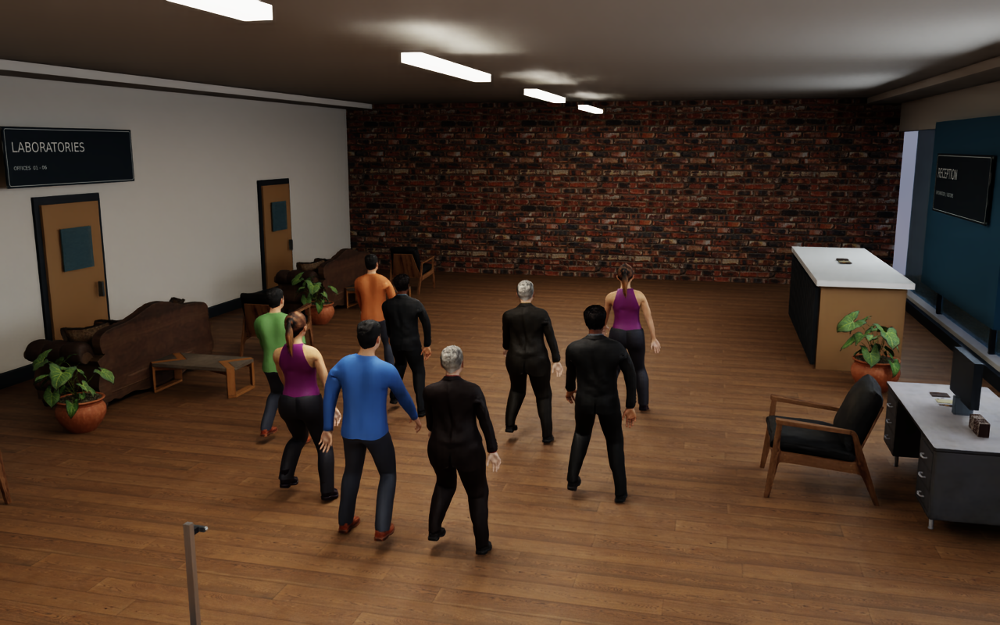
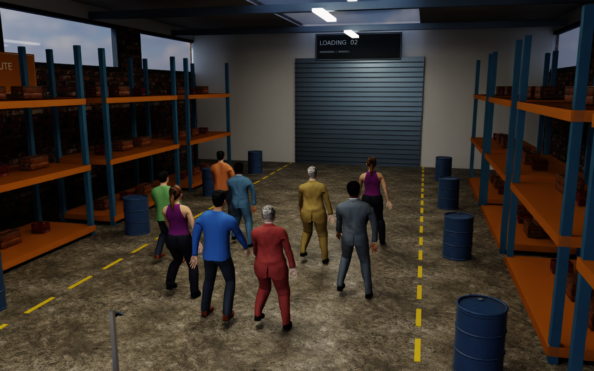
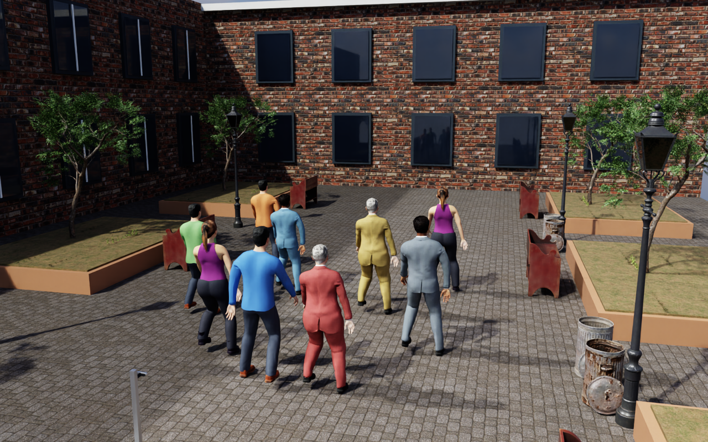
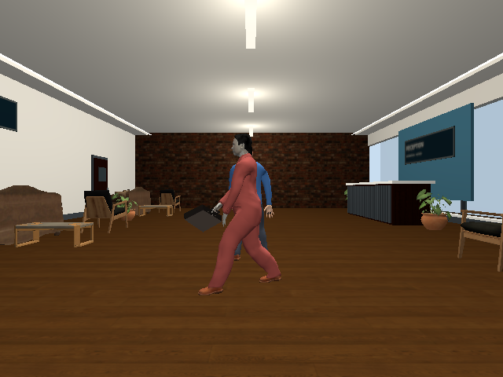
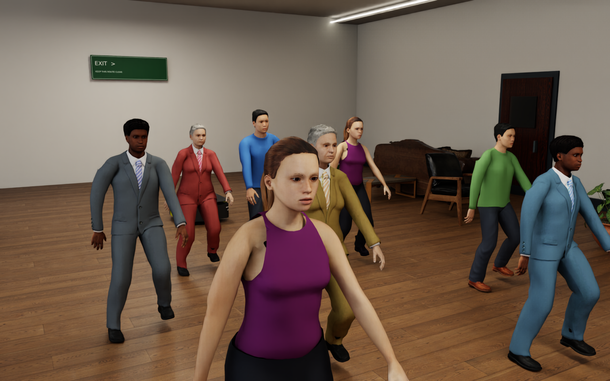

# Realistic simulation environments

The `realistic` scene profile adds furnished worlds and a varied pedestrian
cast to the crowd runner, with enclosed interiors, wayfinding signs and
textured architectural surfaces. The existing F1/F2/F3
benchmark results apply to their recorded profiles; they do not qualify these
new worlds or characters. The observation robot remains stationary.

## Worlds and people

| `--environment` | Contents |
|---|---|
| `office` | Wood floor, ceiling and cove lights, glazed frontage, reception counter, desks, monitors, books, notebooks, lounge furniture, plants, bins and room signs |
| `warehouse` | Concrete floor, roof/skylight and clerestory windows, storage racks, crates, barrels, aisle markings, loading door and pedestrian signs |
| `courtyard` | Paved walkways, planted grass/shrub beds, trees, benches, street lamps, bins, wayfinding and windowed building facades |

Four source characters are available: Sam and Maya in casual clothing, Harper
and Jordan in business clothing. Clothing colours and uniform stature scaling
provide additional variants. Casual trousers keep neutral colours when shirt
colours change. The cast reuses these four models; it is not a
population of independently modelled people. Look-alike scenarios deliberately
assign the leader and look-alike the same model, scale and clothing settings.
Appearance assignments are rendering/evaluation metadata, never a recognition
input. All routes are scripted rather than reactive pedestrian navigation.

Both simulators consume the shared layout and cast. Isaac uses evaluated mesh
animation and textured PreviewSurface materials with an OmniGlass surface for glazing; Gazebo uses native Collada
actors with per-person gait speed. Fixture UVs keep wall textures horizontal
and tile floor materials in metres. Rendering and material support differ. Isaac preserves source normal strength,
metallic/roughness texture channels and dielectric specular strength. Surface
roughness maps break up uniform highlights. Cloth texture brightness is
normalized before tinting so dark source suits retain the assigned colour.
Gazebo uses a flat assigned colour for textured business garments; it does not
reproduce Isaac's fabric shading. Source pixels remain unchanged.

Reception counters and doors use wood-grain textures. Office cove lights
illuminate the ceiling; warehouse clerestory openings admit daylight. Courtyard
grass and shrub strips use separate publisher opacity maps in both renderers.
These decorative plants have no collision geometry; trees retain trunk proxies. Gazebo
interiors add four ceiling point lights and emissive fixture surfaces. Its
fixture exporter namespaces Collada identifiers and gives copied architectural
maps unique basenames, preventing Ogre's shared resource registry from reusing
the wood-floor texture for brick walls or signs. These copies live in each
run's `fixtures/textures/` directory; publisher files remain unchanged.
The static converter removes loose wire edges (Collada `<lines>`), which
Gazebo would draw as unlit white strokes over tree foliage; triangle geometry
and texture pixels are unchanged.

Trees use a 180,000-triangle visual mesh derived from the source and simple
cylindrical trunk collisions in both backends. The proxy is approximate and
does not model foliage collision. Lidar rendering still uses the visible tree.
The Gazebo launch bridges `/world/leader_follow_scene/clock` to ROS `/clock`,
so startup does not depend on Gazebo also creating the short `/clock` topic.

## Run a scenario

Build and source the workspace as described in [simulation](simulation.md).
Then choose one world and scenario:

```bash
ros2 run ridgeback_leader_follow crowd_scene \
  --backend gz --scene-profile realistic --environment office \
  --scenario crossing --gui

isaac_venv/bin/python -m ridgeback_leader_follow.crowd_runner \
  --backend isaac --scene-profile realistic --environment courtyard \
  --scenario crowd --crowd-size 8 --gui
```

| Scenario | CLI name | Behaviour |
|---|---|---|
| Alone | `leader_alone` | Straight sections and turns in the realistic profile |
| Crossing | `crossing` | A passer-by crosses between observer and leader |
| Look-alike | `lookalike_parallel` | Matching-looking pedestrian walks beside the leader |
| Swap | `lookalike_crossing` | Leader and look-alike cross paths |
| Stop in a group | `leader_stop` | Leader stops among standing pedestrians |
| Crowd | `crowd` | Combined paths with `--crowd-size 2`, `4` or `8` bystanders |

`--environment` requires `--scene-profile realistic`; its default is `office`.
The other five routes reuse the original fixture paths. Only the realistic
alone route adds turns; original baseline and F3 routes are unchanged.
All normal recording, private-domain and owned-process cleanup options apply.

## Asset setup and conversion

Large mesh, animation, GLB and HDR files use Git LFS. After cloning, install
Git LFS and run `git lfs install` followed by `git lfs pull` from the repository.
Downloaded weights, virtual environments and raw run output remain under the
existing ignored directories.

The CC0 sources and conversion hashes are recorded in
[`sim/assets/realistic/NOTICE.md`](../../src/ridgeback_leader_follow/sim/assets/realistic/NOTICE.md)
and its adjacent `sources.json`. Powered by [Poly Haven](https://polyhaven.com).
The three additional characters are from Innerscene/MakeHuman. Maya's existing
attribution remains in its asset directory.

To rebuild from publisher files, use system Python with `requests`, then the
project's Blender 4.2.9 binary:

```bash
python3 src/ridgeback_leader_follow/sim/fetch_realistic_assets.py \
  src/ridgeback_leader_follow/sim/assets/realistic

artifacts/leader-following/tools/blender-4.2.9-linux-x64/blender -b \
  --python-exit-code 1 \
  --python src/ridgeback_leader_follow/sim/prepare_realistic_assets.py -- \
  src/ridgeback_leader_follow/sim/assets/realistic/props/sofa_03
```

Repeat conversion for each directory under `props/`. For each directory under
`humans/`, append `human` after the directory argument. Blender evaluates the
walk and exports the Gazebo skin; existing Maya assets are reused.
Static conversion verifies the exported world-space pose against the vertex
cache, and reduces source meshes above 250,000 polygons to a 180,000-triangle
budget. Material names are normalized during import to disambiguate duplicate
source names. Original wayfinding textures are regenerated with
`python3 src/ridgeback_leader_follow/sim/prepare_scene_signs.py`. Compare
regenerated files against the source/conversion receipts before replacing a
recorded population. Publisher content may change despite retaining its URL.

## Visual review and validation

Render the three worlds without starting ROS nodes:

```bash
OMNI_KIT_ACCEPT_EULA=YES isaac_venv/bin/python \
  src/ridgeback_leader_follow/sim/preview_realistic.py \
  --output artifacts/leader-following/realistic-previews
```

The renderer closes after writing overview, human-height and cast PNGs and USD
snapshots. Current checks cover static obstacle clearance across all six
scenario families in all three layouts, cast assignment, turn geometry,
Collada texture paths, actor scales and preservation of commanded paths.
The scene/sensor qualifier also accepts `--scene-profile realistic`,
`--environments office warehouse courtyard`, `--scenarios` and `--crowd-sizes`
filters. It does not run recognition. For example:

```bash
ros2 run ridgeback_leader_follow qualify_crowd --scene-profile realistic \
  --environments courtyard --scenarios crowd --crowd-sizes 8 \
  --backends gz --ros-domain 210
```

Offline mesh annotations reconstruct the recorded route and use each person's
recorded character, stature and gait speed. Realistic recordings require the
saved animation cache and matching SHA-256; evaluation refuses missing or
mismatched geometry. `benchmarking.annotations --stationary-base` uses recorded
TF to remove odometry drift for a surveyed stationary observer. This option is
not valid for a moving robot. These inputs are used only for scoring.

Rendered previews are provided below. Full 20-second scene/sensor checks cover all six scenario families in both
simulators, distributed across office (alone/crossing), warehouse (both
look-alikes) and courtyard (stop/crowd with eight bystanders). This is twelve
cases rather than the complete world/scenario/crowd-size matrix. New recognition
qualification remains pending.









Gazebo's robot camera uses different lighting and material support from the
Isaac overview views above; the same layout and cast are used.



## Archived evidence

- [Realistic worlds, asset conversion and startup validation](../../archive/engineering/2026-11-05-realistic-worlds.md) — tested population, tree/clock startup failures and verification limits.

- [Material, lighting and vegetation review](../../archive/engineering/2026-11-05-visual-materials.md) — visual population and limited runtime evidence.

- [Gazebo material isolation and full playback review](../../archive/engineering/2026-11-05-gazebo-material-isolation.md) — texture collision diagnosis and scenario coverage.
