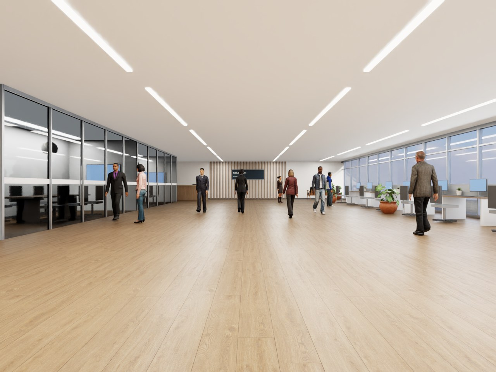
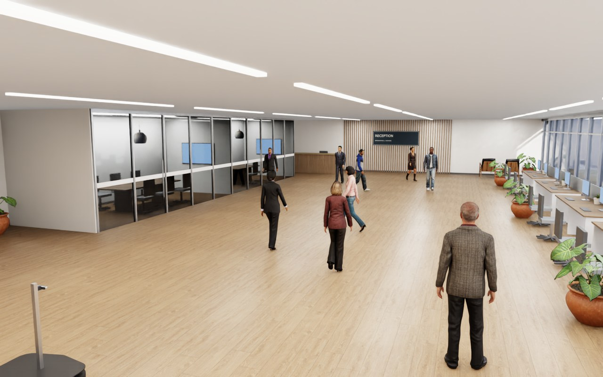
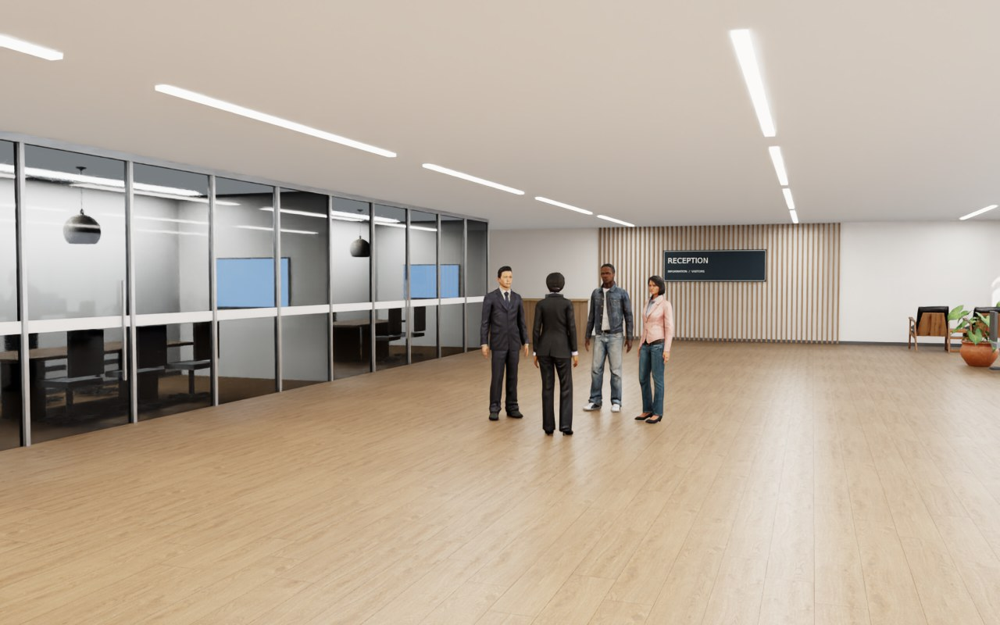
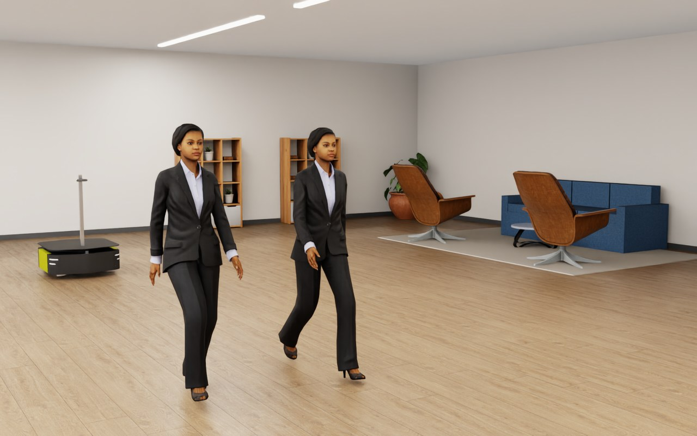
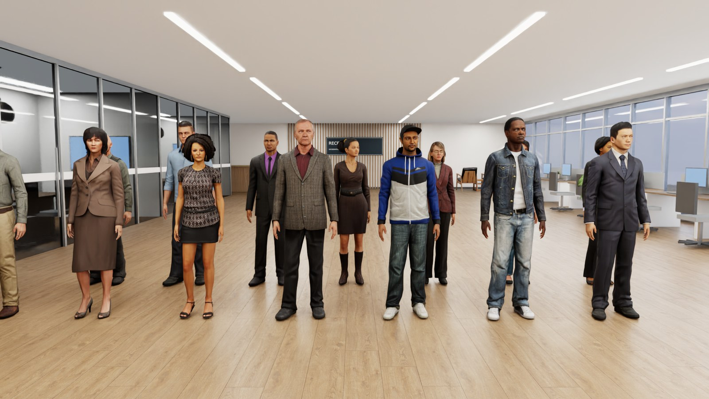
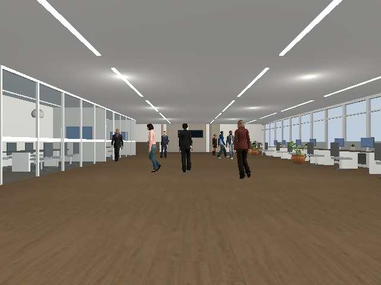

# Realistic simulation environments

The `realistic` scene profile adds furnished worlds and a varied pedestrian
cast to the crowd runner. Its default world is a modern open-plan office; the
earlier office, warehouse and courtyard worlds remain available. The existing
F1/F2/F3 benchmark results apply to their recorded profiles; they do not
qualify these worlds or characters. The observation robot remains stationary.

## Worlds

| `--environment` | Contents |
|---|---|
| `modern_office` (default) | Light-oak floor, warm-white walls, full-height south glazing with slim mullions, linear LED ceiling runs, window workstations with monitors and task chairs, two glazed meeting rooms with oak tables, wall displays and pendants, a lounge with sofa, mid-century chairs, rug and cube shelving, and an oak-slatted reception wall with a marble-topped counter |
| `office` | Earlier lobby: wood floor, cove lights, glazed frontage, reception, desks, lounge furniture and room signs |
| `warehouse` | Concrete floor, roof/skylight and clerestory windows, storage racks, crates, barrels, aisle markings, loading door and pedestrian signs |
| `courtyard` | Paved walkways, planted grass/shrub beds, trees, benches, street lamps, bins, wayfinding and windowed building facades |

The modern office keeps pedestrian lanes at x 0.5-21.5 m and |y| <= 4.2 m
clear of furniture; tests check every route against collision footprints.
Workstations, partitions, glazing, sofa and task chairs are procedural boxes
with Poly Haven surfaces; lounge chairs, coffee and side tables, shelving,
credenza, pendants and plants are Poly Haven models. Monitors, wall displays,
LED runs and a faint ceiling glow are emissive. Isaac lights the office with
the daylight HDRI, a low south-west sun through the glazing, window fill and
one rectangular light per LED run. Gazebo uses a directional sun, eight
ceiling point lights and emissive fixtures, and keeps texture pixels unscaled
by palette colours in this world.

## People and motion

The cast is fourteen distinct Microsoft Rocketbox (MIT) characters with the
publisher's own outfits: business suits, blazers, a waistcoat, casual jackets,
knitwear, dresses and jeans, across a range of ages, skin tones, builds and
hair. Per-person scales map the publisher skeletons onto statures of about
1.63-1.85 m. Assignments follow cast order, so a crowd of eight bystanders
shows nine different people. Look-alike scenarios deliberately give the
leader and look-alike the same character and scale. Appearance assignments
are rendering/evaluation metadata, never a recognition input.

Each character has two clips baked from the publisher's neutral motion
capture: a 1.2 s walk cycle (about 1.0 m/s stride for men, 1.2 m/s for women
before stature scaling) and an 8 s idle loop whose last second blends back to
its start. While a scripted segment moves, gait phase follows travelled
distance, so stance feet stay planted at any path speed; while a person stands
(including before their first step and after their route ends) the idle loop
plays. Deterministic per-person phase offsets keep pairs, including
look-alikes, from walking or breathing in step. Isaac selects cached frames;
Modern-office walkers waiting for a delayed start face their first travel
heading, so crossing pedestrians do not snap sideways when they start.
The recorded route includes this initial heading; older recordings default
to zero. Isaac interpolates the 10 Hz idle vertex cache across the loop seam, uses
the 30 Hz walk samples and nearest cached normals, and skips repeated USD
attribute writes when the sampled pose has not changed.
Gazebo's `CrowdMotion` plugin switches each actor between its `walk` and
`idle` animations using the same rule and offsets.

In the modern office all six scenario families walk at about 1.1 m/s (one
brisk crosser at 1.35 m/s) with rounded corners, between 1.6 m and about 13 m
in front of the stationary robot, so its camera sees people large and from the
front as well as from behind: the alone route jogs left, turns around and
returns towards the robot; the passer crosses about 3.5 m ahead, between robot
and leader; look-alikes walk side by side or swap sides; the leader joins a
standing group of three; and the crowd is a busy hall with a fast crosser
between robot and leader, a slow pair crossing the view, walkers passing the
robot on both sides and a standing trio. Everyone stays at least 0.8 m apart at
crowd sizes 2, 4 and 8. The earlier
realistic worlds keep their recorded routes, which walk at 0.2-0.5 m/s.
All routes are scripted rather than reactive pedestrian navigation.

## Exact explainer pedestrian playback

`--scenario explainer` with the realistic profile and `modern_office` replays
all pedestrian routes in `explainer.html`'s animation: 24 seconds, one leader,
ten bystanders, including the fast crosser, slow pair, three stationary people,
matching look-alike and three other walkers. This mode has a fixed population;
`--crowd-size` does not change it. It is separate from the six benchmark
families. The existing `crowd` command does not reproduce this illustration.

The HTML's coordinates map to world metres as `x = svg_x - 2.2` and
`y = 4.6 - svg_y`, preserving distances and timing while putting the observer
at the origin and converting screen-down to world-up. The original furnished modern-office layout is used without expanding the
floor or moving furniture. Routes are not rounded, shortened or slowed to fit
the room. The fast crosser continues beyond the original room boundary and
can pass through partitions on that exact illustrated path; these kinematic
pedestrians do not stop at furniture or walls.
A regression test compares every person's position to the HTML at all 721
30 Hz display times; another checks that the original office layout is retained without changing
any person’s waypoints.
These are scripted paths: interpersonal avoidance is not added to the drawing's
choreography.

The three group members remain stationary and play idle motion. The look-alike
uses the leader's model and scale with its own animation phase. Walk motion
continues to follow travelled distance. The illustration's robot controller,
lock-state display and avoidance are **not** reproduced: the observation robot
remains stationary, and this is not a recognition or following test.

```bash
# Gazebo (after building and sourcing the workspace)
python3 -m ridgeback_leader_follow.crowd_runner \
  --backend gz --scene-profile realistic --environment modern_office \
  --scenario explainer --ros-domain 215 --gui

# Isaac Sim
OMNI_KIT_ACCEPT_EULA=YES isaac_venv/bin/python \
  -m ridgeback_leader_follow.crowd_runner \
  --backend isaac --scene-profile realistic --environment modern_office \
  --scenario explainer --ros-domain 216 --gui
```

## Rendering differences

Both simulators consume the shared layout and cast. Isaac uses evaluated mesh
animation and textured PreviewSurface materials with an OmniGlass surface for
glazing; Gazebo uses native Collada actors with per-person gait speed. Fixture
UVs keep wall textures horizontal and tile floor materials in metres. Isaac
preserves source normal strength, metallic/roughness texture channels and
dielectric specular strength; Gazebo shading is simpler and does not
reproduce Isaac's fabric, glass or global illumination.

The earlier Innerscene and Maya characters stay in the repository so earlier
recorded realistic populations remain scoreable; all realistic worlds now use
the Rocketbox cast.

Gazebo interiors add ceiling point lights and emissive fixture surfaces. Its
fixture exporter namespaces Collada identifiers and gives copied architectural
maps unique basenames in each run's `fixtures/textures/` directory, preventing
Ogre's shared resource registry from reusing one texture for another surface; Rocketbox image identifiers are likewise the
unique texture names. The static converter removes loose wire edges (Collada
`<lines>`), which Gazebo would draw as unlit white strokes over tree foliage.
Trees use a 180,000-triangle visual mesh and cylindrical trunk collisions in
both backends; foliage has no collision. The Gazebo launch bridges
`/world/leader_follow_scene/clock` to ROS `/clock`.

## Interactive rendering performance

`--render-quality reference` (the default) retains the original lighting and
renderer settings. `--render-quality performance` is available with the
realistic profile. Gazebo disables scene shadows and keeps the sun plus two
fill lights. Isaac disables RTX shadows, reflections and indirect diffuse;
the modern office uses HDR daylight and sun instead of the window-fill and
ceiling-light emitters. Fixture meshes, textures, glass, humans, paths,
collisions and sensor configuration remain present. Lighting appearance changes;
this mode is not interchangeable with reference images for recognition scoring.

Isaac keeps its 120 Hz physics configuration and the step rate described under
[Smooth Isaac window](#smooth-isaac-window). The selected lighting mode does not
guarantee any frame rate. Ground truth remains sampled on the 0.05-second grid.

```bash
./tools/run_leader_gazebo_gpu --render-quality performance
# In a separate run, after sourcing ROS and the workspace:
isaac_venv/bin/python3 -m ridgeback_leader_follow.crowd_runner \
  --backend isaac --scene-profile realistic --environment modern_office \
  --scenario explainer --render-quality performance --gui
```

Reduced lighting has not demonstrated a useful frame-rate improvement on this
host. It remains an optional comparison mode rather than the recommended default.

The selected render quality is recorded in each run's manifest. Omit the option
or select `reference` to restore the original lighting and timing.

Experimental preview dispatch and timing instrumentation were removed.
Earlier frame-cost measurements were host loop costs, not remote-desktop FPS. Concurrent simulators and GPU workloads
can affect results; compare one scene with the same window size and machine
load. A visual-only mode without sensor computation is not implemented.

### Humans, sensors and collisions

`--performance-profile balanced` enables the following options together for
`--scene-profile realistic`. The reference profile remains the default.
Each option can also be selected independently for a controlled comparison.

| Option | Reference | Reduced-cost setting |
|---|---|---|
| `--human-detail` | `full` | `distant`: about half the triangles for people whose entire route stays at least 7 m from both the robot and the initial Isaac observer position |
| `--sensor-quality` | `reference`: 640×480 RGB/aligned depth at 30 simulation Hz | `reduced`: 320×240 at 15 simulation Hz, with unused depth point-cloud publication disabled |
| `--collision-quality` | `reference`: existing colliders | `simple`: primitive boxes for furniture and props; cylindrical tree-trunk colliders remain |

The leader and look-alike always retain their full meshes. Distance selection
checks the complete line segments between waypoints and is fixed for the run;
it does not switch detail dynamically when an operator orbits the GUI camera.
Reduced assets retain the publisher outfits, textures, UVs, skeleton and clips.
Identical Gazebo cast members reuse skin/animation files; Isaac reuses material
graphs for identical texture/material inputs. Cached animation writes preserve
the selected pose and idle interpolation.

Simple prop collision boxes enclose each visual mesh's local bounds and retain
its position, rotation and scale. They can close gaps under chairs or shelving;
they are approximations for interactive scenes, not equivalent collision geometry
for navigation evaluation. Visual meshes remain unchanged. The hardware robot
configuration is never edited: reduced camera settings are written only to the
run-local declaration. The smaller image keeps the same field of view and uses
`fx=fy=192, cx=160, cy=120`; LiDAR configuration is unchanged.

Reduced sensors ran through the real tracker and offline detector/association
checks, but those checks showed lower camera-only recall. This setting therefore
remains opt-in and is not qualified as a replacement for F2/F3 recordings. The
run manifest records the tuning, camera contract and per-person mesh detail.
Changing these settings requires a new recognition/tracking qualification.

```bash
# Run one simulator at a time, from a built and sourced workspace.
./tools/run_leader_gazebo_gpu --performance-profile balanced
isaac_venv/bin/python3 -m ridgeback_leader_follow.crowd_runner \
  --backend isaac --scene-profile realistic --environment modern_office \
  --scenario explainer --performance-profile balanced --gui
# Example: reduce only furniture collision cost, retaining full camera quality.
./tools/run_leader_gazebo_gpu --collision-quality simple
```

The balanced profile retains reference lighting because reducing lights alone
showed no useful gain, and it is not needed for a smooth Isaac window (below).
Remote browser delivery is measured separately using the
[streaming probe](remote_streaming.md).

### Smooth Isaac window

The Isaac crowd runner uses CPU PhysX for its physics scene. With GPU dynamics,
each of the four 120 Hz physics substeps waited on the GPU, which was most of a
modern-office update. ROS callbacks are drained through persistent executors
instead of per-call `rclpy.spin_once`. Neither change alters paths, sensor tick
rates or the sensor contract.

The realistic loop still renders 30 updates per simulated second by default,
which caps the window at 30 FPS. `--isaac-step-hz 60` renders 60 updates per
simulated second for viewing. The camera stays at 30 Hz and the LiDARs at
40 Hz because they follow their own sensor tick rates. Clock, odometry and TF
publish once per update, so they double. Use the default timing for
recordings that are compared with earlier evidence.

```bash
OMNI_KIT_ACCEPT_EULA=YES isaac_venv/bin/python -m ridgeback_leader_follow.crowd_runner \
  --backend isaac --scene-profile realistic --environment modern_office \
  --scenario explainer --isaac-step-hz 60 --gui
```

On the shared workstation, the modern-office explainer with all sensors
reached about 56 Isaac updates per second in an xrdp window at 1280x720,
up from about 15–20. That count is the viewport rate, not the frame rate a
remote browser receives. The window size in `ISAAC_WINDOW` (default
`1280x720`) still sets the remote-desktop copy cost.

LOD assets are reproducible with `sim/prepare_distance_lods.py` under the leader
package, the pinned Rocketbox source cache and Blender 4.2.9:

```bash
python3 src/ridgeback_leader_follow/sim/prepare_distance_lods.py \
  --blender artifacts/leader-following/tools/blender-4.2.9-linux-x64/blender \
  --cache artifacts/leader-following/rocketbox-source
```

The derivative `lod1/conversion.json` receipts record the triangle ratio, source
receipt hash, gait/floor checks and generated hashes. Textures are shared with
the original character directory; the existing Microsoft Rocketbox MIT license
and source provenance apply to the derivatives.

### GPU-backed OpenGL for remote Gazebo

Use the existing repository `tools/gpu-run` (also installed on this host as
`/usr/local/bin/gpu-run`). It is the established NVIDIA GLX/PRIME path described
in [troubleshooting](../troubleshooting.md#camera-rate-collapses-under-software-rendering).
A separate VirtualGL installation is not required for this launcher.

```bash
# Compare the default and NVIDIA OpenGL renderers without opening a scene.
tools/gpu-run
# Compatibility helper: verify NVIDIA, then run the normal 24-second scene.
tools/run_leader_gazebo_gpu
```

The helper delegates to `tools/gpu-run`, retains the office, people, sensors and
renderer configuration, and changes only its own process environment. Its
OpenGL check is saved under `artifacts/leader-following/gpu-launch/`. Extra
arguments such as `--duration 8` are forwarded to the crowd runner. GPU selection
is verified; a particular GUI/display FPS is not guaranteed. This OpenGL route
is not a measured improvement to Isaac's Vulkan renderer or desktop streaming.

## Run a scenario

Build and source the workspace as described in [simulation](simulation.md).
Then choose one world and scenario:

```bash
ros2 run ridgeback_leader_follow crowd_scene \
  --backend gz --scene-profile realistic --environment modern_office \
  --scenario crossing --gui

isaac_venv/bin/python -m ridgeback_leader_follow.crowd_runner \
  --backend isaac --scene-profile realistic --environment courtyard \
  --scenario crowd --crowd-size 8 --gui
```

| Scenario | CLI name | Behaviour |
|---|---|---|
| Alone | `leader_alone` | Straight sections and turns (a turn-around in the modern office) |
| Crossing | `crossing` | A passer-by crosses between observer and leader |
| Look-alike | `lookalike_parallel` | Matching-looking pedestrian walks beside the leader |
| Swap | `lookalike_crossing` | Leader and look-alike cross paths |
| Stop in a group | `leader_stop` | Leader stops among standing pedestrians |
| Crowd | `crowd` | Combined paths with `--crowd-size 2`, `4` or `8` bystanders |

`--environment` requires `--scene-profile realistic`; its default is `modern_office`.
The modern office uses the natural-pace routes described above. In the earlier
realistic worlds the other five routes reuse the original fixture paths and
only the alone route adds turns. Baseline and F3 routes are unchanged.
All normal recording, private-domain and owned-process cleanup options apply.

## Asset setup and conversion

Large mesh, animation, GLB and HDR files use Git LFS. After cloning, install
Git LFS and run `git lfs install` followed by `git lfs pull` from the repository.
Downloaded weights, virtual environments and raw run output remain under the
existing ignored directories.

Licences, sources and conversion hashes are recorded in
[`sim/assets/realistic/NOTICE.md`](../../src/ridgeback_leader_follow/sim/assets/realistic/NOTICE.md),
its adjacent `sources.json` (CC0 Poly Haven props, surfaces and HDRI; powered
by [Poly Haven](https://polyhaven.com)) and `rocketbox/sources.json` (MIT
Microsoft Rocketbox characters and clips, pinned to one publisher commit).
The earlier Innerscene/MakeHuman characters and Maya keep their attributions.

To rebuild from publisher files, use system Python with `requests`, then the
project's Blender 4.2.9 binary:

```bash
python3 src/ridgeback_leader_follow/sim/fetch_realistic_assets.py \
  src/ridgeback_leader_follow/sim/assets/realistic

artifacts/leader-following/tools/blender-4.2.9-linux-x64/blender -b \
  --python-exit-code 1 \
  --python src/ridgeback_leader_follow/sim/prepare_realistic_assets.py -- \
  src/ridgeback_leader_follow/sim/assets/realistic/props/sofa_03
```

Repeat conversion for each directory under `props/`. For each directory under
`humans/`, append `human` after the directory argument. Blender evaluates the
walk and exports the Gazebo skin; existing Maya assets are reused.

Rocketbox characters are fetched into an ignored source cache (about 1.2 GB of
FBX/TGA files), their textures converted into the asset tree, then baked one
character at a time; the roster lives in `rocketbox_cast.py`:

```bash
python3 src/ridgeback_leader_follow/sim/fetch_rocketbox_humans.py \
  artifacts/leader-following/rocketbox-source \
  src/ridgeback_leader_follow/sim/assets/realistic/rocketbox

artifacts/leader-following/tools/blender-4.2.9-linux-x64/blender -b \
  --python-exit-code 1 \
  --python src/ridgeback_leader_follow/sim/prepare_rocketbox_human.py -- \
  artifacts/leader-following/rocketbox-source business_female_01 \
  src/ridgeback_leader_follow/sim/assets/realistic/rocketbox/business_female_01
```

The bake bakes the FBX object transform into the rest pose, retargets each
clip by copying world bone orientations onto the avatar's own bone offsets
(pelvis motion scaled by leg length), removes the walk's net root travel,
faces +X and seats the lowest sole on z=0. The facing turn stays on an unscaled
armature node, because Gazebo keeps the root joint's rest orientation for
actors. Vertices without skin weights inherit their nearest weighted
neighbour's weights. The bake fails if the keyed skeleton departs from the
retarget by more than 2 mm or the idle loop does not close.
Static conversion verifies the exported world-space pose against the vertex
cache, and reduces source meshes above 250,000 polygons to a 180,000-triangle
budget. Material names are normalized during import to disambiguate duplicate
source names. Original wayfinding textures are regenerated with
`python3 src/ridgeback_leader_follow/sim/prepare_scene_signs.py`. Compare
regenerated files against the source/conversion receipts before replacing a
recorded population. Publisher content may change despite retaining its URL.

## Visual review and validation

Render a world without starting ROS nodes. Each sampled scenario time yields
an overview, a human-height view, a close cast view and the robot camera's
view (its mount pose and 640x480 field of view):

```bash
OMNI_KIT_ACCEPT_EULA=YES isaac_venv/bin/python \
  src/ridgeback_leader_follow/sim/preview_realistic.py \
  --output artifacts/leader-following/realistic-previews \
  --environments modern_office --scenario crowd --times 4 9
```

Tests cover static obstacle clearance for the six benchmark families in every layout,
modern-office pace and person-to-person separation, cast diversity and
statures, look-alike assignment, Rocketbox receipt hashes and cache/skin
consistency, idle selection, Gazebo walk/idle animations and emissive
fixtures, Collada texture paths and preservation of commanded paths.
The scene/sensor qualifier also accepts `--scene-profile realistic`,
`--environments`, `--scenarios` and `--crowd-sizes` filters; it defaults to the
modern office. It does not run recognition. For example:

```bash
ros2 run ridgeback_leader_follow qualify_crowd --scene-profile realistic \
  --environments modern_office --scenarios crowd --crowd-sizes 8 \
  --backends gz --ros-domain 210
```

Offline mesh annotations reconstruct the recorded route and use each person's
recorded character, stature, gait speed and, when baked, idle loop and phase
offsets. Realistic recordings require the saved walk and idle caches with
matching SHA-256; evaluation refuses missing or mismatched geometry.
`benchmarking.annotations --stationary-base` uses recorded TF to remove
odometry drift for a surveyed stationary observer. This option is not valid
for a moving robot. These inputs are used only for scoring.

All six scenario families passed 20-second scene/sensor playback in the modern office in both simulators (twelve cases; crowd with eight bystanders). Earlier worlds have not been replayed with the new cast.

Rendering quality, playback validation and recognition performance are
separate claims. The images below are actual simulator renders. They are
detailed and naturally lit but not photographic: Rocketbox meshes have about
7,000-10,000 triangles, faces do not animate, hands keep one grip, and clothing
does not simulate cloth. Walk-to-idle switches are instantaneous; turns are
rounded paths rather than biomechanical turning steps. Pedestrians do not
react to the robot or each other. No recognition result exists for this cast.



The Isaac robot camera (mount pose and 640x480 field of view) during the
eight-bystander crowd: faces of oncoming walkers, a glazed meeting room on the
left and window workstations on the right.





The stop scenario: the leader has joined three standing people, all playing
the idle loop with different phases.



Look-alikes share one character deliberately; their gait phases differ.





Gazebo renders the same layout and cast with simpler shading and no global illumination.

The earlier worlds, rendered with the earlier four-character cast:


## Archived evidence

- [Realistic worlds, asset conversion and startup validation](../../archive/engineering/2026-11-05-realistic-worlds.md) — tested population, tree/clock startup failures and verification limits.

- [Material, lighting and vegetation review](../../archive/engineering/2026-11-05-visual-materials.md) — visual population and limited runtime evidence.

- [Gazebo material isolation and full playback review](../../archive/engineering/2026-11-05-gazebo-material-isolation.md) — texture collision diagnosis and scenario coverage.

- [Modern office and Rocketbox pedestrians](../../archive/engineering/2026-11-05-modern-office-rocketbox.md) — selection, retargeting findings and twelve-case playback.

- [Exact explainer pedestrian choreography](../../archive/engineering/2026-11-05-explainer-pedestrian-motion.md) — reference paths, population and playback verification.

- [Simulation performance investigation](../../archive/engineering/2026-11-05-simulation-performance.md) — measured costs, rejected preview preset and limits.

- [Full scene using the existing gpu-run path](../../archive/engineering/2026-11-05-existing-gpu-run.md) — GPU verification, playback speed and sensor rates; GUI FPS was not instrumented.

- [Direct viewport FPS and reduced-lighting comparison](../../archive/engineering/2026-11-11-lighting-performance.md) — lighting-only results, rejected 60 Hz/DLSS changes and measurement limits.

- [Human LOD, sensor and collider checks](../../archive/engineering/2026-11-11-runtime-performance.md) — direct viewport measurements, tracking trade-offs and pending browser delivery measurement.

- [Isaac update-cost breakdown](../../archive/engineering/2026-11-11-isaac-update-cost.md) — GPU-dynamics and ROS-spin costs, the CPU-physics and 60 Hz step results.
