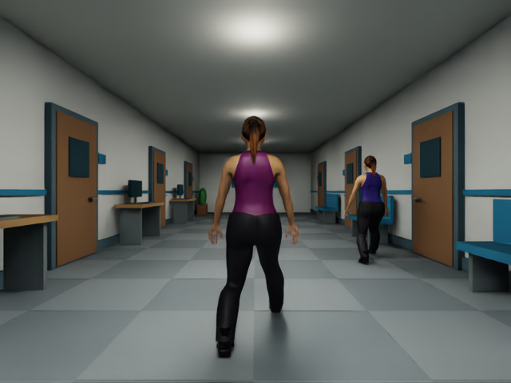

# Leader-following crowd simulation

This reference owns the F1 crowd scenes and their qualification. The
[FOLLOWING plan](../plans/FOLLOWING_leader_in_crowds.md) owns subsequent
people tracking, leader recognition and closed-loop following work.

## Scene set

Every scene lasts 20 seconds in a shared corridor. World coordinates are
metres, Z-up, with the floor at z=0 and the observation Ridgeback at the
origin facing +X. The robot remains stationary during F1.

| Scenario | People | Motion |
|---|---|---|
| `leader_alone` | 1 | Leader walks straight, turns left and stops |
| `crossing` | 2 | Bystander crosses the sightline between robot and leader |
| `lookalike_parallel` | 2 | An identically dressed person walks beside the leader |
| `lookalike_crossing` | 2 | Leader and look-alike cross the same path at different times, avoiding body overlap |
| `leader_stop` | 4 | Leader approaches and stops among three standing people |
| `crowd` | 3, 5 or 9 | Leader with 2, 4 or 8 bystanders walking in adjacent lanes |

`crowd_scenarios.py` owns waypoint positions, durations and identities. Path
interpolation is linear; heading follows the current segment and persists at
a stop. The path's travelled distance drives the two-second gait cycle at
0.5 m per animation second, so a stationary person does not keep walking in
place. In the default `baseline` profile all instances use the same textured
human: identical appearance is deliberate for the look-alike scenarios. The
[F3 appearance profile](#f3-appearance-profile) dresses the same paths in
distinct outfits. Both are controlled synthetic asset sets, not a claim about
appearance diversity or performance on real people.

## Pedestrian asset

The character is **Cesium Man**, © 2017 Cesium, CC-BY-4.0, from the pinned
Khronos glTF Sample Assets source. The original binary, upstream license,
[attribution and conversion notice](../../src/ridgeback_leader_follow/sim/assets/cesium_man/NOTICE.md),
source revision and SHA-256 conversion receipt are tracked beside the asset.

`sim/prepare_human.py` runs under Blender 4.2.9 to produce the Gazebo Collada
skin/animation and 48 evaluated mesh frames for Isaac from that one source.
The character is scaled to 1.75 m and seated on the floor. Blender is needed
only to regenerate assets; normal launches use the committed outputs.

Gazebo's native `CrowdMotion` system sets the actor's trajectory pose and
animation time on each simulation update. Isaac updates the corresponding
world transform and sampled skinned mesh on its simulation thread. These are
animated, textured humans rather than the earlier box proxies. They are
scripted actors: they do not react to the robot or other pedestrians, and do
not implement physical human collision response. Following and avoidance
performance belong to later phases.

## Robot and sensor boundary

Gazebo includes the existing Clearpath `robot_spawn` bringup. Isaac reuses the
committed Ridgeback USD, `RidgebackRig`, `RosIO`, and production camera/lidar
bindings, with a generated `robot_state_publisher` description. Neither path
starts frontier exploration, Nav2 or a following controller. No F1 code
publishes a robot velocity command. Isaac consumes no external drive commands;
Gazebo's standard command path remains present on the private simulation domain.

The robot configuration is copied from `clearpath/robot.yaml` into each run's
`setup/` directory. Existing host or hardware configurations are not edited.
Pedestrians remain at their initial pose until valid RGB, aligned depth,
camera calibration, both lidar scans, raw odometry and static transforms have
arrived. Readiness uses actual messages, not a fixed startup delay.

Under `/r100_0001/`, the monitored topics are:

- `sensors/camera_0/color/image` and `color/camera_info`;
- `sensors/camera_0/depth/image`;
- `sensors/lidar2d_0/scan` and `sensors/lidar2d_1/scan`;
- `platform/odom/filtered` in Gazebo, `platform/odom` in Isaac, plus `tf` and `tf_static`.

Both backends use the production 640×480 D455 profile and dual UST-10LX
sensors. Isaac uses ideal aligned geometric depth for this F1 baseline.
Simulator time drives motion and stamps. Scenario time excludes startup and
sensor warmup. Rendering and rasterized gait can differ between engines;
their shared trajectory contract is independent of pixel-level rendering.

## Run a scene

From the workspace root, install the simulation dependency profiles and build
as described in the root README. The optional Gazebo plugin is built when
`gz-sim8` development libraries are present; the ordinary leader identity
node can still be built without Gazebo. Isaac requires the complete pinned
`isaac_venv`. Build after adding the new modules and executable:

```bash
source /opt/ros/jazzy/setup.bash
colcon build --symlink-install --base-paths src --packages-select ridgeback_leader_follow
source install/setup.bash

ros2 run ridgeback_leader_follow crowd_scene --backend gz --scenario crossing --gui
isaac_venv/bin/python3 -m ridgeback_leader_follow.crowd_runner --backend isaac --scenario crossing --gui
```

Omit `--gui` for headless runs. `--scenario` accepts the six names above;
`--crowd-size 2|4|8` selects the bystander count for `crowd`. `--duration 1`
shortens a smoke test; durations must be multiples of 0.05 s up to 20 s.
`--output-dir <new-directory>` selects an evidence directory; existing
directories are refused. `--record` also writes the monitored sensor topics
to a SQLite ROS bag, including latched static transforms for replay.

Each standalone scene chooses a private ROS domain unless `--ros-domain N`
is specified; the manifest records it. Gazebo also uses a unique transport
partition. All child processes belong to the run and are stopped on completion
or interruption. `ROS_LOG_DIR` overrides are preserved. Headless stepping is
unthrottled by the F1 runner; GUI mode is paced at no more than real time.

## Richer environments

The optional `realistic` profile adds office, warehouse and courtyard worlds,
plus four source human characters and clothing/stature variants. Visual
refinement and runtime validation are in progress. Commands, asset setup and
limitations live in the [environment reference](environments.md).

## Furnished lab demonstration

`--scene-profile lab` selects an additional **Isaac-only** scene: a tiled
corridor with doors, desks, monitors, benches and planters, explicit surface
materials, and overhead lighting. The default `baseline` profile retains the
Cesium Man scene used for the F1/F2 measurements; those measurements do not
qualify the new lab scene or its perception performance.

The lab pedestrian is **Maya**, an Innerscene character adapted from
MakeHuman/MPFB assets, dedicated under CC0. Its original GLB, extracted textures,
material assignments, baked animation and hash receipt are stored under
`sim/assets/maya/`; the [asset notice](../../src/ridgeback_leader_follow/sim/assets/maya/NOTICE.md)
owns provenance and conversion details. The character has casual clothing,
hair and skin textures. Clothing colours alternate between instances except
in look-alike scenes; body and rig remain identical. This is one character
with outfit variations, not a diverse population of independently modelled humans.
PreviewSurface rendering preserves base colour and alpha cutouts, with simplified
source shading. The lab walk uses its own distance-driven gait speed.



Robot RGB preview of the lab profile at the start of its demonstration walk.
Regenerate with the command below and copy `frames/rgb_00s.png` from the run
into this page's asset directory.

```bash
source /opt/ros/jazzy/setup.bash
source install/setup.bash
isaac_venv/bin/python -m ridgeback_leader_follow.crowd_runner \
  --backend isaac --scene-profile lab --demo-cycles 20 --gui
```

`--demo-cycles 1..120` repeats a continuous 30-second out-and-back walk with
standing pauses and a staggered crossing, without teleporting between cycles.
It requires the lab profile and cannot be combined with `--duration`.
Omit it to run an ordinary 20-second scenario with the lab appearance, or use
`--duration` to shorten that scenario. All paths remain scripted, with no
reactive pedestrian avoidance. The robot remains stationary. Sensor readiness,
private domains and evidence recording follow the same runner contract;
`manifest.json` explicitly records the profile and the actual scenario.
A tracker can be launched separately on that run's ROS domain using the
[people-tracker instructions](people_tracker.md).

## F3 appearance profile

`--scene-profile f3` prepares the six scene families for leader-recognition
work in **both** simulators. It must be selected explicitly; `baseline` stays
the default, and the F1/F2 results above were recorded with it. The corridor,
paths, timing, robot sensors, readiness and ground-truth recording are the
baseline ones: only the pedestrians' appearance changes.

Every person is the CC0 Maya pedestrian from the lab profile, in one of ten
fixed outfits (top colour, trouser colour, brown/black/blonde hair) defined in
`crowd_appearance.py`. Any two tops differ by at least CIE76 ΔE 30. Assignment
is deterministic and uses only scenario order and names:

| Person | Outfit |
|---|---|
| Leader | Always `cobalt_khaki` (blue top, khaki trousers, brown hair) |
| `lf_lookalike` in `lookalike_parallel` and `lookalike_crossing` | Exactly the leader's outfit |
| Every other person | The next unused outfit in palette order |

So all people differ except the deliberate look-alike pair, including in the
nine-person crowd. Body, rig, skin and walk are shared: this is one character
in different clothing, not a population of different people.

```bash
ros2 run ridgeback_leader_follow crowd_scene --backend gz --scene-profile f3 --scenario crowd --crowd-size 8 --gui
isaac_venv/bin/python3 -m ridgeback_leader_follow.crowd_runner \
  --backend isaac --scene-profile f3 --scenario crowd --crowd-size 8 --gui
```

Both backends render the same mesh, walk and recoloured textures. Isaac uses
the Maya vertex cache with per-outfit PreviewSurface materials. Gazebo uses a
Collada export of the same character, which the export script checks
vertex-by-vertex against the Isaac cache. Each run writes one skin per outfit
under `actors/`, because Gazebo shares a loaded mesh or texture between
identically named files. The `CrowdMotion` plugin accepts an optional
`gait_speed`, so the Maya walk keeps its baked 1.35 m per animation second;
baseline worlds omit it and keep 0.5. Lighting, shading and alpha-cutout
thresholds differ between renderers, so pixel colours are similar rather than
identical across simulators.

`manifest.json` records the outfit worn by each person under `appearance`, as
scoring evidence. Outfit names are never published on ROS; perception sees
only the rendered sensor data. The
[asset notice](../../src/ridgeback_leader_follow/sim/assets/maya_f3/NOTICE.md)
owns the recolouring method, the Gazebo export changes, regeneration commands
and hash receipts.

`qualify_crowd --scene-profile f3` runs the same eight-configuration gates per
backend, also checks the recorded outfits, and writes to
`artifacts/leader-following/f3-appearance-qualification-<time>/` by default.
Passing those gates establishes playback, sensors and truth, not recognition
performance.

All eight F3 configurations per backend passed those gates, with recorded
outfits matching the assignment and observed poses within 1e-8 m of their
paths. Reports: `artifacts/leader-following/f3-appearance-gazebo-r3/qualification.json`
and `artifacts/leader-following/f3-appearance-isaac-r3/qualification.json`.
Camera snapshots were also inspected: the outfits are distinct, look-alikes
are identical, the walk animates in both simulators, and the feet stay on the floor. In the
nine-person crowd some people are occluded in individual frames. The F3
scenes are qualified as recordings only; leader recognition remains untested.

## Ground truth and artifacts

Runs default to `artifacts/leader-following/<unique-run>/`:

| Artifact | Contents |
|---|---|
| `manifest.json` | Scenario, domain, duration, input hashes, base revision and completion/failure |
| `ground_truth.csv` | Every person's identity, role, observed world position/yaw, simulator/scenario time and separate commanded pose/time |
| `sensor_health.json` | Valid message counts, run counts, stamps, image encoding/shape and scan frame/bin information |
| `camera_info.json` | Camera calibration and optical frame |
| `frames/` | RGB PNGs, depth NPZs and front/rear scan JSON at 0, 6, 10, 14 and 19 s |
| `source/`, `simulation_inputs/`, `launch_inputs/` | Preserved Python, native plugin, human assets and launch inputs, including the plugin binary |
| `setup/`, `package.diff` | Run-local robot configuration/generated state and tracked package diff |
| `sensors/` | Optional sensor ROS bag |
| `scene.sdf` / `final_scene.usda` | Generated Gazebo world / final Isaac stage |

Truth is sampled at 20 Hz. Gazebo reads the actor-origin world pose multiplied
by the observed `TrajectoryPose` component, exactly as the renderer does;
Isaac reads world transforms from the live stage after updating. Commands are
logged separately and never substituted for observed positions. Ground truth
does not publish `People` messages or enter leader recognition. A complete
F1 run establishes scene playback and data availability, not detector accuracy,
identity retention, collision avoidance or following success.

## Qualification

```bash
ros2 run ridgeback_leader_follow qualify_crowd
# Or qualify one backend at a time, with explicit isolated domains:
ros2 run ridgeback_leader_follow qualify_crowd --backends gz --ros-domain 87
ros2 run ridgeback_leader_follow qualify_crowd --backends isaac --ros-domain 88
```

`ISAAC_PYTHON` can select a non-default Isaac environment. `--output-root`
selects a fresh qualification directory and `--record` enables bags for every
scene. Qualification runs eight configurations per backend: the five
non-density scenes and all three crowd sizes. Each case must exit cleanly,
report completion, log every person for the full duration without gaps over
75 ms, preserve finite world poses matching its path within 5 mm/rad, and
provide live camera/depth/calibration, both scans, odometry and static TF.
It also requires a representative RGB frame and nearby front-lidar returns
in the initial pedestrian sector. `qualification.json` records per-case results;
an interrupted or failed case cannot produce a passing matrix.

Inspect representative camera, depth and scan snapshots as part of review;
automated message counts alone do not establish that the intended people are
visible. F1 has no ten-repetition following-performance claim: that protocol
applies when tracking and control exist in later phases.

## Qualification result

All eight configurations per backend passed the F1 gates: six scenario
families with the crowd family exercised at all three densities. The sixteen
20-second runs recorded every person at 20 Hz, alongside live robot sensors.
Results are scene/data qualification only; F2–F4 performance remains untested.
The saved reports are `artifacts/leader-following/f1-gazebo-filtered/qualification.json`
and `artifacts/leader-following/f1-isaac-qualification/qualification.json`.
Run backends sequentially: simultaneous cold starts can time out the vendor
controller activation. Use an unused ROS domain to avoid unrelated publishers.
