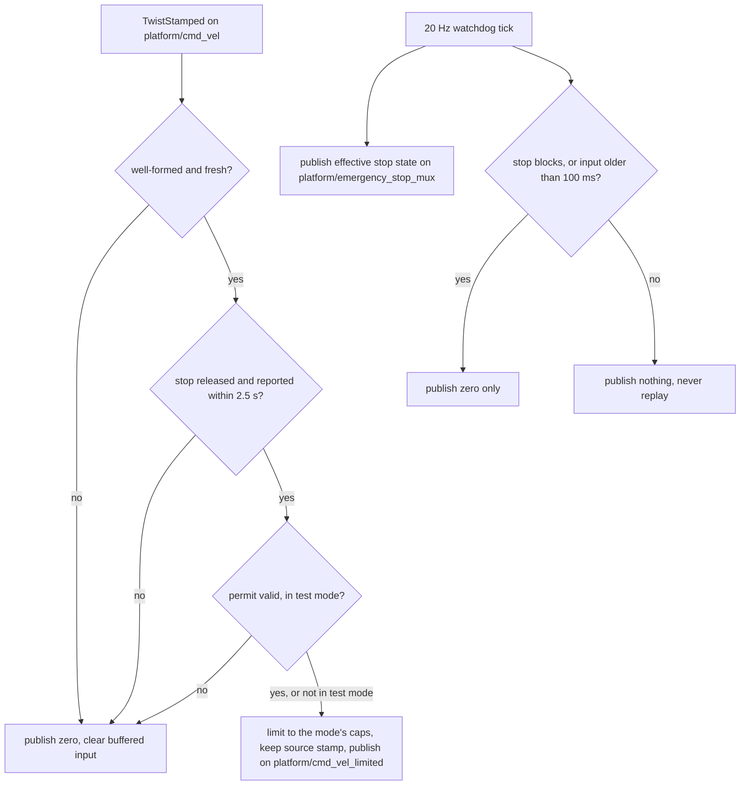
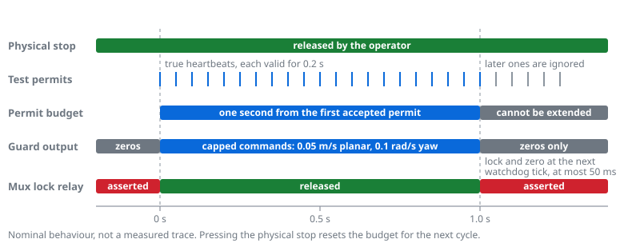

# Ridgeback commissioning guard

The commissioning guard is one fixed process after the mux:
`platform/cmd_vel` → guard → `platform/cmd_vel_limited` → mecanum controller.
Normal joystick, boost, RC, marker and Nav2 inputs all share it. It also relays
the firmware e-stop to the mux, as described under
[e-stop delivery](estop_stop_semantics.md#e-stop-delivery-to-the-mux). Its
maintained source is `tools/hardware/commissioning_speed_guard.py`; the
[installer](../../tools/hardware/install_commissioning_caps.py) renders and
deploys it. The [driving router](driving_readiness.md#installed-state) records
which mode is installed.

## Speed modes

The guard runs in exactly one of three mutually exclusive modes.

| Mode | Guard flag | Installer flag | Planar limit | Yaw limit | Ordinary driving |
|---|---|---|---|---|---|
| Commissioning caps (default) | none | none | 0.05 m/s on the planar vector magnitude, including diagonals | 0.1 rad/s | Allowed, capped |
| Test-permit interlock | `--require-test-permit` | `--test-interlock` | 0.05 m/s planar magnitude | 0.1 rad/s | Blocked without a fresh permit |
| Original manual speeds | `--original-manual-speeds` | `--original-manual-speeds` | 1.2 m/s on each planar axis | 1.5 rad/s | Allowed |

In the capped modes, boost cannot exceed the limits; the guard scales the
planar vector down without changing its direction. The original joystick scale
values remain intact in every mode: the guard limits commands, it never edits
the combiner.

The original-manual mode preserves the vendor `joy_x_combiner.py` range: L1
scales of 0.4 m/s on each planar axis and 0.5 rad/s yaw, multiplied by three
with R1. It keeps the original per-axis diagonal behaviour, so a boosted
diagonal can reach about 1.70 m/s in magnitude. These are joystick mapping
values, not measured safe operating speeds or completed driving qualification.
The profile applies to every command source entering the guard, not just
joystick messages. It retains finite/planar/frame validation, source-stamp
preservation, the 100 ms command-age and watchdog limits, the firmware-stop
freshness check, the reliable mux-stop relay and the separately installed
motor-feedback plugin. It cannot be combined with the test-permit mode.
Interlocked trial tools require their exact commissioning installation and
must not be used to qualify motion under the faster manual profile.

## Admission and watchdog



*Guard decisions. Notice that only an incoming command can produce a nonzero
output; the watchdog path ends in a zero or in nothing. Well-formed means finite
and planar, frame empty or `base_link`, a nonzero stamp no older than 100 ms and
no more than 5 ms in the future; a valid permit is fresh within 0.2 s and inside
the one-second budget.*

The guard requires fresh firmware stop data indicating that the stop is
released. Missing data, an asserted stop, or more than 2.5 seconds without stop
data blocks motion commands. It rejects nonfinite or nonplanar commands,
unsupported frames, zero stamps, stamps older than 100 ms and stamps more than
5 ms in the future, and publishes a zero instead. It preserves accepted source
stamps. Any stop transition, or a backwards jump in ROS time, clears the
buffered input. The 20 Hz watchdog emits only zeros when input expires or the
stop blocks; it never replays a nonzero command. A failed guard leaves the
controller without nonzero references, subject to the controller's own
`reference_timeout`. These are software command bounds, not measured braking
or physical speed guarantees.

## Test-permit interlock

The installer selects this temporary mode with `--test-interlock`. The guard
asserts its mux stop relay and sends zero limited output until fresh reliable
Bool permits arrive on `platform/commissioning_test_permit`.



*Test-permit budget. Notice that heartbeats after one second do not extend
motion; the lock and zero follow at the next watchdog tick.*

- Each permit is fresh for 0.2 seconds.
- The first true permit accepted while the stop is released opens at most one
  second of motion per physical stop cycle.
- Continued true heartbeats or false/true transitions cannot extend that budget.
  A false permit clears the buffered input.
- A physical asserted-stop transition clears the budget for the next cycle.
  Releasing the stop clears current permission and never resumes a cached
  command.
- The 20 Hz guard watchdog enforces expiry at its next timer callback.

In this mode ordinary manual driving is blocked without a test permit. Only the
[trial recorders](driving_check_tools.md#physical-control-observer) publish
permits. These are software bounds, not measured physical stopping guarantees
or certified safety limits.

## Installation and rollback

The installer owns four files:

- `/usr/local/lib/dynamo-hardware/commissioning_speed_guard.py`
- `/usr/local/lib/dynamo-hardware/commissioning_platform.launch.py` (wrapper)
- `/etc/systemd/system/dynamo-commissioning-speed-guard.service`
- `/etc/systemd/system/clearpath-platform.service.d/70-dynamo-commissioning.conf`

It stages these files and preserves prior bytes, modes and owners. Application
is refused unless passive observation confirms an engaged physical stop,
stationary raw odometry and the expected active controller. Before stopping the
platform it requires a chrony reference no older than 60 seconds, requesting an
NTP burst if needed. It restarts only the platform and guard, then verifies that
the controller subscribes to the limited topic and not to the raw mux topic,
that exactly one guard publisher owns the limited topic, and that the reliable
stop relay and mux remap are in place. A failed application leaves the platform
stopped; it does not automatically restore an uncapped command path. A restore
queues the platform start without the installer's 35-second service timeout,
because the platform's clock gate can wait up to 900 seconds; verify the active
state with a live probe rather than an intermediate receipt label.

An upgrade or mode change uses `--upgrade-from-run-dir` with the receipt whose
recorded hashes match the installed files exactly. Unknown changed files prevent
the upgrade. Each application backs up the four owned files. Restore from the
**new** install directory with
`--restore --operator-confirmed --run-dir <new-install-directory>` to recover
the preceding installation with the stop pressed. Restoring a first installation removes the caps and is not permission
to drive. The root [README](../../README.md#stationary-driving-readiness-checks)
owns the default, upgrade and test-lock commands. The original-manual
selection uses the same pattern:

```bash
sudo python3 tools/hardware/install_commissioning_caps.py \
  --apply --operator-confirmed --original-manual-speeds \
  --upgrade-from-run-dir "$PWD/artifacts/hardware/<receipt-matching-installed-files>" \
  --run-dir "$PWD/artifacts/hardware/original-manual-install-$(date -u +%Y%m%dT%H%M%SZ)"
```

The installed receipt is listed in the
[installed state](driving_readiness.md#installed-state); a test-lock
installation is undone by restoring from its own receipt.

The platform drop-in requires the guard. The wrapper applies a launch-scoped
`SetRemap`, which takes precedence over Clearpath's native remap, and then
includes the generated platform job. No robot declaration or generated
Clearpath config is rewritten. The wrapper checks the pinned guard hash and
refuses unexpected additional platform jobs; review those changes after
upgrades.

Installed script copies are root-owned and do not follow a rebuilt or switched
workspace checkout. The deployed CycloneDDS profile and domain 0 are retained.
Camera, sensor and desktop units are outside this installer. Recovery
preparation includes all four [guarded host candidates](ridgeback_public_recovery.md),
built from the maintained guard and wrapper separately from the original
captured baseline.
Fresh-SSD preparation generates the default low commissioning limits; recreate
and qualify that baseline before selecting the manual profile through the
installer. The maintained renderer and the installer command own reconstruction
of every mode; no undocumented live service edit is required.

## Boot ordering limitation

The guard unit orders itself `After=network.target` and `Before=` the platform,
with `Restart=on-failure` after one second. `network.target` does not establish
that each interface named by the deployed DDS profile, such as `wlp3s0`, is
present, so the guard can fail and restart before it starts successfully.
Device-specific boot readiness and a supervised cold-boot check remain open;
eventual active status must not be treated as a clean startup qualification.

## Archived evidence

- [Commissioning guard installation and first low-speed trials](../../archive/engineering/2026-10-06-driving-guard-and-deadman-trials.md)
- [E-stop QoS repair and stationary disconnect trials](../../archive/engineering/2026-10-09-estop-qos-and-disconnect-trials.md)
  — relay installation and the boot-time restart.
- [Interlock, bounded-permit and moving-disconnect trials](../../archive/engineering/2026-10-12-interlock-and-moving-disconnect-trials.md)
  — test-permit installation and the measured budget boundary.
- [Original-manual profile and D4 handover trials](../../archive/engineering/2026-10-21-original-manual-and-d4-trials.md)
- [D2 preparation and the reconnected deadman run](../../archive/engineering/2026-10-22-d2-preparation-and-run.md)
