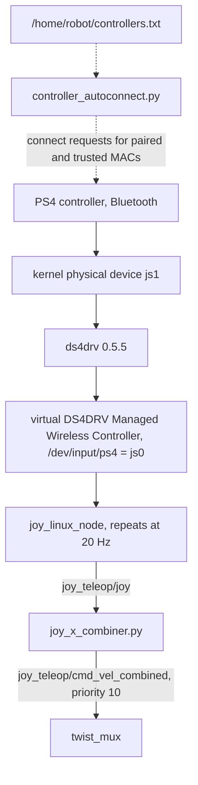

# Ridgeback controller input

This page owns how the wireless driving controller's input reaches the mux on
`r100_0160`: the device chain, the combiner mapping, neutral-return semantics,
disconnection behaviour, the autoconnect helper and the known
connected-but-no-input failure. The [stop mechanisms](estop_stop_semantics.md)
page owns what the rest of the command path does when input stops.

## Input chain

*Controller input chain. Notice that ROS reads only the driver-managed virtual
device; the kernel's physical device is a diagnostic boundary, not an input.*

The live controller uses `ds4drv` 0.5.5 and a virtual
`DS4DRV Managed Wireless Controller` exposed as `/dev/input/ps4`. A platform
drop-in restores that device path and the mux's joystick topic
(`joy_teleop/cmd_vel_combined`) before every platform start, because Clearpath
regeneration reverts both. The `joy_linux_node` repeats joystick messages at
20 Hz, so repeated ROS joystick messages alone do not establish newly received
physical controller reports.

Do not switch ROS directly to the physical device (`js1`): its axis/button
mapping and disconnect behaviour require separate qualification and could
bypass the established mapping.

## Mapping and scales

The deployed vendor combiner (`/opt/mybotshop/scripts/joy_x_combiner.py`) and
its tracked [recovery copy](../../deployment/r100_0160/README.md) match SHA-256
`d3a4431a92e66cb671459cb52df089a4d2ec8874eca0358081ab5c22add40f7b`.

| Control | Joy index | Command |
|---|---|---|
| Left stick horizontal | axis 0 | yaw, 0.5 rad/s full scale |
| Left and right stick vertical | axes 1 and 4, summed and clamped to ±1 | forward x, 0.4 m/s full scale |
| Right stick horizontal | axis 3 | lateral y, 0.4 m/s full scale |
| L1, top-left bumper (Linux key 310) | button 4 | driving enable, normal scale |
| R1 | button 5 | driving enable, all three scales × 3 |
| Triggers | axes 2 and 5 | unused; may rest at nonzero values |

On this mapping, **right-stick horizontal moves sideways** and **left-stick
horizontal turns**. Positive axis 3 requests positive lateral (left) motion;
negative axis 0 requests clockwise yaw. The combiner stamps its output with
`base_link` and the current time. The
[command path](driving_command_path.md#speed-scales-and-limits) and the
[guard modes](commissioning_guard.md#speed-modes) own what limits these
requests downstream.

## Neutral and fresh input

The combiner publishes only while button 4 or 5 is held, so a held button keeps
priority 10 occupied. Centring the sticks with a button held publishes zero
velocities; releasing both buttons stops publication. The mux then expires the
input after 0.5 s.

The trial tools define neutral as axes 0, 1, 3 and 4 within 0.05, both
driving-enable buttons released, fresh input and finite values on all axes.
Unused axes 2 and 5 may rest at nonzero values; axis 2 has been observed
resting at +1.

Fresh physical input is established by changing axis/button states together
with combiner source messages, not by the count of joystick messages. The
stationary observer's generic joystick-input summary flag is not populated in
stationary mode; analyze the raw joystick and combiner samples. A neutral
return is captured only when a sample shows released buttons and centred axes
after the held input.

## Disconnection behaviour

When `ds4drv` detects a disconnect, it logs it in its journal and resets every
axis and button of the virtual joystick to neutral; the combiner then sends
nothing. Receive times of the last held and first neutral messages are not a
physical link-loss latency. A device-specific `bluetoothctl disconnect`
reproduces a deliberate disconnect; its exit status is supporting evidence only,
so verify the driver journal, `bluetoothctl info` state and the joystick reset.

A deliberate disconnect is not a silent radio fade. The D3 silent-loss recorder
is designed around the driver zeroing input once the report rate falls below
40%; that behaviour has not been observed on this robot.

The PS+Triangle binding in the captured `ds4drv` configuration is defined under
`profile:kbmouse`. The deployed driving controller has neither that profile nor
a named binding set enabled, and the global bindings are empty. The shortcut is
therefore not an established driving-profile action, and disconnections recorded
while it was held have no established mechanism.

## Autoconnect helper

The stationary setup installer (`tools/hardware/install_stationary_setup.py`)
replaces the platform-restarting connection handler with the root-pinned
[`controller_autoconnect.py`](../../tools/hardware/controller_autoconnect.py)
and an ExecStart-only service drop-in. The helper:

- reads the configured MAC list (`/home/robot/controllers.txt`);
- queries each device's paired, trusted and connected state with a bounded
  `bluetoothctl` call, and repeats every five seconds;
- requests connection only for already paired and trusted devices;
- never pairs or trusts automatically, resets the robot, publishes ROS commands
  or restarts platform or combiner services.

Unknown or untrusted controllers require local pairing. The helper's
`connected-link-only` status is not proof of physical reports, live joystick
input or return to neutral. The root
[README](../../README.md#stationary-desktop-and-controller-setup-repair) owns
installation and receipt-based rollback.

## Connected-but-no-input failure

The controller can stay Bluetooth-connected while delivering no input. The
symptoms are repeated `0 reports/s` warnings from `ds4drv` and identical
all-zero ROS joystick states while the operator moves the controls. Cached
physical and virtual device states that stay unchanged during operator input
place the loss at or before physical report reception, not in ROS forwarding.
The root cause is unresolved.

Recovery for this condition, with the physical stop held and the software test
lock active where installed:

1. Preserve diagnostics first with the
   [controller-input diagnostic](driving_check_tools.md#controller-input-diagnostic).
2. Disconnect only the identified controller, and verify `Connected: no` before
   a manual reconnect.
3. Press PS once with controls centred and both driving-enable buttons released.
4. Confirm actual physical input and its return to neutral with a fresh
   stationary recording.

Bluetooth connection or periodic zero ROS input alone is insufficient. A driver
restart alone did not restore input. Do not release the stop to prove input
delivery, automatically reset the robot stop, or restart the whole platform or
desktop to repair controller input. The root
[README](../../README.md#stationary-driving-readiness-checks) owns the exact
commands.

## Archived evidence

- [E-stop QoS repair and stationary disconnect trials](../../archive/engineering/2026-10-09-estop-qos-and-disconnect-trials.md)
  — stationary disconnect propagation and the PS+Triangle recordings.
- [Controller input loss, recovery and reconnect cycles](../../archive/engineering/2026-10-12-controller-input-loss-and-reconnect-cycles.md)
- [Direction and deadman trials](../../archive/engineering/2026-10-14-direction-and-deadman-trials.md)
  — stick-mapping checks and L1 release captures.
