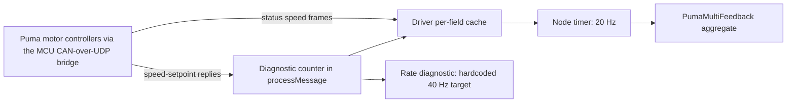
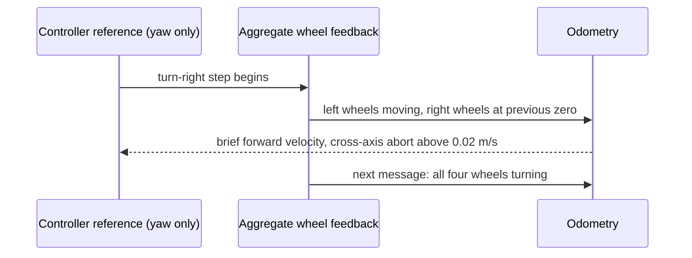

# Ridgeback wheel feedback and diagnostic qualification

The [driving qualification](driving_readiness.md) remains open. Command caps
bound requested velocities; they do not establish synchronized wheel response,
physical stopping distance or truthful diagnostic decoding.

This page is the overview of the wheel-feedback path: what is installed, how
the motor diagnostics decode faults, and which rates the driver produces. The
details live in three pages:

- [Per-wheel field-age driver](wheel_feedback_field_age.md): field eligibility,
  the age and queue pipeline, its bounds, build, installation and acceptance.
- [Wheel-feedback consumer](wheel_feedback_consumer.md): how the hardware plugin
  validates feedback, inhibits commands and recovers.
- [Motor-link fault injection](motor_link_fault_injection.md): stationary
  interruption checks and the raised-wheel D6 and D7 trials.

The [qualification plan](../plans/PHYSICAL_remaining_qualification.md#driving-and-feedback)
owns the status of D5–D7.

## Installed state

Three root-owned layers replace parts of the apt Clearpath 2.9.4 platform. Each
is a pinned prefix selected by a `clearpath-platform.service` drop-in, and each
has its own receipt-based rollback.

| Layer | Installed form | Content | Rollback |
|---|---|---|---|
| Running motor driver | `/opt/dynamo-puma-field/<manifest-hash>`, selected by `97-dynamo-puma-field-driver.conf` | Clearpath 2.9.4 with the fault-flag, cache-safety, completeness, field-age and queue-timing patches; motion fields 150 ms, auxiliary fields 500 ms | `install_puma_field_driver.py --restore`; returns to the repair driver below |
| Repair driver (rollback target) | `/opt/dynamo-puma/76ff6b99a1e35cc56e27e07302aa98f94ebb85f809348e25eaab04a50ef49856/`, `80-dynamo-puma-repair.conf`, guard drop-in `20-dynamo-dds-readiness.conf`, helper `/usr/local/lib/dynamo-hardware/wait_dds_interfaces.py` | Clearpath 2.9.4 with the fault-flag and cache-safety patches | `install_puma_repair.py --restore`, documented in the [README](../../README.md) |
| Hardware consumer | `/opt/dynamo-puma-feedback/<manifest-hash>`, selected by `95-dynamo-puma-feedback.conf` | Clearpath 2.9.4 Puma hardware plugin with the feedback-consumer patch | `install_puma_feedback_plugin.py --restore`, documented in the README |

The field-driver drop-in copies the consumer drop-in's `ExecStart` and swaps
only the driver prefix, so the running platform uses both. The plugin installer
does not inspect that later drop-in: when both are to be removed, restore the
field driver first. Restoring the field driver needs the physical stop pressed
and the receipt directory used to install it:

```bash
cd /home/robot/DyNAMO-Ridgeback
sudo python3 tools/hardware/install_puma_field_driver.py --restore \
  --operator-confirmed \
  --run-dir "$PWD/artifacts/hardware/d5-field-driver-install-20261022-2"
```

Restore re-validates that stage: the commissioning cap mode (original-manual
speeds when it was installed), the consumer drop-in, robot identity and
dependency versions must still match, or it refuses and leaves the drop-in.

The installed receipts are, from the bottom layer up,
`artifacts/hardware/20261012-puma-repair-install/`,
`artifacts/hardware/20261013-puma-feedback-install-stage-5/` and
`artifacts/hardware/d5-field-driver-install-20261022-2/` on the robot host. The
repair and consumer installations restarted only the platform and guard; the
field driver restarted only the platform. Each verified that the camera, sensor
and desktop services were unchanged. The repair installation preserves
whichever exact capped or test-interlocked guard installation was verified when
it was staged; changed
caps or dependencies block its apply step, and its restore returns the previous
capped platform without modifying the test-lock files. Restore keeps each
pinned prefix on disk as evidence.

All three layers are accepted while stationary only: the repair driver decodes
fault masks correctly, the consumer loads in the real controller manager and
inhibits commands on a real feedback interruption, and the field driver passed
its 60-second acceptance. None of these changes gains, firmware, command caps
or the 40 Hz diagnostic target. Cold boot is not qualified: the qualification
plan records one earlier post-install reboot, and the repair's DDS
interface-readiness helper has no cold-boot recovery evidence. Driver reconnect
after a lost motor link is not qualified either.

Before a Clearpath package upgrade or a fresh-host reconstruction, re-evaluate
every patch against the selected source. Do not overwrite apt executables or
source a mutable checkout into the live platform service. Any rebuilt layer
needs its own pinned install, provenance, stationary verification and rollback.
The [recovery runbook](ridgeback_recovery.md) owns host reconstruction.

## Fault flags

The installed `clearpath_motor_msgs/PumaStatus` defines masks 1, 2, 4 and 8 for
current, temperature, bus voltage and bridge-driver faults. The upstream
Clearpath 2.9.4 Puma node uses those masks as bit-shift positions when decoding
its human-readable diagnostics. Shifting fault 8 by mask 8 yields zero, so the
stock node reports `Bridge Driver Fault: False` while the raw field says 8.
On a stock driver, read the raw mask instead. The reporting defect does not
establish the reason for a motor fault.

The maintained [diagnostic patch](../../patches/clearpath_puma_fault_flags.patch)
tests each mask with a bitwise AND. Both installed drivers carry it, and the
human-readable bridge-driver flag reports true together with raw mask 8 while
the physical stop is pressed. That status is the motor controllers' report
while stopped, not evidence of a physical motor fault. The
[offline verifier](../../tools/hardware/verify_puma_fault_patch.py) checks the
downloaded 2.9.4 source hash, applies the patch to a temporary tree and
compiles the corrected expression against all 256 fault values and four masks.

Source ownership is the official
[2.9.4 node](https://github.com/clearpathrobotics/clearpath_robot/blob/2.9.4/clearpath_motor_drivers/puma_motor_driver/src/multi_puma_node.cpp)
and [label definitions](https://github.com/clearpathrobotics/clearpath_robot/blob/2.9.4/clearpath_motor_drivers/puma_motor_driver/include/puma_motor_driver/multi_puma_node.hpp).
The inspected node source hash is
`d156ed91b28d5526de64c625cad7555b7728f54c7c1e020c9b341bbabccda89b`.

## Cache bounds repair

Upstream 2.9.4 reads analog input through field index 15 of a status-cache
array of length 15. The protocol index mask permits values 0–15, and several
other cache arrays are smaller and also lack bounds checks. This is a
source-level memory-access defect; it is not established as the cause of any
observed motion transient.

The maintained [cache-safety patch](../../patches/clearpath_puma_cache_safety.patch)
sizes every protocol-indexed cache to sixteen entries, reads fixed-point values
through aligned `memcpy`, selects exact API classes and zero-pads validated short
payloads. [The repair builder](../../tools/hardware/build_puma_repair.py) applies
patches to the exported tree with `patch`, checks forward application and
reverse applicability, and repeats applied-patch verification before staging;
a regression test reproduces the silent skip that `git apply` produced inside
an ignored nested Git tree. The installer rejects candidates without verified
patch-application provenance before any service action.

## Rates and freshness

Three different rates must be distinguished:

- **Aggregate publication.** The Puma node timer defaults to 20 Hz when
  `frequency` is absent from the deployed configuration; it limits aggregated
  `PumaMultiFeedback` publication.
- **Per-field arrival.** Individual fields arrive through CAN and are cached
  independently. An aggregate timestamp does not prove that each wheel or field
  was just updated.
- **Diagnostic reads.** The hardcoded 40 Hz diagnostic target applies to selected
  CAN message classes counted by `Driver::processMessage`, not to the ROS
  aggregate. Status-class speed fields and speed-control setpoint replies take
  different paths through this counter.



Measured stationary on `r100_0160`: status-speed frames arrive at the same
rate on every wheel, while counted setpoint replies fall short on the rear-right
wheel despite equal outgoing traffic, and no counted stream reaches the 40 Hz
target. That locates neither the loss nor a physical feedback stall; interface
receive timestamps are not wire timestamps. The rates and gaps are in the
paired rate capture under [Archived evidence](#archived-evidence).

The [2.9.4 driver](https://github.com/clearpathrobotics/clearpath_robot/blob/2.9.4/clearpath_motor_drivers/puma_motor_driver/src/driver.cpp)
and node source own these semantics. Do not change the diagnostic target to
20 Hz merely because the ROS topic arrives at 20 Hz: measure the counted CAN
classes, request/reply origin and per-device loss, and reconcile the reply,
query and command semantics with the firmware expectations first.

Upstream readiness ORs received-field bits across all wheels, so an aggregate
can pass without every field being newly received for every wheel, and reading
cached speeds clears their received flags. The installed field-age driver
replaces that check with per-wheel completeness and explicit age bounds; see
[field eligibility](wheel_feedback_field_age.md#field-eligibility).

## Observed startup transients

Abrupt one-second step pulses produced repeatable startup-transient aborts:
the test stops and sends zeros when reported motion outside the requested axis
exceeds its conservative 0.02 m/s planar threshold. In one turn-right abort the
controller reference contained only yaw. One feedback message reported the two
left wheels moving while both right wheels kept their previous zero readings;
the next reported all four moving in the requested direction. The controller
turned those mixed readings into brief forward odometry.



This establishes the software calculation, not whether the physical wheels
responded at different times or their feedback was delivered at different
times. Do not raise the abort threshold or treat the transient as harmless
without that evidence. The pulse helper's optional 250 ms rise/fall profile
stays within the original peak and one-second duration and reduces the
cross-axis readings (trials under [Archived evidence](#archived-evidence)). The
ramp changes the commanded acceleration; it does not repair feedback timing or
qualify emergency stopping.

The installed field driver requires every wheel's position and speed to have
been received since the previous aggregate. Whether that removes the
abrupt-start transient is untested. Abrupt-start trials capture controller
references, individual wheel feedback, raw and filtered odometry and operator
observations together.

## Archived evidence

- [Puma diagnostic build and startup-transient aborts](../../archive/engineering/2026-10-06-puma-build-and-startup-transients.md)
- [Puma repair, CAN rates and offline freshness models](../../archive/engineering/2026-10-12-puma-repair-rates-and-freshness-replays.md)
- [Consumer plugin and stationary feedback interruptions](../../archive/engineering/2026-10-13-consumer-plugin-and-feedback-outage.md)
- [Single-bound field-age candidate and stationary captures](../../archive/engineering/2026-10-16-field-age-captures.md)
- [Short moving captures, policy replays and queue-timing builds](../../archive/engineering/2026-10-21-d5-motion-captures-and-queue.md)
- [Split field-age bounds and stationary acceptance](../../archive/engineering/2026-10-22-d5-acceptance.md)
