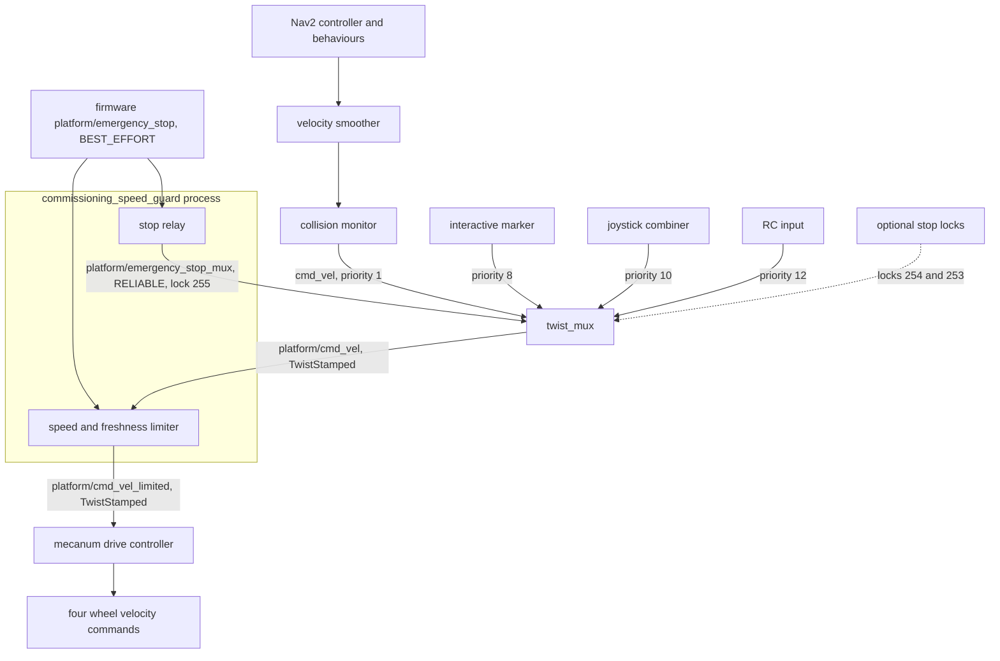

# Ridgeback driving command path

This page owns the deployed velocity-command topology of `r100_0160` and the
stop, stamp and speed semantics of each layer. The
[commissioning guard](commissioning_guard.md) owns the guard's limits and modes,
the [stop mechanisms](estop_stop_semantics.md) page owns e-stop delivery and
deadman stopping, and the [driving qualification router](driving_readiness.md)
lists the installed state.

## Topology

Every source enters one `twist_mux`. Its output passes through the commissioning
guard before the mecanum drive controller. The guard is one process with two
roles: it limits velocity commands, and it relays the firmware e-stop to the
mux on a reliable topic.

*Deployed command path. Notice that every source, including Nav2, reaches the
wheels only through the guard's limiter, and that the e-stop reaches the mux
through the guard's relay rather than directly from the firmware.*

| Mux input | Topic | Priority | Input expiry |
|---|---|---|---|
| External (Nav2 collision monitor output) | `cmd_vel` | 1 | 0.5 s |
| Interactive marker | `twist_marker_server/cmd_vel` | 8 | 0.5 s |
| Joystick combiner | `joy_teleop/cmd_vel_combined` | 10 | 0.5 s |
| RC input | `rc_teleop/cmd_vel` | 12 | 0.5 s |
| E-stop lock | `platform/emergency_stop_mux` (mux-only remap) | 255 | none |
| Optional locks | `platform/safety_stop` (254), `joy_teleop/bt_quality_stop` | 254, 253 | none |

The mux output, the guard output and the controller subscription all carry
`geometry_msgs/msg/TwistStamped`. The mecanum controller
(`platform_velocity_controller`) is active, not chained, and claims all four
wheel velocity interfaces. `lighting_node` also subscribes to the mux output.

The Nav2 hops are the repository configuration. They were observed live with
no goal sent; the stationary inspection that established the manual path had
no Nav2 running. Joystick, RC and interactive-marker inputs enter the mux
independently of the collision monitor. **An operator must not assume manual
commands have obstacle avoidance.** `autonomous_motion_enabled:=false` prevents
frontier goal generation; it does not stop a running Nav2 server from accepting
goals from other clients.

## Layer semantics

The inspected installation runs mecanum controller 4.40.1 and twist mux 4.5.0.
Recheck these semantics after upgrades or Clearpath regeneration.

| Layer | Behaviour | Qualification limit |
|---|---|---|
| Joystick combiner | Publishes while button 4 or 5 is held; stops publishing when both are released | Release relies on downstream timeouts; no explicit zero is sent |
| Mux | Receive-time input expiry is 0.5 s; forwards the winning stamped message unchanged | Input expiry and asserted locks suppress commands; they do not themselves publish a zero |
| Commissioning guard | Validates, limits and preserves the source stamp; a 20 Hz watchdog publishes zeros only | Software bounds; see the [guard contract](commissioning_guard.md#admission-and-watchdog) |
| Mecanum controller | `reference_timeout` is command-stamp based; expired valid references produce zero wheel commands in subsequent updates | Measure effective timeout and physical stopping; do not infer it from mux expiry |
| E-stop | Firmware `platform/emergency_stop` → guard → reliable `platform/emergency_stop_mux`; mux lock priority 255 | Physical motor inhibition and recovery need operator tests |
| Optional locks | `platform/safety_stop` and `joy_teleop/bt_quality_stop` had no publishers at inspection | Zero lock timeout provides no missing-publisher watchdog |

Live parameter reads confirmed `reference_timeout: 0.1`, controller update rate
20 Hz, mux input expiry 0.5 s and wall time on the controller, mux and joystick
nodes. The mux output offers reliable QoS, depth 1; the controller requests best
effort, depth 1, a compatible pair. This leaves only two nominal 50 ms update
intervals within the command-age budget, so delayed stamps matter.
Controller-manager and EKF bulk parameter reads returned incomplete responses;
their missing values remain gaps rather than assumed defaults.

The generated `use_stamped_vel: false` and `cmd_vel_timeout: 0.5` entries are
legacy settings, not the interface/timeout selectors consumed by the installed
mecanum implementation. Its declared parameter schema and stamped subscriber
are authoritative. Similarly, legacy `linear.x/y` and `angular.z` velocity and
acceleration entries are not proof of controller-side speed limiting.

## Speed scales and limits

The deployed combiner requests up to 0.4 m/s in either planar component and
0.5 rad/s normally; boost multiplies these by three. Combined planar motion
can exceed either individual component. These are command scales, not measured
robot speeds. The [controller input page](controller_input.md#mapping-and-scales)
owns the axis mapping.

The repository Nav2 smoother permits 1.3 m/s per planar axis and 4 rad/s; it
does not limit manual mux inputs. The commissioning guard is the only speed
limit that applies to every source. Its installed mode and limits are owned by
the [guard reference](commissioning_guard.md#speed-modes): the default and
test-permit modes cap the planar vector at 0.05 m/s and yaw at 0.1 rad/s, while
the original-manual mode passes the combiner's full range.

## Stamps and frames

Controller commands are body-frame velocities. A header frame is not a request
to transform an arbitrary coordinate frame. The controller replaces zero header
stamps with controller time and rejects sufficiently old stamps. Its age
comparison does not explicitly reject future stamps, so a future stamp can defer
expiry. The guard rejects stamps more than 5 ms in the future and older than
100 ms before they reach the controller. Use wall time on the robot and verify
clocks before cross-host control.

## Implementation sources

- [mecanum controller 4.40.1](https://github.com/ros-controls/ros2_controllers/blob/4.40.1/mecanum_drive_controller/src/mecanum_drive_controller.cpp)
- [mux 4.5.0](https://github.com/ros-teleop/twist_mux/blob/4.5.0/src/twist_mux.cpp)
- [mux input handles](https://github.com/ros-teleop/twist_mux/blob/4.5.0/include/twist_mux/topic_handle.hpp)

The captured combiner and configuration are reconstructible through the
[host recovery inputs](../../deployment/r100_0160/README.md). The read-only
[graph/parameter auditor](driving_check_tools.md#graph-and-parameter-auditor)
re-inspects this path.

## Archived evidence

- [Commissioning guard installation and first low-speed trials](../../archive/engineering/2026-10-06-driving-guard-and-deadman-trials.md)
  — the stationary inspection that established the manual path.
- [Nav2 command chain observed live](../../archive/engineering/2026-10-13-r100-0160-nav2-command-chain.md)
  — the Nav2 hops on the live graph.
