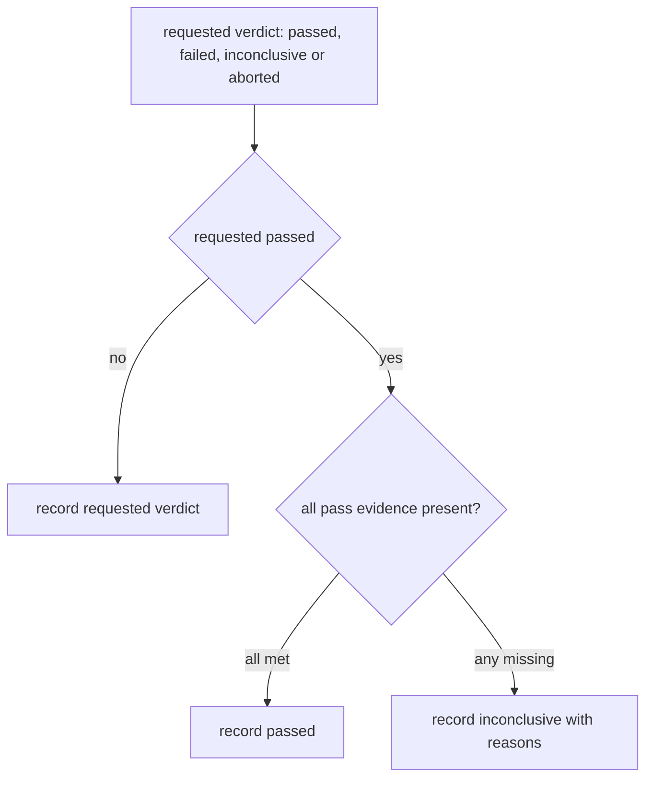
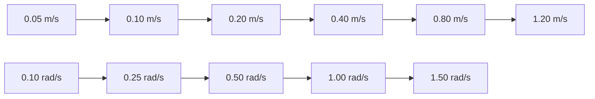

# Ridgeback driving qualification procedure

Driving qualification of `r100_0160` is one program of lanes D1–D8: bounded
direction trials (D1), stop mechanisms (D2), controller loss and reconnect (D3),
source handover (D4), wheel-feedback freshness (D5), feedback and motor-link
faults (D6, D7) and measured stopping distance (D8). This page owns how a
supervised trial is run, how its result is classified and what each lane needs
to pass. The [qualification plan](../plans/PHYSICAL_remaining_qualification.md#driving-and-feedback)
holds lane status; the
[backlog](../BACKLOG.md#physical-command-chain-validation) holds the open gates.
The [field-age](wheel_feedback_field_age.md) and
[motor-link fault](motor_link_fault_injection.md) references own the D5–D7
conditions.

## Supervised physical procedure

1. With an operator, clear surrounding floor and an accessible physical stop,
   recheck the installed guard mode and controller routing with a stationary
   probe. Do not start autonomous goals; keep perception changes out of driving
   trials.
2. While stationary, press the physical stop and observe its reported state,
   controller state and wheel feedback. Never reset or release it
   automatically; release is the operator's action.
3. Only after explicit approval for motion, test one axis at a time with a
   one-second bounded command, then zero. Verify forward/backward, lateral and
   yaw signs against physical movement and wheel/filtered odometry.
4. At the same small speed, test deadman release, stopped command publication,
   loss of the joystick connection and the physical stop separately. Record the
   last command, zero wheel reference, odometry and actual stop; timestamps
   alone cannot measure stopping distance.
5. Verify higher-priority takeover and return to external control without
   unexpected movement. Start the Nav2 chain only after the perception and TF
   gates pass; test collision-monitor suppression and stale-source handling
   without intentionally driving towards a person or obstacle.

Only one live robot action runs at a time. The one-second pulse, the test-permit
budget and the commissioning caps are test bounds, not measured braking
guarantees. Agree physical stopping limits before motion, based on the
available clearance. Full autonomous driving stays unqualified until these
checks and the perception and geometry gates pass.

## Speed profile for moving trials

Moving D-lane trials run under the temporary
[test-permit interlock](commissioning_guard.md#test-permit-interlock): 0.05 m/s
planar magnitude, 0.1 rad/s yaw and one second of motion per physical stop
cycle. When the original-manual profile is installed, install and verify the
test interlock with the physical stop pressed before the trial, and restore the
saved manual-speed installation afterwards. Interlocked recorders refuse the
original-manual installation and must not be used to qualify motion at the
faster profile. The forward-pulse helper's `--original-manual-speeds` and
`physical-e-stop` modes and the live handover recorder run on the manual guard
instead, but request at most 0.05 m/s from their own synthetic source.

## Operator sequencing

- Start every trial with the physical stop pressed and the controller neutral.
- At `RECORDING READY`, release only the physical stop. Touch the controller
  only after the recorder prints `PHYSICAL RELEASE RECORDED`. The firmware
  reports the stop about once per second, so the report can lag the release.
- Make one movement per run, in the selected direction only. Avoid touching
  the other stick axes; the recorder's cross-axis bounds abort on drift.
- For a deadman trial, release L1 as soon as movement is felt while the forward
  stick stays displaced, then centre the stick. For a physical-stop trial,
  press the red stop as soon as movement starts, while still holding the
  controls. Do not wait for a terminal prompt.
- Press the physical stop immediately for any unexpected movement.
- Do not repeat a motion abort merely to obtain a pass. Preserve the recording,
  examine it, and record any deviation, such as a longer exposure than
  requested, with the result.

## Stop-action classification

A stop-action trial (deadman, physical stop, command-source silence,
controller disconnect) passes the command-chain check only if the requested
action, not the guard's independent budget, ended motion:

- recent nonzero motor commands precede the action;
- limited and motor commands reach zero before the independent permit budget
  expires, and motor commands stay zero afterwards;
- the expected lock state is observed: a deadman release or source silence
  leaves the software lock open while permits remain true, and a physical stop
  asserts it.

Otherwise the recorder returns `stop-action-command-chain-inconclusive`. A zero
produced only at the one-second budget does not qualify the requested
mechanism, and the budget is never enlarged to make a human-timed trial pass.
A moving-disconnect trial additionally needs confirmed transport loss and input
reset. A bounded-permit trial qualifies the budget itself only when source input
and permits continue after the guard locks and wheel commands stay zero. Every
classification uses host receive times and needs separately observed physical
stopping.

## Lane preconditions

- **D2** — current build, test interlock installed, agreed clearance, and D1
  complete. Each mechanism is a separate run.
- **D3** — silent radio loss needs two operators: one beside the physical stop,
  one carrying the still-held controller away. Deliberate disconnects and
  reconnect cycles are stationary first.
- **D4** — regression on the final installed configuration.
- **D6, D7** — rated stands with all wheels clear, a qualified helper and an
  exclusive robot window, as owned by the
  [motor-link fault reference](motor_link_fault_injection.md#raised-wheel-trial-tool).
- **D8** — measured geometry and a declared floor, load and clearance; see
  [stopping-distance measurement](#stopping-distance-measurement).

## Evidence and verdicts

[`driving_qualification.py`](../../tools/hardware/driving_qualification.py)
owns the common evidence join for D1–D8.

- `snapshot` records source and installed configuration hashes (the guard,
  observer and fault-runner sources, guard unit and platform drop-ins,
  `/etc/clearpath/robot.yaml` and the controller list), the selected service
  commands and relevant processes, without changing robot state. Firewall rules
  cannot be listed without root, so each fault runner performs its own
  privileged exact-rule preflight and cleanup check.
- `finalize` combines an immutable hash of a recorder result with the physical
  observation, conditions, measurements, recovery, final installed mode and
  independent video where required.
- `matrix` collects finalized records without inferring a result from a
  directory name, and reports each lane's acceptance.

*Finalization. Notice that missing evidence can only lower a requested pass;
nothing raises a verdict. Pass evidence is a physical observation and a
recorder result that supports a pass, plus hashed video and a baseline snapshot
for D6–D8, a recovery result for D6 and D7, and the D8 conditions and ladder.*

| Lane | Matrix acceptance |
|---|---|
| D1 | One bounded sign trial in each of the six principal directions |
| D2 | Three isolated passing repetitions each of command loss, deadman and physical e-stop |
| D3 | Three genuine silent radio losses and three neutral reconnect/input/return cycles |
| D4 | One handover regression on the final installed configuration |
| D5 | Installed stationary field-freshness acceptance |
| D6 | Three raised-wheel feedback-loss trials with video and recovery |
| D7 | Three raised-wheel outgoing-link-loss trials with video and recovery |
| D8 | Three passing measurements at every staged speed for each stop mechanism and principal direction, within one consistent test series |

Runs recorded before this schema can be imported; importing preserves their
original limits and does not upgrade them.

## Stopping-distance measurement

Record an independently measured physical stopping distance at each approved
speed, load and floor condition. Track a fixed point on the robot against floor
marks in video, identify its position at the stop action and at complete rest,
and measure the displacement with its uncertainty. Retain the command,
motor-command and wheel-odometry traces. Repeat each stop mechanism separately,
including deadman, command silence and physical stop. Do not infer a physical
distance from ROS receive timestamps or odometry alone. Establish the
applicable clearance limit before a full-speed trial.

A passing D8 finalization requires these conditions: floor, payload, battery
state, tire condition, direction, motion class, test-series identity and
available clearance. It also requires target and actual speed, stopping
distance, distance uncertainty, stop duration, video and a baseline snapshot.
Actual speed must reach at least 90% of target, and stopping distance plus
uncertainty must fit within the declared clearance.

*D8 speed ladder: translation (top) and rotation (bottom). Notice that a stage
cannot pass until every lower stage has passed for the same mechanism,
direction and test series; any other target speed is rejected.*

## Passed lanes

- **D1** (2026-10-14): one bounded floor trial in each of the six principal
  directions under the test-permit interlock (0.05 m/s planar, 0.1 rad/s yaw,
  one second per stop cycle), each with operator-confirmed direction and stop.
- **D4** (2026-10-21, `d4-handover-can-20261021-6`): stationary until
  commanded; a low 0.025 m/s source was taken over by a higher-priority
  0.045 m/s source, control returned 0.525 s after the last high command (0.5 s
  mux timeout), the robot stopped itself when both fell silent, and the
  controller was untouched.
- **D5** (2026-10-22, stationary): see
  [field-age acceptance](wheel_feedback_field_age.md).

Run details are in the records under [Archived evidence](#archived-evidence);
lane status is in the
[qualification plan](../plans/PHYSICAL_remaining_qualification.md).

## Archived evidence

- [Direction and deadman trials](../../archive/engineering/2026-10-14-direction-and-deadman-trials.md)
  — the D1 direction set and D2 deadman and command-loss runs.
- [Original-manual profile and D4 handover](../../archive/engineering/2026-10-21-original-manual-and-d4-trials.md)
  — the D4 handover runs.
- [Physical-stop capture attempts](../../archive/engineering/2026-10-16-physical-stop-captures.md)
  — why the operator-sequencing rules exist.
- [D2 preparation and the reconnected deadman run](../../archive/engineering/2026-10-22-d2-preparation-and-run.md)
  — the baseline snapshot and the import of earlier runs.
