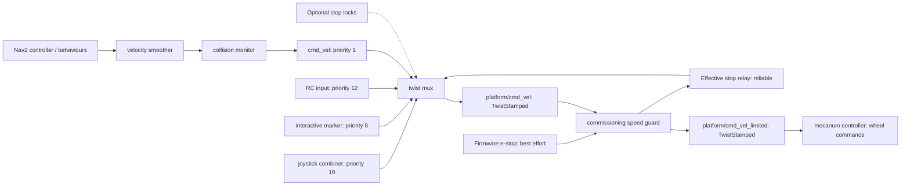

# Ridgeback driving command path and qualification

<!-- doc-budget: 1630 lines; reason: split pending into current-state pages and archive records -->

Driving readiness requires both a compatible software command path and observed
physical stopping. Graph discovery, stationary odometry, DDS throughput and
camera readiness do not establish the latter. The remaining gate lives in the
[project backlog](../BACKLOG.md#physical-command-chain-validation).

## Deployed command path

The 2026-10-06 stationary inspection of `r100_0160`, domain 0, established the
native path. The commissioning guard was subsequently installed with the
physical e-stop engaged, and the resulting path below was verified without
publishing velocity commands. The e-stop relay repair was installed and verified
stationary on 2026-10-09, giving the current command path below.



The guard relays firmware stop data to the mux through the compatible QoS path
described below.
The Nav2 portion is the repository's configured path, **not an observed active
publisher** in this inspection. Nav2 was absent from the live graph. Joystick,
RC and interactive-marker inputs enter the mux independently of the collision
monitor. An operator must not assume manual commands have obstacle avoidance.
`autonomous_motion_enabled:=false` prevents frontier goal generation; it does
not disable a running Nav2 server's acceptance of goals from other clients.

The live mux output, guard output and base controller subscription use
`geometry_msgs/msg/TwistStamped`. `ListControllers` reported the mecanum
controller active, not chained, claiming all four wheel velocity interfaces.
Raw odometry reported zero velocity during the passive stationary observation;
filtered odometry had small nonzero estimates. Neither proves a physical stop.

During the operator-assisted stationary stop check, the first post-confirmation
capture still received `emergency_stop: false`. After the operator confirmed
flashing red lights, a later capture received `true` in all eight samples and
diagnostics reported `E-stopped`; all four motor outputs reported zero volts.
There was no continuous capture across the physical button transition, so its
latency and the reason for the earlier false values are unestablished. No
motion was commanded against the stop and no stop reset was performed.

Motor diagnostics also reported roughly 15–20 Hz feedback against a 40 Hz
diagnostic target. Direct motor status reported fault value 8 during the stop,
while aggregated diagnostic fields reported no bridge-driver fault. Preserve
and reconcile these readings before treating the drive diagnostics as a
qualification gate; neither alone establishes a hardware defect.
The [wheel-feedback reference](drive_feedback_diagnostics.md) owns the confirmed
fault-decoding defect, prepared patch and remaining CAN-rate/freshness investigation.

## E-stop delivery to the mux

A stationary wireless-disconnect check exposed an incompatible e-stop QoS pair:
`proton_ros2` offers **BEST_EFFORT**, while the installed `twist_mux` lock
subscription requests **RELIABLE**. Discovery and matching topic/type names do
not make that pair deliver messages. The mux forwarded a small joystick command
while every captured firmware stop report was asserted. The original installed
guard receives BEST_EFFORT stop data and kept its limited output and wheel
commands at zero; the observer aborted before a disconnection was captured.
The earlier graph audit preserved this QoS mismatch but its interpretation
missed it. The auditor now flags known reliability/durability delivery blockers;
absence of those flags is not a full QoS compatibility or readiness pass.

The installed repair uses the guard to publish a separate reliable Bool topic,
`platform/emergency_stop_mux`. It republishes the effective stop state at 20 Hz:
startup, asserted firmware stop, missing firmware reports and reports older than
2.5 seconds all assert the lock. The native source remains unchanged; the relay
never feeds back into its own firmware subscription or refreshes that source's
freshness. A node-specific launch remap redirects **only the mux** to the relay.
Other firmware stop consumers retain their original topic. Command caps and
source stamps retain their existing semantics.

The repair was **installed and verified stationary on 2026-10-09**. All four
owned file hashes matched the maintained source and installation record. The
post-install probe confirmed a single reliable guard publisher on the relay,
the mux's reliable subscription to that relay, no mux subscription to the
original firmware stop topic, asserted relay data and the active controller
subscribed exclusively through the guard. The sensor and VNC service process IDs
were unchanged; the camera service was already inactive. Installation evidence
lives under `artifacts/hardware/20261009-stop-qos-install/`.

An independent 19-second subscriptions-only recording under
`artifacts/hardware/20261009-stop-qos-stationary/` captured 19 asserted firmware
stop reports and 380 samples each of raw odometry, limited commands and wheel
commands, all zero. All captured motor feedback speeds were zero. This verifies
stationary software state; physical controller disconnection, stop transitions
and stopping during motion remain separate tests. A subsequent stationary
controller trial under `artifacts/hardware/20261009-wireless-disconnect-stationary-2/`
captured live joystick requests while all 31 firmware stop reports were asserted.
The mux forwarded no commands; limited commands, wheel commands, raw odometry
and motor speed feedback remained zero. Deadman and stick input continued until
the recording ended. The operator reported starting the recorder and operating
the joystick, without switching the controller off. This demonstrates
asserted-stop suppression; physical controller disconnection remains untested.

Before deployment, thirteen isolated loopback checks passed with the actual
installed mux and mecanum controller and mock wheels, including
BEST_EFFORT-to-RELIABLE stop delivery, asserted-lock suppression, release without
replay and stale firmware stop suppression during ongoing fresh commands.
Evidence lives under `artifacts/hardware/20261006-stop-qos-mock/`; the tested
candidate is under `20261006-stop-qos-staged/`. Upgrading requires a stationary
robot, physical stop engaged, operator present and an exact match to all four
files in the prior verified capped-install record. Unknown changed files prevent
upgrade; failed installation leaves the platform stopped. Recovery preparation
uses the maintained guard and wrapper, separately from the original captured
baseline.

## Recorded physical e-stop transition

The 2026-10-09 `20261009-physical-estop-stop-2` observer run captured an
asserted firmware stop while the joystick still requested forward. Immediately
before the asserted report, the limited command was 0.05 m/s. The first limited
command after it was zero; the next captured wheel commands and raw odometry
were also zero. All subsequent captured samples stayed zero. This establishes
software suppression and zero reported wheel motion across the captured stop
transition. The physical operator observation is still required separately.

Only 0.43 seconds of recording remained after the asserted report, so this run
does not establish a sustained stop or safe release without replay. It included
multiple movement bouts and exceeded the requested single one-second movement.
Receive timestamps do not measure latency from the physical button press.
The raw recording and interpretation are preserved under
`artifacts/hardware/20261009-physical-estop-stop-2/`. Keep these limits separate
from the remaining driving qualification gates.

The subsequent `20261009-physical-estop-stop-3` recording captured nearly five
seconds of asserted-stop state with 101 zero limited commands, 100 zero wheel
commands and 100 zero raw odometry samples. However, the forward request ended
at 17.66 seconds and the last nonzero raw odometry was at 17.82 seconds; a later
firmware report still indicated released at 18.56 seconds, before reporting
pressed at 19.56 seconds. This run demonstrates a sustained stationary tail,
but does not isolate physical e-stop inhibition during motion. Operator action
order remains to be clarified; the physical stopping gate remains open.

The `20261009-physical-estop-stop-4` run captured the stop asserted while the
joystick driving-enable button and forward axis remained active. The immediately
preceding limited command was 0.05 m/s; its first post-report sample was zero.
All 62 subsequent limited commands, 61 wheel commands and 61 raw odometry
samples stayed zero across a 3.05-second tail. This isolates asserted-stop
suppression from controller centring. Raw wheel motion had already subsided
before the periodic asserted report arrived, consistent with earlier physical
inhibition, but the physical button timestamp was not recorded and its latency
cannot be derived. The operator confirmed that pressing the physical red stop
stopped the robot while forward remained held, and that the robot was then
stationary with the physical stop pressed. Physical stopping is therefore
observed for this trial; this does not qualify release or recovery.

The first movement command preceded the asserted report by 6.96 seconds,
exceeding the requested one-second exposure; this interval includes an unknown
reporting delay. Preserve that procedure deviation rather than describing this
as a compliant one-second trial. No safe-release/replay test was performed.

The `e-stop-release` observer mode supports a separate neutral-release check.
It sends no commands, requires fresh neutral joystick input and an initially
pressed stop, observes ten seconds after the released stop report, and finishes
only after the operator re-engages the stop and two asserted reports arrive.
Unexpected commands, nonzero wheel motion, stale feedback or controller input,
and premature re-engagement abort the recording. This observer remains unable
to stop the robot itself. The 2026-10-09 `20261009-neutral-estop-release` live recording captured
13.93 seconds between released and re-engaged firmware reports. No raw mux
command arrived; all 339 limited-command samples, 337 wheel-command samples
and 337 raw odometry samples during the operator phase were finite and exactly
zero. The final two firmware reports asserted the stop. This verifies the
recorded neutral-release software response. The operator confirmed the robot
remained still. Neutral release is observed for this trial. Held-input release and wireless reconnection remain separate gates.

## Stop, stamp and speed semantics

The installed versions inspected were mecanum controller 4.40.1 and twist mux
4.5.0. Recheck after upgrades or Clearpath regeneration.

| Layer | Relevant behaviour | Qualification limit |
|---|---|---|
| Joystick combiner | Publishes while button 4 or 5 is held; stops publishing when both are released | Release relies on downstream timeout; no explicit zero is sent |
| Mux | Receive-time input expiry is 0.5 s; forwards the winning stamped message unchanged | Input expiry and asserted locks suppress commands; they do not themselves publish a zero |
| Mecanum controller | `reference_timeout` is command-stamp based; expired valid references produce zero wheel commands in subsequent updates | Measure effective timeout and physical stopping; do not infer it from mux expiry |
| E-stop | Firmware `platform/emergency_stop` → guard → reliable `platform/emergency_stop_mux`; mux lock priority 255 | Physical motor inhibition and recovery need operator tests |
| Optional locks | `platform/safety_stop` and `joy_teleop/bt_quality_stop` had no publishers at inspection | Zero lock timeout provides no missing-publisher watchdog |

Live parameter reads confirmed `reference_timeout: 0.1`, controller update rate
20 Hz, mux input expiry 0.5 s and wall time on the controller, mux and joystick
nodes. The mux output offered reliable QoS, depth 1; the controller requested
best effort, depth 1, a compatible pair. This leaves only two nominal 50 ms
update intervals within the command-age budget, so delayed stamps can matter.
Controller-manager and EKF bulk parameter reads returned incomplete responses;
their missing values remain gaps rather than assumed defaults.

The generated `use_stamped_vel: false` and `cmd_vel_timeout: 0.5` entries are
legacy settings, not the interface/timeout selectors consumed by the installed
mecanum implementation. Its declared parameter schema and stamped subscriber
are authoritative. Similarly, legacy `linear.x/y` and `angular.z` velocity and
acceleration entries are not proof of controller-side speed limiting.

The deployed combiner requests up to 0.4 m/s in either planar component and
0.5 rad/s normally; boost multiplies these by three. Combined planar motion
can exceed either individual component. These are command scales, not measured
robot speeds. The repository Nav2 smoother permits 1.3 m/s per planar axis and
4 rad/s; that smoother does not limit manual mux inputs. Qualification needs
an explicit commissioning speed limit before motor tests.

Controller commands are body-frame velocities. A header frame is not a request
to transform an arbitrary coordinate frame. Zero header stamps are replaced
with controller time; sufficiently old stamps are rejected. Future stamps are
not explicitly rejected by the inspected age comparison and can defer expiry.
Use wall time on the robot and verify clocks before cross-host control.

Implementation sources:
[mecanum controller 4.40.1](https://github.com/ros-controls/ros2_controllers/blob/4.40.1/mecanum_drive_controller/src/mecanum_drive_controller.cpp),
[mux 4.5.0](https://github.com/ros-teleop/twist_mux/blob/4.5.0/src/twist_mux.cpp),
[mux input handles](https://github.com/ros-teleop/twist_mux/blob/4.5.0/include/twist_mux/topic_handle.hpp).
The captured combiner and configuration are reconstructible through the
[host recovery inputs](../../deployment/r100_0160/README.md).

## Commissioning caps

The commissioning guard was installed and verified stationary on `r100_0160`
on 2026-10-06. It adds one fixed guard after the mux: `platform/cmd_vel` → guard →
`platform/cmd_vel_limited` → mecanum controller. Limits are **0.05 m/s for the
planar vector magnitude**, including diagonal commands, and **0.1 rad/s yaw**.
Normal joystick, boost, RC, marker and Nav2 inputs all share this guard. Boost
cannot exceed these limits. Original joystick scale values remain intact.

The guard requires fresh firmware stop data indicating the stop is released.
Missing data, an asserted stop, or more than 2.5 seconds without stop data blocks
motion commands. It rejects nonfinite/nonplanar commands, unsupported frames,
zero stamps, stamps older than 100 ms, and stamps over 5 ms into the future.
It preserves accepted source stamps. A 20 Hz watchdog emits only zeros when
input expires or the stop blocks; it never replays a nonzero command. A failed
guard leaves the controller without nonzero references, subject to the existing
controller timeout. These are software command bounds, not measured braking
or physical speed guarantees.

The maintained [installer](../../tools/hardware/install_commissioning_caps.py)
stages four files, preserves prior bytes/modes/owners, and refuses application
unless passive observation confirms a physical stop, stationary raw odometry
and the expected active controller. It restarts only the platform and guard,
then verifies that the controller subscribes to the limited topic and no longer
subscribes to the raw mux topic. Exactly one guard publisher must own the
limited topic. Failed application leaves the platform stopped; it does not
automatically restore an uncapped command path.

Installation evidence is under
`artifacts/hardware/20261006-commissioning-caps-install/`. A separate read-only
check under `artifacts/hardware/20261006-commissioning-caps/` confirmed three
engaged-stop samples, 46 stationary raw-odometry samples, the active controller,
and the expected exclusive guard publisher/controller subscription. All four
installed file hashes matched the installation result. Platform and guard units
were active; sensor and VNC process IDs were unchanged. This verifies the
stationary installed state, not cold-boot recovery or physical stopping.

The platform drop-in requires the guard. A launch-scoped `SetRemap` takes
precedence over Clearpath's native remap, then includes its generated platform
job. No robot declaration or generated Clearpath config is rewritten. The
wrapper checks the pinned guard hash and refuses unexpected additional platform
jobs; review those changes after upgrades.

On the 2026-10-09 boot, the original guard failed twice because the DDS profile's
required `wlp3s0` interface was not yet available, then started successfully.
`After=network.target` does not establish that each configured DDS interface is
present. The installed QoS repair retains that unit ordering. Device-specific boot
readiness and a supervised cold-boot check therefore remain open; eventual
active status must not be treated as a clean startup qualification.

Installed script copies are root-owned
and do not follow a rebuilt/switched workspace checkout. Current CycloneDDS,
domain 0 and the deployed DDS profile are retained. Camera, sensor and desktop
units are outside this installer. Recovery preparation includes all four
[guarded host candidates](ridgeback_public_recovery.md).

The [loopback qualification](../../tools/hardware/check_commissioning_pipeline.py)
loads the installed mecanum controller with `mock_components/GenericSystem`
wheel interfaces in domain 213 and a private namespace. It verifies routing,
boost/diagonal caps, preserved stamps, expiry and asserted-stop suppression.
It never loads a physical driver. The first candidate remap failed that test;
the corrected first-precedence remap passed all seven original checks.
The later stop-QoS repair passed the expanded thirteen-check mock suite. Before
that repair was installed, one supervised
forward pulse subsequently delivered 20 nonzero commands through the guard at
0.05 m/s with matching source stamps. Raw wheel odometry recorded a maximum
forward velocity of about 0.0508 m/s and 0.0472 m displacement before recording
ended; the operator reported that the robot moved and stopped by itself. These values are wheel
odometry, not an independent physical distance measurement.

That first pulse trial is incomplete: the test helper crashed while serializing
its first explicit zero because it assigned a Python integer to a ROS float64
field. The guard and platform stayed active. A separate zero-only recovery
and passive observation confirmed stationary raw odometry, but there was no
continuous recording across stopping and no stopping-time qualification.
After the operator re-engaged the physical stop, a separate passive check
confirmed three engaged-stop samples and 43 stationary raw-odometry samples,
with the guard routing and active controller retained. The observed physical
direction has not yet been confirmed independently of the odometry sign.
The helper now converts command values to floats; a regression test serializes
and deserializes both integer-zero inputs and motion using actual ROS message
types. Evidence, including the pre-fix source and truncated recording, lives in
`artifacts/hardware/20261006-forward-pulse-live/`. The corrected forward trial
subsequently completed with explicit zero commands and continuous odometry;
the operator confirmed forward movement and a clean stop. Wheel odometry
recorded 0.0521 m travel and settled within a strict 0.001 per-component
velocity tolerance about 0.485 s after the first zero command. These are
wheel-data measurements, not a physical stopping-distance qualification.

Later backward, lateral and turn-left trials completed software recording,
but turn-right retries and a backward repeat triggered startup-transient aborts.
The [wheel-feedback reference](drive_feedback_diagnostics.md#observed-startup-transients)
owns those findings. A later five-direction gently ramped sequence completed
under unchanged abort limits, with the operator confirming every direction and
clean stop. This qualifies that small ramped sequence; it does not close the
abrupt-start investigation.

Three gently ramped forward command-loss trials ended publication at the peak
and observed a full second of silence before cleanup zeros. All three recorded
stationary raw odometry during silence; the operator confirmed movement and a
self-stop for the third. In the first capture, guard zero, zero wheel command
and raw-odometry settling occurred approximately 0.122 s, 0.144 s and 0.246 s
respectively after the last nonzero command (odometry tolerance 0.005 per
component). These are host receive-time measurements for that capture, not
certified physical braking times. Evidence lives under
`artifacts/hardware/20261006-forward-command-loss/` and its two repeat directories.
This closes the bounded command-publication-loss trial, not joystick or radio
connection loss.

The first deadman observer run captured only stationary data: every joystick
axis/button remained zero, the physical stop report remained asserted, and no
nonzero mux/guard or wheel command was recorded. A successful recorder exit is
not a successful stop test. Its evidence is under
`artifacts/hardware/20261006-deadman-stop/`. A second run captured forward
joystick commands limited to 0.05 m/s, an explicit zero on stick centring,
zero wheel commands and stationary final raw odometry. The deadman button
stayed held and the final reported physical stop remained released; it does
not qualify deadman release. Operator observations are recorded separately
from these software measurements. The operator subsequently confirmed a
stationary robot with the physical stop engaged. Evidence is under
`artifacts/hardware/20261006-deadman-stop-2/`. Deadman, connection loss, physical
e-stop under motion and cold boot remain open. Driving readiness is incomplete.


A later deadman recording captured release of button 4 while the forward stick
was still nonzero. The joystick combiner and mux stopped publishing, without
sending an explicit zero. Zero wheel commands arrived about 0.109 s after the
observed release; the guard's watchdog zero arrived about 0.137 s after release,
and raw odometry settled within 0.005 per component about 0.209 s after release.
The controller's own expiry can produce zero wheel commands before the guard
watchdog fires. These are callback receive-time measurements, not physical
braking or button-to-firmware latency guarantees. The recorded controller
references stayed within the installed 0.05 m/s planar and 0.1 rad/s yaw caps.

This recording contained two command bouts, longer than the requested one-second
forward trial, with some joystick-requested yaw; retain those protocol deviations
when interpreting it. Final raw odometry was stationary, but the last firmware
stop report remained released. Physical stop observations and subsequent e-stop
confirmation are separate gates. The operator could not tell whether button
release stopped the robot, then confirmed it stationary with the e-stop engaged;
a follow-up capture verified 19 asserted-stop reports and zero raw odometry. Evidence and analysis are under
`artifacts/hardware/20261006-deadman-stop-4/`. This establishes the software
response to a captured deadman release; the physical stopping observation is
inconclusive for that 2026-10-06 trial. The later observation below supplies
physical confirmation for a captured low-speed release.


On 2026-10-09, a later trial captured release of the driving-enable button while
forward stick input remained nonzero. Combiner and mux publication ceased;
guard zero and zero wheel commands arrived about 0.115 seconds after release,
and raw odometry settled within 0.005 per component about 0.209 seconds after
release. Commands and raw odometry stayed stopped until another button press
approximately six seconds later. The operator confirmed that the first movement
stopped by itself before the physical e-stop was pressed. This establishes an
observed low-speed deadman stop with the installed caps and repaired stop relay.

The first forward bout lasted about 2.6 seconds rather than the requested one
second. A second movement started near the end; recording ended with forward
commands, nonzero raw odometry and released stop data. Preserve these deviations:
the entire capture is not a clean single-pulse pass. The operator subsequently
confirmed stationary, e-stop pressed and flashing red lights; an independent
live probe received three asserted-stop reports and 57 stationary raw-odometry
samples, with the capped controller and stop relay routing intact. Evidence and
analysis are under `artifacts/hardware/20261009-deadman-stop-3/`. Moving
controller disconnection, physical e-stop during motion, takeover, abrupt-start
behaviour and cold boot remain separate open gates.

## Stationary and isolated diagnostics

The [graph/parameter auditor](../../tools/hardware/audit_driving_readiness.py)
uses the robot-local namespace, domain 0 and explicit deployed CycloneDDS
profile. It has a bounded worker and queries graph endpoints and only
`ListParameters`/`GetParameters`. It creates no data subscriptions or command
publishers, changes no parameters and never reports physical readiness as a
pass. Missing or unreadable parameters remain evidence gaps.

The [installed-mux check](../../tools/hardware/check_driving_mux.py) runs a new
mux with synthetic inputs, fixed domain 213, loopback-only DDS and a private
namespace. It never starts or addresses a base controller. It checks stamped
message preservation, source priorities, stop-lock suppression/release,
silence after input expiry, and priority handoff. This is a software behaviour
test, not an e-stop or motor test. Operator commands live in the
[README](../../README.md#stationary-driving-readiness-checks).

Its `--config` option reads an installed YAML policy but replaces every input
and lock topic before running the isolated mux. On October 16 the copied
robot policy passed the arbitration and suppression checks for external,
interactive-marker, joystick and RC priorities (1, 8, 10 and 12), each of its
three locks (255, 254 and 253), stamped-message preservation, input expiry
and return to the lowest-priority source. The exact source/configuration
hashes and result are under
`artifacts/hardware/20261016-deployed-mux-isolated/`. This advances D4's
software-policy check; live takeover and its physical response remain open.

The [mux-to-guard handover check](../../tools/hardware/check_driving_handover.py)
extends that isolated D4 check through the current guard in its original manual
speed profile. It requires a policy snapshot, replaces every source/lock endpoint,
and starts only a private mux and guard on fixed domain 214 with loopback DDS.
It starts no base controller and does not contact deployed processes. The October
21 run using the October 16 deployed-policy snapshot passed 17 checks: all four
priority levels over continuously publishing lower sources, each descending
handover, guard zero during the expiry gap, all-source silence, firmware-stop
relay suppression, release without replay, fresh-input resumption and exact
timestamp/frame/velocity preservation. Original manual diagonal boost values
(1.2 m/s on each planar axis and 1.5 rad/s yaw) passed unchanged in this synthetic
test. After the last higher-priority input, guard zero arrived in 121–130 ms and
the lower-priority stream resumed in 526–527 ms, consistent with the 0.5-second
mux timeout. Logs, per-message traces, policy/source snapshots, executable hash
and the result are under
`artifacts/hardware/20261021-d4-mux-guard-handover-final/`. These are host software
timings, not physical stopping times. A live joystick takeover and clean physical
return remain open D4 work; this run neither changed the live speed profile nor
tested wheels, radio behavior or operator response.

A [live bounded-source handover recorder](../../tools/hardware/check_live_driving_handover.py)
was prepared on October 21. Its read-only preflight passed with the physical
stop pressed, stationary odometry, neutral controller and original-manual guard
installed. The first preflight correctly rejected an existing
`twist_marker_server/cmd_vel` publisher; the prepared live trial instead uses
currently unoccupied `cmd_vel` and `rc_teleop/cmd_vel` inputs at 0.025 and
0.045 m/s requested forward speeds. These are synthetic inputs to the **live**
mux, guard and platform, not a test of the physical RC controller. Its wheel
response and operator observation remain pending until the bounded live trial
finishes. Preflight evidence is under
`artifacts/hardware/d4-live-preflight-20261021-3/`.
The first live attempt under `artifacts/hardware/d4-live-handover-20261021/`
timed out while waiting for the physical stop-release report. It published no
movement command. A second attempt under
`artifacts/hardware/d4-live-handover-20261021-2/` did publish the two bounded
forward sources through the live mux and guard. The saved trace reported the
high-priority source taking over, the lower-priority source returning 0.526 s
after the last high-priority request, and no sustained nonzero command after
both sources fell silent. Its raw-odometry forward peak was 0.00178 m/s. The
recorder then timed out before the operator re-engaged the physical stop, so
its overall status is `aborted`; this is software handover evidence, not a
completed physical-motion qualification. A later read-only probe confirmed the
physical stop pressed, the robot stationary, and the controller active. The
operator requested one fresh supervised repeat.
That repeat under `artifacts/hardware/d4-live-handover-20261021-4/`
recorded no physical-stop release, no nonzero source publication, no nonzero
guard command and zero raw odometry; it did not add live motion evidence.
A fresh run under `artifacts/hardware/d4-live-handover-20261021-5/` completed
the software switch again: the lower-priority source returned 0.525 s after
the final high-priority request and the final physical stop was recorded
pressed. Raw odometry remained zero throughout, and the operator reported the
robot stayed still. Thus live mux and guard switching passed, but physical
wheel response during source handover is still unverified. A separately
bounded, joystick-free manual-mode pulse is the next check of the drive path.
That one-second 0.05 m/s pulse under
`artifacts/hardware/d5-manual-pulse-20261021/` reached outgoing CAN speed-set
frames, but the robot stayed still and raw odometry showed only a tiny delayed
response. Motor status reported fault bit 8 on all four controllers during the
command, and incoming setpoint fields stayed zero. The fault cleared several
seconds after the physical stop was released, after the pulse had ended. The
bounded pulse and D4 handover tools now require fresh, stable zero-fault
speed-mode reports after stop release before sending any nonzero command. This
readiness change first passed offline tests and was then exercised in the
following live repeat.
The next one-second pulse under
`artifacts/hardware/d5-manual-pulse-20261021-2/` did wait 6.78 s for all four
motor faults to clear after stop release. The operator observed forward motion
and a self-stop; raw odometry peaked at 0.0511 m/s and the final physical stop
was recorded pressed. The earlier no-motion result was therefore consistent
with commanding while the motors still reported fault 8, rather than a broken
mux-to-wheel command route. A physical D4 source-handover repeat with the
motor-ready gate was the next diagnostic step.
The passive-CAN-wrapped repeat under
`artifacts/hardware/d4-handover-can-20261021/` sent no nonzero source command:
the operator kept the physical stop pressed, and all observed stop reports
remained pressed until the recorder timed out. Its 32,739 valid CAN field
receipts describe stationary feedback only; they cannot qualify the live
handover. A fresh run must record physical release and motor readiness before
either bounded source publishes motion.
A later run under `artifacts/hardware/d4-handover-can-20261021-6/` did record
the physical stop release and waited 7.23 s for four clear motor statuses.
The live mux accepted the 0.025 m/s lower-priority source, then the 0.045 m/s
higher-priority source; the lower source returned 0.525 s after the last high
request. Raw forward odometry peaked at 0.0465 m/s. The operator confirmed
forward-only movement and a self-stop before pressing the red stop; the final
pressed-stop report was saved. The passive CAN capture had 0 malformed relevant
frames. This qualifies one bounded live source handover and return, while actual
radio-controller takeover, loaded recurrence and physical stopping distance
remain separate checks.

Raw inspection data, original configs and the passive observation script are
under `artifacts/hardware/20261006-driving-readiness/` on the tested host.
These files are local evidence, not tracked recovery inputs.

The [forward-pulse helper](../../tools/hardware/commissioning_forward_pulse.py)
defaults to passive observation. Execution requires explicit operator
confirmation and a released, fresh firmware stop state. It verifies installed
guard files, exclusive output ownership, controller routing/activity, stationary
raw odometry and an uncontested external mux input. The fixed request is forward
0.05 m/s for at most one monotonic second, followed by zero commands. Missing
stop/odometry/guard data, competing nonzero commands or unexpected odometry
abort the pulse. Conservative abort thresholds are diagnostic test bounds,
not certified physical stopping limits. Samples and an operator-observation
placeholder are saved separately; a stationary final odometry value cannot
establish actual braking. The helper performs no service changes or firmware
reset/enable actions. The [README](../../README.md#stationary-driving-readiness-checks)
owns operator commands.

The helper can also observe a one-second publishing silence after a bounded
pulse (`--stop-mode timeout`) before cleanup zeros. With `--ramp`, that profile
only ramps up so silence begins at the peak. This is a distinct command-loss
test; it does not prove joystick disconnect or a physical e-stop under motion.
The [physical-control observer](../../tools/hardware/observe_driving_stop.py)
creates only subscriptions and checks graph/file ownership. The operator
performs deadman release, controller disconnection or the physical stop while
it records joystick messages, mux/guard outputs, wheel commands/feedback,
raw/filtered odometry and diagnostics. It sends no stop or reset and marks
results as awaiting analysis and physical observations.


The live wireless controller uses `ds4drv` 0.5.5 and a virtual
`DS4DRV Managed Wireless Controller` exposed as `/dev/input/ps4`; the ROS
`joy_linux_node` is configured to repeat joystick messages at 20 Hz. Repeated
ROS joystick messages alone therefore do not establish newly received physical
controller reports. Inspect disconnection propagation before a moving test.
The observer's `disconnect-stationary` mode leaves the physical stop engaged,
records a held deadman/forward joystick input and its disappearance/reset when
the operator switches the controller off, and rejects a released stop or nonzero
mux command. It has a 60-second input-start window and 20-second recording tail.
It publishes no commands and does not switch off the controller itself. This
stationary transport check does not qualify physical braking or a moving radio
outage; the moving-disconnection gate stays separate.

On 2026-10-09, the third stationary trial captured held joystick input followed
by a `ds4drv` journal disconnection at 11:39:03 UTC. The joystick then reset all
axes and buttons to neutral, and the combiner sent no commands after that reset.
The recording retained approximately 2.43 seconds of neutral input after reset;
its 20-second tail starts at first input, not at physical disconnection. All 27
firmware stop reports were asserted, the mux forwarded no commands, and limited
commands, wheel commands, raw odometry and motor feedback speeds remained zero.
This verifies propagation of this deliberate controller power-off while stopped;
it does not measure physical power-off-to-reset latency, sustained radio-loss
handling, reconnection or moving-disconnect stopping. Evidence, controller
journal and analysis are under
`artifacts/hardware/20261009-wireless-disconnect-stationary-3/`.

Configuration parsing corrected the earlier PS+Triangle shortcut claim: its
binding is defined under `profile:kbmouse`, but the deployed driving controller
has neither that profile nor a named binding set enabled; global bindings are
empty. Thus the shortcut is not an established driving-profile action. The
stationary tests did record disconnections, but their mechanism is unproven.

The `20261009-shortcut-held-disconnect` recording captured driving-enable,
forward input and PS/Triangle held until 40.658 seconds, followed by neutral
input at 40.688 seconds. The driver logged disconnected at 13:17:50 UTC.
All 40 stop reports were asserted; no mux commands arrived, and 964 limited
commands, 781 raw odometry samples and 800 wheel commands were zero. This
establishes held-input clearing across the recorded stationary disconnection,
without proving that the shortcut caused it or qualifying stopping in motion.

The observer's optional `--disconnect-device <MAC>` requires operator confirmation and currently supports only
`disconnect-stationary`. Automatic moving disconnection is disabled pending a
preflight motion interlock. It checks that this device
is connected before recording and invokes a device-specific Bluetooth disconnect
on first held input in the stationary mode, retaining command output and exit
status. It never releases
the physical stop or reconnects the controller; nonzero mux commands and released
stop reports abort the stationary mode. Command failure or a timeout aborts
the recording. The recorder cannot stop the robot. Successful
command exit alone is not proof of disconnection: verify the driver journal,
Bluetooth status and joystick reset. This deliberately requested disconnect is
separate from silent radio loss and moving-disconnection stopping.

The `20261009-auto-held-disconnect-2` stationary trial verified this automatic
path: the device-specific disconnect returned zero with success output, the
controller driver logged disconnected at 2026-10-09 13:27:21 UTC, and subsequent
Bluetooth inspection reported `Connected: no`. Held joystick input was last
received at 4.646 seconds and neutral input at 4.665 seconds; these receive times
are not a physical link-loss latency measurement. The recording retained twenty
seconds of neutral input afterward. All 24 firmware stop reports were asserted;
no mux commands arrived, and all 493 samples each of limited commands, wheel
commands and raw odometry were finite and exactly zero. This qualifies the
captured deliberate disconnect/reset while the physical stop was held. Stopping
during motion, silent radio loss and wireless reconnection remain separate gates.

The attempted `20261009-moving-disconnect` run failed before arming: all captured
firmware stop reports indicated released and the observer timed out waiting for
an initially pressed stop. Nonzero mux requests spanned roughly 11.45–51.08
seconds of recording during preflight, exceeding the requested one-second
exposure. No disconnect process was launched; Bluetooth remained connected.
The operator subsequently confirmed the robot stationary with the physical stop
pressed. This is not evidence of failed stopping after a link loss, because no
link loss was induced. The automatic moving variant is disabled until a
preflight motion interlock is prepared and tested. The observer now immediately
aborts on commands or wheel motion before READY; that warning alone is not a
physical command interlock. No further moving trial is authorized by this record.

## Temporary commissioning test interlock

### Returning to original manual speeds

On 2026-10-21 the operator requested ordinary manual driving at the original
joystick speed range. The installed vendor `joy_x_combiner.py` uses L1 scales
of 0.4 m/s on each planar axis and 0.5 rad/s yaw; R1 multiplies all three by
three. The guard's explicit `--original-manual-speeds` mode preserves those
commands and their original per-axis diagonal behavior, limiting each planar
axis to 1.2 m/s and yaw to 1.5 rad/s. A boosted diagonal can therefore reach
about 1.70 m/s in magnitude. These are joystick mapping values, not measured
safe operating speeds or completed driving qualification. The profile applies
to every command source entering the guard, not just joystick messages.

This mode retains finite/planar/frame validation, source-stamp preservation,
the 100 ms command-age/watchdog limits, the firmware-stop freshness check,
the reliable mux-stop relay and the separate installed motor-feedback plugin.
It cannot be combined with the one-second test-permit mode. The default and
`--test-interlock` modes retain the 0.05 m/s planar-norm / 0.1 rad/s limits.
Interlocked trial tools require their exact commissioning installation and
must not be used to qualify motion under the faster manual profile.

The profile was **installed and verified stationary on 2026-10-21**, recorded
in `artifacts/hardware/original-manual-install-20261021T121340Z/`. The live
guard uses `--original-manual-speeds`, with no test-permit requirement. Its
post-install probe confirmed the pressed stop, stationary odometry, active
mecanum controller, guarded command routing and the reliable stop relay.
The sensor and desktop service process IDs were unchanged. Physical driving
at the restored speed range has not been qualified by this stationary install.

For D4/D5 testing later that day, the one-second 0.05 m/s test-interlock mode
was temporarily installed in `artifacts/hardware/d4-d5-test-interlock-live-20261021-2/`.
The three D5 capture attempts did not arm moving trials, and the exact saved
pre-test manual-speed files and service activity were restored from that run.
After restoration, the guard and platform were active; a read-only ROS probe
confirmed the pressed physical stop, stationary raw odometry, active mecanum
controller, guarded routing and reliable mux-stop relay. This restoration is
not a physical-speed or D5 moving qualification.

A later attempt to stage a joystick-independent D5 pulse stopped before any
motion: the platform's clock startup gate waited for a fresh chrony reference,
while the installer had a shorter 35-second service-start timeout. The recovery
restored the manual-mode files; after a fresh NTP burst, both services became
active and the stationary stop/routing probe passed. The installer now requires
a fresh clock reference before disrupting the platform and queues restore
startup without imposing that short timeout on the clock gate. The failed
attempt is under `artifacts/hardware/d5-pulse-test-lock-20261021/`; no pulse
capture or moving qualification resulted.

The corrected retry installed the 0.05 m/s test lock under
`artifacts/hardware/d5-pulse-test-lock-20261021-2/`. One joystick-independent
half-second forward pulse completed under that lock and captured passive CAN;
the detailed D5 evidence and limits are in [wheel feedback diagnostics](drive_feedback_diagnostics.md).
The exact pre-test manual-speed files were restored afterward. Both platform
and guard were active, and a read-only ROS probe again confirmed the pressed
physical stop, stationary raw odometry, active mecanum controller and guarded
routing. The restore receipt initially said `platform-starting` because start
was queued behind the clock gate; the subsequent live probe, rather than that
intermediate label, establishes the active postcondition.

For reference, the transition from the preceding test-locked installation was:

```bash
sudo python3 tools/hardware/install_commissioning_caps.py \
  --apply --operator-confirmed --original-manual-speeds \
  --upgrade-from-run-dir "$PWD/artifacts/hardware/20261009-test-interlock-install" \
  --run-dir "$PWD/artifacts/hardware/original-manual-install-$(date -u +%Y%m%dT%H%M%SZ)"
```

The prior receipt must match the installed files exactly; after a later install,
use that newer verified receipt instead (currently
`original-manual-install-20261021T121340Z`). Application restarts the platform and
guard, backs up the four owned files and verifies stationary routing and an
active controller. Restore from the **new** install directory with
`--restore --operator-confirmed --run-dir <new-install-directory>` to recover
the preceding installation under the pressed stop. The staged evidence is
`artifacts/hardware/20261021-original-manual-preview/`; its isolated domain-213
mock-controller run passed original boosted diagonals, source silence, the
stop relay, stale firmware data and release without replay. This does not
establish physical stopping at the original speeds.

Fresh-SSD preparation continues to generate the default low commissioning
limits. Recreate and qualify that baseline before selecting this explicit
manual profile through the installer. The maintained renderer and this command
own reconstruction of the higher-speed mode; no undocumented live service edit
is required.

The guard mode `--require-test-permit` was installed and verified stationary
on 2026-10-09. At that installation, all four files matched its receipt under
`artifacts/hardware/20261009-test-interlock-install/` and the active guard
command included the required-permit flag. It was replaced by the original
manual-speed profile on 2026-10-21 as described above.
The installer selects it with `--test-interlock`. It asserts the existing mux
stop relay and sends zero limited output until fresh reliable Bool permits
arrive on `platform/commissioning_test_permit`. Permit freshness is bounded to
0.2 seconds and the first accepted permit opens at most one second per physical
stop cycle. Continued true heartbeats or false/true transitions cannot extend
that budget; a physical asserted-stop transition clears it. Releasing the stop
clears current permission and never resumes a cached command. The 20 Hz guard
watchdog enforces expiration at its next timer callback. These are software
bounds, not measured physical stopping guarantees or certified safety limits.

Normal guard mode is unchanged unless this explicit temporary flag is selected.
In temporary mode ordinary manual driving is blocked without a test permit.
The recorder currently supports stationary interlocked checks and neutral stop release through
`--test-interlock`, monitoring the software lock as well as the physical stop; the separate `interlock-permit` observer mode prepares one explicitly
authorized bounded single-direction trial. `--direction` accepts forward,
backward, left, right, turn-left or turn-right. This changes only the recorder's
expected input/command/odometry component and sign, preserving installed planar
and yaw caps, neutral/stop preflight and permit duration. The inspected live
`joy_x_combiner.py` maps right-stick horizontal (Joy axis 3) to lateral y,
left-stick horizontal (axis 0) to yaw, and sums both vertical sticks for x.
The recorder rejects mixed-axis input before granting a permit and checks
direction-specific limited output and odometry. Non-forward directions are
rejected for disconnect and feedback-fault tests, which remain forward-only.
No installed guard file changes for direction selection.
The legacy un-interlocked automatic moving variant stays disabled. Restore from the
new install receipt with the physical stop held to return to the previous capped
installation. The passive post-install recording received nineteen asserted stop reports and
zero limited commands, wheel commands and raw odometry throughout. The `20261009-interlocked-neutral-release-2` recording captured physical stop
release for 15.94 seconds while all 479 software-lock reports in the operator
phase stayed asserted (maximum receive gap 51.7 ms). No mux commands arrived;
all 458 limited commands, 455 wheel commands and 455 raw odometry samples were
finite and zero. The final two physical stop reports were asserted. This verifies
software-lock assertion across neutral physical release. The operator confirmed
the robot remained still and the physical stop was pressed afterward. It does not yet test suppression of a held command
with the physical stop released.

Seven loopback-only ROS checks on domain 214 passed with simulated topics and
no hardware nodes: no-permit blocking, capped permitted forwarding, heartbeat
loss, maximum budget expiry, refusal to rearm with false/true alone, blocked
physical release and a new permit following an asserted-stop cycle. Offline
boundary tests also pass. Evidence is under
`artifacts/hardware/20261009-test-interlock-staged/`; regenerate the isolated
checks with `tools/hardware/check_test_interlock.py`. Live installation has passed its stationary verification. A neutral software-lock check after physical stop release was recorded as
described above. Held-command suppression and a supervised bounded permit
workflow remain pending; automatic moving disconnect remains disabled.

The `interlock-held` observer mode requires the explicitly installed temporary
interlock and operator confirmation. It sends no commands or permits. It rejects
existing or newly discovered permit publishers and requires fresh asserted
software-lock reports, zero commands and stationary wheel odometry throughout.
After an initially pressed stop and neutral controls are verified, it prompts for
physical release, then a brief held forward input. Completion requires that
input be captured while the physical stop is reported released, followed by five
seconds of observation, neutral controls and two final asserted physical stop
reports. Missing/stale lock, stop, joystick, limited output or odometry aborts.
This prepares the held-command suppression check; it does not grant a movement
permit or enable automatic moving disconnection. Physical confirmation and raw
source-command evidence must still be reviewed after the run.

The 2026-10-12 `20261012-interlock-held` live run verifies held-command
suppression: while the physical stop was reported released, 1,506 nonzero
joystick-combiner source samples arrived (maximum requested component 0.4 m/s).
All 482 software-lock reports in the operator phase stayed asserted; no mux
commands arrived. All 461 limited-command samples, 459 wheel-command samples
and 459 raw odometry samples were finite and exactly zero. The operator confirmed
no physical movement when forward was pressed. The final two physical stop
reports were asserted. Forward requests spanned 14.68–23.33 seconds, exceeding
the requested one-second input; retain this deviation rather than treating the
run as a compliant one-second trial. This verifies the lock's suppression, not
bounded permitted movement or moving disconnection. Raw results and analysis
remain under `artifacts/hardware/20261012-interlock-held/`.

The `interlock-permit` recorder requires the installed interlock, operator
confirmation and `--permit-motion-confirmed`. Initial preflight still requires
pressed physical stop, neutral joystick, no permit publishers, stationary wheels
and asserted software lock. Only after physical release is recorded and a held
forward input arrives does it publish fresh permits, for at most 1.25 seconds.
The guard independently enforces its one-second budget; the extra permit tail
checks that continued heartbeats cannot extend motion. In the ordinary budget
mode, controller release or an asserted stop cancels the trial permanently. The recorder checks source/limited
routing, competing permit publishers, fresh stop/lock/joystick/odometry/output,
forward command caps and conservative raw-odometry bounds. Every exit attempts
a false permit. This is software control, not a certified physical stopping
limit: the operator must press the physical stop for unexpected behavior. Live
qualification requires source input and permits continuing after the guard
locks, zero wheel commands afterward and separately observed physical stopping.
The bounded-permit live trial is recorded below; physical operator confirmation
is required separately. The run sends no velocity commands and does
not disconnect the controller.

For D2, the offline-prepared `--stop-action deadman` forward mode keeps the
same bounded permit alive after the driving-enable button is released, so the
recording can distinguish deadman stopping from a permit cancellation. It
records release only when the forward stick remains displaced; centring the
stick alone does not count. The companion `--stop-action e-stop` mode prompts
for the physical stop during the forward window and records its assertion.
Both modes enforce the installed one-second guard budget and require
separate operator observation. The later October 14 trials below did not
qualify these modes: deadman attempts were inconclusive and physical-stop
attempts stayed blocked because the operator kept the red stop pressed.
The observer now leaves true test permits flowing after either requested stop
action. The physical stop itself still asserts the guard lock; deadman release
should instead make the command source disappear while the lock remains open.
For either trial the result is marked inconclusive unless recent nonzero motor
commands precede the action, both limited and motor commands reach zero before
the independent permit budget, motor commands stay zero, and the expected lock
state is observed. This classification uses host receive times and cannot
measure physical button latency or stopping distance. A zero produced only at
the one-second budget does not qualify the requested stop mechanism.

The direct [pulse helper](../../tools/hardware/commissioning_forward_pulse.py)
also has an offline-prepared `--test-interlock` command-loss path. It verifies
the installed test lock, starts with the physical stop pressed and neutral
controller, prompts for release, publishes one bounded forward source for
half a second, then stops publishing commands while the test permit remains
fresh. The guard's fixed budget still ends motion by one second. It records
whether a zero motor command arrived during source silence before that budget
expired and waits for physical-stop re-engagement. The recorder now exits
inconclusive if no nonzero wheel command preceded silence, if zero arrives only
at the independent budget, or if a nonzero command resumes after the first zero.
This is intended to isolate
command-source timeout from permit expiry; it has passed offline tests only.

The first `20261012-bounded-permit` live trial aborted when a capped forward
command of 0.05 m/s also contained 0.00143 rad/s yaw from small lateral stick
input. The observer had required effectively zero command yaw, which was too
strict for this manual-input test. The operator confirmed stationary state with
the physical stop pressed afterward. The run did not reach the one-second
budget boundary and does not qualify that gate. A revised observer permits
command yaw up to 0.005 rad/s (5% of the installed yaw cap) to account for small
manual drift; planar speed, lateral-command limits and raw-odometry abort limits
are unchanged. This changes only the trial's command acceptance, not the
installed guard or robot control configuration. Retry requires a fresh
operator-authorized trial and evidence directory.

The second bounded-permit attempt (`20261012-bounded-permit-2`) never armed:
the controller had zero motion axes and released driving-enable buttons, but
unused axis 2 rested at +1. The observer incorrectly required every axis to be
zero. The deployed combiner and tracked recovery copy matched SHA-256
`d3a4431a92e66cb671459cb52df089a4d2ec8874eca0358081ab5c22add40f7b`.
Its motion mapping consumes axes 0 (yaw), 1+4 (forward) and 3 (lateral).
The corrected neutral check requires these four axes within 0.05, both enable
buttons released, fresh input and finite values on all axes. Unused axes 2 and
5 may have nonzero resting values. The forward-input check follows that same
mapping. No permits were issued in this failed attempt, so it is not a live
motion or timeout qualification. The robot configuration remains unchanged.

The `20261012-bounded-permit-3` live recording reached the budget boundary.
The first true permit was sent at 19.987 seconds; the software lock reasserted
at 21.016 seconds (1.029 seconds later in observer receive time). Limited
commands stopped forwarding nonzero values after 20.995 seconds. The next wheel
command at 21.019 seconds was zero and all later wheel commands stayed zero.
True permits continued until 21.205 seconds and nonzero joystick source requests
until 22.125 seconds. Physical stop assertion was reported only at 34.659
seconds. Thus neither controller release nor physical stop assertion explains
the earlier software suppression: the recorded budget expiry blocked continued
input. Raw odometry retained small settling readings (under roughly 0.0023 in
its components after permit-start +1.15 seconds) before settling; this is not a
physical stopping-distance or certified braking-time measurement. The operator confirmed that the robot stopped by itself while forward remained
held, and that it was afterward stationary with the physical stop pressed.
The bounded-permit gate is observed for this trial. The final two physical stop
reports were asserted. Raw results and analysis are preserved under
`artifacts/hardware/20261012-bounded-permit-3/`.

The joystick request lasted longer than the roughly 1.25-second prompt window,
and physical re-engagement occurred substantially later; preserve these procedure
deviations. This run tests bounded permission, not controller link loss.

The prepared `interlock-disconnect` mode uses the installed bounded interlock
and requires explicit operator, permit-motion and moving-disconnect confirmation,
as well as one connected Bluetooth device. It starts blocked, requires initial
pressed physical stop and neutral controls, then issues a one-shot disconnect
half a second after the first nonzero mux command during permitted forward input.
Its command output, return status and request time are preserved. In contrast to
the ordinary bounded-permit trial, joystick reset alone does not cancel permits:
true heartbeats continue briefly within the same 1.25-second window, while the
guard independently caps permission to one second. This allows a wheel-command
stop from input loss to be distinguished from the safety backstop. Physical stop
assertion, stale stop/output/wheel observations, unexpected commands/motion or
competing permit publishers abort the trial and attempt a false permit. A stale
joystick stream after the requested disconnect is expected and does not itself
abort. The Bluetooth client's exit code is retained as supporting evidence;
the recorder verifies actual link state after the physical stop is pressed and
marks an unconfirmed disconnect as failed.
There is no automatic reconnect. Live acceptance requires confirmed transport
loss and input reset, zero wheel commands before budget expiry while permits
remain true, no unexpected movement, and operator-observed stopping. A stop
explained only by the backstop is not a disconnect qualification. This test
addresses deliberate disconnect, not silent radio loss or reconnection.

The `20261012-interlocked-moving-disconnect` trial captured a real deliberate
controller disconnect despite ending with a Bluetooth-client timeout. The
request was recorded at 21.800 seconds; held input reset to neutral at 21.818
seconds, and the first zero wheel command after motion arrived at 21.904 seconds.
All later recorded wheel commands stayed zero. The software budget lock only
reasserted at 22.298 seconds, while true permit heartbeats continued until
22.486 seconds. Thus the commanded stop preceded the backstop by about 0.394
seconds; it is not explained by budget expiry or permit cancellation. These are
observer receive times, not certified physical braking latency. The controller
driver logged disconnected at 2026-10-12 10:12:28 UTC and subsequent Bluetooth
inspection confirmed `Connected: no`. The operator confirmed the robot afterward stationary with the physical stop
pressed. Physical stopping caused by the disconnect remains to be confirmed
separately; the raw observer abort status is retained.

The child `bluetoothctl` process had not exited after two seconds and was killed;
its empty buffered output and timeout must not be equated with failed transport
loss. The recorder now invokes the client with a one-second CLI timeout and
closed stdin so it does not wait on the interactive terminal. Command exit alone
still cannot establish transport success: preserve the driver log, status and
input reset. This recorder correction is not a robot configuration change.
Moving radio-loss and reconnection qualification remain separate gates.

The D3 recorder was subsequently tightened offline: after a disconnect request,
it now records through the bounded permit and exits only with fresh asserted
physical stop, zero limited commands, zero wheel commands and stationary raw
odometry. It queries the selected controller's actual Bluetooth state after
that safe tail instead of treating a late or nonzero `bluetoothctl` exit as
proof of a connected controller. This change has passed offline tests only;
repeated loss/reconnect and silent radio loss remain open.

The repeat `20261012-interlocked-moving-disconnect-2` completed recording and
supports deliberate moving-disconnect stopping. It requested link disconnection
at 17.857 seconds; the last nonzero joystick source request arrived at 17.861
seconds, zero limited output at 17.962 seconds, and zero wheel commands at 17.997
seconds. All subsequent 513 limited commands and 205 wheel commands were exactly
zero. The software budget lock asserted later at 18.355 seconds while true
permits continued until 18.567 seconds: wheel commands stopped about 0.358
seconds before the budget backstop. Raw odometry included small settling
readings; receive timestamps do not establish certified braking time/distance.
The driver logged disconnected at 2026-10-12 10:19:49 UTC, Bluetooth subsequently
reported disconnected, and the client exited zero. The operator reported forward
movement, automatic stopping and joystick disconnection, followed by pressing
the physical e-stop. Final firmware reports asserted that stop. Deliberate
moving-disconnect stopping is therefore observed for this trial. Silent radio
loss, sustained outage and safe reconnection remain separate gates.

The first stationary reconnect trial (`20261012-stationary-reconnect`) failed
to confirm controller reconnection: the selected Bluetooth device still reported
disconnected at the end. The second trial aborted before the reconnect prompt
because raw odometry age reached roughly 0.276 seconds, above the unchanged
0.25-second freshness requirement. The physical-stop report age was about 1.22
seconds, and software-lock/limited-output reports were only about 0.01 seconds
old. Thus the second abort concerns wheel observation freshness, not evidence
of a failed controller reconnection. The preceding raw odometry gaps in that
recording were around 0.05 seconds; its final gap ended at observer abort, so
neither its total duration nor cause is established. Active service state alone
cannot qualify it. Reconnection remains open; preserve these failures rather
than increasing the freshness threshold to pass a trial. Recorder errors now
identify the stale topic, observed age and threshold.

A later read-only controller inspection confirmed Bluetooth connected and the
controller driver logged reconnect at 2026-10-12 10:38:27 UTC, followed by
repeated `0 reports/s` warnings. The stationary input check under
`20261012-controller-input-check` recorded 378 joystick samples but only one
all-zero axis/button state and no joystick-combiner source commands. These
periodic ROS messages do not establish fresh physical controller reports.
All 19 firmware stop reports and 399 software-lock reports were asserted, and
limited commands, wheel commands and raw odometry remained zero. Whether the
operator exercised the controller during this specific recording awaits
confirmation; the mechanism behind the zero-report warnings is unresolved.
Bluetooth connection state alone therefore does not qualify restored controller
operation. Do not resume movement until physical input delivery is verified.

The second stationary input recording (`20261012-controller-input-check-2`)
also captured 378 identical zero joystick states and no combiner commands.
Bluetooth remained connected while the driver continued `0 reports/s` warnings.
The input inventory distinguished the driver-managed virtual controller on
`js0` (the `/dev/input/ps4` target) from the kernel's physical wireless controller
on `js1`. This makes the physical-to-virtual driver path the next diagnostic
boundary; it does not establish which component failed. Both stops stayed
asserted and wheel output/odometry remained zero. The operator confirmed exercising driving-enable and forward during this
second recording. Restored physical input delivery therefore failed despite
Bluetooth connection. The precise driver/kernel/controller cause remains
unresolved.
Do not switch ROS directly to `js1`: its axis/button mapping and disconnect
behavior require separate qualification and could bypass the established mapping.

Restarting only `ds4drv` at 2026-10-12 10:47:05 UTC recreated the virtual
joystick and reopened the Bluetooth controller, but the following
`20261012-controller-input-after-restart` ROS recording still contained 376
identical zero joystick states and no combiner commands. Physical stop reports
became released during that recording, contrary to the stationary procedure;
software lock reports stayed asserted and wheel commands/odometry remained zero.
The run does not establish restored physical input. Read-only descriptor
inspection showed ROS using the current `js0` inode, so a removed old joystick
file descriptor was not evidenced. Device/report-path cause remains unresolved.
The observer now aborts stationary recordings on physical stop release or
unexpected downstream commands/wheel motion. Confirm pressed physical stop
before any further recovery action; no motion trials are warranted.

The post-power-cycle recording (`20261012-controller-input-after-powercycle`)
still captured 376 identical zero joystick states and no combiner source commands.
All physical stop and software-lock reports stayed asserted, and wheel output
and raw odometry were zero. This does not establish recovered live input.
Further identical operator recordings are not diagnostic progress; inspect the
physical-report/virtual-input driver boundary before retrying reconnection.

`tools/hardware/diagnose_controller_input.py` snapshots only controller-driver
and ROS joystick process thread wait channels/stacks/syscalls, input-device file
handles, input inventory, service state and controller journal. It neither reads
input-device data nor grabs devices, sends signals, restarts services, writes
Bluetooth settings or publishes ROS commands. Root is needed to inspect the
root-owned controller driver; missing permissions are recorded as inspection
errors. Snapshots belong in fresh `artifacts/hardware/` directories. This is a
diagnostic tool, not a readiness or recovery pass.

The operator confirmed physical input during the kernel/virtual-state comparison:
399 samples each of physical and virtual cached state remained unchanged. The
physical device identity matched the paired controller MAC. This places the
missing input at or before physical report reception rather than establishing a
ROS forwarding-only defect. Kernel history retained the same physical connection
from 10:38:26 despite the attempted manual power cycle; no intervening disconnect
was recorded. A device-specific recovery disconnect at 2026-10-12 11:12:29 UTC
returned success, Bluetooth reported `Connected: no` and the driver logged
`Disconnected`. No platform, sensor or desktop restart was performed. Manual
reconnection and live-input verification after this clean disconnect are pending;
no root cause is established by this recovery step.

A clean device-specific disconnect followed by manual PS-button reconnect
restored physical input in this session. The driver logged a fresh connection
at 2026-10-12 11:13:36 UTC and a battery report one second later. The subsequent
`20261012-controller-input-clean-reconnect` recording captured 2,842 joystick
samples with 73 distinct states, including 848 held driving inputs and 992
combiner source messages reaching 0.4 m/s. All 19 physical stop reports and 400
software-lock reports stayed asserted; all limited commands, wheel commands and
raw odometry were zero. This verifies restored controller input delivery after
manual recovery, not reliability of automatic reconnection or the underlying
cause of the earlier report loss. The recording ended with driving-enable and
forward still held; neutral return was not captured, and the operator was told
to release and centre controls while keeping the physical stop pressed.

For recovery from this specific connected-but-no-input condition, hold the
physical stop, preserve diagnostics, explicitly disconnect only the identified
controller and verify the link is disconnected before manual reconnect. Confirm
actual physical input and its return to neutral using a stationary recording;
Bluetooth connection or periodic zero ROS input alone is insufficient. A driver
restart alone did not restore input in this session. Do not release the stop to
prove input delivery, automatically reset the robot stop, or restart the whole
platform/desktop to repair controller input. The root cause remains open.

## Remaining physical verification

1. With an operator, clear surrounding floor and accessible e-stop, recheck the
   installed commissioning guard and controller routing. Keep the planar
   magnitude limit at 0.05 m/s and yaw limit at 0.1 rad/s; qualify nonzero
   controller references during the explicitly approved motion test below.
   Do not start autonomous goals; keep perception changes out of this test.
2. While stationary, press the physical e-stop and observe its reported state,
   controller state and wheel feedback. Document the operator's physical
   recovery procedure; never reset or release it automatically.
3. After explicit approval for motion, test one axis at a time with a one-second
   bounded command, then explicit zero. Verify forward/backward, lateral and
   yaw signs against physical movement and wheel/filtered odometry.
4. At the same small speed, separately test deadman release, stopped command
   publication, loss of the joystick connection and physical e-stop. Measure
   last command, zero wheel reference, odometry and actual stop; timestamps
   alone cannot measure stopping distance.
5. Verify higher-priority takeover and return to external control without
   unexpected movement. Start the Nav2 chain only after perception/TF gates
   pass; test collision-monitor suppression and stale-source handling without
   intentionally driving towards a person or obstacle.

The one-second pulse and commissioning caps are test bounds, not
measured braking guarantees. Physical stopping limits must be agreed before
motion based on the available clearance. Full autonomous driving remains
unqualified until these checks and the perception/geometry gates pass.

The observer permits up to six additional seconds for initial wheel-feedback
discovery if fewer than twenty raw odometry samples arrived in its initial
window. It still rejects insufficient data, nonzero preflight wheel motion and
stale or released stop state before physical actions. An aborted auto-disconnect
trial on 2026-10-09 received its first raw odometry only at 4.05 seconds, leaving
twelve samples before rejection; a subsequent passive stationary probe completed.
Late discovery is therefore an observed startup condition, not proof of missing
motor traffic or a successful disconnect test.

The stationary `interlock-reconnect` observer requires the installed test lock,
operator confirmation and `--reconnect-device <controller-MAC>`. Start with the
physical e-stop pressed and the controller disconnected. It records ten seconds
of disconnected state, then prompts for manual PS-button reconnection with all
driving controls centred/released. It records thirty more seconds, confirms the
selected device connected, and verifies fresh neutral joystick and asserted
physical stop reports afterward. It sends no commands, permits, connect or
disconnect requests. Stop release, software unlock, non-neutral driving input,
unexpected commands/wheel motion, stale stop/wheel observations or a competing
permit publisher abort. Preserve driver journals to establish actual disconnect
and reconnect times. This does not simulate silent radio loss, test reconnection
with the physical stop released, or establish multi-minute outage recovery.

The experimental [stationary cycle recorder](../../tools/hardware/check_controller_cycles.py)
combines up to three deliberate disconnect/reconnect and restored-input checks
in one operator session. It requires the installed test interlock, confirmed
pressed physical stop and guarded routing, then checks stop/lock freshness,
zero limited and four-wheel commands, and stationary raw odometry continuously.
It confirms held joystick input and its combiner source before disconnecting
only the configured controller. After confirmed disconnection it prompts for
manual PS reconnection with neutral controls, verifies restored held input,
then a sustained neutral return and quiet source. It never publishes ROS
commands or permits and never restarts services. Stop release, software unlock,
unexpected motion, stale safety observations, a competing permit publisher or
non-neutral reconnect aborts. Snapshots, Bluetooth query results and input
messages preserve the failed phase as well as completed cycles. The sequence
has been exercised with simulated ROS/Bluetooth and the live stationary run
below. Deliberate link disconnection remains separate from silent
radio-report loss and stopping during movement.

On October 16, `controller-cycles-20261016T085114Z` completed all three
stationary deliberate disconnect/neutral-reconnect cycles in approximately
187 seconds. Each reconnect was followed by new held joystick and combiner
input, then a sustained neutral return. No combiner source messages arrived
during the confirmed-disconnected or neutral-reconnect phases. All 177 physical
stop reports and 3,699 software-lock reports stayed asserted. All 3,522 motor
command batches, limited-command samples and raw-odometry samples were exactly
zero; wheel-command and odometry receive gaps stayed below 54 ms. Initial and
final checks verified an active controller and guarded routing. The raw trace,
tested source snapshots, Bluetooth state queries and review are preserved in
that evidence directory. Repeated **stationary** reconnect/input recovery is
observed for this session; silent radio loss, moving reconnect and longer-term
reliability remain open.

The controller diagnostic additionally supports `--sample-states
--operator-confirmed`. With the physical stop pressed and the exact temporary
interlock installed, it verifies stationary stop/routing before and after a
20-second operator input window. It compares cached absolute-axis and button
state using read-only input ioctls for the kernel physical controller and managed
virtual controller. It never consumes event queues, grabs devices, publishes
commands/permits or alters mapping. Require exactly one physical device with the
configured controller MAC and one managed virtual device; ambiguity aborts.
Inspect `input-states.jsonl` to distinguish physical-report reception from
virtual-device forwarding. Keep the physical stop pressed during all actions;
this is input diagnosis, not driving qualification.


## Controller autoconnect service ownership

On 2026-10-12 the stationary setup installer replaced the platform-restarting
connection handler with the root-pinned `controller_autoconnect.py` and an
ExecStart-only service drop-in. It reads the configured MAC list, queries link
state and requests connection only for already paired/trusted devices. It never
pairs/trusts automatically, resets the robot, publishes ROS commands or restarts
platform/combiner services. Unknown/untrusted controllers require local pairing.
Polling is bounded per query and repeats every five seconds.

Independent post-install verification matched all six setup files, root owners
and modes; protected platform, guard, camera, sensor and merger process IDs were
unchanged. The passive probe recorded seven asserted stop reports and 140
stationary raw-odometry samples with correct guarded routing. The helper reports
`connected-link-only`; that is not proof of physical reports, live joystick
input or return to neutral. The earlier reconnect defect therefore remains open.
Public installation and exact receipt-based rollback live in the root README.


A subsequent `20261012-controller-after-setup` cached-state recording captured
399 samples each from the physical and managed virtual devices, 23 distinct
states on each, driving-enable/forward input and a released-button neutral tail.
Both devices responded and returned to neutral. The before/after passive probes
confirmed asserted stop, stationary raw odometry and correct guarded routing.
This closes the current cached-input/neutral-return observation, not repeated
reconnect reliability. No simultaneous ROS joystick/source-command capture or
Bluetooth transition was recorded in this run. Preserve its longer-than-requested
held-input interval; the stop was instructed to remain pressed throughout, and
this was not a permitted-motion or stop-distance trial.


The subsequent `20261012-controller-ros-input` stationary ROS recording captured
2,888 joystick messages and 1,556 combiner requests, including positive forward
input, followed by released driving-enable buttons and more than two seconds
of neutral axes. All 15 firmware stop and 315 relay reports asserted the stop.
The mux published no commands, and all 300 samples each of limited commands,
wheel commands and raw odometry were zero. This verifies current end-to-end ROS
input, neutral return and stationary stop suppression. It is not a Bluetooth
reconnect or moving stop test. Input was held about eight seconds rather than
the requested one; no stop release was recorded. The observer's generic
joystick-input flag is not populated for stationary mode; analyze the raw
joystick/combiner samples rather than using that false default as evidence of
missing input.


After installing the non-restarting autoconnect helper, the
`20261012-reconnect-after-setup-2` trial recorded Bluetooth changing from
disconnected to connected, 841 neutral joystick samples, 43 asserted firmware
stop reports and 888 asserted relay samples. All 846 limited commands, 845 wheel
commands and 845 raw odometry samples were zero; the mux published no commands.
Platform, combiner and guard process IDs remained unchanged. This is a passing
neutral reconnect observation for one trial; fresh physical input after that
reconnect and repeated cycles remain required. A preceding trial aborted on
button 4; the operator clarified they pressed driving-enable after PS, contrary
to the neutral-only procedure. It is not evidence of a spontaneous reconnect
button fault.


The companion `20261012-input-after-reconnect` recording then verified restored
live ROS input: 543 joystick messages, 342 combiner requests containing forward
input, and a neutral tail of about 7.55 seconds. All 15 firmware stop reports
and 315 relay reports remained asserted. The mux published no commands, and all
300 limited commands, 300 wheel commands and 300 raw odometry samples were zero.
Together with the preceding neutral reconnect, this establishes one successful
post-repair reconnect/input/neutral-return cycle without a platform restart.
Repeated cycles and silent-radio-loss qualification remain open. Driving-enable
was held about 6.45 seconds rather than the requested one second; this was an
engaged-stop observation, not a motion exposure or braking test.

## Controller input under the physical stop

After the local clock gate eventually passed and the platform reached
active/running, `controller-input-20261014T090714Z` recorded 991 joystick
samples. Of these, 797 had non-neutral axes/buttons, including forward input
and driving-enable button 4, followed by 87 neutral samples. All 19 firmware
stop reports and 399 software-stop reports were asserted. All 380 limited
commands, 381 motor commands and 381 raw odometry samples were finite and zero.
This establishes fresh ROS controller input and neutral return under the stop;
it does not qualify a motion or reconnect trial. The input spanned about 10.7
seconds rather than the requested one-second action. Stationary mode's summary
input flag remains false by design; the conclusion uses raw recorded messages.
The preceding `controller-check-20261014T090349Z` contained only neutral input;
the operator confirmed they had only run the command for that attempt.

The subsequent `forward-permit-20261014T090919Z` was a floor trial with the
operator beside the robot and clear floor confirmed. Limited commands requested
forward only, capped at 0.05 m/s, for an observed span of about 0.997 seconds;
twenty nonzero equal-wheel command batches were recorded. Zero wheel commands
followed the bounded permit. The operator confirmed forward movement and an
automatic stop before pressing the physical e-stop, and confirmed stationary
with stop engaged afterward. The final recorded firmware-stop state is asserted.
This is one passing bounded-forward observation, not calibrated stopping distance
or qualification of silent radio loss, feedback faults or unrestricted driving.
Raw samples and an analysis summary are saved with that run.

The `backward-permit-20261014T095109Z` trial then verified the negative
longitudinal direction on the same installed guard. Limited x commands stayed
in −0.05..0 m/s, with zero lateral/yaw requests, for an observed nonzero span
of 0.995 seconds. Twenty nonzero equal negative-wheel command batches were
followed by zeros; the first zero motor batch arrived 32.2 ms after the last
nonzero limited command. Raw odometry was backward during motion and its later
tail was zero. The final firmware-stop report was asserted. The operator
confirmed backward movement and automatic stopping before pressing the e-stop,
then stationary with the stop pressed. This closes one bounded backward trial,
not stopping-distance, lateral/yaw, feedback-loss or unrestricted driving gates.

The first left attempt (`left-permit-20261014T095533Z`) never issued a permit
and aborted on the 60-second sequence deadline. Raw Joy axis 0 ranged −1..1
while axis 3 (configured lateral input) remained zero. The combiner requested
yaw up to ±0.5 rad/s and no lateral velocity, so the recorder correctly refused
the left-specific permit. All limited output remained zero; the physical stop
was re-engaged and the operator confirmed stationary with it pressed. This is
an unarmed direction/input mismatch, not a failed sideways motor response.
The physical stick-to-Joy mapping must be observed with the stop pressed before
another left movement trial; configuration alone cannot prove which control
the operator moved or whether the current device mapping matches expectations.

The stationary recorder's `--mapping-axis 3` option was added to make that
observation explicit: connected-controller preflight, held physical stop and
software lock, fresh stop/odometry/Joy/limited observations, driving-enable
released, up to sixty seconds waiting for a stick action, followed by one second
neutral. It prints the actual changed motion-axis indices and preserves raw
messages, with no commands/permits. Constant trigger axes are excluded from
motion detection. This is an input-mapping observation, not a sideways motor
test, and does not qualify movement if the expected axis was absent.

The first explicit mapping runs ended before stick input: one had driving-enable
held and another released the physical stop. Both retained zero wheel commands
and odometry. The stationary mapping mode now waits (within the same sixty-second
deadline) while driving-enable is held, ignoring those samples until released.
Physical-stop release, stale observations, software unlock or nonzero wheel
commands/odometry still abort. This changes operator waiting behavior only;
there are still no command or permit publishers in mapping mode.

`stick-mapping-20261014T104342Z` subsequently captured isolated positive axis-3
movement (range 0..1), followed by neutral return, with the physical stop
asserted in all ten firmware reports. The tool ignored driving-enable-held
samples and accepted the stick observation after its release. All limited
commands, wheel commands and raw odometry remained finite and zero. The mapping
summary reports expected axis 3 only; the operator action was the instructed
right-thumbstick-left movement. This supports the expected positive lateral
input mapping and prepares a separate bounded left movement trial; it is not
itself a physical sideways-motion pass.

`left-permit-20261014T104511Z` then recorded one bounded left trial: limited
y commands stayed in 0..0.05 m/s, x/yaw commands were zero, and the observed
nonzero command span was 0.959 seconds. Twenty nonzero wheel batches had the
expected alternating signs; zeros followed, with the first zero motor batch
54.0 ms after the last nonzero limited command. Raw odometry showed positive
lateral motion and a near-zero late tail; the final firmware stop was asserted.
The operator confirmed sideways-left movement and an automatic stop before
pressing the physical e-stop. This passes one bounded left-direction trial;
right/yaw direction checks and calibrated stopping-distance remain separate.

`right-permit-20261014T104838Z` recorded the matching right trial: limited
y stayed in −0.05..0 m/s, with zero x/yaw commands and a 0.991-second nonzero
span. Twenty nonzero wheel batches had the opposite alternating signs to the
left trial. The first zero motor batch arrived 42.7 ms after the last nonzero
limited command. Raw odometry showed negative lateral movement and a zero late
tail; final firmware-stop feedback was asserted. The operator confirmed sideways
right movement and automatic stopping before pressing the physical e-stop.
Both lateral directions now have one bounded trial; yaw direction and measured
stopping-distance qualification remain separate.

`turn-left-permit-20261014T105128Z` recorded one counterclockwise trial with
zero planar commands and yaw commands in 0..0.1 rad/s for an observed span
of 0.976 seconds. Twenty nonzero wheel batches had the expected alternating
left/right signs; the first zero motor batch arrived 40.2 ms after the last
nonzero limited command. Encoder-derived yaw reached 0.102 rad/s and the late
odometry tail was zero. Final firmware stop was asserted, and the operator
confirmed a counterclockwise turn and automatic stop before pressing it.
Turn-right remains in this direction set; this result does not measure physical
angular stopping distance or qualify unrestricted motion.

Two turn-right attempts at `turn-right-permit-20261014T110150Z` and
`turn-right-permit-20261014T110247Z` did not arm a permit or move the robot.
Both recorded zero limited yaw, zero wheel commands and no odometry yaw above
0.01 rad/s. The first saw right-stick lateral input (axis 3 negative), while
the second saw positive yaw-stick input matching turn-left; neither contained
the negative axis-0 input required for turn-right. The second observer reached
its 60-second deadline and ended with Ctrl-C, so its result is an aborted
control-input attempt, not a turn-right qualification. The operator confirmed
the robot stationary with the physical e-stop pressed and red lights flashing.
The stationary mapping mode now accepts `--mapping-axis 0` to record the
left-thumbstick-right sign with the physical stop held before another motion
attempt.

`yaw-right-mapping-20261014T110632Z` aborted because the physical stop was
released during a stationary mapping check. After re-engaging it,
`yaw-right-mapping-20261014T110707Z` recorded only axis 0, with values
−1.0..−0.183, a neutral return, and the expected negative yaw sign. It
created no command publisher, observed no stop release and detected no
movement command. This verifies the joystick action for turn-right while
stationary; the physical turn-right trial remains open.
The bounded trial observer now ends with an explicit stop instruction if no
valid direction input arrives within 15 seconds after physical-stop release.

`turn-right-permit-20261014T110845Z` completed the final direction in this
set. Limited yaw stayed in −0.1..0 rad/s with zero planar command; the nonzero
command span was 0.955 seconds. Twenty nonzero motor batches had the opposite
wheel signs to turn-left, and the first zero motor batch followed the last
nonzero motor batch by 50.1 ms. Raw odometry reached −0.1024 rad/s and was zero
through the final two seconds; firmware reported the physical stop pressed at
the end. The operator confirmed a clockwise turn and automatic stop before
pressing the e-stop. All six bounded direction signs now have one floor trial
with operator confirmation. This does not measure physical stopping distance
or qualify unrestricted or faulted driving.

The first D2 deadman retry on October 14 (`d2-deadman-20261014T113700Z`)
is **inconclusive**. The first true permit was sent at 24.491 seconds, the
software lock reasserted at 25.478 seconds, and the last nonzero motor command
arrived at 25.493 seconds. Joystick input remained forward with driving-enable
held until about 27.0 seconds; the recorded button release at 27.066 seconds
coincided with centring the stick. Thus the guard's one-second budget explains
the stop before the release, despite the operator observing that the robot
stopped and confirming it was later stationary with the physical stop pressed.
The new D2 classifier correctly returned
`stop-action-command-chain-inconclusive`; this run cannot establish a
deadman-triggered stop on the current build.

The repeat `d2-deadman-retry-20261014T114331Z` also remained inconclusive.
Its first true permit arrived at 19.035 seconds, the test lock reasserted at
20.012 seconds and the last nonzero motor command arrived at 20.027 seconds.
ROS joystick samples kept reporting L1/button 4 held through forward input
until the stick was centred at about 21.404 seconds; the first sample with that
button released arrived at 21.450 seconds. The operator reports releasing the
button first and observing the robot stop, but these recorded input transitions
cannot distinguish that action from the earlier budget stop. Inspect the
physical-to-ROS button reporting path under the pressed stop before requesting
another moving deadman trial. No D2 deadman qualification is claimed from this
repeat.

A stationary physical/virtual controller snapshot at
`d2-button-path-20261014T114618Z` sampled both devices at approximately
50 ms intervals under the pressed physical stop. The two reported the same
Linux L1 key 310 state: held from about 6.023 to 14.002 seconds, released at
14.052 seconds. Forward axis 1 returned near neutral before that release, so
this run also did not record L1 release while forward remained held. The
operator reports using the top-left L1 bumper. The diagnostic's printed
instruction had said to “release and centre” together, conflicting with the
separate-release instruction in chat. A dedicated `--separate-release` mode
now prints the sequence unambiguously and records whether both physical and
virtual devices show the release with the forward stick still displaced. It
sends no commands and requires the e-stop throughout. The later captures below
did not observe that separate release; do not infer a controller fault or
request another moving retry solely from the earlier snapshots.

The first `--separate-release` attempt at
`d2-separate-release-20261014T115127Z` reached L1-plus-forward only at
18.269 seconds of a fixed 20-second recording, so it ended before the
requested release interval. Both physical and virtual states agree; the
result is a timing-limited capture, not a demonstrated button failure. The
stationary diagnostic now waits up to 60 seconds for the first held input and
then records up to 20 more seconds for the separate release, printing the
observed transition prompts. The subsequent stationary run used that correction.

The corrected stationary run `d2-separate-release-fixed-20261014T141043Z`
verified the physical stop and zero odometry before and after sampling. Both
physical and virtual controller states matched throughout. In the first input
bout L1 became held at 16.213 seconds and forward axis 1 crossed the chosen
displacement threshold at 17.568 seconds; the stick returned toward neutral
at 21.483 seconds, while L1 was released only at 24.646 seconds. A second L1
press began at 29.565 seconds, with forward displacement at 30.017 seconds,
and L1 remained held until the 20-second post-input window ended. No interval
with L1 released and the forward stick still displaced was captured. This
supports an incomplete action sequence, not a physical-to-virtual controller
lag or a button defect. Do not repeat moving deadman trials solely to resolve
this procedural ambiguity; the earlier October 9 observed stop remains the
best evidence, with its documented protocol deviations.

The later stationary `d2-release-action-20261016T101033Z` run resolved that
input-sequence ambiguity. The physical and managed virtual controllers both
reported L1 plus forward, then L1 released while the forward stick remained
displaced for about four seconds (80 samples each). Their first held and
separate-release transitions agreed within the recorder's sampling interval.
Independent before/after probes found the physical stop engaged, active
controller routing and stationary raw odometry. This verifies the L1 input
path and the operator action under the stop; it does not establish a moving
deadman stop on the current build or change the earlier trial's limits.

The supervised D2 command-source-loss trial
`d2-command-loss-20261014T141323Z` used the installed test interlock and
forward-only 0.05 m/s cap. It sent ten nonzero ramped source commands over
approximately 0.5 seconds, then deliberately sent no source command for one
second while true test-permit heartbeats continued. The first zero motor
command arrived 54.5 ms after the recorded start of publishing silence, with
no later nonzero motor command. The source-silence stop preceded the guard's
independent one-second budget; raw odometry was stationary during the silent
interval and at the end. The physical stop was reported pressed at completion.
The operator confirmed brief forward motion and automatic stopping before
pressing it. This qualifies the low-speed **command-source timeout** in this
configuration, subject to host receive-time and single-trial limits; it is
not a measured physical stopping distance or radio-loss qualification.

The first current-build physical-stop attempt
`d2-physical-stop-20261014T141512Z` aborted before a movement permit:
forward joystick input arrived while every recorded firmware stop report was
still asserted. No true test permit, nonzero limited command or nonzero wheel
command was sent. The operator confirmed the robot remained stationary with
the physical stop pressed afterward. This is a preflight timing/sequence
abort, not a physical-stop result. A retry must wait for the observer's
`PHYSICAL RELEASE RECORDED` message before touching the controller.

The repeat `d2-physical-stop-retry-20261014T141651Z` also stayed in
preflight: all recorded firmware stop reports were asserted, no true test
permit was sent, and limited and wheel commands stayed zero. The operator
confirmed the robot stationary with the red stop pressed and explained that
they had kept the physical e-stop pressed during both attempted trials.
These are safely blocked starts, not a physical-stop qualification or evidence
of a reporting fault. A current-build moving e-stop test requires intentionally
releasing the robot's physical stop at `RECORDING READY`, waiting for the
observer to report `PHYSICAL RELEASE RECORDED`, then commanding the bounded
movement before pressing the stop. The earlier October 9 physical-stop
observation retains its documented limits.

The October 16 attempt `d2-physical-stop-20261016T101524Z` likewise aborted
before the permit armed. Across 22 firmware stop reports the physical stop
remained asserted. All 549 test-permit messages were false, and the recorded
limited and wheel commands were zero throughout. Forward joystick input then
arrived without `PHYSICAL RELEASE RECORDED`, so the observer stopped the trial.
The operator confirmed the robot stationary with the red stop pressed afterward.
This is another safely blocked start, not a moving physical-stop test. The
operator reports physically releasing the red stop at `RECORDING READY`.
That conflicts with every recorded firmware stop state, so a neutral,
stationary stop-release/reporting check is required before a moving retry.

That check, `d2-neutral-stop-report-20261016T102329Z`, recorded a full
physical-stop release and re-engagement with the software test lock still
asserted. In its operator window, the firmware stop changed from pressed to
released at 9.909 seconds and back to pressed at 25.851 seconds. There were
no test permits or joystick movement requests. The earlier trial's all-pressed
trace therefore does not establish a broken stop-reporting path. A moving
retry still requires the operator to wait for `PHYSICAL RELEASE RECORDED`
before pressing L1 or moving the stick; the stop report arrives roughly once
per second and may lag the physical release.

The next supervised retry, `d2-physical-stop-retry-20261016T102502Z`, did
record the physical release and start true one-shot permits. Forward limited
commands reached the installed 0.05 m/s cap. At 24.322 seconds the limited
command included −0.00616 rad/s yaw, exceeding the observer's forward-only
0.005 rad/s cross-axis bound; it aborted before recording a physical-stop
action. The joystick's yaw axis had drifted to −0.0123 while forward remained
held. The operator observed only forward motion and confirmed the robot
stationary with the red stop pressed afterward. This is a bounded abort, not
evidence of a failed physical e-stop. Keep the cross-axis abort bound for the
next trial and ask the operator to avoid touching the horizontal stick axis.

A later October 16 pair under the `d2-physical-stop-final-*` prefix did not
qualify the stop either. The first run ended without a result and recorded no
physical release or true permit. The second run, at `20261016T102741Z`,
recorded release and one true permit before a −0.00616 rad/s yaw component
triggered the same forward-only observer abort. The operator confirmed the
robot stationary with the red stop pressed. After these two aborts, the
observer's incidental-yaw command bound was changed from 0.005 to 0.01 rad/s
(10% of the installed yaw cap); the 0.05 m/s forward cap, zero lateral bound,
wheel odometry bounds and independent permit timeout remain unchanged. This
is an offline-verified recorder adjustment, not a completed physical-stop
qualification.

The adjusted observer run `d2-physical-stop-adjusted-20261016T102950Z`
aborted before motion. All 25 recorded firmware stop reports were asserted;
all 623 test permits were false, and limited and wheel commands remained
zero. Forward joystick input arrived without a recorded physical release.
The recorder correctly refused to arm; no conclusion about moving physical
stop behavior follows. The operator terminal confirms the same abort message.
The observer prompt now presents only the physical-release action at
`RECORDING READY`; controller instructions appear only after the firmware
reports `PHYSICAL RELEASE RECORDED`. This changes operator sequencing, not the
release gate, installed speed limits or physical-stop behavior. It has passed
offline tests but has not yet produced a qualifying moving-stop trial.

The two-step run `d2-physical-stop-two-step-20261016T103208Z` reached
forward motion with a recorded physical release and bounded permits. The
physical-stop press was reported at 21.781 seconds, approximately 4.12
seconds after the first permit and well after the independent guard budget
ended at 18.659 seconds. The operator observed the robot stop by itself
before pressing the red stop and confirmed it pressed afterward. This
qualifies neither physical braking nor the e-stop command chain under motion.
The next prompt asks for the red stop as soon as movement starts, rather than
waiting for a terminal prompt that can arrive too late for a human response.

The at-motion-prompt run `d2-physical-stop-at-motion-20261016T103421Z`
again recorded physical release, joystick forward, true permits and a later
physical-stop press. The first permit was at 21.504 seconds; the independent
guard budget ended at 22.504 seconds; the reported stop press was at 28.493
seconds. The action therefore occurred after the automatic stop, and the
command-chain classifier returned inconclusive. The one-second permit budget
was not enlarged to make a human-timed test pass. A future e-stop qualification
must actually capture the stop action while nonzero motor commands are still
present, with the operator able to act within that window.

## D2, D3 and D8 preparation

The current guard service uses `--original-manual-speeds`. A read-only
stationary batch on 2026-10-22 passed with the physical stop pressed; both
platform and guard services were active, and the local clock gate passed.
Those observations do not authorize a moving stop trial at original manual
speeds. Before another D2 moving trial, install and verify the temporary
5 cm/s test interlock with the physical stop pressed, then restore the saved
manual-speed installation after the trial.

The passive D3 silent-loss recorder now requires an initially connected
controller, held forward input and active teleop source commands, a later
Bluetooth link drop, fresh neutral and zero reports within 1.5 seconds of the
last held joystick report, and zero mux/guard commands throughout the
pressed-stop trial. Earlier captures did not demonstrate a link drop and do
not pass D3. One operator must remain beside the physical stop while another
carries the still-held controller away; with only one operator available, this
live test is deferred.

For D8, record an independently measured physical stopping distance at each
approved speed, load and floor condition. Track a fixed point on the robot
against floor marks in video, identify its position at the stop action and at
complete rest, measure the displacement with uncertainty, and retain the
command, motor-command and wheel-odometry traces. Repeat each stop mechanism
separately, including deadman, command silence and physical e-stop; do not
infer a physical distance
from ROS receive timestamps or odometry alone. Establish the applicable
clearance limit before a full-speed trial. No D8 distance has yet been
measured.

The `d2-deadman-reconnected-20261022` trial used the installed 5 cm/s test
interlock and reached one bounded forward permit. The first true permit was at
20.005 seconds and the last nonzero motor command at 21.022 seconds. The
joystick trace showed L1 plus forward input through 23.423 seconds, with no
sample in which L1 was released while forward remained held. The recorder
therefore classified the deadman-specific command-chain result as
inconclusive. Its final reports show the physical stop pressed, zero motor
commands and stationary raw odometry. The operator confirmed the robot was
stationary with the red stop pressed. Do not count this as an isolated deadman
stop; a future trial must first capture button release with the forward stick
still held, before the independent permit expires.

The temporary test-interlock installation was then restored from its saved
backup. The guard again runs `--original-manual-speeds`; both guard and
platform reached active/running, the clock gate passed, and a fresh stationary
health batch passed with the physical stop pressed. No further moving D2 trial
was performed in original-manual-speed mode.

An alternative D2 physical-stop recorder is prepared in
`tools/hardware/commissioning_forward_pulse.py` for the restored manual guard.
It requests only a ramped 0.05 m/s forward command for at most two seconds,
requires the operator to press the physical stop during measured movement,
keeps the source request alive briefly after the stop report, and checks for
zero limited and motor commands while the stop is pressed. Its parser and
classification checks pass offline. It has **not** been run on hardware and
does not by itself measure braking distance; run only after a fresh operator,
floor-clearance and physical-stop check.

## Unified D-lane evidence and progression

[`driving_qualification.py`](../../tools/hardware/driving_qualification.py)
owns the common evidence join for D1–D8. `snapshot` records source and installed
configuration hashes, selected service commands and relevant processes without
changing robot state. The 2026-10-22 live identity snapshot is under
`d-lane-baseline-20261022-live/`; it records the manual-speed guard, installed
field driver and feedback plugin. A contemporaneous read-only stationary health
run passed under `stationary-batch-20261022T094439Z-e52fb0/`. Firewall rules
could not be listed without root in the snapshot, so each fault runner still
performs its own privileged exact-rule preflight and cleanup check.

`finalize` combines an immutable hash of a recorder result with the physical
observation, conditions, measurements, recovery, final installed mode and
independent video where required. It emits only `passed`, `failed`,
`inconclusive` or `aborted`. A requested pass is downgraded to inconclusive if
the automatic result does not support it. D6, D7 and D8 require a nonempty
hashed video; D6 and D7 also require a supervised recovery result. `matrix`
collects those records without inferring a result from a directory name.

The established D1 six-direction runs, the one D2 command-loss run, three D3
deliberate disconnect/reconnect cycles, the passing D4 handover and stationary
D5 field-driver acceptance have been imported into this schema. This preserves
their original limits: D2 still needs three isolated repetitions per mechanism,
D3 still needs genuine radio degradation, and D4 still needs regression on the
final installed configuration.

For D8, a passing finalization requires floor, payload, battery state, tire
condition, direction, motion class, test-series identity and available clearance.
It also requires target and actual speed, stopping distance, distance
uncertainty, stop duration and video. Actual speed must reach at least 90% of
target; distance plus uncertainty must fit the declared clearance. The allowed
translation sequence is 0.05, 0.10, 0.20, 0.40, 0.80 and 1.20 m/s; rotation is
0.10, 0.25, 0.50, 1.00 and 1.50 rad/s. A higher stage cannot pass until every
lower stage for the same mechanism, direction and test series has passed.
