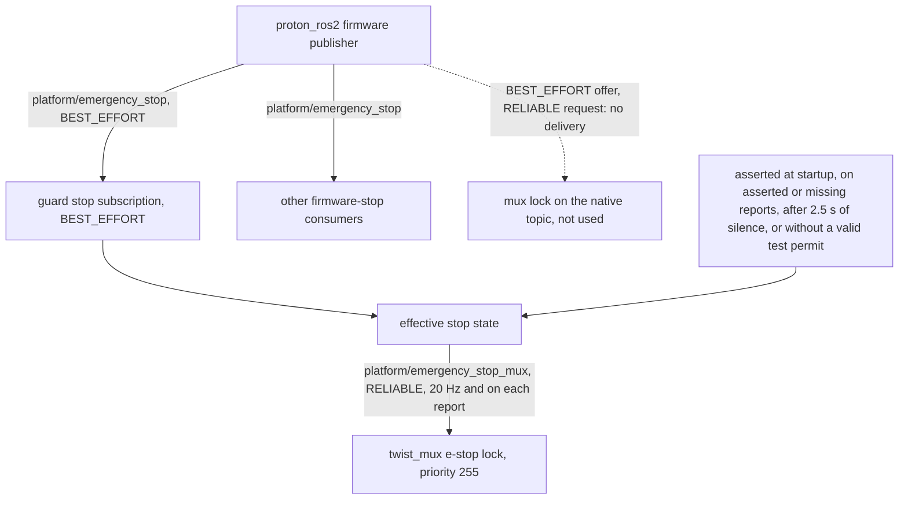
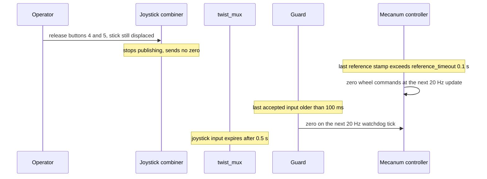

# Ridgeback stop mechanisms

This page owns how a moving `r100_0160` is brought to zero commands: physical
e-stop delivery to the mux, deadman release, command-source loss and controller
disconnection. The [command path](driving_command_path.md) owns the topology and
per-layer timeouts; the [commissioning guard](commissioning_guard.md) owns the
guard's admission rules and test-permit budget.

## Mechanisms at a glance

| Mechanism | What ends nonzero wheel commands | Software bound | Physical qualification |
|---|---|---|---|
| Physical e-stop | Motor drivers inhibited (zero output volts, fault 8); the guard also blocks commands and asserts the mux lock | Guard reacts to each firmware report; reports arrive about once per second | D2, D8 |
| Deadman release | Combiner stops publishing; controller `reference_timeout` and guard watchdog produce zeros | 0.1 s command age at the controller and guard | D2, D8 |
| Command-source loss | Same as deadman release, for any mux source | 0.1 s command age; 0.5 s mux input expiry | D2, D8 |
| Controller disconnection | `ds4drv` resets the virtual joystick to neutral; the combiner stops | Depends on driver detection of the link loss | D3 |
| Test-permit budget | Guard asserts its lock after one second per stop cycle (test mode only) | Next 20 Hz watchdog tick | Test backstop only |

Software bounds are host receive-time behaviour, not braking times or stopping
distances. The [qualification plan](../plans/PHYSICAL_remaining_qualification.md#driving-and-feedback)
holds the status of each D-lane.

## E-stop delivery to the mux

The native firmware publisher (`proton_ros2`) offers `platform/emergency_stop`
as **BEST_EFFORT**, while the installed `twist_mux` lock subscription requests
**RELIABLE**. Discovery and matching topic/type names do not make that pair
deliver messages: without a repair, the mux forwards commands while the firmware
reports the stop asserted.

The guard therefore publishes a separate reliable Bool topic,
`platform/emergency_stop_mux`. It republishes its effective stop state at 20 Hz
from its watchdog and after every firmware report. Startup, an asserted firmware
stop, missing firmware reports and reports older than 2.5 seconds all assert the
lock; in [test-permit mode](commissioning_guard.md#test-permit-interlock) the lock
also stays asserted without a valid permit.

*E-stop delivery. Notice that only the mux is remapped to the relay; the
incompatible native pair (dotted) is not used, and every other consumer keeps
the firmware topic.*

The native source remains unchanged. The relay never feeds back into the
guard's own firmware subscription and never refreshes that source's freshness.
A node-specific launch remap (`twist_mux:platform/emergency_stop` →
`platform/emergency_stop_mux`) redirects **only the mux** to the relay; the
guard and other firmware-stop consumers retain the original topic. Do not apply a
global e-stop-topic remap. Command caps and source stamps keep their semantics.
The [guard installer](commissioning_guard.md#installation-and-rollback) installs
and verifies the relay with the other guard files.

The [graph/parameter auditor](driving_check_tools.md#graph-and-parameter-auditor)
flags known reliability/durability delivery blockers. Absence of those flags is
not a full QoS compatibility or readiness pass.

## Firmware stop reporting

The firmware reports the stop about once per second, so a report can lag the
physical press or release. Receive timestamps of these reports do not measure
latency from the physical button. While the stop is pressed, diagnostics report
`E-stopped`, all four motor outputs read zero volts and direct motor status
reports fault 8. The motor status stream can show fault 8 before the slower
firmware report of the same action. Motor faults can persist for several
seconds after release; the trial tools wait for fresh zero-fault speed-mode
reports before sending motion. The
[wheel-feedback reference](drive_feedback_diagnostics.md) owns fault decoding.

Never reset or release the physical stop automatically; release is an operator
action.

## Release without replay

A stop transition in either direction clears the guard's buffered input and
publishes a zero. The guard never resumes a cached command: after release it
forwards only fresh source messages. The mux lock suppresses forwarding while
asserted and does not replay after release. Isolated mock checks cover release
without replay; physical release status is tracked as D2 in the
[qualification plan](../plans/PHYSICAL_remaining_qualification.md).

## Deadman release

The joystick combiner publishes only while driving-enable button 4 or 5 is held.
Releasing both stops publication without an explicit zero. Centring the stick
while a button stays held instead publishes explicit zero velocities.

*Deadman release. Notice that no layer forwards an explicit zero from the
operator; the controller's own stamp expiry can zero the wheels before the
guard's watchdog zero arrives, and the mux expiry comes last.*

A measured release on the robot showed the same order: zero wheel commands,
then the guard zero, then raw odometry settling. Those host receive-time values
are archived; they are not physical braking or button-to-firmware latency
guarantees.

## Command-source loss

Any source that stops publishing follows the deadman path: the controller and
guard command-age limits zero the wheels, and the mux later expires the input
and returns to the next lower-priority active source. Publication loss is
distinct from controller disconnection and from radio fade.

## Controller disconnection

On a detected disconnect, `ds4drv` resets the virtual joystick's axes and buttons
to neutral, so the combiner stops publishing. Because `joy_linux_node` repeats
joystick messages at 20 Hz, repeated ROS messages alone do not prove fresh
physical reports. A deliberate disconnect is not a silent radio fade. The
[controller input page](controller_input.md#disconnection-behaviour) owns the
driver behaviour.

## Archived evidence

- [Commissioning guard installation and first low-speed trials](../../archive/engineering/2026-10-06-driving-guard-and-deadman-trials.md)
  — first stationary e-stop check and the measured deadman-release timeline.
- [E-stop QoS repair and stationary disconnect trials](../../archive/engineering/2026-10-09-estop-qos-and-disconnect-trials.md)
  — QoS mismatch, relay installation, physical stop transitions and neutral release.
- [Interlock, bounded-permit and moving-disconnect trials](../../archive/engineering/2026-10-12-interlock-and-moving-disconnect-trials.md)
- [Physical-stop capture attempts](../../archive/engineering/2026-10-16-physical-stop-captures.md)
