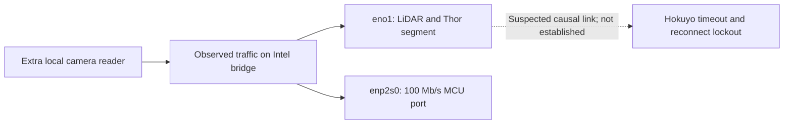
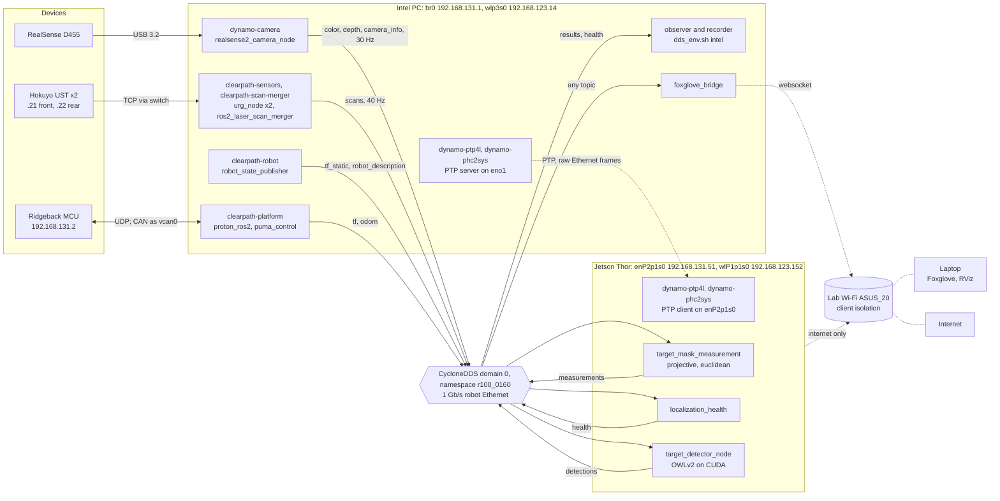

# Intel–Thor DDS transport

This page owns the DDS transport contract between the robot's Intel PC and the
Jetson AGX Thor: the middleware, which interfaces carry ROS traffic, the
receive-buffer requirement, the Intel service switch, and the pre-deploy check.
Operator commands live in the
[README](../../README.md#intel-thor-link-setup-and-pre-deploy-check); unfinished
deployment work lives in the
[Intel–Thor deployment plan](../plans/PHYSICAL_intel_thor_deployment.md).

## Camera subscriber blocker

The September 18 [camera](../plans/handoffs/PHYSICAL_d455_camera_runs_agent1.md)
and [transport](../plans/handoffs/PHYSICAL_intel_thor_transport_agent2.md)
handoffs report repeated LiDAR lockouts associated with new local camera
subscribers under the installed services configuration. No verified fix is
recorded. Suspend routine camera subscribers and localization acceptance on
that configuration; controlled diagnosis belongs to the transport owner.

The camera-only probe measured about 92 Mbit/s on `br0` and both physical
ports. Three lockouts were reported after subscriber starts; the later two
followed within 1–2 seconds. Data multicast is a working hypothesis, and the
cause of the Hokuyo TCP stalls remains unproven. Do not generalize this result
to all CycloneDDS configurations. The committed services XML still has no
explicit `AllowMulticast` restriction.

The proposed discovery-only multicast change and any Fast DDS recovery need
robot-side verification: a controlled local-reader wire test, 60 s camera
capture, and observation of sensor recovery, followed by the
[backlog's longer soak](../BACKLOG.md#hokuyo-driver-recovery-after-read-timeouts).
The existing `check_link` pass does not exercise this failure: it uses
Ethernet-only profiles, a separate domain, and one reader per probe topic.

## Topology

| Host | Robot Ethernet | Also attached to |
|---|---|---|
| Intel (`cpr-r100-0160`) | `br0` 192.168.131.1, bridging `eno1` (1 Gb/s, to the switch with Thor and both Hokuyo LiDARs) and `enp2s0` (100 Mb/s, to the MCU at 192.168.131.2) | Lab Wi-Fi `wlp3s0` 192.168.123.14 (static), Tailscale; `br0` also carries 192.168.123.8/32 |
| Thor (`nvidia-thor-r100-0160`) | `enP2p1s0` 192.168.131.51 (1 Gb/s, static), plus a route for 192.168.123.14 via 192.168.131.1 (`thor_lan_route`) | Lab Wi-Fi `wlP1p1s0` 192.168.123.152 (default route, internet only) |

The lab access point (`ASUS_20`) does not pass traffic between its clients:
Intel and Thor cannot reach each other over Wi-Fi (checked 2026-10-12).

*Hosts, robot services and ROS nodes, and what crosses each link. Solid edges
are wired; dotted edges use Wi-Fi or, for PTP, raw Ethernet outside DDS.*

| Link | Carries | Contract |
|---|---|---|
| D455 → Intel, USB 3.2 | Colour and depth frames | 640×480 at 30 Hz |
| MCU ↔ Intel, `enp2s0` | Power, e-stop, IMU, lights and fans over UDP; the wheel drivers' CAN bus, bridged to Intel as `vcan0` | Clearpath platform services |
| Hokuyo LiDARs → Intel, `eno1` via the switch | Scans | About 40 Hz each; Intel publishes the merged `sensors/scan` |
| Intel → Thor, DDS | `sensors/camera_0/color/image` (`rgb8`, 921,600 B) and `depth/image` (`16UC1`, 614,400 B) at 30 Hz, about 369 Mbit/s together, best effort; `camera_info`; scans; `tf`; `tf_static` and `robot_description` (reliable, transient local) | [Configuration contract](#configuration-contract); timing in the [sensor timing reference](intel_thor_sensor_latency.md) |
| Thor → Intel, DDS | `detections/target/raw`, `measurements/target/mask`, `localization/health` and the worker states; DDS acknowledgements and discovery replies | [Distributed localization contract](../target_localization/distributed_deployment.md#topics-types-and-acquisition-semantics) |
| Intel → Thor, PTP | Intel's wall clock as IEEE 1588 L2 frames, outside DDS | [Robot-local deployment](robot_local_deployment.md#clock-synchronization-and-camera-transport-candidates) |
| Intel ↔ Wi-Fi | Internet; `foxglove_bridge` for laptops; the robot services also advertise 192.168.123.14 to DDS | Laptops need client isolation off on the access point |
| Thor ↔ Wi-Fi | Internet only (git, pip, model downloads) | Thor's DDS is bound to Ethernet; replies to 192.168.123.14 use the cable |

## Middleware

The deployment selects CycloneDDS (`rmw_cyclonedds_cpp`) on both ROS 2 Jazzy
hosts, matching the repository's simulator default. Confirm effective settings
on each running process before acceptance; repository profiles do not prove
the installed service state. Intel's Clearpath services ran Fast DDS
only because the live `/etc/clearpath/robot.yaml` did not name a middleware.
In a cross-host benchmark the two middlewares tied within the link's capacity.
The team selected CycloneDDS so that the robot and the simulators use the same
middleware. Mixing them is avoided: when the link was overloaded, a Fast DDS
publisher feeding a CycloneDDS subscriber queued frames for about 11 s.

## Why each host needs an interface restriction

Both hosts are on the lab Wi-Fi as well as the robot Ethernet. Unconfigured,
Fast DDS sends every cross-host sample over both networks, and CycloneDDS picks
an interface itself, which may be the Wi-Fi default route. Either way, camera
frames (about 900 KiB each) cross the lab Wi-Fi, and unplugging the Ethernet
silently moves traffic onto Wi-Fi instead of failing visibly. With the
distribution's 212,992-byte socket buffers, duplicated frames overflow the
receive socket and the stream stalls, even though ping stays below 1 ms.

The restriction must be on the **receiving** side. A writer sends to every
address its reader advertises, whatever the writer's own configuration.
In one test Thor was pinned to Ethernet and the Intel reader also advertised
Wi-Fi: Thor then sent the stream through its own Wi-Fi (466 Mbit/s across both
hosts).

## Configuration contract

The deployment files are in
[`src/ridgeback_autonomy_hardware/config/intel_thor/`](../../src/ridgeback_autonomy_hardware/config/intel_thor/):

| File | Used by | Interfaces |
|---|---|---|
| `cyclonedds_thor.xml` | Every ROS process on Thor, through `dds_env.sh` | 192.168.131.51 only |
| `cyclonedds_intel.xml` | Intel repository nodes and `ros2` sessions that receive from Thor, through `dds_env.sh` | 192.168.131.1 only |
| `cyclonedds_intel_services.xml` | Intel robot services, installed as `/etc/clearpath/cyclonedds.xml` | `br0` and `wlp3s0` by name |
| `dds_env.sh` | Sourced by operators and launches on either host. It selects `rmw_cyclonedds_cpp` and the host's Ethernet-only configuration (the role comes from the Ethernet address present, or `intel`/`thor` explicitly), and leaves `ROS_DOMAIN_ID` to the deployment. | — |
| `60-dynamo-dds-buffers.conf` | `/etc/sysctl.d/` on both hosts | Raises only `net.core.rmem_max` to 16 MiB |
| `90-dynamo-multicast-querier.conf` | Intel, `/etc/systemd/network/10-netplan-br0.netdev.d/` | Makes `br0` the IGMP querier of the robot Ethernet |
| `fastdds_thor.xml`, `fastdds_intel.xml` | `rmw_benchmark` comparisons only | Ethernet address only |

Rules:

- **Intel's `br0` is the robot segment's IGMP querier.** DDS discovery uses
  multicast (239.255.0.1). With no querier on the segment, IGMP snooping stops
  delivering a restarted host's discovery multicast to the other host until
  the membership entry ages out. Intel then cannot discover restarted Thor
  processes, and receives no health or measurements, for about 5–6 minutes.
  netplan cannot set the querier; the systemd-networkd drop-in does, at boot.
- **Thor is Ethernet-only.** Every Thor reader therefore advertises only
  192.168.131.51, so Intel sends Thor's inputs over `br0` even from the
  robot services, which are also on Wi-Fi.
- **Intel readers of Thor output are Ethernet-only.** Repository nodes and any
  `ros2` inspection of Thor topics source `dds_env.sh`. An ordinary Intel login
  shell sources `/etc/clearpath/setup.bash`, which carries the services'
  Ethernet + Wi-Fi configuration. If such a shell subscribes to a large Thor
  topic, Thor sends that topic over Wi-Fi.
- **The robot services stay on Wi-Fi as well**, so lab laptops keep access to
  the robot graph. These services publish to Thor and never subscribe to its
  output.
- **Buffers are a soft maximum.** Each configuration asks for up to 16 MiB,
  capped by `rmem_max`. A host without the sysctl still starts its services;
  `check_link` reports the missing limit. `rmem_default` stays at the
  distribution default.
- **Addresses and interface names are fixed in the files.** If a robot
  Ethernet address or interface name changes, update the configurations,
  `dds_env.sh`, and `check_link` together.
- The participant-index ceiling from
  [`config/cyclonedds.xml`](../../src/ridgeback_autonomy/config/cyclonedds.xml)
  is repeated in every configuration. `dds_env.sh` sets `CYCLONEDDS_URI`, so
  the launch files do not apply their own default.
- If `dds_env.sh` cannot select a host, or receives an invalid role, it returns
  nonzero and preserves the previous DDS environment. A chained
  `source .../dds_env.sh intel && ros2 ...` therefore stops on setup failure.

## Intel service switch

[`tools/intel_thor/intel_services_rmw`](../../tools/intel_thor/intel_services_rmw)
moves Intel's robot services between the middlewares. `status` needs no root.
`apply` and `rollback` run with sudo and restart services, which briefly drops
motor power and teleop. Run them with the robot stationary and the e-stop in
reach.

`apply` performs these steps:

1. Saves `/etc/clearpath/robot.yaml`, its middleware selection, the original
   `/etc/clearpath/cyclonedds.xml`, and the managed service drop-ins to
   `/etc/clearpath/dynamo-rmw-backup/`. File absence, permissions, and symlinks
   are preserved. Repeated applies keep the first complete backup.
2. Installs `cyclonedds_intel_services.xml` as `/etc/clearpath/cyclonedds.xml`,
   and installs the sysctl file.
3. Sets `system.ros2.middleware.implementation: rmw_cyclonedds_cpp` and
   `system.bash.env.CYCLONEDDS_URI` in `robot.yaml`. `clearpath-robot.service`
   regenerates `/etc/clearpath/setup.bash` from these keys. The platform and
   sensor start scripts export Fast DDS first and then source that file, so the
   regenerated values win. Clearpath's `profile` key only sets the Fast DDS
   variable, so the Cyclone path is passed through `bash.env` instead. The
   Clearpath installer is not rerun, which keeps the MyBotShop edits to the
   generated units.
4. Adds `60-dynamo-cyclonedds.conf` drop-ins to the MyBotShop units that do not
   source the Clearpath setup: `clearpath-scan-merger`,
   `clearpath-joy-x-combiner`, `realsense-camera`, `depth-to-mono8`,
   `ridgeback-camera-mjpeg` and `mbs-webserver`. The one-shot or normally
   disabled `camera-web-ready`, `ridgeback-startup-recover`, `robot-slam` and
   `robot-map-navi` get the drop-in as well, so they use the same middleware
   whenever they run.
5. Restarts the units that were running and are not already on CycloneDDS.
   Stopped units stay stopped, so running `apply` again restarts nothing that
   has already switched.

`rollback` restores the saved `robot.yaml`, DDS configuration, and managed
drop-ins before regenerating the Clearpath setup and restarting the currently
active units on the saved middleware. Files originally absent are removed;
existing files and symlinks are restored. Settings are reloaded even when the
previous middleware was already CycloneDDS. Stopped units remain stopped.
The backup is removed only after successful restarts; a failed rollback can
be retried. The receive-buffer sysctl file and live limit remain in place.

An incomplete backup, including an older backup containing only `robot.yaml`,
blocks both `apply` and `rollback` before host configuration is changed. Those
older backups cannot establish the original DDS file or drop-in contents.
Recover those originals manually and retain the old evidence separately before
starting a new managed switch; do not treat current installed files as originals.

### Recovery with later robot configuration changes

The script restores the whole saved YAML; it does not merge later robot edits.
The September 18 legacy backup predates the rear LiDAR correction. Copying it
over the live YAML would restore the old rear x while leaving the separately
corrected scan merger unchanged. Neither that whole-file copy nor deletion of
the only backup is an acceptable recovery procedure for the later robot state.

For robot-side manual recovery, first save the current YAML, DDS configuration,
managed drop-ins, merger configuration, and active-service list. Compare them
with the pre-switch backup and construct a reviewed middleware-only reversal:
restore the prior `system.ros2.middleware` selection and the prior presence/value
of `system.bash.env.CYCLONEDDS_URI`, preserving unrelated keys, sensor mounts,
namespace and subsequent edits. Remove a now-empty container only if the
comparison establishes it was created by the switch. Restore or remove only
the DDS file and the exact ten drop-ins owned by the switch, after confirming
their prior state; do not glob over unrelated service overrides.

Reload systemd, regenerate Clearpath setup from that reviewed YAML, and restart
the affected previously active services with the robot stationary. Verify the
effective middleware, camera state, scan rates, rear TF x and merger
`laser2XOff` (both expected −0.3922 m after the recorded correction). Retain both
before/after snapshots and the legacy backup as evidence. This is a recovery
procedure to execute and validate on the robot, not a claim it has been run.

`battery-sysfs-bridge` sources the Clearpath setup, so the switch reaches it.
The Fast DDS profile it exports has no effect under CycloneDDS.

## Pre-deploy check

[`tools/intel_thor/check_link`](../../tools/intel_thor/check_link) runs on Intel
and reaches Thor over key-based SSH. It exits nonzero on any failure.
It does not qualify the installed services configuration or clear the
[camera subscriber blocker](#camera-subscriber-blocker).

| Area | Fails when | Warns when |
|---|---|---|
| Routing and link | Intel lacks 192.168.131.1, the route to Thor uses Wi-Fi, either Thor-facing port is below 1000 Mb/s full duplex, or ping loses packets | — |
| Buffers, each host | `rmem_max` is below 16 MiB | The limit is not persisted in `/etc/sysctl.d` |
| Intel services | `br0` is not the IGMP querier | `/etc/clearpath/setup.bash` does not select CycloneDDS, a running robot service other than the scan merger (the documented exception) is still on Fast DDS, or the querier drop-in is not installed |
| Thor host | SSH fails, or `rmw_cyclonedds_cpp` is missing | Thor's checkout of the same directory name (or `--thor-repo`) is missing or at a different revision |
| Configurations | A file does not parse, or its interfaces differ from the table above | — |
| Clock | Offset exceeds 10 ms | Offset exceeds 2 ms, or a host reports NTP unsynchronized |
| Performance policy, each host | A CPU policy is not at the performance governor, Intel's energy preference is not performance, Thor is not in 120W, or the boot unit is not enabled (from `host_performance status`) | — |
| Traffic, each direction | The probe receives nothing or under 90% of 30 Hz, or Wi-Fi carries more than 20 Mbit/s above the background measured just before the probes | The largest frame gap exceeds 100 ms, or the probe's own sockets drop packets |

The clock check measures the offset over one SSH channel and bounds its error
by half the smallest round trip. The traffic test uses
[`dds_link_probe.py`](../../tools/intel_thor/dds_link_probe.py) with the
deployment configurations to stream synthetic 900 KiB frames at 30 Hz, for
10 s each way (`--duration`). It uses ROS domain 87 (`--domain`), so it never
joins the robot graph. It shares the Ethernet segment with the LiDARs, so run
it only with the robot stationary; `--no-traffic` skips it. Drops are counted
on the probe's own sockets, because the host-wide `UdpRcvbufErrors` counter
includes unrelated processes. The Wi-Fi threshold allows for the background
traffic of the robot's web and Foxglove services; a duplicate camera path
shows up at roughly 200 Mbit/s.

[`tools/intel_thor/rmw_benchmark`](../../tools/intel_thor/rmw_benchmark)
repeats the middleware comparison. It covers 640×480 and 1280×720, with and
without depth, in both directions, and measures loss, exact-stamp
colour/depth pairing, round-trip time and CPU. It writes its results under
`artifacts/hardware/rmw_benchmark/`.

## Known limits

- Intel's robot services advertise Intel's Wi-Fi address to Thor. Thor reaches
  it only through `tools/intel_thor/thor_lan_route`, which routes it over the
  robot Ethernet; the lab access point does not pass traffic between Wi-Fi
  clients. See [troubleshooting](../troubleshooting.md#thor-receives-sensor-streams-but-no-static-tf).
- Thor is powered from the Ridgeback's USER POWER panel (three ports, each
  behind a 5 A fuse with a green indicator, beside a 20 A fuse). On 2026-10-09
  Thor stopped responding during a heavy GPU load in MAXN, and afterwards all
  three ports read 0 V at the pins with their indicators still green. Thor's
  logs kept nothing from that day, so the cause is unconfirmed. Thor therefore
  runs in 120W, not MAXN, until the panel's supply capacity is known; Thor's
  dev kit can draw more than a 5 A port supplies at the lower port voltages.
- The raw 1280×720 colour + depth stream is about 1.1 Gbit/s, which does not
  fit the 1 Gb/s link on either middleware. Senders fall behind, and frames
  arrive more than a second old.
- Intel's vendor image consumers `depth_to_mono8.py` and the MJPEG camera
  server each drop UDP packets continuously (about 100 per second combined,
  recorded under Fast DDS). They are outside this repository and do not affect
  Thor, but they make Intel's host-wide drop counter useless as a link metric.
- Raw 640×480 colour (921,600 B) and aligned depth (614,400 B) at 30 Hz need
  369 Mbit/s, 37% of the link. One frame pair takes about 12.3 ms on the wire,
  so no DDS setting brings raw VGA below that; only fewer bytes or no network
  hop can.
- The RealSense driver publishes aligned depth before colour. With a Thor
  reader, depth's send occupies the link for about its wire time (~4.6 ms
  measured) before colour is published, so colour carries that delay. Only a
  patched driver changes the order; the deployment plan holds the decision.
- Repeated subscriber-associated camera failures and Hokuyo lockouts are
  documented in the [camera subscriber blocker](#camera-subscriber-blocker).
  The Ethernet traffic was measured; the multicast explanation and the cause
  of the Hokuyo stalls remain hypotheses. Restarting drivers clears the
  reconnect lockout but does not resolve the initiating problem. Recovery is in
  [troubleshooting](../troubleshooting.md#hokuyo-drivers-stuck-reconnecting),
  and the open fix is in the
  [backlog](../BACKLOG.md#hokuyo-driver-recovery-after-read-timeouts).
- The check and the benchmark use synthetic frames from a Python probe. They
  do not prove camera-driver health, the real driver's timing, or the rate of
  the real perception pipeline.

## Sensor timing and time synchronization

PTP carries Intel's wall clock to Thor, whose chrony is disabled; Intel keeps
chrony for UTC with a 500 ppm slew limit. The
[robot-local deployment reference](robot_local_deployment.md#clock-synchronization-and-camera-transport-candidates)
owns the installers and rollback, and the
[sensor timing reference](intel_thor_sensor_latency.md) owns clock bounds,
latency components and the qualification collector.

The selected camera transport is raw colour and aligned depth at 640×480 and
30 Hz under the services DDS contract above, with both hosts at the
performance governor and Thor in its 120W power mode (`tools/intel_thor/host_performance`).
The latency figures were measured with Thor in MAXN; Thor's own share of each
stream's delay (delivery to the callback) was under about 1 ms.
It meets the working targets with margin: network + DDS p95 ≤ 20 ms, stamp to
Thor callback p95 ≤ 40 ms, loss ≤ 1%, exact pairing ≥ 99%, LiDAR continuity
unchanged. Larger send buffers, larger DDS messages, a lower rate and
compression were measured or considered and rejected; see
[Intel–Thor camera transport candidates](../do_not_try_again/intel_thor_camera_transport.md).
Lossy colour would additionally need the detector compared on raw and decoded
frames.

## Archived evidence

- [Intel–Thor DDS transport diagnosis](../../archive/engineering/2026-09-18-intel-thor-dds-transport.md)
- [Intel–Thor middleware benchmark](../../archive/engineering/2026-09-18-intel-thor-rmw-benchmark.md)
- [r100_0160 Intel–Thor camera transport candidates](../../archive/engineering/2026-10-06-r100-0160-thor-transport-candidates.md)
