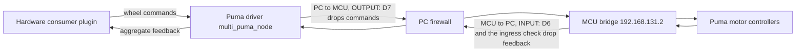
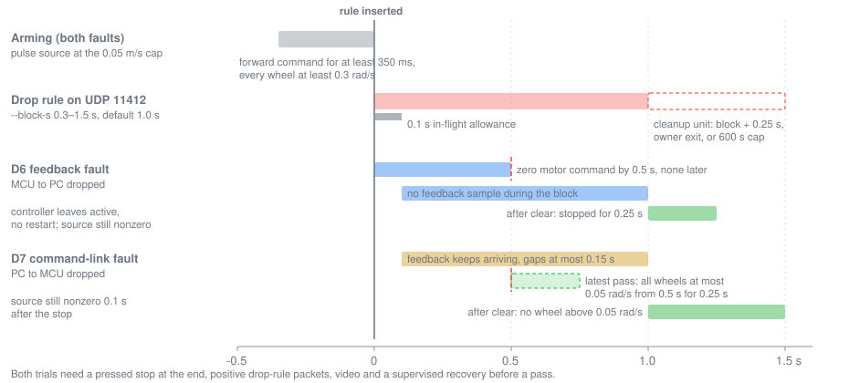

# Motor-link fault injection

The wheel-feedback stack has two stationary interruption checks and one
raised-wheel trial tool. They separate three failure paths that look alike from
ROS: the motor driver stopping, motor feedback not reaching the PC, and motor
commands not reaching the motor controllers. Status and scheduling of the D6
and D7 trials live in the
[qualification plan](../plans/PHYSICAL_remaining_qualification.md#driving-and-feedback);
this page owns their mechanism, conditions and pass criteria.

## Fault paths

The Puma driver on the PC exchanges CAN frames with the motor controllers
through the MCU's CAN-over-UDP bridge: MCU `192.168.131.2` to PC
`192.168.131.1`, UDP port 11412. Each trial drops one direction at the PC
firewall.



*Notice that D6 leaves the command direction open, so the consumer's own
timeout must stop the wheels, while D7 leaves feedback open, so the wheels'
response to undeliverable commands can be measured.*

| Check | What is interrupted | What keeps working | What it tests |
|---|---|---|---|
| Driver pause | the whole `multi_puma_node` for 0.8 s | the consumer plugin and controller manager | consumer response to real ROS feedback loss, stationary |
| Ingress drop | MCU to PC UDP for 0.8 s | driver and command transmission | consumer response to missing motor feedback, stationary |
| D6 `--fault feedback` | MCU to PC UDP, up to 1.5 s | driver and command transmission | consumer stop while wheels turn |
| D7 `--fault command-link` | PC to MCU UDP, up to 1.5 s | feedback | motor controllers' own command-loss watchdog |

Pausing the whole driver also stops command consumption, so a moving repeat of
the pause would confound the plugin's feedback timeout with the driver itself
ceasing to command. The virtual `vcan0` receiver in the Clearpath launch only
republishes the shared virtual bus as ROS telemetry on `vcan0/rx`; pausing it
does not isolate the driver's SocketCAN input and is not a motor-link
interruption. A malformed ROS feedback batch, such as
`observe_driving_stop.py --test interlock-feedback-fault`, tests the consumer's
invalid-batch path, not missing per-wheel CAN frames.

## Stationary interruption checks

Both checks run with the physical stop pressed, the controller centred and an
operator beside the robot; neither sends movement. Commands and rollback live
in the root [README](../../README.md).

- [`check_live_feedback_outage.py`](../../tools/hardware/check_live_feedback_outage.py)
  pauses only the Puma driver for 0.8 seconds. An independent one-second
  systemd timer resumes it even if the observer exits. With the installed
  consumer, two zero wheel-command messages arrived 0.290 seconds after the
  pause began, the controller manager logged a hardware read error and
  deactivated the platform controller, and the driver and controller-manager
  PIDs were unchanged. The checker's zero-command window is 0.250–0.500 s.
- [`check_motor_can_ingress.py`](../../tools/hardware/check_motor_can_ingress.py)
  drops only incoming UDP from the MCU to port 11412 for 0.8 seconds, after
  arming an independent three-second firewall rollback timer. The controller
  manager reported its read fault and deactivated the controller about 290 ms
  after the rule was inserted; at most two already in-flight aggregates arrived
  after insertion; motor commands and raw wheel velocities stayed zero. After
  incoming feedback returned, command and odometry streams did not resume:
  restored transport alone does not restore active control. The checker
  tolerates odometry going stale after the fault and requires restored feedback
  before it reports `stationary-can-ingress-observed`.

Recovery restarts only `clearpath-platform.service` with the stop still pressed,
then runs `check_live_feedback_outage.py --verify-recovery`. That read-only check
waits for platform startup and requires fresh real feedback, zero wheel
commands, stationary odometry, the active controller and the pinned plugin. Both
checkers accept either the pinned repair driver or the field-age driver.

These checks establish the consumer's response while stopped. They do not show
braking while moving, failed delivery of outgoing zeros, one missing wheel
field, a broken CAN conductor, or how quickly the motors receive zero after the
driver resumes.

## Raised-wheel trial tool

[`check_raised_wheel_link_fault.py`](../../tools/hardware/check_raised_wheel_link_fault.py)
runs one bounded fault during one raised-wheel forward pulse:

```bash
cd /home/robot/DyNAMO-Ridgeback
sudo python3 tools/hardware/check_raised_wheel_link_fault.py --fault feedback \
  --source manual-pulse --operator-confirmed --wheels-raised-confirmed \
  --run-dir "$PWD/artifacts/hardware/<fresh-run-dir>"
sudo python3 tools/hardware/check_raised_wheel_link_fault.py --recover \
  --operator-confirmed --run-dir "$PWD/artifacts/hardware/<fresh-recovery-dir>"
```

**Conditions.** The tool needs sudo, `--operator-confirmed`,
`--wheels-raised-confirmed` and a fresh run directory below
`artifacts/hardware/`. It refuses unless the running driver is the field-age
driver under `/opt/dynamo-puma-field/`. The physical conditions are not
checkable by software and must hold before running it:

- the D5 field driver is installed and accepted;
- all four wheels are clear of the floor on rated stands;
- a qualified operator is at the physical stop;
- the robot service window is exclusive.

Stands-only fault trials are not authorized floor trials, and no floor-driving
CAN-disconnect trial is authorized.

**Motion.** The unchanged guarded pulse tool is the only motion source:
`--source manual-pulse` (default) under the original-manual guard, or `pulse`
under the test interlock, each one ramped 0.05 m/s request. The injector never publishes. It waits until the motor command has been
forward for 350 ms and every wheel's feedback reports at least 0.3 rad/s; 0.05
m/s is about 0.66 rad/s at the wheel.

**Fault.** It then inserts one firewall `DROP` rule for `--block-s` seconds
(0.3–1.5, default 1.0). Before any motion, a target-less counting rule must see
at least 20 bridge packets in one second in the chosen direction, or the tool
refuses. The drop rule's own packet counter must then increase; a zero counter
fails the automatic criteria and leaves the fault response untested.

**Cleanup.** Before the rule exists, the tool starts a transient systemd unit
that is independent of the terminal. The unit removes the exact rule 0.25 s
after the block, as soon as the injector process disappears, or at its
10-minute `RuntimeMaxSec` cap through `ExecStopPost`. Tests run that cleanup
loop against a fake `iptables`.



*Notice that both pass windows close 0.5 s after the rule is inserted, and that
D6 is judged from motor commands while D7 is judged from wheel feedback.*

## D6 feedback fault

`--fault feedback` drops MCU to PC traffic only. The driver keeps running and
sending commands, so the hardware consumer's missing-feedback path is isolated.
The automatic criteria are:

- no feedback sample arrives after the 0.1 s in-flight allowance until the
  rule clears;
- zero motor commands arrive within 0.5 s, and no nonzero command after that;
- the upstream limited source is still nonzero after that response, so the
  stop came from the consumer and not from the source;
- the controller leaves the active state and does not reactivate;
- fresh feedback after the rule clears shows a sustained stop for at least
  0.25 s;
- no malformed feedback, a positive drop counter, and the stop pressed at the
  end.

Missing feedback also hides the physical wheels from ROS during the outage.
A pass therefore needs independently recorded video and the supervised
recovery; the automatic result alone is inconclusive.

## D7 command-link fault

`--fault command-link` drops PC to MCU traffic only. Outgoing zeros cannot reach
the motors, while feedback still arrives and measures the wheels. The automatic
criteria are:

- feedback stays fresh, with at least three samples and no gap over 150 ms
  during the block;
- every valid four-wheel sample reaches and holds at most 0.05 rad/s for
  0.25 s, starting within the provisional 0.5 s limit;
- the upstream source is still nonzero after that stop, so the motor
  controllers stopped on their own watchdog;
- no wheel exceeds 0.05 rad/s after the rule clears;
- no malformed feedback, a positive drop counter, and the stop pressed at the
  end.

Malformed, nonfinite or non-four-wheel feedback never counts as stopped. A
longer stop is a motor-controller watchdog finding, not a reason to lengthen
the block. Record the wheels on video as well.

## Verdicts and recovery

The tool reports `automatic-criteria-passed-awaiting-video-and-recovery` at
best. After either trial the platform is treated as latched. `--recover`
requires the stop pressed and no remaining fault rule, restarts only the
platform and runs the read-only recovery check. Each trial is then finalized
with `driving_qualification.py finalize`, which joins the raw result with the
operator's observation, the hashed video and the recovery result; D6 and D7
cannot pass without nonempty video and an explicit supervised recovery. The
acceptance matrix counts D6 complete after three passing raised-wheel
feedback-loss trials and D7 after three passing outgoing-link trials. Both must
preserve the field driver's 150 ms motion, 500 ms auxiliary and 75 ms queue
bounds in their captured evidence.

## Electrical link loss

A genuinely lost motor-CAN path can also block outgoing zero commands, so its
physical stop depends on motor-controller behavior beyond the ROS plugin. D7
models that at the PC firewall. Any test of a real electrical failure needs all
wheels supported by rated service equipment, a qualified operator at the
physical stop, a bounded command whose loss path and automatic recovery are
independently controlled, and capture of physical wheel rotation as well as
host CAN frames and ROS topics.

## Archived evidence

- [Stationary feedback interruptions and their recoveries](../../archive/engineering/2026-10-13-consumer-plugin-and-feedback-outage.md)
