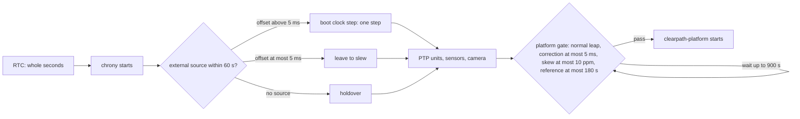

# Stationary auxiliary-sensor checks

This reference records at-rest inspection limits for the Ridgeback IMU, battery
telemetry and supporting scans. The sensor measurement plan owns remaining
acceptance work; the [driving reference](driving_readiness.md) owns actuation.

## At-rest capture

On 2026-10-13 a 25-second subscriptions-only recording, with five seconds
excluded for discovery, observed the following on `r100_0160`, domain 0:

| Signal | Received rate | Largest receive gap |
|---|---:|---:|
| Front scan | 39.94 Hz | 36.6 ms |
| Rear scan | 39.95 Hz | 50.1 ms |
| Raw/processed IMU | 50.00 Hz | 25.6 ms |
| BatteryState | 10.03 Hz | 102.0 ms |
| Raw wheel odometry | 20.00 Hz | 55.3 ms |

All 25 received firmware e-stop reports were asserted, and raw odometry stayed
stationary. Captured stamped streams had no duplicate or regressing stamps in
the measured window. No camera subscribers, commands, control service requests,
Bluetooth transitions or service restarts were used.

An explicit merged-scan subscription in a separate 20-second capture received
39.91 Hz after discovery, with a maximum gap of 35.3 ms. The topic was absent
from the first immediate graph inventory; absence in that inventory did not
establish absent delivery. The middleware exception and lazy conversion pipeline
require explicit discovery/subscription evidence. Neither short capture qualifies
long-run scan continuity or Hokuyo timeout recovery.

Raw IMU frame was `imu_0_link`. Mean acceleration magnitude was 9.813 m/s²;
mean angular rates were approximately (0.00055, −0.00087, −0.00048) rad/s.
These are recorded at-rest means, not calibrated biases or verified axis signs.
Raw orientation marks orientation unavailable; processed orientation carries
all-zero covariance. ROS defines those zeros as unknown covariance, so no measured orientation
certainty can be inferred. Sensor calibration and extended bias/drift
observation remain open; consumer selection and source diagnosis are below.

Battery telemetry reported 26.48–26.59 V and 87.7–88.8% during the capture,
with current 1.44–2.77 A. Temperature and cell-temperature fields were NaN;
cell-voltage entries duplicated the pack voltage. Per-cell health, temperature
and charge accuracy are therefore not established. Battery guard, sysfs bridge
and power logger were active. The guard configuration remains `ACTION=warn`;
this observation did not test warning thresholds or change shutdown policy.

Evidence, raw messages, recorder source and analyses are under
`artifacts/hardware/20261013-stationary-health/`. The recorder used monotonic
receive times; reported rates do not depend on inter-host clock synchronization.

## Time and boot limitations

Chrony reported the host about 170 ms fast early in this inspection, decreasing
to about 100 ms fast roughly two minutes later, despite a selected normal NTP
source. A small latest NTP measurement offset did not mean the system clock had
finished correction. No clock step or configuration change was made. Verify
convergence and startup/time-readiness policy before cross-host acquisition-age
claims. Thor offset, holdover and synchronized sensor timestamps are unqualified.

The installed desktop/guard repair survived the observed October 13 boot with
correct listeners and zero reported restarts. Detailed setup ownership and the
limits of that single boot live in the [recovery runbook](ridgeback_recovery.md).

## Source diagnosis and installed repairs

The installed ROS message definition explicitly interprets zero IMU covariance
as **unknown**, not zero uncertainty. No nonzero orientation covariance is
invented from the short at-rest window. The EKF's live selection uses IMU yaw
rate and x acceleration, with gravity removal, but does not fuse IMU orientation
as an absolute heading measurement. The raw gyro covariance is a supplied model;
measured short-window scatter and mean are characterization, not a qualified
bias/noise calibration. Multi-orientation reference measurements, temperature
stability and longer stationary characterization remain needed before changing
calibration constants. The earlier concern about zero covariance alone is
resolved as message semantics, not a new sensor defect.

A real configuration mismatch was reproduced: generated YAML targets
`imu_filter_node`, while the launch runs `imu_filter_madgwick`. Live parameters
showed default `use_mag=true`, despite the intended `false`. An isolated real
filter test on domain 216 reproduced ignored settings and verified a corrected
selector restores `use_mag=false` and `publish_tf=false` without changing the
node name. The installed platform wrapper passes corrected parameters through the
existing launch argument, preserving the commissioning wrapper. The separate
upstream launch-name patch is an alternative and is not applied to the host.
This repairs parameter selection, not absolute orientation/gyro calibration.

Installed Clearpath BatteryState code initializes temperature to NaN, derives
charge percentage from a pack-voltage lookup, and synthesizes cell-voltage entries
from pack voltage divided by the battery configuration's series count. For this
configuration those entries repeat pack voltage. They are not independent cell
measurements. The maintained narrow battery patch and installed root-pinned Python
overlay instead emit NaN for each unknown individual voltage, per BatteryState
semantics; tests execute the actual patched method and confirm pack fields are
unchanged. No available independent cell-voltage or battery-temperature sensor
was identified in this data source. Obtain hardware telemetry before declaring
those values measurable; CPU/MCU temperature is not battery temperature.

Clock correction is caused by the installed time profile's `maxslewrate 500` and
`makestep 1 3`: a sub-second boot offset can converge slowly instead of stepping.
That profile belongs to the ongoing Intel–Thor time workflow; this repair does
not replace it or step a running robot clock. Subsequent monitoring recorded
about 39 µs remaining system correction, passing the local convergence gate;
root delay/dispersion still gave an estimated UTC error bound near 17 ms. Do not
interpret the small remaining correction as absolute UTC/cross-host accuracy.
The gate checks the **System time** field, not just Last offset, and rejects
unsynchronized/local-only sources, stale references and nonfinite reports.

The maintained `install_auxiliary_repairs.py` repair was **installed and verified
stationary on 2026-10-13**. The first application left its receipt at `applying`;
verification-only completion checked the installed state without another restart.
It changes only new scoped platform integration/helper files, keeps all existing
caps/Puma sources untouched, and adds bounded clock readiness before platform
startup. A failure restores its own prior integration; installation requires an
asserted-stop stationary probe. Final verification recorded seven asserted stop
reports, 139 stationary raw-odometry samples, correct guarded routing, 100 IMU
messages with intended filter settings and 20 BatteryState samples with unknown
individual voltages and valid pack voltage. Local clock readiness passed with
about 2 µs correction remaining; the estimated UTC error bound was still about
20 ms, not microsecond absolute accuracy. Protected camera, sensor, merger and
desktop service states matched their prior process IDs. Camera, sensors, merger and desktop are outside
its restart scope. Stage/apply/restore commands are in the
[stationary repairs runbook](stationary_repairs_runbook.md#auxiliary-repairs).
Physical calibration, new battery sensing and repeated boot qualification are
separate from these software corrections.

## IMU characterization and actual battery hardware boundary

A further 60-second post-repair fixed-pose raw IMU capture recorded 2,998 samples
with the stop asserted and stationary odometry. Gyro mean was approximately
(0.000084, −0.001157, −0.000981) rad/s; standard deviations were
(0.000511, 0.000547, 0.000547) rad/s. The first/second-half means changed by
roughly (−0.000060, −0.000087, −0.000082) rad/s. These are a reproducible
zero-rate/noise characterization, not constants installed as calibration.
Accelerometer mean was (0.00516, −0.00439, 9.79655) m/s², which still combines
sensor error, gravity and mount alignment. The maintained recorder preserves
raw samples and covariance; it never changes the live filter. Evidence is under
`artifacts/hardware/20261013-imu-stationary-characterization/`.

Full calibration needs independent reference measurements across orientations
and known rotation rates, plus repeat observations through relevant temperature
conditions. Do not tip or lift the Ridgeback to collect arbitrary calibration
poses. If the embedded sensor is not safely accessible, arrange a technician's
fixture/approved reference procedure or calibrate its installed output against
an external calibrated reference. Apply constants only after independent
validation and defining their source/temperature validity. This cannot be
completed from a single stationary pose by software alone.

The installed R100 Proton protocol confirms exactly one pack-voltage channel
plus accessory rails, one aggregate current, and two temperature channels labelled
MCU and PCB. During the capture those temperatures were around 42.2°C and
24.8°C. Neither is battery temperature. No independent cell-voltage or battery
thermistor/BMS channel is configured. The Linux `test_power` battery device is a
synthetic desktop bridge: its `TEMP=26` and chemistry/model defaults are not
physical battery evidence, and the bridge does not update temperature from a
battery sensor. No connected smart BMS was established by this inventory.

The operator could not identify the installed battery model/chemistry. Confirm
it from an accessible label or integrator record before selecting monitoring
hardware or changing the estimator model. Actual battery temperature and
individual voltages require suitable sensors or a supported BMS, installation
by qualified personnel, and measured channel correspondence. Software must not
substitute MCU/PCB temperature or inferred voltages. The current output correctly
marks those fields unknown; new physical sensing remains a hardware dependency.

## Intel clock and boot policy

The platform will not start on a wrong clock. Its pre-start gate runs
`check_clock_ready.py --timeout 900 --max-correction 0.005` (unit
`TimeoutStartSec=930`): it waits until chrony reports a remaining correction of
at most 5 ms, skew of at most 10 ppm, normal leap status and a reference no
older than 180 s.

Intel's chrony profile uses `pool ntp.ubuntu.com iburst maxsources 4 maxpoll 7`
with a 500 ppm slew rate and `makestep 1 3`. The pool gives the gate several
sources to select from, and `maxpoll 7` (128 s) keeps the reference younger than
the gate's 180 s limit. `expand_clock_sources.py` and `bound_clock_poll.py` make
those two changes without restarting chrony or stepping the clock; their apply
and restore commands are in the
[stationary repairs runbook](stationary_repairs_runbook.md#intel-clock-sources).
The maintained time installer must keep the pool source when it re-renders
upstreams.

The RTC keeps whole seconds, so Intel can boot up to a second off, and
`makestep 1 3` would slew a sub-second error at 500 ppm for many minutes while
the gate holds the base. `dynamo-boot-clock.service`, installed with
`time_sync boot-step-install --host intel`, closes that gap: it runs after
chrony and before `clearpath-robot`, the sensors, platform, camera and both PTP
units, waits up to 60 s for an external source, steps once if the offset is
above 5 ms and otherwise leaves holdover. It never steps under a running
consumer. `verify_boot_clock.py` checks a boot read-only, and
`verify_auxiliary_boot.py` checks the gate, services and stationary IMU and
battery data after a reboot.

*Boot ordering on Intel. Notice that any step happens before the first clock
consumer starts, so live sensor stamps never jump; the platform gate is the
last check before motor power.*

With internet time, three of three boots stepped or slewed before any consumer
started and the gate passed in 0.1 s (S6; boots under
[Archived evidence](#archived-evidence)). Booting without an internet source is
untested: the 60 s give-up path is covered only by offline tests, and the gate
should then hold the base until time returns. Source loss, holdover, repeated
cold power cycles and Intel–Thor offset are not qualified here; the
[deferred gates](../BACKLOG.md#deferred-hardware-gates) track the no-internet
boot.

## Passive stationary health

The passive health commands (the fast batch, the guarded camera screen and the
passive Hokuyo watch) and their operating conditions are in the
[stationary repairs runbook](stationary_repairs_runbook.md#fast-stationary-health-batch).
The October 13 batch passed all 22 checks, and the passive Hokuyo watch held
39.91/39.92 Hz front/rear with maximum receive gaps of 43.8/37.7 ms
(`artifacts/hardware/stationary-batch-20261013T132501Z-78c5ac/` and
`artifacts/hardware/20261013-hokuyo-passive-audit.json`). That confirms
short-window healthy scans, not timeout recovery.

## Archived evidence

- [Intel clock gate, sources and boot-step qualification](../../archive/engineering/2026-10-13-r100-0160-intel-clock-qualification.md)
  — first reboot check, source expansion and poll bound, the October 14 startup
  delay and the S6 boots.
