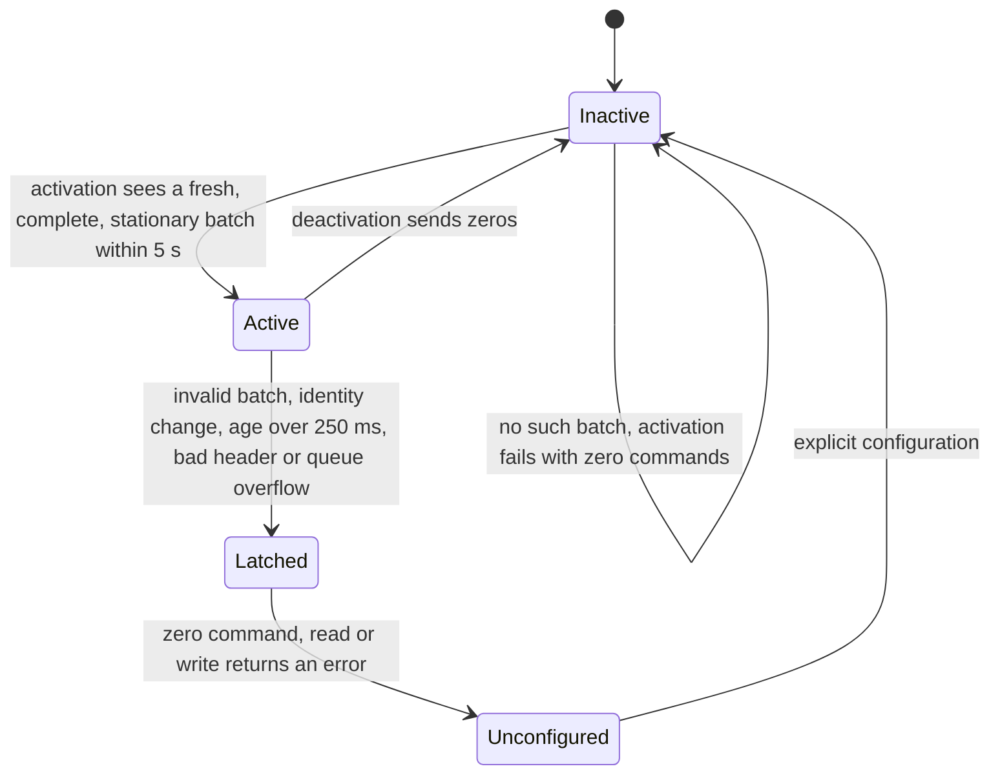

# Wheel-feedback consumer

The Puma hardware plugin in `clearpath_hardware_interfaces` turns aggregate
wheel feedback into joint states for the mecanum controller and turns joint
commands into wheel commands. The installed plugin is Clearpath 2.9.4 with a
feedback-consumer patch that validates every batch, bounds its age and inhibits
nonzero commands on bad or missing feedback. It is separate from the motor
driver; the [overview](drive_feedback_diagnostics.md#installed-state) lists
both installed layers.

## Stock behavior

The apt package `ros-jazzy-clearpath-hardware-interfaces`
`2.9.4-1noble.20260724.050450` remains installed and is the rollback target.
Its installed `libpuma_hardware.so` has SHA-256
`2c7af1dad48dc0e8f0f71f90a471617f291a8204208f3d224e7c35533ef4a3b7`, and its
read/write disassembly matches the 2.9.4 source:

- Joint states update only when a new aggregate arrives; otherwise previous
  speed and travel values persist.
- `read()` returns success regardless, and `write()` keeps publishing the
  current requested wheel commands. Neither path checks feedback age.
- A partial batch mixes new and old wheel states.
- An unknown joint name inserts a map entry that overwrites joint index zero.
- Nonfinite speed is accepted without a read error.

[`verify_puma_feedback_consumer.py`](../../tools/hardware/verify_puma_feedback_consumer.py)
reproduces these cases offline by executing the extracted `read`, `write`,
joint-update and command-building bodies against inert sinks. For example, after
one complete nonzero batch, one hundred simulated 50 ms cycles without feedback
kept the old velocity, returned success and emitted four hundred nonzero wheel
command values. No live feedback loss or malformed feedback was injected into
the stock plugin. The existing command-age timeout and the one-second test
permit limit cover command delivery and test exposure, not feedback freshness.

## Installed policy

The shared policy has one maintained source,
[`puma_feedback_safety.hpp`](../../tools/hardware/puma_feedback_safety.hpp),
applied to the plugin by the
[consumer patch](../../patches/clearpath_puma_feedback_consumer.patch).

**Batch validation.** A batch is accepted only if it contains exactly the
configured joint names, each once, with unique CAN device IDs in 1–63 and
finite speed, travel, duty, current and setpoint. Name-to-device associations
are bound at activation and must not change during that activation. The device
IDs are learned from feedback, not checked against the robot declaration.
Inhibition never fabricates zero measured velocity: joint states always come
from real feedback.

**Age.** Each callback receipt uses a monotonic clock, backdated by the
nonnegative ROS header age at delivery, so time already spent in transport
consumes the same budget. Read and write each check independently that the
latest accepted receipt is at most 250 ms old; a newly arriving packet cannot
erase an interval that has already expired. Header timestamps must be present,
at most 250 ms old and at most 5 ms in the future, checked at receipt and at
consumption. Header checks use ROS time, so they depend on qualified clock
behavior. Per-field freshness inside each aggregate is the
[field-age driver's](wheel_feedback_field_age.md) responsibility.

**Collection.** The transport keeps up to 32 queued batches so a good packet
cannot overwrite an invalid one before validation, and each read collects up to
32 times, validating every delivered batch. One collection per read would let
25 Hz input accumulate behind the 20 Hz read loop. Queue overflow and an invalid
header are faults.

**Inhibition and latching.** Invalid, expired or overflowed feedback produces
an explicit zero wheel command, returns a hardware error and latches the
fault. Later good feedback does not resume driving.

**Activation.** Lifecycle activation waits at most five seconds for a fresh,
complete and stationary batch (every wheel speed at most 0.001 rad/s). Without
one it fails with zero commands. Inactive reads drain input and keep commands
at zero without reporting a startup error.

**Deactivation.** Deactivation and the error callback send zeros and disable
active reads and writes. Inactive writes stay zero until an explicit
successful activation.

These are software requests: delivery of the zero command and physical braking
are outside this policy.

## Lifecycle

*Notice that no path leads from Latched back to Active without an explicit
configuration and a fresh stationary activation.*

Under the controller manager, a read or write error deactivates the platform
controller and leaves the hardware component unconfigured. The controller does
not restart automatically. Recovery needs explicit configuration and activation
of the component and controller while the wheels are stationary; old commands
are not replayed and new commands are accepted afterwards. On the robot the
supervised recovery is a platform restart with the stop pressed, followed by
the read-only recovery check described in
[motor-link fault injection](motor_link_fault_injection.md#stationary-interruption-checks).

In the offline fake-wheel controller-manager check, the controller manager logs
an interface-mode-switch error when it removes interfaces before deactivating
the controller, although the queried controller is inactive and fake motor
commands remain zero. That framework log is not evidence of a robot fault.

## Verification

Offline and fake-wheel checks, all without the motor driver or CAN:

- [`check_puma_feedback_safety.py`](../../tools/hardware/check_puma_feedback_safety.py)
  and [`check_puma_feedback_adapter.py`](../../tools/hardware/check_puma_feedback_adapter.py)
  execute the policy and the extracted transport, read, write, activation and
  deactivation bodies with injected clocks and inert ROS. They cover startup
  without feedback, malformed batches, message overwrite, overflow, identity
  changes, stale feedback, command inhibition, latched recovery and stationary
  activation.
- [`check_puma_feedback_ros.py`](../../tools/hardware/check_puma_feedback_ros.py)
  loads the compiled plugin on loopback-only ROS domain 214 with fake wheels,
  verifies the loaded library identity and checks activation, healthy commands,
  inhibition when feedback stops, retained measurements, latched recovery and
  deactivation. It sets joint storage directly, so it does not exercise
  controller-manager initialization or error transitions.
- [`check_puma_feedback_manager.py`](../../tools/hardware/check_puma_feedback_manager.py)
  runs a controller manager on loopback-only ROS domain 215 from a fake URDF,
  with a forward-command controller, 25 Hz fake feedback and a 20 Hz control
  loop. It stops and restores feedback while commands continue and checks zero
  commands, controller deactivation, no automatic restart, explicit stationary
  recovery without command replay and orderly deactivation.

On the robot, with the physical stop pressed, real feedback interruptions
produced zero wheel commands and controller deactivation, and restored transport
alone did not restore active control.
[Motor-link fault injection](motor_link_fault_injection.md) owns those checks
and the moving trials that remain.

## Packaging and installation

[The offline builder](../../tools/hardware/build_puma_feedback_candidate.py)
accepts only the pinned source archive, checks the policy and extracted
adapter and lifecycle bodies, compiles the package and records dependency
versions, source and library hashes and input snapshots. It applies the patch
with forward and reverse checks and rejects inputs that change during the
build. It never installs, opens CAN or joins the live ROS graph.

[The plugin-prefix stager](../../tools/hardware/stage_puma_plugin_prefix.py)
builds an overlay prefix from a verified candidate. It copies the Puma library,
`package.xml` and plugin descriptors, and links the sibling hardware plugins and
the package's six executables to their apt files. The real Clearpath launch
resolves `clearpath_hardware_interfaces` executables through that prefix, so a
prefix without them fails at platform start.

[The installer](../../tools/hardware/install_puma_feedback_plugin.py) stages a
root-owned `/opt/dynamo-puma-feedback/<manifest-hash>` prefix and one later
platform drop-in, `95-dynamo-puma-feedback.conf`, that selects only the pinned
Puma library. It preserves the commissioned guard, the Puma motor driver, the
auxiliary launch chain and the other plugin descriptors, checks rollback
ownership and confirms the library mapped by the real controller manager after
restart. Its commands, apply conditions and rollback are in the root
[README](../../README.md); the installed receipt is
`artifacts/hardware/20261013-puma-feedback-install-stage-5/`, which reports
`installed-verified-stationary`. Apply first runs the platform's clock startup
gate and refuses, with no service changed, when the clock reference is too old;
obtain a fresh NTP sample and retry.
[`verify_feedback_boot.py`](../../tools/hardware/verify_feedback_boot.py)
checks one reboot: changed boot ID, platform clock gate, stationary stop and
the pinned plugin mapped by the new controller manager.

## Limits

The installed policy is not a certified safety component. Physical braking with
moving wheels, electrical CAN loss and repeated-fault recovery are not
established by these checks; the moving trials are D6 and D7.
