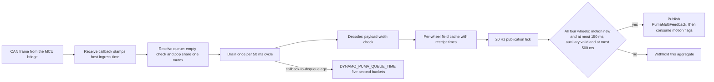
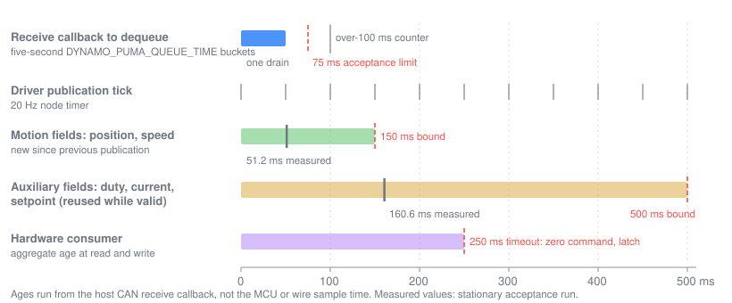

# Per-wheel field-age driver

The running Puma motor driver is Clearpath 2.9.4 with a per-wheel field-age
policy. It publishes an aggregate wheel-feedback message only when every wheel
has newly received motion fields and every cached field is within an explicit
age bound. It is installed over the pinned repair driver and is accepted while
stationary; the [overview](drive_feedback_diagnostics.md#installed-state) lists
the installed layers and the
[qualification plan](../plans/PHYSICAL_remaining_qualification.md#driving-and-feedback)
owns its D5 status.

## Field eligibility

Each wheel caches five feedback fields, split into two classes:

| Class | Fields | Payload width | Rule at each publication tick |
|---|---|---|---|
| Motion | position, speed | 4 bytes | new since the previous publication and at most **150 ms** old |
| Auxiliary | duty, current | 2 bytes | valid and at most **500 ms** old; may be reused |
| Auxiliary | setpoint | 4 bytes | valid and at most **500 ms** old; may be reused |

- A driver counts as ready only in speed mode.
- A wrong payload width or a malformed recognized field invalidates that
  field's cache. Invalid or regressing receipt metadata cannot renew readiness.
- All four wheels are checked before an aggregate is built. A wheel that misses
  either motion field withholds the whole aggregate; it does not borrow another
  wheel's freshness.
- New-motion flags are consumed only after the publish call returns, so a
  failed publication does not spend them.
- Diagnostics read the cache without consuming flags. Each driver reports its
  oldest motion-field age and oldest auxiliary-field age; −1 denotes missing or
  invalid data.

Auxiliary fields get the looser bound because speed-setpoint replies arrive
slowly and unevenly (see [rates](drive_feedback_diagnostics.md#rates-and-freshness));
withholding odometry for a late setpoint reply would make a healthy wheel look
stale. The hardware consumer checks auxiliary fields only for finiteness.

Underneath the age bounds, the completeness layer replaces upstream readiness,
which ORed received-field bits across all wheels. It requires each wheel's own
fields, resets status-field completeness per wheel and runs the consuming
diagnostic getters on a copy of the cache, so diagnostics no longer clear
publication flags. Completeness alone establishes receipt since the last
consumption, not an age; the age bounds add that.

## Age and queue pipeline

*Notice that the queue wait is structural (one 50 ms drain), that the 150 ms
motion bound covers three publication ticks, and that the consumer's separate
250 ms aggregate timeout sits between the two field bounds.*

The receive callback timestamps each frame before it is queued, and the queue
carries that timestamp into the decoder. Dequeuing late or stamping a new ROS
aggregate therefore does not make an old field fresh. Ages run from the host
receive callback; they exclude MCU, physical CAN-wire, kernel and network delay.

The queue-timing layer measures callback-to-dequeue age without changing field
eligibility. Every five seconds it logs one journal line,
`DYNAMO_PUMA_QUEUE_TIME frames=<n> mean_ms=<mean> max_ms=<max> over_100ms=<count>`,
and resets the bucket. Because the driver drains the queue once per 50 ms, a
bucket maximum near 50 ms and a mean near 30 ms are the structural wait, not
load.

## Bound selection

A single 200 ms bound, used by the earlier experiments, treated a slow setpoint
reply like a stale wheel speed: rear setpoint gaps of 150–250 ms withheld
aggregates while position and speed stayed near 40 ms. The split bounds were
chosen from replays of the maintained policy classes over five real passive
captures (quiet and loaded stationary, a stationary attempt, a manual pulse and
the D4 handover):

- At 150/500 ms every capture published on every tick after start-up, with a
  50 ms worst gap and no consumer fault, also with a fixed 25–100 ms
  receive-queue delay.
- One rear setpoint silent for 400 ms never reached the consumer; 700 ms of
  setpoint silence, or 300 ms of one wheel's speed silence, latched it.
- A 100 ms motion bound failed at 75 ms of queue delay, and 125 ms failed at
  100 ms.
- Beyond the bound the chain fails safe: the consumer does not activate.

The replay timer is idealised and the delays are fixed, so these results are
not live measurements. The stationary acceptance supplies the live values.

## Build

[The offline builder](../../tools/hardware/stage_puma_field_candidate.py)
accepts only the pinned Clearpath 2.9.4 archive and a fresh output directory
under `artifacts/hardware/`. It applies this patch chain with forward and
reverse checks:

1. [fault flags](../../patches/clearpath_puma_fault_flags.patch)
2. [cache safety](../../patches/clearpath_puma_cache_safety.patch)
3. [completeness](../../patches/clearpath_puma_freshness.patch)
4. [field age](../../patches/clearpath_puma_field_age.patch)
5. [queue timing](../../patches/clearpath_puma_queue_timing.patch)

It copies the maintained [policy header](../../tools/hardware/puma_field_freshness.hpp)
into the package and builds it. The only program it runs is a checker that uses
the real driver cache and decoder methods with null ROS and CAN handles; the
motor node is compiled but never started. The output carries `candidate.json`,
not a deployment `SOURCE.json`, and the builder performs no installation.

Separate checks cover the remaining layers:
[`verify_puma_field_node.py`](../../tools/hardware/verify_puma_field_node.py)
runs the extracted aggregate routines with inert wheels and publisher (missing
fields, failed publication, flag consumption, stale queued frames);
[`check_puma_field_freshness.py`](../../tools/hardware/check_puma_field_freshness.py)
compiles and runs the policy alone; and
[`puma_policy_chain_check.cpp`](../../tools/hardware/puma_policy_chain_check.cpp)
composes the driver-field and consumer policies without ROS or CAN: a slow
setpoint with one withheld aggregate tick leaves the 250 ms consumer healthy,
while a long single-wheel speed gap suppresses aggregates, trips and latches
the consumer, and needs explicit activation after fresh data. This verifies
policy composition only.

## Installation and rollback

[The field-driver installer](../../tools/hardware/install_puma_field_driver.py)
owns deployment. Its stage, apply, restore and live-acceptance commands are in
the [Puma runbook](puma_feedback_runbook.md#field-age-driver).

- **Stage** verifies the candidate's input hashes against the maintained
  patches and policy header, its dependency versions and its binary hash. The
  running driver must be the pinned repair named by the consumer drop-in
  `95-dynamo-puma-feedback.conf`. Stage renders the later drop-in
  `97-dynamo-puma-field-driver.conf`, which copies that `ExecStart` and swaps
  only the driver prefix to the root-owned `/opt/dynamo-puma-field/<manifest-hash>`.
- **Apply** requires sudo, a pressed physical stop and the clock start margin.
  It refuses when the consumer drop-in, robot identity, commissioning cap mode,
  dependency versions or running driver changed since staging; stage again in
  that case. It restarts only `clearpath-platform.service`, then verifies the
  stop, stationary odometry, the active controller, guard routing, the new
  driver path and the unchanged plugin and independent services.
- **On failure** apply removes its drop-in, restarts the original driver and
  verifies it.
- **Restore** does the same on request and keeps the prefix as evidence. It
  re-validates the same staged record, so the commissioning cap mode and
  consumer drop-in must still match the stage.

The installed driver was staged and applied with the guard in its
original-manual speed mode; its receipt is listed in the
[installed state](drive_feedback_diagnostics.md#installed-state).

## Live acceptance

With the stop pressed, run
[`check_puma_field_driver_live.py`](../../tools/hardware/check_puma_field_driver_live.py)
for 20–300 seconds (default 60). It reads aggregates, the per-driver age
diagnostics, the `DYNAMO_PUMA_QUEUE_TIME` journal buckets, the stop and raw
odometry, and passes only if all of the following hold:

- the field driver is the running driver;
- aggregates arrive at 19 Hz or more, with no gap over 100 ms;
- all four drivers report valid ages within 150/500 ms;
- every queue bucket maximum is at most 75 ms and no receipt is over 100 ms;
- the stop stays pressed and odometry stays stationary.

The 75 ms queue limit is one 50 ms drain cycle plus 25 ms of scheduling margin.
If the check fails, or the driver is not kept, run the installer's restore.

The installed driver passed a 60-second acceptance
(`d5-field-live-acceptance-20261022-2`): 1,200 aggregates at 19.99 Hz with a
52.0 ms maximum gap; all four drivers reporting, with motion age at most
51.2 ms and auxiliary age at most 160.6 ms; no invalid samples; queue maximum
50.6 ms with none over 100 ms; the stop pressed and odometry zero throughout.
This qualifies stationary operation only. The D6 and D7 trials must preserve
the 150 ms motion, 500 ms auxiliary and 75 ms queue bounds in their captured
evidence.

## Measurement tools

- [`capture_wheel_field_trial.py`](../../tools/hardware/capture_wheel_field_trial.py)
  starts passive `candump` before an existing bounded trial and always stops it
  afterward. It never sends CAN frames or publishes ROS messages. It requires
  actual CAN frames before starting the observer, cancels the trial if capture
  exits, and never certifies a physical stop from terminal exit alone.
  The source option selects the trial:
  - `--source joystick` (default): the bounded forward observer.
  - `--source pulse`: the guarded forward pulse under the temporary test
    interlock. The stop must be reported released and the controller neutral;
    one ramped forward command lasts at most half a second at 0.05 m/s before
    silence.
    The operator stays beside the robot and presses the stop after the pulse.
    Half a second of motion confirms that moving field receipts exist; it
    cannot set a bound for sustained motion or load.
  - `--source manual-pulse`: a one-second ramped 0.05 m/s forward pulse under
    the original-manual guard. It needs a fresh pressed stop and neutral
    controller before release, checks the installed manual-mode files and live
    routing, records motor commands and wheel feedback, then sends zeros and
    waits for the stop to be pressed again. Use it when the shorter pulse or
    the low-speed handover reports zero raw odometry.
  - `--source handover`: the live D4 two-source forward handover under the
    original-manual guard, at 0.025 and 0.045 m/s with the stop and guard
    active; the wrapper only adds passive CAN recording.
- The pulse and handover recorders wait after stop release until all four
  motors report speed mode with zero faults for one second, and abort without
  commanding if that does not happen within 20 seconds. Without this gate, one
  pulse sent while all four motors still reported fault 8 after stop release
  reached the outgoing CAN frames but produced no visible movement.
- [`analyze_puma_motion_window.py`](../../tools/hardware/analyze_puma_motion_window.py)
  aligns a pulse or handover's ROS command window with its CAN receipts and
  reports per-field silences and malformed receipts.
- [`check_puma_capture_chain.py`](../../tools/hardware/check_puma_capture_chain.py)
  replays passive CAN timing through the maintained C++ field-age and consumer
  classes, with optional fixed queue delays and withheld fields.
- [`replay_puma_freshness.py`](../../tools/hardware/replay_puma_freshness.py)
  is the older flag and scheduling model; it reads both verbose and compact
  `candump -L -x` logs.
- [`measure_feedback_ros_delivery.py`](../../tools/hardware/measure_feedback_ros_delivery.py)
  measures aggregate header-to-callback delay at an independent stationary
  observer; it does not see the driver's internal queue.

Every capture tool needs an operator who confirms visible motion and stopping;
a completed trace alone does not establish travel.

## Limits

The stationary acceptance does not measure field age or queue delay under
motion, sustained motion or CPU load; the archived moving captures cover at
most 1.7 seconds of nonzero command. Ages exclude delay before the host receive
callback, so physical wheel synchronization is not established.
