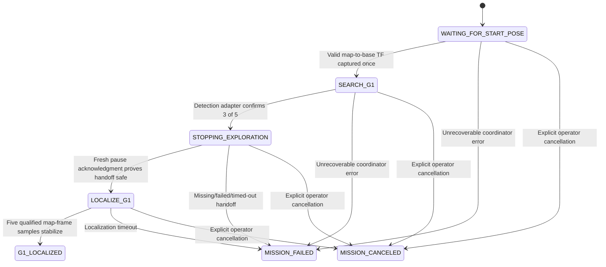

# EXPLORATION - Parking mission migration

Status: **Phase 1 geometry foundation and Phase 2 detection, localization,
explorer handoff, and non-driving mission coordination are implemented; parking
execution remains pending.** This plan covers adapting the existing
Ridgeback-G1 parking mission to the current package-split architecture without
duplicating localization or changing Nav2 safety configuration.

## Phase 1 foundation

The pure parking math now lives in
`ridgeback_autonomy.mission.parking_geometry`. Its task-point transforms,
inverse base-pose calculation, angle normalization, rotated footprint math,
pre-parking offset, path length, and inclusive reach-boundary behavior are
unchanged from the original mission. The geometry tests are independent of ROS
nodes and are registered with the package's existing ament pytest suite.

The original `test_mission_geometry.py` also contains tests for occupancy-grid
sampling, footprint and full-path rejection, candidate ranking, marker state,
mission commitment, start-pose capture, and localization fallback. Those are
mission-manager integration tests rather than parking-geometry tests. They are
deferred to Phase 2 and must be migrated with their assertions intact once the
new manager exists.

The target-detection input is now isolated in
`ridgeback_autonomy.mission.target_detection`. It validates generic
`TargetDetections` batches, selects the highest-scoring configured humanoid
label, preserves the original rolling five-result/three-positive confirmation
policy, and exposes the original five-negative localization-reset signal. The
original search path had no wall-age timeout, so the adapter does not invent
one. For stale traffic, it rejects messages older than the last accepted source
timestamp.
The original G1 detector filtered at `0.50`, while the current generic detector
defaults to `0.55`. The adapter retains the original `0.50` floor but does not
alter the upstream detector, so the current live pipeline remains effectively
`0.55` until launch configuration is considered in a later integration phase.

## Phase 2 localization input

`ridgeback_autonomy.mission.target_localization` now owns the measurement-side
mission boundary. The default contract consumes `measurements/target/mask` and
selects `euclidean_reconstruction` first, with `projective_ranging` as an
explicit deterministic fallback. Both provide forward and lateral coordinates,
an estimator status, and detection-stamped mask/depth synchronization in the
current Gazebo pipeline. It never averages estimator families. Pointcloud
measurements remain supported when explicitly configured, but are not a default
fallback: their message schema has no per-estimator status, and the current
pointcloud worker can pair a detection-stamped batch with the latest processed
cloud rather than an exact stamp match. Polar profiling is likewise excluded
from the mission default because its single LiDAR plane supplies a target
surface position, not a ground-center or foot reference.

Each observation is associated to one detection by the same source timestamp,
normalized label, and exact bbox. This is intentionally stricter than array
index matching: `TargetMeasurements` has no persistent object identifier, so a
future manager must retain the corresponding current detection association and
cannot safely carry an index between frames. The adapter validates the
detection score, estimator fields, finite positive range, and `MissReason.OK`
for mask estimators. Pointcloud validity is inferred from finite fields because
the interface deliberately has no pointcloud status array.

All estimator coordinates are relative to Ridgeback's front reference:
forward is +X and lateral is base +Y (left-positive). The adapter calls the
shared `remove_vehicle_front_offset()` exactly once, yielding base-origin
`x=forward` and `y=lateral`, then requests `map -> configured_base_frame` from
tf2 at the measurement header stamp. It does not interpret the detection
header's camera frame as the numeric measurement frame and does not fall back
to latest TF. Five qualified, already-map-frame observations from one estimator
are stabilized with an x/y median. A sample farther than the original body
fallback's 0.75 m jump threshold is rejected; samples from different estimator
families are retained in separate buffers and never combined.

### Scientific limitation

No current generic estimator reproduces the original G1 foot-midpoint
semantics. Pointcloud deliberately crops the upper-central bbox; projective
ranging reduces a masked foreground around a representative body pixel;
euclidean reconstruction reduces foreground 3D points to a centroid; and polar
profiling reduces scan-plane target returns. The adapter therefore labels every
output `generic_target_position` with `is_foot_midpoint=false`. Synthetic tests
validate interface, frame, timestamp, and stabilization behavior only; they do
not establish that this generic position is accurate enough to center the G1
parking donut. The smallest compatible extension, if runtime evaluation shows
that gap matters, is one quality-gated G1 ground-center/foot estimator inside
`ridgeback_localization` using its existing synchronized detection/depth
infrastructure, exposed with explicit reference semantics and status. Raw RGB-D
processing must not be rebuilt inside the mission manager.

## Phase 2 exploration ownership handoff

The original mission entered `STOPPING_EXPLORATION`, called the explorer's
`explore/set_enabled` service with `false`, and polled until both the service
request had completed and `explore/active` reported false. Only then did it
continue to localization and parking. Its resume path called the same service
with `true`. The old manager did not impose a separate bounded handoff timeout;
it relied on the explorer retaining ownership until the action result callback
reported a terminal result.

The current explorer now exposes the equivalent ownership contract through two
relative services and one transient-local status topic:

| Interface | Type | Contract |
|---|---|---|
| `mission/pause` | `std_srvs/srv/Trigger` | Latches an explicit pause and immediately stops new frontier scheduling. `success=true` means the explorer has no pending goal acceptance, active goal handle, or cancellation state. `success=false` means ownership is still unresolved, including pending, rejected, failed, or overdue cancellation; it is not permission for another Nav2 owner to start. |
| `mission/status` | `std_msgs/msg/String` JSON | `pause_requested=true` and `handoff_safe=true` are the authoritative asynchronous handoff acknowledgment. `goal_pending`, `goal_active`, `cancellation`, and `cancellation_overdue` explain an incomplete handoff. |
| `mission/resume` | `std_srvs/srv/Trigger` | Clears an explicit pause only when no explorer-owned goal/cancellation remains and, when required, localization health is current and advancing. Resume is never automatic. |

A pause received while idle is immediately safe. A pause received while goal
acceptance is pending remains unsafe; if that goal is accepted later it is
immediately canceled. An active goal remains owned by the explorer while cancel
acceptance is pending and until its result is `SUCCEEDED`, `CANCELED`, or
`ABORTED`. Cancel rejection, transport failure, result failure, and timeout all
remain unsafe. The timeout is diagnostic only and never releases ownership.
Repeated pause requests are idempotent and cannot send duplicate cancellation
requests.

The future parking manager must call `mission/pause`, observe
`mission/status`, and wait for `handoff_safe=true` before sending any Nav2 goal.
Before requesting `mission/resume`, that manager must first settle its own Nav2
goal; the Trigger service cannot identify arbitrary external Nav2 clients.
`explore/status` remains an exploration-progress topic and is not an ownership
proof.

## Phase 2D non-driving mission coordinator

`ridgeback_autonomy.mission.mission_manager_node` now connects the migrated
detection and localization adapters to the explorer ownership contract. It has
no Nav2 action client and deliberately stops in `G1_LOCALIZED`; this state means
the Phase 2D target-localization prefix completed, not that parking or the whole
mission succeeded.

The manager captures the configured `map -> robot_base_frame` transform only
after it exists and contains finite translation plus a valid quaternion. The
resulting start pose is immutable for that mission attempt. A manager reset
clears it by default and does not implicitly resume MissionGuard; explorer
resume remains a separate explicit ownership operation.

Only `TargetDetectionAdapter` performs detection validation and voting. On
confirmation, the manager commits the selected label/bbox, calls relative
`mission/pause`, and enters `STOPPING_EXPLORATION`. A successful service response
is an immediate fresh acknowledgment. A false response means the pause is
latched but still settling. The manager then requires a status received after
that response with `pause_requested=true`, `handoff_safe=true`, no pending or
active goal, and `cancellation=none`. Because transient-local data can be
delivered late, even that status is verified with one fresh idempotent pause
request; only its successful response transfers ownership. Missing services,
failed service requests, and unsettled handoffs are bounded by
`handoff_timeout_s` (10 s default) and retain distinct failure codes:
`pause_service_unavailable`, `pause_request_failed`, and
`exploration_handoff_timeout`. Rejected, failed, or overdue cancellation must
repeat in fresh status before producing a terminal failure, so one delayed
latched sample cannot fail a new attempt.

After commitment, valid detections continue to populate a bounded, exact
timestamp/label/bbox association history without causing another target-found
transition. `TargetMeasurements` is passed unchanged to
`TargetLocalizationAdapter` only when an exact same-frame association exists.
The adapter remains solely responsible for estimator status, stale data,
vehicle-front compensation, source-time TF, jump rejection, and five-sample
median stabilization. The final value retains
`reference=generic_target_position` and `is_foot_midpoint=false`; Phase 2D does
not promote it to a verified G1 ground center and cannot use it for parking.

Transient invalid detections, missing associations, invalid estimator values,
and source-time TF misses are recoverable while localization remains within its
5 s default deadline. Missing/failed ownership transfer and localization timeout
are terminal technical failures. Explicit cancellation is separately classified
as `operator_canceled`. None of these paths initiates return navigation or
reports `MISSION_COMPLETE`.

Recoverable diagnostics describe the current blocked attempt rather than
permanent mission failure. They are cleared when the corresponding guard later
succeeds, so a successful start capture, ownership handoff, or stabilized target
snapshot cannot retain a stale failure classification.

Current state and event diagnostics are transient-local JSON on relative topic
`parking_mission/state`. They include state, reason, event, target commitment,
start-pose availability, failure class/code, target reference/source, and the
constant `parking_navigation_enabled=false`. Every transition is logged with
its reason; rejected guards and recoverable issues publish diagnostic events.

The original manager's committed branch returned home after exhausted focused
localization, observation failure, missing candidate prerequisites,
pre-parking/path failure, or parking navigation failure. Its non-committed
localization timeout resumed exploration. Successful completion was only
`PARKED -> wait -> RETURNING_TO_START -> MISSION_COMPLETE`; hard internal paths
used `MISSION_FAILED`. Phase 2D does not reproduce the premature return-home
behavior: it classifies localization inability as a technical terminal failure
and remains stationary.

Future G1-centered exploration belongs after a trustworthy target position is
available and before parking candidate generation. An `EXPLORE_G1_REGION` state
can be inserted after `G1_LOCALIZED`, using a separately specified scoped
ownership/resume contract and coverage completion criterion. It is not
implemented here.

## Compatibility matrix

| Area | Original mission contract | Current dev contract | Phase 2 adaptation |
|---|---|---|---|
| Detection | `G1Detections` on `detections/g1/raw` | `ridgeback_interfaces/TargetDetections` on `detections/target/raw` | Consume the shared type and keep target-found confirmation behind a small mission input boundary so detection is not hard-wired to G1 naming. |
| Measurements | Monolithic `G1Measurements` on `measurements/g1/camera` | `TargetMeasurements` split across `measurements/target/mask` and optional `measurements/target/pointcloud` | Select one qualified localization source or fuse explicit valid fields. Do not recreate RGB-D processing inside the mission manager. |
| Measurement semantics | Legacy RGB, sensor-depth, mono-depth, pointcloud, and LiDAR arrays | Pointcloud, projective-ranging, euclidean-reconstruction, and polar-profiling arrays with per-estimator status | Map only valid estimator fields. Legacy `sensor_depth_distance_m`, `rgb_*`, `mono_depth_*`, and `lidar_*` have no direct schema equivalent. |
| Planar reference | Legacy mission reconstructed camera/base positions itself | Shared estimators publish lateral as base +Y left-positive and forward from the robot-front reference | Call `remove_vehicle_front_offset()` before map projection, then transform the base-origin-relative point with the measurement-time `map -> base` transform. |
| Time/synchronization | Mission cached raw RGB/depth/cloud and used legacy matching helpers | Localization workers own sensor matching and publish source-stamped batches; shared stamp/buffer helpers replace old utilities | Treat the localization output stamp as authoritative. Do not add a second raw-sensor synchronization path in autonomy. |
| TF | Mission assumed `map` and bare `base_link` under namespaced TF topics | Topic namespace and TF frame IDs are deliberately independent; simulation localization currently receives `r100_0001/robot/base_link`, while Nav2 uses `base_link` | Make map and observed base frame explicit launch parameters and verify the live TF chain. Never derive frame IDs from the ROS namespace. |
| Exploration ownership | `explore/set_enabled` (`SetBool`) plus `explore/active` (`Bool`) | `mission/pause` latches a pause in `MissionGuard`; `mission/resume` restores scheduling only after settlement and required health | Wait for the terminally acknowledged `mission/status.handoff_safe` contract. No sleeps or second explorer owner are needed. |
| Exploration status | Active Boolean represented an in-flight goal | `explore/status` reports `exploration_started` or `exploration_complete`; `mission/status` reports pause request, handoff safety, health, pending/active goal, and cancellation state | Use `mission/status` for ownership settlement. `explore/status` alone does not prove an action goal is terminal. |
| Nav2 actions | Relative `compute_path_to_pose` and `navigate_to_pose`, planner loaded from YAML | Same namespaced actions and `GridBased` planner remain | Preserve action code, error-code checks, non-empty-path requirement, and sequential ownership after explorer settlement. |
| Footprint | Mission loaded the global-costmap footprint from Nav2 YAML | YAML now contains the authoritative 16-point Ridgeback envelope with padding | Continue loading current configuration; do not copy the old rectangular test footprint into runtime code. Retest complete-footprint and path sampling against the new polygon. |
| Costmaps/map | Occupancy map plus mission-side unknown/occupied/path checks | SLAM/Nav2 still publish map and costmaps, with global planning allowed through unknown for exploration | Preserve stricter mission candidate/path rejection of unknown space. Do not change Nav2 parameters. |
| Shared helpers | TF, pointcloud, image, and synchronization helpers lived under autonomy | Helpers moved to `ridgeback_common` and `ridgeback_localization.core`; some legacy helpers were removed | Import shared TF/image/pointcloud utilities from their owning packages. Replace removed bbox/time helpers with current structured APIs. |
| RViz markers | Mission-owned reachability, candidate, selected-pose, and thesis marker topics | Target estimate visualization is generic; current exploration RViz has no parking displays | Retain mission-owned parking markers on relative namespaced topics and add only the final clean displays to the current RViz layout. Do not reuse target-estimate namespaces as parking state. |
| Launch/readiness | Monolithic mission launch brought up simulator, perception, SLAM, Nav2, explorer, manager, and RViz | `ridgeback_exploration.launch.py` owns backend-neutral bringup, readiness gates, localization mode, and autonomous-motion gating | Add the manager through the existing event-driven launch boundary after localization/Nav2/explorer readiness. Preserve `backend`, `target_localization_enabled`, `autonomous_motion_enabled`, namespace, and simulated-time arguments. |

## Code that can be preserved

- The migrated parking geometry module.
- Start-pose capture and immutable return target, after frame parameters are adapted.
- The committed-target state sequence and three-of-five confirmation policy.
- Reach-annulus sampling and occupancy classification.
- Task-point-to-base conversion and pre-parking geometry.
- Complete rotated-footprint, clearance, and sampled-path checks.
- `ComputePathToPose` validation, deterministic candidate ranking, sequential
  pre-parking/final navigation, parking wait, and return-to-start behavior.
- Mission-owned reachability and selected-pose marker construction, after topic
  names and the current footprint are wired in.

## Code that requires adaptation

- All imports of generated `G1*` messages and old autonomy-owned perception
  helpers.
- Legacy measurement field selection and raw depth/cloud synchronization.
- Map projection of front-referenced target measurements.
- The exploration stop/settled handshake; the old service and active topic do
  not exist in the new explorer.
- Frame defaults and TF lookup assumptions.
- Marker input logic that depended on `g1_estimates/rgb`; current estimator
  marker namespaces are generic and are visualization output, not a stable
  mission data contract.
- Launch integration, readiness, node installation, and RViz displays.
- Manager-coupled tests from the original geometry test module.

## Phase 2 implementation order

1. **Define the target input boundary.** Add a small adapter from
   `TargetDetections` to a detector-independent target-found event and preserve
   the current three-of-five confirmation behavior.
2. **Choose and test one localization contract.** Consume qualified
   `TargetMeasurements`, honor estimator status, undo the robot-front offset,
   and transform each sample at its source stamp. If the existing estimator
   outputs cannot supply the required stable planar target center, extend
   `ridgeback_localization` once rather than rebuilding perception in the
   mission manager.
3. **Implemented: explicit explorer ownership handoff.** `MissionGuard` now
   exposes `mission/pause`, terminal `handoff_safe` status, and guarded
   `mission/resume`, retaining goal identity through cancellation settlement.
4. **Implemented: port the non-driving mission skeleton.** Start-pose capture,
   search, target commitment, terminal stop settlement, source-associated
   localization, diagnostics, reset, cancellation, and technical-failure states
   are restored. Return and parking actions remain intentionally absent.
5. **Port candidate generation and map safety.** Load the current Nav2
   footprint/planner configuration, then migrate occupancy, rotated-footprint,
   clearance, and sampled-path checks. Restore the deferred safety assertions.
6. **Port Nav2 feasibility and ranking.** Preserve all-candidate evaluation,
   action result/error checks, path length, and deterministic ordering. Do not
   introduce the supervisor's proposed donut changes in this migration.
7. **Port execution.** Add pre-parking, final parking, the existing wait, and
   return-to-start actions only after explorer ownership is proven settled.
8. **Port markers and launch integration.** Add relative marker topics and
   clean RViz displays, then integrate the manager into the current readiness
   chain without changing backend packages or Nav2 safety parameters.
9. **Restore integration coverage.** Migrate the remaining manager tests,
   exercise message serialization/frame conversions, fake action ownership and
   cancellation, then run bounded Gazebo startup and end-to-end mission tests.

## Phase 2 acceptance gates

- No legacy `G1Detections`/`G1Measurements` dependency and no duplicate
  perception pipeline.
- Every stabilized target sample is map-frame data transformed at its source
  timestamp with the robot-front offset handled exactly once.
- Frontier and mission navigation goals never overlap; handoff waits for a
  terminal action result.
- The current authoritative footprint and planner are loaded from configuration,
  with unknown/out-of-map/path-footprint rejection retained.
- A failed target localization or empty feasible set follows the documented
  mission outcome without changing SLAM, localization workers, frontier
  selection, or Nav2 safety parameters.
- Geometry and migrated manager tests pass before the mission manager is added
  to a public launch.
