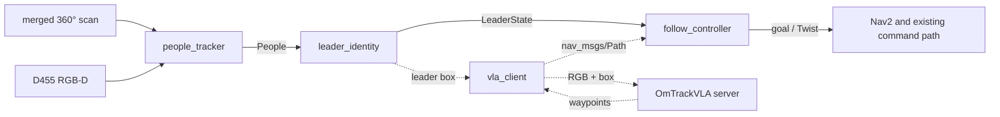

# FOLLOWING — Leader following in crowds

Status: planned, 2026-11-01. The message contract and the `leader_identity`
node exist ([reference](../leader_following/architecture.md)); nothing here
has driven a robot or run in a crowd scenario.

## Goal

The Ridgeback follows one person (the leader) through a crowded space. It keeps
the right person when others cross between, occlude or look alike; keeps a set
distance from the leader and a minimum clearance from everyone else; and stops
and searches instead of following an unconfirmed person.

## Decisions

| Decision | Choice |
|---|---|
| Leader choice | Lock onto the nearest person in front at start; a language prompt is not required |
| First system | Modular baseline: lidar and RGB-D people tracking, appearance re-identification, the existing Nav2 stack for motion |
| Development order | Simulation first, across both simulators (Gazebo, Isaac) as a sim-to-sim check; real-robot tests after the simulated loop is stable |
| OmTrackVLA | Stays in its own repository as a model server; a client node here sends RGB frames with the leader's box (server `planner` mode) and publishes its waypoints as `nav_msgs/Path` |
| Branch | `leader-following`, additive to `dev`: new packages, new docs, new simulator scenario files |

## Target node graph

- **people_tracker**: lidar person detection on the existing front+rear merged
  scan, D455 detections with depth, constant-velocity Kalman fusion,
  OSNet-AIN appearance embeddings; publishes `People`. Reuses
  `camera_people.py`.
- **leader_identity**: implemented.
- **follow_controller**: holds a set distance and bearing; moves only when
  `LOCKED`; keeps the leader in camera view. Collision avoidance and speed
  limits come from Nav2 and the [driving command path](../physical/driving_command_path.md).
- **vla_client** (optional method): the dotted path.

## Phases

| Phase | Work | Done when |
|---|---|---|
| F1 Crowd scenes | Several moving pedestrians, including look-alikes, in the Gazebo and Isaac backends; ground-truth positions from the simulator | Every scenario below spawns in both backends |
| F2 People tracking | `people_tracker` on simulated data | Leader-track coverage and ID switches measured per scenario |
| F3 Re-identification | OSNet-AIN embeddings in `People` | Leader-pick accuracy among nearby people measured |
| F4 Closed loop in sim | `follow_controller`; same scenarios in both simulators | Every metric below reported for both simulators |
| F5 Real robot | Stationary recordings replayed offline first, then driving once the [driving readiness](../physical/driving_readiness.md) gates allow it; the leader wears a ground-truth tag the system never reads | Real-robot numbers for the scenario set |
| F6 Comparison | OmTrackVLA through `vla_client`, other methods | Methods compared on identical scenarios |

## Evaluation

| Scenario | Stresses |
|---|---|
| Leader alone, straight and turning | Distance keeping |
| One passer-by crosses between robot and leader | Short occlusion and recovery |
| Look-alike walks beside the leader | Appearance-only identity |
| Leader and look-alike cross paths | Track swap |
| Leader stops among standing people | Stopping distance, clearance |
| Crowd at increasing density | Everything combined |

Metrics per scenario, median and spread over at least 10 repetitions: follow
success rate, correct-lock time, ID switches, wrong-follow time (target 0),
recovery time after occlusion, distance-keeping error, minimum clearance to
bystanders, and safety stops.

## Open questions

- Target crowd density: a lab corridor with a few people, or a dense public space.
- Which simulator is the development default and which validates.
- Lidar person detector: depends on the lidar mount height in the
  [geometry reference](../robot/geometry.md).
