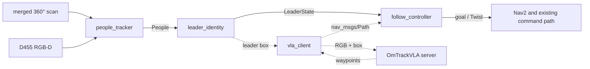

# FOLLOWING — Leader following in crowds

Status: planned, 2026-11-01. The message contract and the `leader_identity`
node exist ([reference](../leader_following/architecture.md)); nothing here
has driven a robot or run in a crowd scenario.

## Goal

The Ridgeback follows one person (the leader) through a crowded space. It keeps
the right person when others cross between, occlude or look alike; keeps a set
distance from the leader and a minimum clearance from everyone else; and stops
and searches instead of following an unconfirmed person.

## Decisions

| Decision | Choice |
|---|---|
| Leader choice | Lock onto the nearest person in front at start; a language prompt is not required |
| First system | Modular baseline: lidar and RGB-D people tracking, appearance re-identification, the existing Nav2 stack for motion |
| Development order | Simulation first, across both simulators (Gazebo, Isaac) as a sim-to-sim check; real-robot tests after the simulated loop is stable |
| OmTrackVLA | Stays in its own repository as a model server; a client node here sends RGB frames with the leader's box (server `planner` mode) and publishes its waypoints as `nav_msgs/Path` |
| Branch | `leader-following`, additive to `dev`: new packages, new docs, new simulator scenario files |

## Target node graph

- **people_tracker**: lidar person detection on the existing front+rear merged
  scan, D455 detections with depth, constant-velocity Kalman fusion,
  OSNet-AIN appearance embeddings; publishes `People`. Reuses
  `camera_people.py`.
- **leader_identity**: implemented.
- **follow_controller**: holds a set distance and bearing; moves only when
  `LOCKED`; keeps the leader in camera view. Collision avoidance and speed
  limits come from Nav2 and the [driving command path](../physical/driving_command_path.md).
- **vla_client** (optional method): the dotted path.

## Phases

All phases are assigned to the student assistant, in order. A phase is done
when its check passes, not when its code exists.

| Phase | Work | Done when |
|---|---|---|
| F1 Crowd scenes | Moving pedestrians, including two dressed alike, in the Gazebo and Isaac backends; one scene per scenario below | Every scenario plays in both backends and the simulator logs every person's ground-truth position |
| F2 People tracking | `people_tracker` node: merged scan plus D455 colour and depth, constant-velocity fusion, stable ids; publishes `People` | Every scenario has a report, scored against simulator ground truth, of leader-track losses and ID switches |
| F3 Leader recognition | Pretrained re-identification embeddings in `Person.appearance`, plus track continuity as a second identity cue in `lock_on.py`, so the lock holds while the leader is out of camera view | `leader_identity` reaches `LOCKED` on the leader in every scenario and holds it while the leader is out of camera view; leader-pick accuracy among nearby people reported per scenario, look-alike scenario included |
| F4 Closed loop in sim | `follow_controller` through Nav2; moves only while `LOCKED` | Every scenario runs start to finish in both simulators with zero wrong-follow time, and every metric below is reported for both |
| F5 Real robot | Recorded people replayed offline through the tracker first, then driving under the [driving readiness](../physical/driving_readiness.md) gates; the leader wears a ground-truth tag the system never reads | The scenario set and every metric exist for the real robot |
| F6 Comparison | OmTrackVLA through `vla_client` (server `planner` mode) on the same scenarios | OmTrackVLA's metrics sit beside the baseline's for every scenario, in simulation and on the robot |

## Working rules

The branch and the robot are shared with the exploration work.

- Work only on `leader-following`, inside `leader_follow_interfaces`,
  `ridgeback_leader_follow`, the leader-following docs and new simulator
  scenario files. Exploration code, launches and configuration stay unchanged;
  a needed shared change is agreed first.
- Nothing lives only on the robot: every robot-side change is committed and
  pushed before leaving it. Robot services and settings are installed from the
  repository (see [robot-local deployment](../physical/robot_local_deployment.md));
  change their sources here and reinstall, never hand-edit installed copies.
- Use a separate checkout or worktree on the robot rather than switching the
  shared one; stop only processes you started.
- Robot-wide settings (robot identity in `/etc/clearpath/robot.yaml`, drivers,
  DDS and network, camera services) change only by agreement, through the
  repository.
- Documentation rides the code commit that changes the behavior; run outputs go
  under `artifacts/`, and the numbers that matter go into the docs.

## Evaluation

| Scenario | Stresses |
|---|---|
| Leader alone, straight and turning | Distance keeping |
| One passer-by crosses between robot and leader | Short occlusion and recovery |
| Look-alike walks beside the leader | Appearance-only identity |
| Leader and look-alike cross paths | Track swap |
| Leader stops among standing people | Stopping distance, clearance |
| Crowd at increasing density | Everything combined |

Metrics per scenario, median and spread over at least 10 repetitions: follow
success rate, correct-lock time, ID switches, wrong-follow time (target 0),
recovery time after occlusion, distance-keeping error, minimum clearance to
bystanders, and safety stops.

## Open questions

- Target crowd density: a lab corridor with a few people, or a dense public space.
- Which simulator is the development default and which validates.
- Lidar person detector: depends on the lidar mount height in the
  [geometry reference](../robot/geometry.md).
