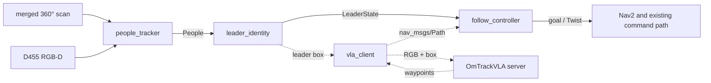

# FOLLOWING — Leader following in crowds

Status: F1 complete: all six animated scene families, including three crowd
densities, passed in Gazebo and Isaac with robot sensors and every person's
simulator-observed position logged ([reference](../leader_following/simulation.md)).
F2 simulation complete: twenty candidates compared on all sixteen qualified
configurations, with the selected OWLv2/LFE-PPN/ByteTrack/Kalman tracker and
per-case reports ([benchmark reference](../leader_following/benchmarks.md)).
F3 simulation checks pass: five appearance candidates compared, OSNet-AIN
selected, and eighteen ROS cases reached correct locks with zero wrong locks.
Both camera-exit cases held every sampled outside-camera observation; visible
lock coverage is 87–100% with the profile's continuity confidence floor
([reference](../leader_following/recognition.md)).
Robot/Thor performance is deferred until hardware access. F4 has started:
`follow_controller` drove the robot through Nav2 behind the leader in the
leader-alone scene in both Isaac and Gazebo
([reference](../leader_following/architecture.md#follow_controller-node)).
The other scenarios and the metrics remain. F5–F6 remain open;
no leader-following controller has driven the physical robot.

## Goal

The Ridgeback follows one person (the leader) through a crowded space. It keeps
the right person when others cross between, occlude or look alike; keeps a set
distance from the leader and a minimum clearance from everyone else; and stops
and searches instead of following an unconfirmed person.

## Decisions

| Decision | Choice |
|---|---|
| Leader choice | Lock onto the nearest person in front at start, with the [documented geometric tie policy](../leader_following/recognition.md#initial-acquisition-ties) for uncertain equal-range estimates; a language prompt is not required |
| First system | Modular baseline: lidar and RGB-D people tracking, appearance re-identification, the existing Nav2 stack for motion |
| Crowd setting | A lab corridor with a few people first; a dense public space later |
| Development order | Simulation first, across both simulators (Gazebo, Isaac) as a sim-to-sim check; real-robot tests after the simulated loop is stable |
| OmTrackVLA | Stays in its own repository as a model server; a client node here sends RGB frames with the leader's box (server `planner` mode) and publishes its waypoints as `nav_msgs/Path` |
| Branch | `leader-following`, additive to `dev`: new packages, new docs, new simulator scenario files |

## Target node graph

- **people_tracker**: implemented simulation baseline with transformed/merged
  front+rear lidar detections, registered D455 depth, image association and
  constant-velocity Kalman fusion; publishes `People`. Appearance embeddings
  are optional F3 inputs; OSNet-AIN is selected for simulation with the bounded F3 results documented
  in the [recognition reference](../leader_following/recognition.md). The [tracker reference](../leader_following/people_tracker.md)
  owns the implemented contract.
- **leader_identity**: implemented.
- **follow_controller**: holds a set distance and bearing; moves only when
  `LOCKED`; keeps the leader in camera view. Collision avoidance and speed
  limits come from Nav2 and the [driving command path](../physical/driving_command_path.md).
- **vla_client** (optional method): the dotted path.

## Phases

All phases are assigned to the student assistant, in order. A phase is done
when its check passes, not when its code exists.

| Phase | Work | Done when |
|---|---|---|
| F1 Crowd scenes — complete | Moving pedestrians, including two dressed alike, in the Gazebo and Isaac backends; one scene per scenario below | Every scenario plays in both backends and the simulator logs every person's ground-truth position |
| F2 People tracking — simulation complete | Candidate benchmark for detection and tracking (below), then a `people_tracker` node built from the chosen combination: merged scan plus D455 colour and depth, constant-velocity fusion, stable ids; publishes `People` | Every F2 candidate has a row in the results table, the chosen combination and its reason are recorded, and every scenario has a report, scored against simulator ground truth, of leader-track losses and ID switches |
| F3 Leader recognition — simulation checks complete | Re-identification candidate benchmark (below), the chosen embeddings in `Person.appearance`, plus track continuity as a second identity cue in `lock_on.py`, so the lock holds while the leader is out of camera view | Every F3 candidate has a row in the results table; `leader_identity` reaches `LOCKED` on the leader in every scenario and holds it while the leader is out of camera view; leader-pick accuracy among nearby people reported per scenario, look-alike scenario included |
| F4 Closed loop in sim | `follow_controller` through Nav2; moves only while `LOCKED` | Every scenario runs start to finish in both simulators with zero wrong-follow time, and every metric below is reported for both |
| F5 Real robot | Recorded people replayed offline through the tracker first, with the lidar detector fine-tuned on robot scans using camera-detection pseudo-labels; then driving under the [driving readiness](../physical/driving_readiness.md) gates; the leader wears a ground-truth tag the system never reads | The scenario set and every metric exist for the real robot |
| F6 Comparison | OmTrackVLA through `vla_client` (server `planner` mode) on the same scenarios | OmTrackVLA's metrics sit beside the baseline's for every scenario, in simulation and on the robot |

## Candidate benchmark (F2, F3)

Methods are chosen by measurement, not up front. One harness first; then each
candidate gets one adapter and one run with default settings on the same data.
Only the best two per category are tuned.

**Data:** every F1 scenario in both simulators, plus one or two real
recordings once F5 starts. **Results:** one table per category in
`docs/leader_following/benchmarks.md`, with numerical campaign evidence linked
there under Archived evidence; raw runs under `artifacts/`. F2 simulation rows
are complete. Robot/Thor timing and GPU-memory measurements are deferred; the
workstation measurements do not substitute for them.

| Category | Candidates | Scored by |
|---|---|---|
| Camera person detection | YOLO11, YOLO26, RT-DETRv2, D-FINE, DEIM, RF-DETR, OWLv2 (already used for target localization) | Recall and precision by distance band (0–2, 2–4, 4–8 m) and visible fraction |
| Lidar person detection (scans at leg height: both lidars about 0.23 m up, see the [geometry reference](../robot/geometry.md)) | DR-SPAAM, DROW3, LFE-PPN, PeTra, ROS leg detector, plain scan clustering (details below) | Same recall and precision, plus coverage outside the camera view |
| Multi-person tracking | ByteTrack, BoT-SORT, OC-SORT, Deep OC-SORT, StrongSORT | HOTA, IDF1 and ID switches against simulator ground truth |
| Single target from one click | SAM 2, SAMURAI | Leader-track coverage and recovery after occlusion |
| Re-identification | OSNet-AIN, CLIP-ReID, TransReID, SOLIDER, DINOv2 features | Correct leader pick among people within 3 m, look-alike scenario separately |

Lidar candidate notes, checked 2026-11-01:

| Candidate | Source | Known result | Notes |
|---|---|---|---|
| DR-SPAAM, DROW3 | [2D_lidar_person_detection](https://github.com/VisualComputingInstitute/2D_lidar_person_detection) (IROS 2020, ICRA 2021) | Best on the FROG benchmark: DR-SPAAM 75.3 AP (5-scan), DROW3 73.6 AP, about 14 ms per scan | GPL-3.0; ROS 1 node, community ROS 2 port linked from the repository; supports fine-tuning from camera pseudo-labels |
| LFE-PPN, LFE-Peaks | [FROG](https://www.frontiersin.org/journals/robotics-and-ai/articles/10.3389/frobt.2025.1671673/full) (2025), ROS package [upo_laser_people_detector](https://github.com/robotics-upo/upo_laser_people_detector) | 66.5 / 64.9 AP at about 1.5 ms per scan | Fastest; license and ROS version not checked |
| PeTra | benchmarked in FROG | 58.3 AP retrained | Older baseline |
| ROS leg detector | ROS 2 Foxy port [ros2_leg_detector](https://github.com/mowito/ros2_leg_detector) of Leigh's detector | 15.8 AP on FROG | Classic baseline; trained for 0.33° scans, the UST-10LX is 0.25° |
| Scan clustering | in-repo | — | Floor every candidate must beat |

The published models were trained with sensors at about 33–37 cm; ours are
about 23 cm, so expect a gap until they are fine-tuned on simulated scans and,
in F5, on robot scans labelled from camera detections. The FROG
[benchmark code](https://github.com/robotics-upo/2DLaserPeopleBenchmark) and
[dataset](https://robotics.upo.es/datasets/frog/laser2d_people/) are a ready
starting point for the lidar part of the harness.

Every row also records time per frame (median and p95) and GPU memory on the
robot GPU and on Thor, and the license; Ultralytics models are AGPL-3.0.
The ported `camera_people.py` (YOLO + BoT-SORT) is one candidate, not the choice.

## Working rules

The branch and the robot are shared with the exploration work.

- Work only on `leader-following`, inside `leader_follow_interfaces`,
  `ridgeback_leader_follow`, the leader-following docs and new simulator
  scenario files. Exploration code, launches and configuration stay unchanged;
  a needed shared change is agreed first.
- Nothing lives only on the robot: every robot-side change is committed and
  pushed before leaving it. Robot services and settings are installed from the
  repository (see [robot-local deployment](../physical/robot_local_deployment.md));
  change their sources here and reinstall, never hand-edit installed copies.
- Use a separate checkout or worktree on the robot rather than switching the
  shared one; stop only processes you started.
- Robot-wide settings (robot identity in `/etc/clearpath/robot.yaml`, drivers,
  DDS and network, camera services) change only by agreement, through the
  repository.
- Documentation rides the code commit that changes the behavior; run outputs go
  under `artifacts/`, and the numbers that matter go into the docs.

## Evaluation

| Scenario | Stresses |
|---|---|
| Leader alone, straight and turning | Distance keeping |
| One passer-by crosses between robot and leader | Short occlusion and recovery |
| Look-alike walks beside the leader | Appearance-only identity |
| Leader and look-alike cross paths | Track swap |
| Leader stops among standing people | Stopping distance, clearance |
| Crowd at increasing density | Everything combined |

Metrics per scenario, median and spread over at least 10 repetitions: follow
success rate, correct-lock time, ID switches, wrong-follow time (target 0),
recovery time after occlusion, distance-keeping error, minimum clearance to
bystanders, and safety stops.
