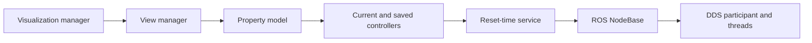

# Maintained dependency patches

Each patch the repository maintains against an imported dependency, with its
defect, change, build and loading proof, and rollback. The import, refresh and
verification procedure that applies to all of them is owned by
[external dependency management](dependencies.md).

## Gazebo Sensors shutdown patch

The Gazebo profile imports gz-sim **8.15.0**, upstream tag `gz-sim8_8.15.0`,
commit `446a44335a45b704b4d36dabcc5508ee34eeb3d8`. This matches the source selected
by `gz_sim_vendor` 0.0.13; that vendor revision supplies no source patches. The
local patch preserves the version and major-8 SONAMEs. It does not import
`gz-common` or the abandoned signal self-pipe backport.

### Synchronization boundary

In `src/systems/sensors/Sensors.cc`, `PostUpdate` waits for pending ECM changes
to reach the rendering scene before replacing them. Upstream's `updateTimeCv`
predicate lacks a shutdown condition, and `Stop` notifies only `renderCv`.
Consequently a pending update can leave a worker waiting after the render
thread has stopped.

The patch serializes each instance's complete `Stop` operation with `stopMutex`,
including connection teardown and render-thread joining. It takes
`renderUtilMutex` before `renderMutex` in `Stop`, changes
`running` while holding both, notifies both condition variables, and releases
both mutexes before joining the render thread. The `PostUpdate` predicate
includes `!running` and returns on shutdown before `UpdateFromECM` and subsequent
sensor work. Coordinating the transition with the wait mutex prevents a lost
notification between predicate evaluation and wait entry; an atomic flag alone
does not supply that coordination.

`RunOnce` releases its `renderMutex` wait before taking `renderUtilMutex`, and
releases `renderUtilMutex` before its later rendering section takes
`renderMutex`. `PostUpdate` and `Reset` likewise do not hold these locks in the
reverse nested order. `Run` is the configure-time transition to running.
The time fields in the predicate are changed under `renderUtilMutex`; the
existing `updateAvailable` flag remains atomic and coordinated with the render
wait by `renderMutex`. The new shutdown wakeup is coordinated with both waits.

The in-tree stop paths are the Stop-event callback and the Sensors destructor;
neither enters holding a Sensors mutex. A server's signal callback and its
destruction path can emit the Stop event concurrently for the same instance.
Without the per-instance guard, both callers can attempt to join the same
`std::thread`, which is undefined. The guard also makes sequential repeated
stops safe without changing the public ABI. No other method takes `stopMutex`,
and the render thread does not need it to exit.

Rendering event callbacks can run while
`renderMutex` is held. Calling server shutdown recursively from such a callback
already risks locking/self-joining upstream and is not a supported extension of
this fix. Repeated stops, same-instance concurrent stops, and independent
instances are tested. Two log messages alone cannot identify their objects;
the same-instance correction was justified by live debugger addresses, caller
stacks, and a blocked join after render-thread exit. This patch does not redesign
general concurrent access to Sensors or cancel all work already in flight.

### Build and regression proof

After the normal Gazebo import and checker application above:

```bash
source /opt/ros/jazzy/setup.bash
source install/setup.bash
export ROS_LOG_DIR="$PWD/artifacts/gz-sim-build/ros"
mkdir -p "$ROS_LOG_DIR"
tools/check_dependencies --profile all
CMAKE_BUILD_PARALLEL_LEVEL=6 MAKEFLAGS=-j6 tools/gpu-run \
  colcon build --symlink-install --packages-select gz-sim8 \
  --cmake-args -DCMAKE_BUILD_TYPE=RelWithDebInfo -DBUILD_TESTING=ON \
  -DBUILD_DOCS=OFF -DSKIP_PYBIND11=ON
source install/setup.bash
tools/gpu-run build/gz-sim8/bin/INTEGRATION_sensors_system \
  --gtest_filter='SensorsTest.*' --gtest_death_test_style=threadsafe
```

`SKIP_PYBIND11` omits unused optional Python bindings; ROS `gzserver` uses the
C++ libraries. The upstream integration target carries six bounded shutdown
tests that include the actual Sensors implementation and access its private
state through a friend fixture. They exercise an already blocked waiter,
contention around entry, pre-entry shutdown, absence of update work after a
shutdown wakeup, joining with locks released, repeated/concurrent stops, and independent
instances. The wait-entry repetition is scheduling stress, not a deterministic
interleaving. These tests use synthetic pending-update state; they do not
construct a working rendering engine. Existing upstream rendering tests and
live installed-launch qualification remain required.

The supplemental protocol reproducer is tracked at
[`tools/tests/gz_sim_sensors_shutdown_protocol_test.cc`](../../tools/tests/gz_sim_sensors_shutdown_protocol_test.cc):

```bash
g++ -std=c++17 -O2 -pthread -DWITH_SHUTDOWN_FIX \
  tools/tests/gz_sim_sensors_shutdown_protocol_test.cc -o /tmp/sensors-protocol
timeout 3 /tmp/sensors-protocol
```

Omit the define for the original protocol; use `WITH_NAIVE_SHUTDOWN_FIX` for
predicate-plus-notify without wait-mutex coordination. The naive variant's
failure rate depends on scheduling. This harness mirrors the protocol and
cannot establish the cause of every historical Gazebo hang or qualify a live
plugin.

### Exact diff and installed loading

Generate patches in a clean **full** clone at the pin, using the same Git
settings and object population as a fresh `vcs import`. `git diff HEAD` includes
index hashes whose automatic abbreviation changes with repository size. A
shallow checkout's applicable patch may therefore fail the exact-diff contract.
Preserve the complete diff, including index metadata; remove only the single
space on blank context lines, as the checker already does. Do not relax that
comparison to accommodate a differently generated patch.

Build/install into the normal workspace, source its setup, and verify a live
`ros_gz_sim/gzserver` process directly:

```bash
awk '/libgz-sim8(\.so|-sensors-system|-rendering)/ {print $NF}' /proc/<pid>/maps | sort -u
```

The core library, rendering library, and **Sensors plugin** must resolve to the
workspace's `install/gz-sim8` (or its symlinked `build/gz-sim8` objects). Record
the complete maps, selected search-path environment, object SHA-256 hashes,
`readelf -d` SONAMEs, source pin, and patch hash. Search-path variables and a
loaded core library alone do not prove the Sensors plugin selection. Check
`gz-common` still resolves to the packaged vendor.

Qualification uses a real foreground PTY and one byte `0x03` for Ctrl-C after
sensor activity is verified. Parse every child exit and launch escalation:
launcher exit 0 plus no process leaks is insufficient if `gzserver` exits -9.
Use an isolated ROS domain, Gazebo partition, temporary Clearpath setup, writable
ROS logs, and scoped shutdown on a shared host. Do not change escalation timing
or benchmark signal policy. Sweep qualification uses `--skip-preflight-cleanup`
after inspecting host ownership. Record standard `GetEntities` results for
`^bench_.*$` and an independent unfiltered name check before shutdown.

### Roll back this optional overlay

First inspect and preserve root and nested changes. To disable the overlay
without discarding work, stop only owned launches, move `src/gz-sim`,
`build/gz-sim8`, and `install/gz-sim8` to a uniquely named location outside the
workspace, and rebuild the workspace setup with the preceding dependency
configuration restored. Start a fresh shell, source ROS and the rebuilt
workspace, and verify maps resolve to `/opt/ros/jazzy/opt/gz_sim_vendor`.
Restore this change's manifest/mapping/ignore/documentation edits as one reviewed
set; do not reset a dirty nested repository or remove user files. Keep the
preserved overlay and evidence until the rollback is accepted.

## ros_gz shutdown patch

The Gazebo profile also imports ros_gz **1.0.24**, upstream tag `1.0.24`, commit
`5912bfe7976a79d2cc9f373b2d40a8a3a3e33da2`, matching the installed
`ros-jazzy-ros-gz-*` 1.0.24 binaries. It is a partial overlay: only
`ros_gz_bridge` and `ros_gz_image` are built; every other ros_gz package keeps
resolving to `/opt/ros/jazzy`.

### Defect

In 1.0.24 the bridge node outlives `main()` through two ownership cycles:

- `RosGzBridge` owns its `BridgeHandle`s through `handles_`, and every handle
  owns the node back through a `rclcpp::Node::SharedPtr`;
- every ROS-to-Gazebo subscription callback captures that `SharedPtr` too, so a
  subscription keeps its own node alive.

The node and its middleware endpoints are then destroyed during process and
shared-library finalization, racing logger teardown, and an active
`parameter_bridge` intermittently dies on Ctrl-C with SIGSEGV or `corrupted
double-linked list` (SIGABRT)
([upstream issue #951](https://github.com/gazebosim/ros_gz/issues/951)).
On 2026-10-22 stock bridges crashed in 7 of 19 Gazebo stops; with the first
cycle alone removed, the bidirectional `cmd_vel_bridge` still crashed in 1 of 10.

Separately, `ros_gz_image`'s `image_bridge` subscribes with a raw `this`, and
Gazebo transport does not wait for a callback already in flight when a
subscription or node is destroyed: a frame arriving during teardown reaches a
destroyed handler and the bridge dies with SIGSEGV
([upstream issue #979](https://github.com/gazebosim/ros_gz/issues/979)).

`patches/ros_gz_bridge_shutdown.patch` holds three upstream changes, in order:

1. [#955](https://github.com/gazebosim/ros_gz/pull/955), backport of #952, commit
   `97a4d64f7907ce1aea01cc1bcc525f4ef2b97952` (released in 1.0.25): the handle's
   back-reference becomes `rclcpp::Node::WeakPtr`, and a protected `RosNode()`
   locks it and throws once the node has expired;
2. [#991](https://github.com/gazebosim/ros_gz/pull/991), backport of #977, commit
   `95e6fdea72fb57ef55a4136292dfa62370ab3fb9` (on `jazzy`, not yet in a release):
   subscription callbacks capture the node's logger instead of the node,
   `parameter_bridge` calls `rclcpp::shutdown()` before returning, and the new
   `test_node_lifetime` gtest checks the node is released for every bridge
   direction;
3. a hand backport of [#981](https://github.com/gazebosim/ros_gz/pull/981),
   commit `43ff7ce1292d37dda2e79ff3c7906508334b0f29`, fixed upstream only on
   `ros2` and not applicable to 1.0.24 as-is: `image_bridge`'s Gazebo callback
   co-owns a guard that `~Handler` closes under its mutex, `main()` destroys
   the handlers before the Gazebo node, and the upstream
   `test_image_bridge_teardown` gtest is carried unchanged.

In `ros_gz_bridge` only private sources change; no installed header or
exported symbol does. The patch creates two test files; the checker records
created files as intent-to-add, so they are part of `git diff HEAD` rather
than untracked.

### Build and loading proof

After the Gazebo import and `tools/check_dependencies --apply --profile all`
(which also writes the `COLCON_IGNORE` markers, see
[Partial overlays](dependencies.md#partial-overlays)):

```bash
source /opt/ros/jazzy/setup.bash
source install/setup.bash
colcon build --symlink-install --base-paths src \
  --packages-select ros_gz_bridge ros_gz_image
source install/setup.bash
```

With a benchmark or exploration environment running, every bridge process must
map the overlay library:

```bash
for pid in $(pgrep -f 'ros_gz_bridge/parameter_bridge|ros_gz_image/image_bridge'); do
  awk '/libros_gz_bridge\.so/ {print $NF}' /proc/$pid/maps | sort -u
done
```

Each line must resolve to `install/ros_gz_bridge/lib/libros_gz_bridge.so`, and
the `image_bridge` processes must run `install/ros_gz_image/lib/ros_gz_image/image_bridge`;
the camera must still stream at its configured rate.

### Exit route and rollback

Once apt ships Jazzy ros_gz releases containing all three changes (1.0.25 has
only the first; #981 has no Jazzy backport yet), retire the overlay:
check first that `apt-get -s upgrade` keeps `gz_sim_vendor` at 0.0.13, upgrade,
then roll back as below and verify `/proc/<pid>/maps` resolves
`libros_gz_bridge.so` to `/opt/ros/jazzy`.

To roll back without discarding work, stop only owned launches, move
`src/ros_gz`, `build/ros_gz_{bridge,image}`, and `install/ros_gz_{bridge,image}` to a uniquely
named location outside the workspace, restore this change's manifest, mapping,
ignore, and documentation edits as one reviewed set, rebuild, and start a fresh
shell. Do not reset a dirty nested checkout.

## RViz shutdown ownership patch

The optional `viz` profile imports RViz **14.1.23**, upstream tag `14.1.23`,
commit `feb01669f1297df2af755ce9cd2ed18083e7a8b2`, matching the installed
`ros-jazzy-rviz-*` 14.1.23 binaries. It is a partial overlay: only
`rviz_common`, `rviz_default_plugins`, and `rviz_visual_testing_framework` are built. The last
is built because `rviz_default_plugins` requires it when `BUILD_TESTING` is
on, as it is in the normal workspace build; the visual tests themselves stay off
(`EnableVisualTests` unset). `rviz2` and `rviz_rendering` keep
resolving to `/opt/ros/jazzy`. The dynamic loader loads the overlay's
`librviz_common.so`; pluginlib loads its `librviz_default_plugins.so` through the
ament index. The root patch records both corrections and their regression tests.

### Defect

`ImageTransportDisplay::unsubscribe()` disconnected its
`message_filters::Connection` and then destroyed the `SubscriberFilter`, but kept
the connection. The connection's disconnect closure holds the raw address of
the filter's `Signal1`, so a second `unsubscribe()` -- `onDisable()` followed by
the destructor -- locks a mutex inside the destroyed filter. The lock fails with
`EINVAL` or `EOWNERDEAD`, `std::system_error` escapes the destructor, and RViz
aborts (SIGABRT) on shutdown. The 2026-10-19 diagnosis traced the throw to
`Signal1<Image>::removeCallback` under `~ImageDisplay`; on 2026-10-22 one
SIGINT aborted stock RViz in 6 of 20 starts with `benchmark.rviz` and 10 of 20
with `exploration.rviz`. The defect entered in 14.1.21 (backport #1745); the
apt candidate 14.1.24 still has it.

`patches/rviz_shutdown.patch` disconnects only while the
filter exists and replaces the connection with an empty one before the filter
is reset, so a repeated `unsubscribe()` does nothing. It changes one inline
method in an installed header that only `rviz_default_plugins` compiles.

`VisualizationManager` also allocated a `ViewManager` without deleting it or
assigning a Qt parent. Its property model owns the current and saved view
controllers. Each controller's reset-time service holds an aliasing shared
pointer to the ROS `NodeBase`; leaking the controller therefore retains the
RCL node even after its outer C++ `Node` is destroyed. CycloneDDS deletes the
participant when its last node is released, so the leak can leave DDS threads
alive during process-level library finalization. The correction destroys the
view manager while its display context and scene are still available.



Destroying the manager must release this ownership chain before the process
unloads middleware libraries. The controller destructor also uses the scene,
which determines where deletion belongs in manager teardown.

### Build and loading proof

After `vcs import < dependencies/viz.repos` and
`tools/check_dependencies --apply --profile all`:

```bash
source /opt/ros/jazzy/setup.bash
source install/setup.bash
colcon build --symlink-install --base-paths src \
  --packages-select rviz_common rviz_visual_testing_framework rviz_default_plugins
source install/setup.bash
```

With the owned RViz instance running, inspect its exact PID:

```bash
awk '/librviz_(common|default_plugins)\.so/ {print $NF}' /proc/<rviz-pid>/maps | sort -u
```

The paths must resolve to `install/rviz_common/lib/` and
`install/rviz_default_plugins/lib/`. A successful build alone does not prove the
running process loaded either correction.

### Coupling and rollback

The pin must match the installed RViz binaries: an apt upgrade to 14.1.24
requires moving the pin and rebasing the patch through the refresh procedure
above, in the same change. To roll back, stop only owned RViz processes, move
`src/rviz`, `build/rviz_*`, and `install/rviz_*` outside the workspace, restore
this change's manifest, mapping, ignore, and documentation edits as one reviewed
set, rebuild, and start a fresh shell.

## UST-10LX Gazebo LiDAR patch

`patches/clearpath_ust10lx_sim_lidar.patch` is the second
[stacked patch](dependencies.md#stacked-patches) on `src/clearpath_common`
(`33e4b311dd9a2dcaa8e8d262ae75fab2c53e560b`). It applies after
`clearpath_realsense_sim_frames.patch` and touches different files. It changes
only the `<gazebo>` sensor block of the `hokuyo_ust` macro.

### Defect

Clearpath's description generator gives every simulated 2D LiDAR the same
hardcoded `Lidar2dDescription` values: 0.5° steps, 0.05–25 m, 40 Hz. Nothing in
`robot.yaml` overrides them. The macro then computed
`samples = round((max_ang - min_ang) / ang_res)`, which omits one end ray: the
±135° window became 540 rays at 0.50093°, where 0.25° would have given 1080.
Gazebo therefore published a different scan from the Isaac assembler and the
hardware UST-10LX (1081 bins at 0.25°, 0.06–10 m). The 25 m range let the
polar estimator latch walls that Isaac, limited to 10 m, reports as `no_value`.

### Change

- `HokuyoUSTDescription` gives `hokuyo_ust` 0.25°, 0.06–10 m, 40 Hz and a
  `noise_stddev` of 0.036 m. `SickLMS1XX` and every other model keep the
  generic description.
- The macro counts both end rays (`+ 1`) and takes `noise_stddev`, default 0.
  Only when it is positive does the macro emit
  `<noise type="gaussian"><mean>0</mean><stddev>…</stddev></noise>`. The macro
  also sets `<range><resolution>` to 0.001, matching the Isaac spec. Gazebo
  does not quantise published ranges with it.

Clearpath cannot import `ridgeback_common`, so the values are literals.
`test_lidar_description.py` ties them to `ridgeback_common.lidar_contract`
(including `GAZEBO_RANGE_NOISE_STDDEV`) and to `ust10lx_2d.json`. The stddev is
a single constant because Gazebo's lidar noise cannot depend on range. Its
derivation and the Isaac/Gazebo noise difference are owned by
[the LiDAR pipeline](../isaac/lidar-pipeline.md#gazebo-parity).

### Build and loading proof

The generator module and the macro are symlinked into `install/` by
`--symlink-install`, so the edit is live without a rebuild; on a copy install,
rebuild `clearpath_generator_common` and `clearpath_sensors_description`. Every
Gazebo launch regenerates `<setup_path>/robot.urdf.xacro` (normally
`~/clearpath`). Its two `hokuyo_ust` lines must carry `ang_res="0.25"`,
`min_range="0.06"`, `max_range="10.0"` and `noise_stddev="0.036"`. On the
running simulator, every `sensors/lidar2d_*/scan` message must have 1081
ranges and `angle_increment` 0.25°.

### Coupling and rollback

Isaac is unaffected: it builds its LiDARs from `ust10lx_2d.json` and the baked
robot USD. The hardware description changes only inside the `<gazebo>` block,
which hardware ignores; its LiDAR links and joints are unchanged. Changing the
Gazebo scan changes Gazebo benchmark provenance: never compare runs from
before and after this patch as a matched pair. The noise is unseeded, so
Gazebo's LiDAR path is no longer bit-reproducible between runs. To roll back, remove the entry
from the checker's `PATCHES` list, reverse the patch in `src/clearpath_common`
(`git -C src/clearpath_common apply -R "$PWD/patches/clearpath_ust10lx_sim_lidar.patch"`
from the workspace root),
and restore this change's test, contract and documentation edits as one set.

## Archived evidence

- [UST-10LX Gazebo LiDAR parity and Isaac noise measurement](../../archive/engineering/2026-10-25-gazebo-ust10lx-lidar.md)
- [Gazebo Sensors shutdown races and qualification](../../archive/engineering/2026-10-18-gazebo-sensors-shutdown.md)
- [ros_gz bridge ownership cycles and image_bridge teardown](../../archive/engineering/2026-10-22-ros-gz-bridge-shutdown.md)
- [RViz Image display teardown abort](../../archive/engineering/2026-10-22-rviz-image-display-teardown.md)
- [Benchmark shutdown ordering and RViz node ownership](../../archive/engineering/2026-10-23-benchmark-shutdown-ownership.md)
