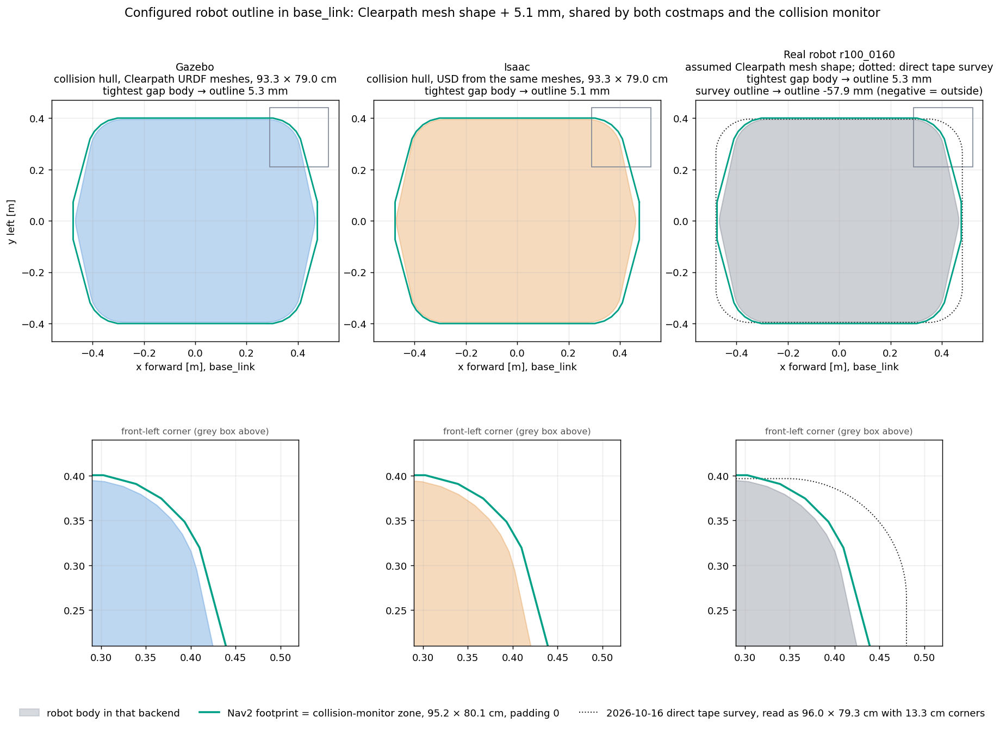
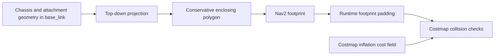

# Robot collision model and navigation footprint

The shared robot reference distinguishes three envelopes. They serve different
purposes and must be compared in the same frame before claiming agreement.

| Envelope | Owner | Meaning |
|---|---|---|
| Physical occupied volume | Measured robot, including attachments | The space the hardware occupies |
| Simulator collision geometry | Each backend's collision model | Shapes used by that simulator to resolve contact |
| Navigation footprint | Shared Nav2 configuration | The planar polygon supplied to navigation; it does not generate simulator colliders |

The [geometry reference](geometry.md) owns mounts and dimensional provenance.
A rendered mesh, a physics collider, and a navigation footprint may differ.
An image of one does not establish the others.

## Configured navigation footprint

Both costmaps and the collision monitor use one outline, the robot body. It
takes the Clearpath r100 collision meshes (`body-collision.stl` and `top.stl`),
widens them by the 4.408 mm longitudinal and 0.201 mm lateral Isaac origin
offset, mirrors them front to rear and left to right, and encloses the result
along 24 support directions with 5.1 mm margin: 95.2 × 80.1 cm, angled ends
included. The margin is built in, so both costmaps set `footprint_padding` to
0. The collision monitor's `FootprintApproach` polygon follows
`local_costmap/published_footprint`. `test_nav2_footprint.py` pins the outline
and checks that it encloses both simulator placements of the meshes by at
least 5 mm.



The figure plots the identical local/global costmap `footprint` entries from
[`nav2_params.yaml`](../../src/ridgeback_autonomy/config/nav2_params.yaml)
against each backend's collision hull. The outline clears the Gazebo hull by at
least 5.3 mm and the Isaac hull by at least 5.1 mm. In a 1.05 m doorway it
leaves 12.5 cm per side when aligned, and its widest swept width while turning
is 105.1 cm. The survey-based outline it replaced, 101.4 × 84.7 cm with
padding, needed 119.8 cm to turn, and the collision monitor's 1.2 s approach
check stopped MPPI's sideways and turning commands inside doorways.

The containment policy is: the outline must enclose every raw simulator
collision projection with at least 5 mm clearance. Inflation remains an
obstacle-cost policy and does not count toward that margin.

**Open hardware basis.** The outline treats `r100_0160` as having the Clearpath
mesh shape, a decision made on 2026-10-30. Two tape surveys of 2026-10-16 bear
on it, and neither traced the end profile:

- The direct survey (`artifacts/hardware/20261016T125020Z-s8-outline-direct/`
  on Intel) gave 96.0 × 79.3 cm overall, 5.5 cm diagonal gaps at all four
  corners and symmetric hubs 26.0 cm from each end, so `base_link` sits at the
  outline's centre. Clearpath publishes the same 960 × 793 mm. Read as a
  rounded rectangle with 13.3 cm corners, its corners lie up to 58 mm outside
  the outline; the mesh's own diagonal corner gap is 10.0 cm.
- The operator's preliminary survey measured the widest body at about
  0.92 × 0.80 m (±0.01 m) with about 0.06 m corner rounding, closer to the
  mesh. No attachments outside that outline were reported; the physical
  `base_link` centre and the mast and bracket dimensions were not surveyed.

Until the centreline length and the end-face setback at the corners are taped,
the footprint does not guarantee physical contact coverage. Against a hull of
the Isaac model's bounds with 4 mm tape uncertainty,
`tools/hardware/compare_measured_outline.py` leaves 3.7 mm at the side faces
where it requires 6.7 mm. Physical clearance and stopping remain under the
command-chain gate.

## Backend contact representations

| Backend | Current reference or limitation |
|---|---|
| Gazebo | Collision elements come through the generated robot description. Three cold-boot wall-contact matrices passed for front, side and 45° approaches at 0.05, 0.10 and 0.20 m/s. |
| Isaac | The importer grafts vendor chassis geometry, uses its convex hull, and authors additional parts. Three cold-boot wall-contact matrices passed the same orientation/speed set plus full-robot and retired-AABB controls. The [Isaac collider reference](../isaac/robot-model.md#colliders) owns those shapes. |
| Hardware | The physical robot determines contact. Navigation geometry must account for the deployed attachments and required clearance; software polygons do not prove physical clearance. |

Both simulator matrices used a 10 mm stop-position gate, 5 mm penetration,
hold-oscillation and tangent-drift gates, 0.5° yaw drift, and stop/reverse
recovery. Isaac passed all 39 cases. Gazebo passed all 27 cases; its worst
penetration was 0.341 mm, worst stop-position spread across boots was 0.001 mm,
and every recovery cleared the first 5 mm within 0.163 s. These simulator
results do not transfer to hardware.

## Relationship between the outline and contact geometry

A projected 2D outline is the top-down shadow of occupied geometry: transform
all relevant parts into `base_link`, then discard their height. A conservative
polygon can enclose that projection, including overhangs. It does not reproduce
height-dependent 3D contact; an obstacle below a camera is not the same as one
at camera height.



The navigation footprint should conservatively enclose the agreed occupied
projection. It need not be vertex-for-vertex identical to either simulator mesh.
Padding and inflation have separate roles and must be recorded explicitly;
inflation is not a correction for missing robot geometry. Compare the unpadded
source polygon and the effective published footprint separately. Nav2 documents
[footprint padding](https://docs.nav2.org/jazzy/configuration_and_development/configuration_guide/core_servers/costmap_2d/)
and [inflation costs](https://docs.nav2.org/jazzy/configuration_and_development/configuration_guide/core_servers/costmap_2d/costmap_plugins/inflation/)
as separate settings.

Gazebo and Isaac need an agreed chassis/attachment envelope, not identical wheel
solvers. Isaac deliberately uses a fixed-height planar drive and disables wheel
contacts; its [drive rationale and limits](../isaac/robot-model.md#why-this-abstraction-fits-the-current-work)
explain the scope. The small chassis-transform differences remain visible in the
static comparison and are covered by the explicit clearance policy rather than
being hidden by replacing the nominal polygon with the model union.

## Qualification ownership

[Dimensional provenance](geometry.md#dimensioned-reference-drawing) and the
remaining [physical envelope qualification](../BACKLOG.md#collision-envelope-and-navigation-footprint-validation)
have separate ownership. A geometry change that affects benchmark inputs
or measured behavior requires rerunning the affected benchmarks before quoting
results.

## Reproducing the static comparison

Generate a fresh description in an artifact directory, then compare its
collisions with the committed Isaac USD and both configured Nav2 polygons:

```bash
source install/setup.bash
mkdir -p artifacts/collision-envelope-validation/setup
cp clearpath/robot.yaml artifacts/collision-envelope-validation/setup/robot.yaml
ros2 run clearpath_generator_common generate_description \
  -s "$PWD/artifacts/collision-envelope-validation/setup/"
xacro artifacts/collision-envelope-validation/setup/robot.urdf.xacro \
  is_sim:=true > artifacts/collision-envelope-validation/robot.urdf
MPLCONFIGDIR=/tmp/ridgeback-mpl isaac_venv/bin/python \
  tools/isaac/compare_collision_envelopes.py \
  --urdf artifacts/collision-envelope-validation/robot.urdf \
  --output artifacts/collision-envelope-validation/review-new \
  --footprint-padding 0.0
```

The review directory must be fresh. Outputs include top-down and side figures,
backend collision hulls, per-part bounds, effective-footprint clearance, input
hashes, source/configuration snapshots and the dirty-tree patch. The plotted
union is a diagnostic outline, not an automatically approved footprint. Use
`tools/isaac/validate_chassis_contacts.py` and
`tools/gazebo/validate_chassis_contacts.py` for physics contact evidence; the
static extraction does not qualify hardware.

## Archived evidence

- [September 18 static envelope audit](../../archive/engineering/2026-09-18-collision-envelope-audit.md)
- [September 22 simulator footprint qualification](../../archive/engineering/2026-09-22-navigation-footprint-qualification.md)
- [September 22 refined-footprint runtime capture](../../archive/engineering/assets/2026-09-22-footprint-qualification/runtime-16-point.json)
- [October 30 arena doorway runs and outline change](../../archive/engineering/2026-10-30-hcc-arena-doorway-runs.md)
