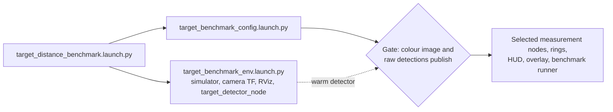

# Benchmark launch arguments

`target_distance_benchmark.launch.py` runs one live benchmark: it starts a
persistent simulator environment and one configuration layer, then scores the
selected estimators against the scenario's ground truth. This page owns its
launch layers and arguments. The root [README](../../README.md) owns example
commands; [running benchmarks](running_benchmarks.md) chooses between a single
run, a [sweep](sweeps.md) and offline replay.

The generated list is the final authority. Print it from a sourced workspace:

```bash
ros2 launch ridgeback_autonomy target_distance_benchmark.launch.py --show-args
```

## Launch layers

The wrapper starts two launch files as separately owned process groups and
stops them in order ([shutdown lifecycle](overview.md#shutdown-lifecycle)).



*The dashed edge is the readiness signal: the detector creates its publisher
only after its model has loaded.*

The configuration gate waits up to 300 s; the
[troubleshooting](../troubleshooting.md) page covers a gate that times out.
`estimators` is split per measurement stack, and each node receives only the
rows it owns, so an unselected row never runs: its fields stay NaN, it gets no
CSV, and inputs only it needs are never subscribed. A polar-only run builds no
depth source and, under `depth_source:=monocular`, loads no model. The
[pipeline](../target_localization/target_localization_pipeline.md#4-depth-sources)
owns how the mask node acquires depth and builds masks.

Ctrl-C finishes configuration cleanup while the simulator still answers, then
stops the environment. With the default `shutdown_on_complete:=false` both
layers stay up for inspection after the runner finishes; `true` closes them in
order.

## Backends

`backend` belongs to the persistent environment. It selects the simulator
adapter, that adapter's asset catalog and its scene-control services, and every
`run.json` records it.

- `gz` (default) needs the optional Gazebo dependencies, `dependencies/gz.repos`.
- `isaac` runs the same scenario file, runner, estimators and reports on Isaac
  Sim 6.1. Start it from the workspace root, where it finds `isaac_venv`, or set
  `ISAAC_PYTHON` to the interpreter.
- `hardware` is refused before any process starts, because hardware has no
  scene-control services or ground truth.

What may be compared across the two simulators is owned by
[semantics](semantics.md#scenario-and-comparison-discipline).

## Environment layer

These settings belong to the persistent environment. A sweep may set them only
in its `defaults` ([sweeps](sweeps.md#sweep-file-format)).

| Argument | Default | Meaning |
|---|---|---|
| `backend` | `gz` | Simulator: `gz` or `isaac`; see [backends](#backends) |
| `namespace` | `r100_0001` | Namespace for simulation, detector, measurement nodes and runner |
| `use_sim_time` | `true` | Use the simulator's `/clock` |
| `setup_path` | `~/clearpath/` | Directory containing `robot.yaml` and generated Clearpath files |
| `world` | `target_distance_calibration` | Public benchmark world. Each backend's asset catalog maps it to that simulator's own world (Isaac: `g1_distance_calibration`, same geometry) |
| `camera_profile` | `640x480` | Simulator camera profile, `640x480` or `1280x720`; recorded in each run, and changing it needs a new environment |
| `color_topic` | `sensors/camera_0/color/image` | Compatibility override for the shared camera contract's colour image; feeds detector, measurements, overlay, runner and readiness gate |
| `gz_gui` | `true` | Gazebo only: launch Gazebo's GUI; set `false` for unattended runs |
| `headless_rendering` | `false` | Gazebo only: optional server-only EGL sensor rendering; `tools/gpu-run` remains the GUI-capable NVIDIA GLX path |
| `headless` | `true` | Isaac only: run Isaac Sim without its viewport window |
| `rtf` | `1.0` | Isaac only: real-time factor; `0` is unthrottled |
| `sim_mode` | `realtime` | Isaac only: `realtime` or fixed-step `deterministic` stepping |
| `depth_fidelity` | `ideal` | Isaac only: `ideal` renderer depth or D455-like `d455` stereo depth; see [camera depth](../isaac/camera-depth.md) |
| `exploration_rviz` | `true` | Launch the persistent benchmark RViz window |

## Detector

The detector lives in the environment layer and loads once per environment.
These settings are startup-only, and a sweep may set them only in `defaults`.

| Argument | Default | Meaning |
|---|---|---|
| `detector` | `owlv2` | Detector implementation; only `owlv2` is registered |
| `detection_model` | `google/owlv2-base-patch16-ensemble` | Checkpoint identifier, distinct from `detector` |
| `target_labels` | `humanoid robot` | Comma-separated detection queries |
| `detection_threshold` | `0.55` | Finite confidence floor in `(0, 1]` |
| `detector_fps` | `10.0` | Upper bound on the detection rate every measurement row inherits ([cadence defaults](../target_localization/detection.md#detector-cadence-defaults)) |
| `detector_debug` | `false` | Detector evidence logging: achieved cadence, superseded frames, and bounded cold/warm percentiles for the throttle wait, decode, inference, parse, publish and CUDA synchronization |

## Estimators and display

| Argument | Default | Meaning |
|---|---|---|
| `estimators` | `all` | Comma-separated subset of `pointcloud`, `projective_ranging`, `euclidean_reconstruction`, `polar_profiling`; any subset works, so `estimators:=polar_profiling` runs that row alone |
| `depth_source` | `stereoscopic` | Aligned-depth producer for the `projective_ranging` and `euclidean_reconstruction` rows: `stereoscopic` or `monocular`; comparing sources takes two runs |
| `mask_gate` | `box` | Mask front-end for the mask rows: `box` (rasterized detection box, no model) or `silhouette` (segmentation model prompted with the boxes; needs the perception venv); comparing gates takes two runs |
| `estimate_viz` | `true` | Publish estimator rings and the benchmark distance HUD |
| `overlay` | `true` | Publish the camera overlay with the selected estimator panels |
| `record_video` | `true` | Best-effort RViz recording to `video/run.mp4`; disable for timing runs, where the screen grab competes with the simulator render path |

## Measurement settings

The isolation recipes and their numbers are described in
[projective ranging](../target_localization/projective_ranging.md),
[Euclidean reconstruction](../target_localization/euclidean_reconstruction.md)
and [polar profiling](../target_localization/polar_profiling.md).

| Argument | Default | Meaning |
|---|---|---|
| `isolation_2d` | `nearest_mode_histogram` | Projective-ranging box-gate foreground recipe: `nearest_mode_histogram` or `otsu` |
| `isolation_2d_bin_width_m` | `0.05` | Depth-histogram bin width of the selected `isolation_2d` recipe; both recipes bin the masked depths |
| `isolation_2d_band_m` | `0.35` | Depth band kept around the near-surface anchor; `nearest_mode_histogram` only |
| `isolation_2d_min_bin_fraction` | `0.05` | Fraction of the masked depths a histogram bin must hold before the anchor may sit on it; `nearest_mode_histogram` only |
| `isolation_3d` | `height_crop_nearest_mode_band` | Euclidean-reconstruction box-gate foreground recipe: `height_crop_nearest_mode_band`, `height_crop_range_band`, `height_crop`, `nearest_mode_band`, or `range_band`. The two band chains differ only in how the background separator anchors: nearest mode or percentile. The percentile anchor slides as background grows, as the `pointcloud` row does |
| `isolation_3d_floor_margin_m` | `0.05` | Height above the floor a point must clear in recipes containing `height_crop` |
| `isolation_3d_percentile` | `25.0` | Range percentile used as the anchor by the `range_band` step |
| `isolation_3d_ahead_m` | `0.1` | Inlier window retained in front of the range anchor |
| `isolation_3d_behind_m` | `0.35` | Inlier window retained behind the range anchor |
| `isolation_3d_bin_width_m` | `0.05` | Range-histogram bin width used by `nearest_mode_band` |
| `isolation_3d_min_bin_fraction` | `0.05` | Fraction of ranges a histogram bin must hold before it may anchor `nearest_mode_band` |
| `min_valid_pixels` | `10` | Shared foreground-sample floor; both depth rows reject a prepared selection below it |
| `mask_depth_max_meters` | `0.0` | Working depth gate for the mask rows; `0` means no gate, so each row is bounded only by what its depth source declares it can resolve |
| `polar_range_jump_m` | `0.3` | Adjacent-beam range step that starts a new polar run |
| `polar_range_band_m` | `0.35` | Maximum offset behind the nearest run for merging another polar run |
| `polar_min_valid_rays` | `2` | Beam floor required for a polar estimate |
| `depth_match_debug` | `false` | Mask-worker evidence logging: exact-depth delivery, pending replacements, batch completion and publication age, and bounded cold/warm percentiles for RGB, SlimSAM, depth production, mask preparation, estimator reduction, worker, lock, and CUDA-synchronization timing |

## Sensor inputs

| Argument | Default | Meaning |
|---|---|---|
| `camera_info_topic` | `sensors/camera_0/color/camera_info` | Compatibility override for the shared camera contract's colour-grid intrinsics |
| `depth_topic` | `sensors/camera_0/depth/image` | Colour-aligned depth of the shared camera contract |
| `pointcloud_topic` | `sensors/camera_0/points` | Simulation's organized point cloud |
| `scan_topic` | `sensors/lidar2d_0/scan` | LaserScan used by polar profiling |
| `base_frame` | `<namespace>/robot/base_link` | Vehicle frame for point-cloud and scan projection |

## Scenario, trials and outputs

| Argument | Default | Meaning |
|---|---|---|
| `scenario` | empty | Scenario YAML; empty uses the packaged full scenario set |
| `repeats` | `5` | Positive-trial repeats per spawn pose; a scene may override it ([semantics](semantics.md#scenario-and-comparison-discipline)) |
| `settle_sec` | `2.0` | Delay after spawning the target before sampling |
| `capture_sec` | `10.0` | Sampling window for collecting usable detections |
| `output_dir` | `<repo-root>/artifacts/benchmarks` | Root that receives one run folder per run |
| `run_dir_name` | empty | Exact run-folder name under `output_dir`; sweeps use the configuration name. Empty keeps the [timestamped name](outputs.md#run-folder-and-file-names) |
| `shutdown_on_complete` | `false` | Shut the configuration launch down when the runner exits; sweeps set `true` |

## Replay capture

Setting either output directory switches a run from elapsed-time capture to an
exact quota of raw detector batches. [Profiles](profiles.md) owns what each
format freezes and the capture workflows.

| Argument | Default | Meaning |
|---|---|---|
| `replay_dataset_dir` | empty | New directory for the compact legacy measurement replay dataset; requires `estimators:=projective_ranging`, `mask_gate:=box` and stereoscopic depth |
| `sensor_capture_dir` | empty | New immutable full sensor-capture artifact for `mask-output` and `mask-model` replay: exact RGB, float32 aligned depth, raw detections, calibration and transforms. Mutually exclusive with `replay_dataset_dir` |
| `capture_batches` | `5` | Raw detector batches captured per trial when either replay output is set; empty batches count. Five is the validated legacy capture default ([profiles](profiles.md#capture-quota)) |
| `capture_drain_sec` | `2.0` | Maximum post-quota drain for matching exact depth, camera context and live measurements. Capture ends early when every selected stamp is complete, and keeps missing matches when the bound expires |
| `capture_timeout_sec` | `30.0` | Hard wall-time bound for obtaining the raw-batch quota; a stall guard, not the normal capture duration |
