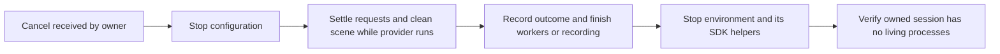

# Target-distance benchmarking

What the benchmark is, what it compares, and what it may not be used to claim.
To start a run, see [running benchmarks](running_benchmarks.md).

## Purpose and scope

The benchmark compares independent target-localization estimators on fixed
spawned target instances in `target_distance_calibration`. It runs on Gazebo or
Isaac Sim, selected with `backend:=gz|isaac`, from the same scenario file.
Unitree G1 is the current scenario asset; reusable perception and benchmark
APIs use target names. It measures simulator ground-truth accuracy,
misses/coverage, and run provenance. It is not hardware validation, it never
substitutes one estimator for another, and one simulator's results do not stand
in for the other's (see [semantics](semantics.md#simulator-assets-and-cross-simulator-comparison)).

## Supported estimators and axes

Public estimator keys, in canonical order:

- `pointcloud` — organized `PointCloud2` input;
- `projective_ranging` — mask plus aligned depth, image-domain reduction;
- `euclidean_reconstruction` — mask plus aligned depth, point-domain reduction;
- `polar_profiling` — mask plus projected planar scan.

`estimators:=all` is the default. A subset launches only required measurement
nodes and disables unselected branches. Mask estimators expose `mask_gate`
(`box` default, or `silhouette`). Depth paths additionally expose `depth_source`
and registered `isolation_2d`/`isolation_3d` recipes; silhouette depth paths
bypass rect isolation. Polar is independent of depth source; pointcloud has its
own source. Output names include only axes that actually executed.

Which of these axes a given run may vary depends on the profile, and which
estimators it may select depends on the profile and on the evidence named — see
[profiles](profiles.md).

The root README owns complete build/run instructions. Main launch:
[`target_distance_benchmark.launch.py`](../../src/ridgeback_autonomy/launch/target_distance_benchmark.launch.py);
its layers and arguments are in [launch arguments](launch_arguments.md).

## Shutdown lifecycle

The single-run wrapper and sweep own configuration and environment launches in
separate sessions. The configuration must settle scene requests and attempt
rollback before its environment is stopped; keeping only the client's ROS
context alive is insufficient if the provider has already stopped stepping.

Normal completion retains the configuration and environment for inspection when
`shutdown_on_complete=false`. With `true`, configuration completion closes the
environment. Existing layer readiness gates still control startup. Repeated
interrupts during cleanup are coalesced; cleanup failure remains a failure, and
the owner still attempts bounded environment cleanup.

Ownership covers all process groups within each newly created session, including
SDK helpers that change process group. It does not use user-wide process-name
matches. Recorder finalization precedes forced termination. Crashed children and
launch-internal SIGTERM/SIGKILL escalation propagate a nonzero status through the
inner launch, supervisor, and public wrapper. Saved measurements remain separate
from these lifecycle outcomes; see [output provenance](outputs.md#sweep-outputs).

Ordered benchmark shutdown prevents the application from intentionally tearing
down a provider during rollback. Providers must independently tolerate direct
shutdown with outstanding requests; that dependency investigation and remaining
RViz/bridge qualification live in the
[shutdown plan](../plans/BENCHMARKING_shutdown_lifecycle.md).

## Exploration evaluation

`tools/benchmark/` is the instrumented **exploration** harness — a probe and a
camera-less robot profile for measuring frontier exploration. It is a separate workflow with its own probe, scenarios, and outputs. Its runbook is
[the exploration evaluation runbook](../exploration/evaluation.md).

## Where to go next

- [open benchmarking work](BACKLOG.md) — remaining validation, tooling, and scenario work
- [running benchmarks](running_benchmarks.md) — which question, which profile,
  and which of the four ways to start it
- [launch arguments](launch_arguments.md) — launch layers, backends, and every
  single-run argument
- [sweeps](sweeps.md) — the persistent-environment supervisor, sweep file
  format, resume, and shipped sweeps
- [semantics](semantics.md) — scenarios, events, observations, instances, miss
  reasons, and what may be compared with what
- [outputs](outputs.md) — `run.json`, `sweep.json`, `summary.md`, CSVs,
  collages, provenance, rename rules, and module ownership
- [profiles](profiles.md) — the legacy measurement dataset and the four-profile
  layered replay contract
- [configurator](configurator.md) — the local browser UI, including its run
  substrate
- [scenario gallery](benchmark_scenarios_v2_gallery.html) — generated visual reference for
  the packaged scene set

## Archived evidence

- [Benchmark shutdown ordering and RViz node ownership](../../archive/engineering/2026-10-23-benchmark-shutdown-ownership.md)
